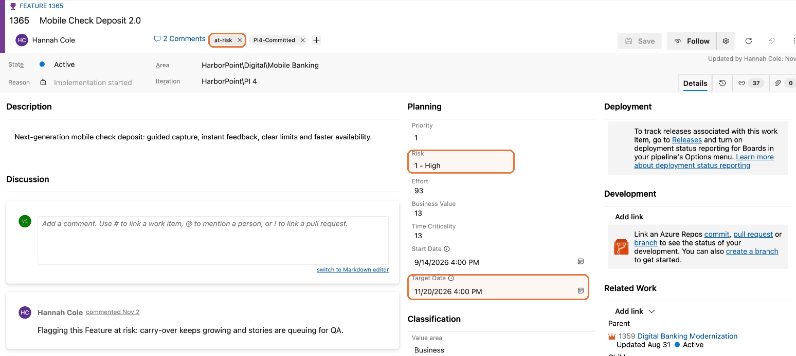
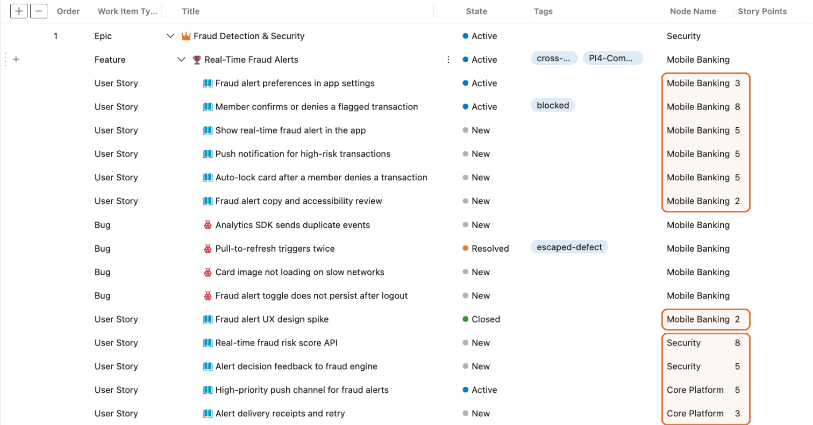
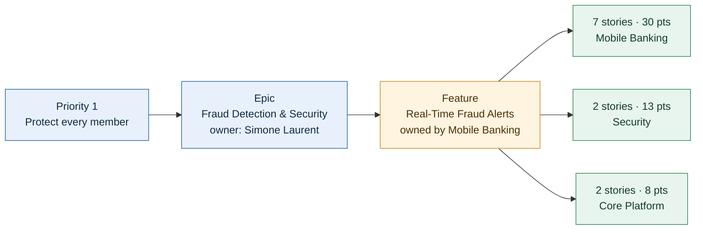

!!! briefing "Mission briefing"
    You've just been appointed **Delivery Manager, Digital Banking** at HarborPoint Financial, reporting to Priya Raman. You inherit a slice of the **Member Experience Transformation Program**, the multi-year program everyone calls *Project Lighthouse*: six delivery teams, six Epics, twenty-four Features, none of which you've seen.

    You know Azure DevOps, but not *this* portfolio. Learn it top down, from strategic priority to Epic to Feature, and drop to stories only when a Feature question needs evidence.

    **Done looks like:**

    - Part 1: portfolio facts found fast, each with its source view.
    - Part 2: the six Epics in rank order, and the one whose rank raises a question.
    - Part 3: one screen showing how far along every Digital Feature is.
    - Part 4: the right view for each management question.
    - Part 5: who owns a Feature, who builds it and which priority it serves.

    Along the way, write down three questions for Priya.

<div class="msg" data-initials="PR" data-tone="teal" markdown>
<p class="msg-head"><strong>Priya Raman</strong><span>Director, Digital Banking · 8:12 AM</span></p>

Welcome aboard. Before you meet the teams, learn the portfolio. By lunch, tell me what every Digital Feature is for, who's building it and how far along it is. Not the sprint detail, just the shape of the thing. If anything looks odd, write it down. Fresh eyes are the only time anyone notices.
</div>

## What you'll walk away with

- Find portfolio facts fast, and know which view and team each came from
- Read a portfolio as a **ranked list**, and notice when ranking and reality disagree
- Build a Feature status view with **rollup** columns, without opening a work item
- Pick the right **lens** (backlog, form, board or Delivery Plan) for each management question
- Know what a progress bar measures, and when it understates the truth
- Tell apart who **owns** a Feature, which priority it **serves**, and who **builds** it

## Before you set sail

- **Access:** Basic. You only *read* the six delivery teams' work and create nothing.
- **Teams you'll switch between:** `HarborPoint Team` (the whole program), `Digital Portfolio` (Priya's view of both Digital teams) and `Mobile Banking`. The [environment map](../start/environment.md) lists them all.
- **Safe to change:** **Column Options**, **View options** and filters. They're saved **per user**, so nobody else sees them.
- **Never change:** the real teams' backlog order, states, estimates or board settings. If you catch yourself dragging a card, let go.
- **Time-box:** 45 minutes, 10 for the speed run. Ace it and you can skim Parts 2 and 3, but still do Part 3's column setup: Lab 2 uses it.

## Part 1 — Prove you know your way around

Can you find your way around a portfolio you've never seen?

!!! speedrun "Speed run · 10 minutes"
    Answer all seven, using any view, and note where you found each answer.

    1. How many Features does **Digital Banking Modernization** have, counting the closed ones?
    2. Which team owns **Mobile Check Deposit 2.0**?
    3. Which Epic sits at the top of the portfolio?
    4. Which *active* Digital Banking Feature is the most complete, and how complete is it?
    5. Which Digital Banking Feature has no child work at all?
    6. Which Feature has work in **three** different teams?
    7. What's the current sprint, and which PI is it in?

<div class="timer" data-minutes="10" data-label="Speed run"></div>

??? pilot "Harbor Pilot · Hint 1: Take a bearing"
    Most answers live on a **portfolio backlog**, seen through a team whose area covers the work: `HarborPoint Team` sees every delivery team, `Digital Portfolio` both Digital teams. **Shared Queries** also has a ready-made tree.

??? pilot "Harbor Pilot · Hint 2: Set the heading"
    - **Boards › Backlogs**, team `HarborPoint Team`, level **Epics**: row order is the portfolio rank.
    - Team `Digital Portfolio`, level **Features**, **Parents** on, plus a **Progress by Story Points** rollup column. Closed Features never appear on a backlog; they're in the **Closed** column of the Features *board*.
    - `Shared Queries/HarborPoint Reports/Portfolio - Epics and Features` lists every Epic's Features, closed ones included.
    - For "three teams", expand a `cross-team` Feature and add **Node Name**.
    - **Boards › Sprints**: the sprint selector marks the **Current** sprint.

??? pilot "Harbor Pilot · Hint 3: Bring it into port (full solution)"
    | # | Answer | Where it's fastest |
    |:-:|:--|:--|
    | 1 | **8 Features** (two Closed, four Active, two New) | `Portfolio - Epics and Features` query, or the `Digital Portfolio` Features **board**. The backlog shows six: it hides closed items at its own level |
    | 2 | **Mobile Banking** | **Area Path** (or **Node Name**) on any Features backlog |
    | 3 | **Fraud Detection & Security** | `HarborPoint Team` Epics backlog, first row |
    | 4 | **Spending Insights, 88%** | **Progress by Story Points** rollup, `Digital Portfolio` Features backlog |
    | 5 | **Member-to-Member Transfers** (no children, no rollup) | Same backlog: empty progress cell, no expand arrow |
    | 6 | **Real-Time Fraud Alerts**: children in Mobile Banking, Security and Core Platform | `HarborPoint Team` Features backlog, expanded, with **Node Name** |
    | 7 | **Sprint 14**, in **PI 4** (`HarborPoint\PI 4\Sprint 14`) | **Boards › Sprints**, sprint selector, **Current** badge |

    **So what?** Question 1: the backlog says six Features, the Epic has eight. Two views, two answers, and neither is wrong.

!!! checkpoint "Checkpoint"
    - [ ] I answered all seven and know where each answer lives

!!! takeaway "Takeaway"
    The view and team context decide what you're shown, so check where a number came from before you repeat it.

## Part 2 — Read the portfolio as a ranked list

Does the portfolio's order match its stated priorities? A portfolio is an **ordered** list, and the order is a decision.

1. **Boards › Backlogs**, team `HarborPoint Team`, level **Epics**.
2. **Column Options** › **+ Add a column**: `Priority`, `Start Date`, `Target Date`, `Tags` and `Area Path`. Select **OK**.
3. In a second browser tab, open **Overview › Wiki** › `Program` › `Program Charter` and find the FY2027 priorities.

<figure class="hp-shot" data-shot="lab01-epics-backlog" markdown>
<div class="hp-shot__bar" aria-hidden="true"><i></i><i></i><i></i><span>Boards › Backlogs › HarborPoint Team › Epics</span></div>

{ loading=lazy }

<figcaption markdown>Six Epics in portfolio order. Row 6 carries **Priority 1** and the `mandatory` tag, and it's ranked last.</figcaption>
</figure>

**You should see** six Epics in this order:

| Order | Epic | Area (owner) | Priority | Runs | Tags |
|:-:|:--|:--|:-:|:--|:--|
| 1 | `Fraud Detection & Security` | Security | 1 | Sprint 9 → 20 | |
| 2 | `Digital Banking Modernization` | Digital | 1 | Sprint 9 → 20 | |
| 3 | `Customer Support Modernization` | Member Support | 2 | Sprint 9 → 19 | |
| 4 | `Branch Experience Transformation` | Branch Experience | 2 | Sprint 9 → 20 | |
| 5 | `Platform Foundations` | Core Platform | 2 | Sprint 9 → 16 | `enabler` |
| 6 | `Compliance: Examination Readiness` | Security | **1** | Sprint 12 → **18** | `mandatory` |

Your columns show calendar dates; the table translates them to sprints. The first four rows match the charter's ranking exactly. Row 6 doesn't.

!!! challenge "Challenge: Read the last row"
    Answer in one line each. Don't fix anything: this is reconnaissance.

    1. What does this list say about the Compliance Epic, and what does the charter say?
    2. Which fact on screen makes row 6 more urgent than its position suggests?
    3. Which team owns it, and which *other* Epic does that team own?

??? pilot "Harbor Pilot · Hint 1: Take a bearing"
    Compare three signals on the same row: position, the **Priority** field and the **Target Date**. Then compare the **Area Path** of rows 1 and 6.

??? pilot "Harbor Pilot · Hint 2: Bring it into port (full solution)"
    1. The backlog ranks it **last**. The charter calls it **mandatory**: a regulatory exam with a non-negotiable date. It carries Priority 1, like the top two Epics.
    2. Its **Target Date**, the end of Sprint 18, is the only date in the portfolio HarborPoint didn't choose: regulatory exam fieldwork begins in Sprint 18, and it won't wait.
    3. **Security**, which also owns the number one Epic, *Fraud Detection & Security*.

    **So what?** The Compliance Epic was added in Sprint 12 and nobody re-ranked the portfolio. Delivery Plans, Forecasting and most humans read backlog order as "priority", and it says compliance matters least. Security clearly disagrees. Write down: *if the team that owns priority number one also carries the mandatory exam work, which wins when they collide?* You'll answer it on Day 2 in [Lab 7](../day-2/lab-07-cross-team-bottleneck.md).

!!! insight "Lighthouse insight: the order is the decision"
    Priority fields are opinions: three Epics here claim Priority 1. Backlog **order** is the one place where "everything is top priority" is impossible, because only one item can be first.

!!! checkpoint "Checkpoint"
    - [ ] I can name the portfolio's six Epics in rank order
    - [ ] I wrote down why the Compliance Epic's position is a question worth asking

!!! takeaway "Takeaway"
    Backlog order is the portfolio's real ranking: when it disagrees with reality, a decision is missing, so ask who should make it.

## Part 3 — One Epic, eight Features

How far along is your own Epic, Digital Banking Modernization, Feature by Feature? You'll live in this view for two days, so set it up properly.

Its engine is **rollup**: a column on a parent's row that summarizes its children, such as percent of Story Points Closed or total points, so you can read a Feature's status without opening it.

!!! predict "Make a call"
    Before you add a column, write down two guesses. **Is the furthest-along Digital Feature also the most valuable one?** And will the Epic's overall percentage look **better or worse** than the Features on screen? This Part settles both.

1. **Boards › Backlogs**, team `Digital Portfolio`, level **Features**.
2. **View options**: **Parents** On, **In Progress Items** On, **Completed Child Items** On.
3. **Column Options** › **+ Add a column**: `Area Path`, `Iteration Path`, `Target Date`, `Business Value` and `Tags`.
4. **+ Add a rollup column** › **From quick list**: **Progress by Story Points**, **Sum of Story Points** and **Progress by all Work Items**. Select **OK**.

Analytics calculates rollup, so a cell may show a grey placeholder bar for a few seconds. If it stays grey, refresh.

<figure class="hp-shot" data-shot="lab01-digital-features-rollup" markdown>
<div class="hp-shot__bar" aria-hidden="true"><i></i><i></i><i></i><span>Boards › Backlogs › Digital Portfolio › Features (Parents on, three rollup columns)</span></div>

{ loading=lazy }

<figcaption markdown>The Epic reads **58% of 455 points**, but its six visible Features add up to only 348. Note `Spending Insights` at **88%** and `Real-Time Fraud Alerts` at **4%**.</figcaption>
</figure>

**You should see** Digital Banking Modernization's six open Features, plus one under a different Epic:

| Feature | Owning team | State | Target | Business Value | Progress (points) | Story Points | Progress (all items) |
|:--|:--|:--|:--|:-:|:-:|:-:|:-:|
| `Mobile Check Deposit 2.0` | Mobile Banking | Active | **Sprint 14** | 13 | 61% | 93 | 50% |
| `Biometric Login` | Mobile Banking | Active | Sprint 16 | 8 | 53% | 51 | 44% |
| `Member-to-Member Transfers` | Mobile Banking | New | Sprint 20 | 20 | *(empty)* | 0 | *(empty)* |
| `Instant Card Controls` | Digital Accounts | New | Sprint 17 | 20 | 0% | 105 | 0% |
| `Online Account Opening` | Digital Accounts | Active | Sprint 16 | 13 | 59% | 56 | 65% |
| `Spending Insights` | Digital Accounts | Active | Sprint 15 | 5 | **88%** | 43 | 89% |
| `Real-Time Fraud Alerts` *(under Fraud Detection & Security)* | Mobile Banking | Active | Sprint 16 | 20 | **4%** | 51 | 7% |

Your row order may differ from this table. Read it for six things:

- **The invisible 107 points.** The Epic row reads **58%** of **455** points, but the six Features on screen add up to 348. The other 107 are two **Closed** Features, `Mobile App Redesign` (55) and `Paperless Statements & Documents` (52): the backlog hides them (the Features **board** shows them, in **Closed**), but the Epic's rollup counts them. So the 58% looks healthier than the visible Features, which are less than half done by points. (That settles your second guess.)
- **States.** Two delivered (the hidden pair), four in flight, two not started: the Epic's whole life story.
- **The empty row.** `Member-to-Member Transfers`, Business Value 20 (joint highest), has no children. It's planned for PI 5 and nobody has broken it down. Fine in Sprint 14; not in Sprint 16.
- **Two bars, two stories.** **Progress by all Work Items** counts every child, bugs included; the points bar weighs stories by estimate. `Mobile Check Deposit 2.0` reads 61% by points but 50% by items: nine open bugs pull the count down. When the bars disagree, ask which kind of work is piling up.
- **The number that hides something.** `Instant Card Controls` reads 105 points, but four of its twenty stories have no estimate. **Sum of Story Points** can't count what nobody estimated.
- **The Feature that isn't in the Epic.** `Real-Time Fraud Alerts` lives in Mobile Banking's area, so `Digital Portfolio` sees it, but its parent is *Fraud Detection & Security*, so it never shows up in Digital Banking Modernization's rollup. Part 5 comes back to it.

!!! challenge "Challenge: Is 88% good news?"
    The most complete active Digital Feature is `Spending Insights`, at 88%. Before you tell Priya, write two sentences: what's true about it, and what question it should raise.

??? pilot "Harbor Pilot · Hint 1: Take a bearing"
    Progress says how far along something is, not whether it was the right thing to be far along on. Which columns on your screen say something about *value*?

??? pilot "Harbor Pilot · Hint 2: Set the heading"
    Compare **Business Value** (and, if you add it, **Time Criticality**) for `Spending Insights`, `Mobile Check Deposit 2.0`, `Instant Card Controls` and `Real-Time Fraud Alerts`. Then check who owns each: a comparison across teams is a different conversation.

??? pilot "Harbor Pilot · Hint 3: Bring it into port (full solution)"
    **What's true:** `Spending Insights` is the *lowest-value* active Digital Feature: Business Value 5, Time Criticality 3. The highest-value work lags: `Real-Time Fraud Alerts` (20 and 20) is at 4%, and `Instant Card Controls` (20 and 20, requested by the EVP) hasn't started. (That answers your first guess.)

    **So what?** It raises *are we working on the right things, in the right order?* Aim it precisely. Finishing `Spending Insights` is sensible: 5 points are left. Ask Digital Accounts, which owns both, why a value-5 Feature got attention ahead of a value-20 leadership ask. There may be a good reason, such as a dependency. And don't conclude Digital Accounts could have sped up Mobile's Features: capacity doesn't pour between teams.

!!! checkpoint "Checkpoint"
    - [ ] My `Digital Portfolio` Features backlog shows rollup progress and points
    - [ ] I can explain why `Real-Time Fraud Alerts` is on this backlog but not under Digital Banking Modernization
    - [ ] I have two sentences on "is 88% good news?"

!!! takeaway "Takeaway"
    A rollup column turns a Features backlog into a one-screen status report, but it tells you how far along the work is, not whether it's the right work.

## Part 4 — Four lenses on one Feature

Which view should you open for which question? Azure DevOps shows a Feature in at least four places. Call each a **lens**: same work item, but each answers one kind of question best. Give each two minutes on `Mobile Check Deposit 2.0`, Digital Banking's biggest active Feature and the one due soonest.

**Lens 1: the backlog row.** On your `Digital Portfolio` Features backlog: 61% done by points, 93 points, due at the end of Sprint 14, *this* sprint.

**Lens 2: the work item form.** On the same backlog, select the Feature's title.

- The header and **Details** show **Priority** 1, **Risk** `1 - High`, **Business Value** 13, **Time Criticality** 13 and **Effort** 93. Effort is a number somebody *typed*; rollup is one Azure DevOps *calculated*. Here they agree. When they don't, ask which is stale.
- **Tags**: `PI4-Committed` and `at-risk`. Someone has already flagged it.
- **Related Work** lists the parent Epic and child stories and bugs. Count roughly; don't open them.
- **History** shows every change, by whom and when. Find when the Feature went **Active**.

<figure class="hp-shot" data-shot="lab01-f2-work-item-form" markdown>
<div class="hp-shot__bar" aria-hidden="true"><i></i><i></i><i></i><span>Work item form › Feature › Mobile Check Deposit 2.0</span></div>

{ loading=lazy }

<figcaption markdown>Lens 2, the form: **Risk 1 - High**, the `at-risk` tag, and a **Target Date** at the end of *this* sprint. The Discussion shows who raised the flag, and when.</figcaption>
</figure>

**Lens 3: the Feature board.** **Boards › Boards**, team `Mobile Banking`, level **Features**. Unlike the backlog, the board shows **Closed** Features too. The card's child annotations read **17/26** for stories (closed out of total) and **1/10** for bugs. Select either to expand the checklist.

**Lens 4: the Delivery Plan.** **Boards › Delivery Plans** › `HarborPoint Program Plan`, Mobile Banking row. Note the calendar markers (**PI 4 System Demo**, **PI 5 Planning**, **Regulatory exam fieldwork**) and the **today** marker. The `Mobile Check Deposit 2.0` card ends a few days after today.

!!! warning "Look, but don't drag"
    Dragging a card on a Delivery Plan moves the real work item to another sprint; dragging its edge rewrites its dates for everyone. This plan belongs to the program office. Select titles and badges. Never drag.

<figure class="hp-shot" data-shot="lab01-program-plan-f2" markdown>
<div class="hp-shot__bar" aria-hidden="true"><i></i><i></i><i></i><span>Boards › Delivery Plans › HarborPoint Program Plan</span></div>

{ loading=lazy }

<figcaption markdown>Lens 4, the calendar: `Mobile Check Deposit 2.0` ends a few days after **today**. The three markers (System Demo, PI 5 Planning, exam fieldwork) put every card in context, and `Real-Time Fraud Alerts` carries a **red** dependency badge.</figcaption>
</figure>

!!! challenge "Challenge: Match the lens to the question"
    For each question, fill in the fastest lens and one thing it *can't* tell you.

    | Question a manager gets asked | Fastest lens | What it can't tell you |
    |:--|:--|:--|
    | How far along is it, and how big is it? | | |
    | Why is it like this? Who changed what, and when? | | |
    | Where is the work stuck right now? | | |
    | When will it land, relative to other teams and our milestones? | | |

??? pilot "Harbor Pilot · Hint 1: Take a bearing"
    Each lens has one superpower: numbers, history, flow or calendar. Match superpower to question, then think about each lens's blind spot.

??? pilot "Harbor Pilot · Hint 2: Bring it into port (full solution)"
    | Question | Fastest lens | What it can't tell you |
    |:--|:--|:--|
    | How far along, how big? | **Backlog row with rollup**: every Feature at once | Whether the remaining work fits before the target, or why it's stuck |
    | Why is it like this? | **Work item form**: History, Discussion, tags, links | Anything about *other* Features: one item at a time |
    | Where is it stuck? | **Board**: columns, child annotations, the Stories board below | Dates; a board has no calendar |
    | When will it land, relative to others? | **Delivery Plan**: teams, dates, markers, dependency badges | Work left inside the card (unless rollup is shown) |

    **So what?** A status statement that holds up combines at least two lenses: *"61% done, deadline in days"* takes the backlog **and** the calendar. In status meetings, notice which lens people quote.

!!! reef "Reef ahead: the progress bar only counts Closed"
    `Biometric Login` reads 53%, so Mobile's developers look about halfway. Check one level down: **Boards › Boards**, team `Mobile Banking`, level **Stories**, **Resolved** column. Bugs sit there too (this team manages bugs with requirements), so look for cards with Story Points: three stories, 11 points, code-complete and waiting for QA. Two are `Biometric Login`'s, one `Mobile Check Deposit 2.0`'s. Mobile Banking has one tester.

    Rollup counts only **Closed** children, so Resolved work shows as *not done*. If those three closed today, `Biometric Login` would read about 69% and `Mobile Check Deposit 2.0` about 65%. A progress bar measures **workflow discipline** as much as progress: a team slow to close looks slower than it is, and one that closes early looks faster.

    While you're there, read the red column headers: **Active 16/5** and **Resolved 6/5**. The work-in-progress limit is five per column, and Active is more than three times over it. Nobody enforces it, but the board is telling you the team has started far more than it can finish.

<figure class="hp-shot" data-shot="lab01-mobile-stories-resolved" markdown>
<div class="hp-shot__bar" aria-hidden="true"><i></i><i></i><i></i><span>Boards › Boards › Mobile Banking › Stories</span></div>

{ loading=lazy }

<figcaption markdown>Three stories, **11 points** of finished code, wait in Resolved for the team's only tester, with Resolved bugs queuing behind them. The red **16/5** and **6/5** headers mean both columns are far over their work-in-progress limit.</figcaption>
</figure>

!!! checkpoint "Checkpoint"
    - [ ] I looked at `Mobile Check Deposit 2.0` through all four lenses
    - [ ] My lens table has a fastest lens and a blind spot for every question
    - [ ] I can explain why `Biometric Login` is further along than 53%, and still not done

!!! takeaway "Takeaway"
    No single view gives a Feature's status. Pair at least two, and check the board before you quote a progress bar.

## Part 5 — Who owns what

Part 3 left a loose end: a Feature on your backlog that isn't in your Epic. Who owns it, and does the same team build it? Three fields answer three questions that managers mix up all the time:

| Question | Where Azure DevOps records it |
|:--|:--|
| Which team **owns** it? | The Feature's **Area Path** |
| Which priority does it **serve**? | Its **Parent** link, the Epic above it |
| Who actually **builds** it? | The **Area Paths of its children** |

Usually one team answers all three. Watch for the Features where the answers split.

The area tree is HarborPoint's org chart for work:

```text
HarborPoint                     ← HarborPoint Team (root plus every delivery area, with sub-areas)
├── Digital                     ← Digital Portfolio (includes sub-areas: sees both teams below)
│   ├── Mobile Banking          ← Mobile Banking
│   └── Digital Accounts        ← Digital Accounts
├── Security                    ← Security
├── Core Platform               ← Core Platform
├── Branch Experience           ← Branch Experience
├── Member Support              ← Member Support
└── Training\P##                ← your P## Sandbox (left out of HarborPoint Team)
```

A delivery team sees only its own area. `Digital Portfolio` and `HarborPoint Team` include sub-areas, which is why Priya sees both Digital teams on one backlog. `HarborPoint Team` leaves out `Training`, so sandboxes never clutter program views. If an item "goes missing", suspect the team selector first.

!!! challenge "Challenge: Priority one, built by whom?"
    One Feature serves the portfolio's **number one** priority, yet a **Digital** team owns and mostly builds it, which makes it partly your problem. Find it, then answer:

    1. Which team owns it, and which Epic does it serve?
    2. How many of its child stories sit in each team's area, and how many points?
    3. Whose progress report will it show up in, and whose will it be missing from?

??? pilot "Harbor Pilot · Hint 1: Take a bearing"
    You met it in Part 3: the Feature on the `Digital Portfolio` backlog whose parent isn't Digital Banking Modernization. To see all its children, you need a team whose area covers *every* builder.

??? pilot "Harbor Pilot · Hint 2: Set the heading"
    **Boards › Backlogs**, team `HarborPoint Team`, level **Features**, **Parents** On and **Completed Child Items** On. Add **Node Name** and **Story Points** columns. Expand the Feature under *Fraud Detection & Security*. Leave the bugs among its children out of your count.

??? pilot "Harbor Pilot · Hint 3: Bring it into port (full solution)"
    **`Real-Time Fraud Alerts`**, tagged `cross-team`. **Mobile Banking** owns it; it serves *Fraud Detection & Security*, priority number one.

    | Children in area | Stories | Points |
    |:--|:-:|:-:|
    | Mobile Banking | 7 | 30 |
    | Security | 2 | 13 |
    | Core Platform | 2 | 8 |
    | **Total** | **11** | **51** (2 done, 4%) |

    It counts toward Simone Laurent's Epic, *Fraud Detection & Security*, and is missing from Priya's, *Digital Banking Modernization*, though a Digital team owns it and does most of the building.

    **So what?** Report Digital's progress Epic by Epic and the Digital Feature most likely to hurt the program is invisible. Put it on your list for Priya.

<figure class="hp-shot" data-shot="lab01-f9-children-by-area" markdown>
<div class="hp-shot__bar" aria-hidden="true"><i></i><i></i><i></i><span>Boards › Backlogs › HarborPoint Team › Features › Real-Time Fraud Alerts expanded</span></div>

{ loading=lazy }

<figcaption markdown>One Feature, three builders. **Node Name** shows seven stories in Mobile Banking (30 points), two in Security (13) and two in Core Platform (8). Mobile's bugs ride along in the same tree.</figcaption>
</figure>



!!! insight "Lighthouse insight: Features are the unit of conversation"
    Leadership talks in priorities and Epics; teams talk in stories. The **Feature** is where the two meet: small enough to deliver in a PI, big enough to mean something to Dana. Make Features your unit of status and treat stories as **evidence**: drop a level to prove a point, then climb back up. If you're reading status story by story to a director, you've descended too far.

!!! checkpoint "Checkpoint"
    - [ ] I can say who owns and builds `Real-Time Fraud Alerts`, and which priority it serves
    - [ ] I know which two teams include sub-areas, and why that matters

!!! takeaway "Takeaway"
    Owns, serves and builds are three different questions, and the Feature most likely to hurt you is the one where the three answers split.

## Knowledge check

<div class="quiz" markdown>

**The Compliance Epic is mandatory, carries Priority 1, and is ranked last on the Epics backlog. What's the best reading?**

- [ ] Compliance is the least important Epic, as the backlog says
- [ ] Priority 1 overrides backlog order, so no action is needed
- [x] Ranking and reality disagree, and someone with authority needs to decide where it belongs
- [ ] The backlog is misconfigured and should be sorted by Priority

<div class="quiz-why" markdown>
Plans, forecasts and people read backlog order as rank. A mandatory Epic with a regulator's date sitting last isn't a data error; it's a decision nobody made when the Epic arrived in Sprint 12. And a backlog can't be sorted by a column: people set its order.
</div>

</div>

<div class="quiz" markdown>

**Biometric Login shows 53% by Story Points, and two of its stories (8 points) sit in Resolved, waiting for QA. What should you tell Priya?**

- [ ] It's 53% done, so it's behind schedule
- [x] Development is further along than 53%, but the work isn't done until it's tested, and testing is the constraint
- [ ] It's really about 69% done, so report 69%
- [ ] The rollup is broken and can't be trusted

<div class="quiz-why" markdown>
Rollup counts only Closed work. 69% claims untested work as done; 53% hides where the work is stuck. The useful message names the constraint: one tester for the whole team.
</div>

</div>

<div class="quiz" markdown>

**Dana asks: "When will Real-Time Fraud Alerts land, compared with the System Demo and the other teams it needs?" Which view answers fastest?**

- [ ] The Digital Portfolio Features backlog with rollup columns
- [ ] The Mobile Banking Features board
- [x] A Delivery Plan with the contributing teams' rows and the PI markers
- [ ] The Feature's work item form

<div class="quiz-why" markdown>
Only a Delivery Plan puts several teams, dates, milestone markers and dependency badges on one screen. The backlog says how far along; the plan says when, and who's waiting on whom.
</div>

</div>

## Captain's log

!!! log "Captain's log"
    1. Where does your portfolio *ranking* live today: backlog order, a slide, or someone's head? Do they agree?
    2. When you report status upward, do you use Epics, Features or stories? Which does your leadership want?
    3. Think of a Feature one team "owns" but three build. Whose report shows it, and whose misses it?
    4. What does "done" mean on your teams' boards, and how much finished-but-not-closed work hides in your progress bars?
    5. Which of the four lenses do you use least? What question have you been answering the slow way?

!!! bonus "Extra knots"
    1. **The program's front window.** Open **Overview › Dashboards** › `HarborPoint Program Overview`. For each widget, note the question it answers and its lens. Which Part 4 question does it *not* answer? Keep your notes for Lab 5's Extra knots.
    2. **Who spans the most teams?** On the `HarborPoint Team` Epics backlog, expand each Epic into its Features and add **Node Name**. Which Epics have more than one owning team, and which team appears under the most Epics?
    3. **The Feature that won't close.** On the `HarborPoint Team` Features backlog, find a Feature at 100% progress but still **Active**. Check its **Target Date**. What does it do to a portfolio report? (You'll meet it again in Lab 3 and on Day 3.)

!!! harbor "Back in your own harbor"
    Three moves for your first week back, about 30 minutes in your own Azure DevOps:

    1. **Hold your ranking up to the light.** Lay the Epics (or top-level) backlog your leadership treats as the portfolio beside your last written priority list. Note every disagreement, and who could settle it.
    2. **Build your Feature status view once.** On your Features backlog, add **Progress by Story Points**, **Sum of Story Points** and **Progress by all Work Items**. Column settings are per user, so nobody else is affected, and you can retire the "how far along" spreadsheet.
    3. **Ask one team what "done" means.** Find your most important Feature's owning team board and count the finished-but-not-Closed work. That's how much your progress bars understate.

## Key takeaways

- **Know where the answer lives.** View and team context decide what you see: the backlog shows six Digital Features, the Epic has eight.
- **The order is the decision.** Priority fields are opinions; backlog order is the real ranking. When rank and reality disagree, find out who should decide.
- **Rollup is your status report.** Rollup columns put an Epic's Feature status on one screen. They show how far along the work is, not whether it's the right work.
- **Match the lens to the question.** The **backlog** for how far, the **form** for why, the **board** for where it's stuck, the **plan** for when. A claim that holds up uses at least two.
- **Progress bars count only Closed.** Resolved work shows as not done, so know what "done" means on a team's board before you quote its percentage.
- **Owns, serves, builds.** Area Path, Parent link and the children's areas answer three different questions. Cross-team Features hide in the gaps.
