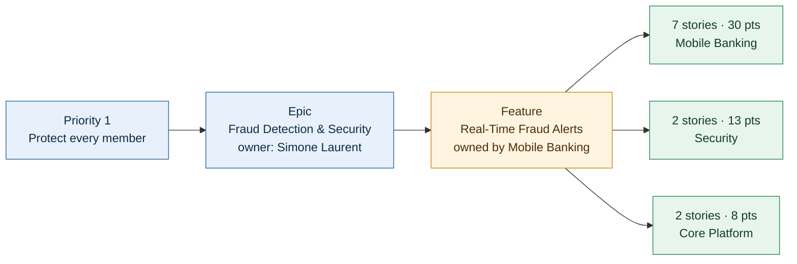

!!! briefing "Mission briefing"
    You've just been appointed **Delivery Manager, Digital Banking** at HarborPoint Financial. You report to Priya Raman, and you inherit a slice of the **Member Experience Transformation Program**, the multi-year program everyone calls *Project Lighthouse*. Six delivery teams, six Epics, twenty-four Features, and you've never seen any of them.

    You already know Azure DevOps. What you don't know yet is *this* portfolio: what it's trying to achieve, what order it's in, who builds what, and how far along it really is. That's what this lab is for. You'll work from the top down, from strategic priority to Epic to Feature, and drop to stories only when a Feature-level question needs evidence.

    **Done looks like:** you can say which portfolio priority every Digital Feature serves, who owns it, how far along it is, and which Azure DevOps view answers which kind of management question fastest. Along the way you'll spot three things about this portfolio that deserve a question.

<div class="msg" data-initials="PR" data-tone="teal" markdown>
<p class="msg-head"><strong>Priya Raman</strong><span>Director, Digital Banking · 8:12 AM</span></p>

Welcome aboard. Before you meet the teams, learn the portfolio. By lunch I'd like you to be able to tell me what every Digital Feature is for, who's building it and how far along it is. Not the sprint detail, just the shape of the thing. And if anything looks odd, write it down. Fresh eyes are the only time anyone notices.
</div>

## What you'll walk away with

- Read a portfolio as a **ranked list** and notice when the ranking and reality disagree
- Build a Feature-level status view with rollup columns, without opening a single work item
- Choose the right lens (backlog, work item form, board or Delivery Plan) for a given management question
- Tell three different things apart: who **owns** a Feature, which priority it **serves**, and who **builds** it
- Know what a progress bar actually measures, and when it understates the truth

## Before you set sail

- **Access:** Basic. You'll only *read* the six delivery teams' work today, and you won't create anything in this lab.
- **Teams you'll switch between** with the team selector: `HarborPoint Team` (the whole program), `Digital Portfolio` (Priya's view across both Digital teams) and `Mobile Banking`. The [environment map](../start/environment.md) lists them all.
- **Safe to change:** **Column Options**, **View options** and filters. They're saved **per user**, so nobody else sees your changes.
- **Never change:** backlog order, states, estimates or board settings of the real teams. If you catch yourself dragging a card, let go.
- **Time-box:** 45 minutes. The speed run is 10 of them. If you breeze through it, skim Parts 1–3 and spend your time on the challenges.

## Part 1 — Prove you know your way around

You've used Azure DevOps for years. Show it.

!!! speedrun "Speed run · 10 minutes"
    Answer all seven. Use any view you like, and note *where* you found each answer.

    1. How many Features does **Digital Banking Modernization** have, counting the closed ones?
    2. Which team owns **Mobile Check Deposit 2.0**?
    3. Which Epic sits at the top of the portfolio?
    4. Which *active* Digital Banking Feature is the most complete, and how complete is it?
    5. Which Digital Banking Feature has no child work at all?
    6. Which Feature has work in **three** different teams?
    7. What's the current sprint, and which PI is it in?

<div class="timer" data-minutes="10" data-label="Speed run"></div>

??? pilot "Harbor Pilot · Hint 1: Take a bearing"
    Most answers live on a **portfolio backlog**. Pick a team whose area covers the work you're asking about: `HarborPoint Team` sees everything, `Digital Portfolio` sees both Digital teams. There's also a ready-made tree in **Shared Queries**.

??? pilot "Harbor Pilot · Hint 2: Set the heading"
    - **Boards › Backlogs**, team `HarborPoint Team`, level **Epics**: row order is the portfolio rank.
    - Team `Digital Portfolio`, level **Features**, **Parents** and **Completed Child Items** on, plus a **Progress by Story Points** rollup column.
    - `Shared Queries/HarborPoint Reports/Portfolio - Epics and Features` lists every Epic's Features, closed ones included.
    - For "three teams", expand a `cross-team` Feature into its stories and add **Node Name**.
    - **Boards › Sprints**: the sprint selector marks the **Current** sprint.

??? pilot "Harbor Pilot · Hint 3: Bring it into port (full solution)"
    | # | Answer | Where it's fastest |
    |:-:|:--|:--|
    | 1 | **8 Features** (two Closed, four Active, two New) | `Portfolio - Epics and Features` query, or the `Digital Portfolio` Features backlog with **Completed Child Items** on |
    | 2 | **Mobile Banking** | **Area Path** (or **Node Name**) column on any Features backlog |
    | 3 | **Fraud Detection & Security** | `HarborPoint Team` Epics backlog, first row |
    | 4 | **Spending Insights, 88%** | **Progress by Story Points** rollup on the `Digital Portfolio` Features backlog |
    | 5 | **Member-to-Member Transfers** (no children, no rollup at all) | Same backlog: its progress cell is empty, and it has no expand arrow |
    | 6 | **Real-Time Fraud Alerts**: children in Mobile Banking, Security and Core Platform | Expand it on the `HarborPoint Team` Features backlog with **Node Name** added |
    | 7 | **Sprint 14**, in **PI 4** (`HarborPoint\PI 4\Sprint 14`) | **Boards › Sprints**, sprint selector, **Current** badge |

    Got all seven in ten minutes? Skim Parts 2 and 3 and go straight to the challenges. You'll still want the column setup from Part 3, because Lab 2 uses it.

!!! checkpoint "Checkpoint"
    - [ ] I answered all seven speed-run questions and know where each answer lives

## Part 2 — Read the portfolio as a ranked list

A portfolio isn't a pile of Epics. It's an **ordered** list, and the order is a decision. Start where the Executive Committee's decisions should show up.

1. **Boards › Backlogs**, team `HarborPoint Team`, level **Epics**.
2. **Column Options** › **+ Add a column**: `Priority`, `Start Date`, `Target Date`, `Tags` and `Area Path`. Select **OK**.
3. In a second browser tab, open **Overview › Wiki** › `Program` › `Program Charter` and find the FY2027 priorities.

<!-- SHOT: lab01-epics-backlog | Boards › Backlogs, team HarborPoint Team, Epics level, columns Priority, Start Date, Target Date, Tags, Area Path added | crop: the six Epic rows; highlight row 6 Compliance: Examination Readiness with Priority 1 and the mandatory tag -->

**You should see** six Epics in this order:

| Order | Epic | Area (owner) | Priority | Runs | Tags |
|:-:|:--|:--|:-:|:--|:--|
| 1 | `Fraud Detection & Security` | Security | 1 | Sprint 9 → 20 | |
| 2 | `Digital Banking Modernization` | Digital | 1 | Sprint 9 → 20 | |
| 3 | `Customer Support Modernization` | Member Support | 2 | Sprint 9 → 19 | |
| 4 | `Branch Experience Transformation` | Branch Experience | 2 | Sprint 9 → 20 | |
| 5 | `Platform Foundations` | Core Platform | 2 | Sprint 9 → 16 | `enabler` |
| 6 | `Compliance: Examination Readiness` | Security | **1** | Sprint 12 → **18** | `mandatory` |

The dates show as calendar dates in your columns; the table translates them to sprints. The first four rows match the charter's ranked priorities exactly. Then look at row 6.

!!! challenge "Challenge: Read the last row"
    Answer three questions in one line each. Don't fix anything: this is a read-only reconnaissance.

    1. What does this list say about the Compliance Epic, and what does the charter say?
    2. Which fact on this screen makes row 6 more urgent than its position suggests?
    3. Which team owns it, and which *other* Epic does that same team own?

??? pilot "Harbor Pilot · Hint 1: Take a bearing"
    Compare three signals on the same row: position, the **Priority** field and the **Target Date**. Then compare the **Area Path** of rows 1 and 6.

??? pilot "Harbor Pilot · Hint 2: Bring it into port (full solution)"
    1. The backlog ranks it **last**. The charter calls it **mandatory**, a regulatory exam with a non-negotiable date. It carries Priority 1, the same as the top two Epics.
    2. Its **Target Date**, the end of Sprint 18, is the only date in the portfolio that HarborPoint didn't choose: regulatory exam fieldwork begins in Sprint 18, and it won't wait.
    3. **Security** owns it, and Security also owns the number one Epic, *Fraud Detection & Security*.

    **So what?** The Compliance Epic was added in Sprint 12, and nobody re-ranked the portfolio. The backlog order is what Delivery Plans, Forecasting and most humans read as "priority", and it says compliance matters least. Security clearly doesn't believe that. Write the question down: *if the team that owns priority number one is also carrying the mandatory exam work, which one wins when they collide?* You'll answer it on Day 2 in [Lab 7](../day-2/lab-07-cross-team-bottleneck.md).

!!! insight "Lighthouse insight: the order is the decision"
    Priority fields are opinions, and three Epics here claim Priority 1. Backlog **order** is the one place where "everything is top priority" is impossible, because only one item can be first. When a portfolio's order and its owners' behavior disagree, the tool isn't wrong. A decision is missing. Your job is to notice and ask who should make it.

!!! checkpoint "Checkpoint"
    - [ ] I can name the portfolio's six Epics in rank order
    - [ ] I wrote down why the Compliance Epic's position is a question worth asking

## Part 3 — One Epic, eight Features

Now drop one level to your own patch: Digital Banking Modernization. This is the view you'll live in for the next two days, so set it up properly.

1. **Boards › Backlogs**, team `Digital Portfolio`, level **Features**.
2. **View options**: **Parents** On, **In Progress Items** On, **Completed Child Items** On.
3. **Column Options** › **+ Add a column**: `Area Path`, `Iteration Path`, `Target Date`, `Business Value` and `Tags`.
4. **+ Add a rollup column** › **From quick list**: **Progress by Story Points**, **Sum of Story Points** and **Progress by all Work Items**. Select **OK**.

<!-- VERIFY: exact quick-list rollup labels on a Features backlog (research shows Stories-level labels; Features level may read "Progress by User Story" / "Count of User Story"). Steps work with whichever "by Story Points" and "all Work Items" labels appear. -->

<!-- VERIFY: whether Completed Child Items On makes the two Closed Features (Mobile App Redesign, Paperless Statements & Documents) appear under their Epic on the Features backlog. If not, point participants to the Portfolio - Epics and Features query for the closed two. -->

Rollup is calculated by Analytics, so a cell may be blank for a moment. Hover over the column header to see when the data was last refreshed.

<!-- SHOT: lab01-digital-features-rollup | Boards › Backlogs, team Digital Portfolio, Features level, Parents on, columns Area Path, Iteration Path, Target Date, Business Value, Tags plus rollup Progress by Story Points and Sum of Story Points | crop: the Digital Banking Modernization group and the Fraud Detection & Security parent row with Real-Time Fraud Alerts under it; highlight the progress bars -->

**You should see** Digital Banking Modernization with its eight Features, plus one more Feature under a different Epic:

| Feature | Owning team | State | Target | Business Value | Progress (points) | Story Points |
|:--|:--|:--|:--|:-:|:-:|:-:|
| `Mobile App Redesign` | Mobile Banking | Closed | Sprint 11 | 13 | 100% | 55 |
| `Mobile Check Deposit 2.0` | Mobile Banking | Active | **Sprint 14** | 13 | 61% | 93 |
| `Biometric Login` | Mobile Banking | Active | Sprint 16 | 8 | 53% | 51 |
| `Member-to-Member Transfers` | Mobile Banking | New | Sprint 20 | 20 | *(empty)* | *(empty)* |
| `Instant Card Controls` | Digital Accounts | New | Sprint 17 | 20 | 0% | 105 |
| `Online Account Opening` | Digital Accounts | Active | Sprint 16 | 13 | 59% | 56 |
| `Spending Insights` | Digital Accounts | Active | Sprint 15 | 5 | **88%** | 43 |
| `Paperless Statements & Documents` | Digital Accounts | Closed | Sprint 13 | 5 | 100% | 52 |
| `Real-Time Fraud Alerts` *(under Fraud Detection & Security)* | Mobile Banking | Active | Sprint 16 | 20 | **4%** | 51 |

Your backlog's row order may differ from this table. Read it for four things:

- **States.** Two delivered, four in flight, two not started. That's the Epic's whole life story in one column.
- **The empty row.** `Member-to-Member Transfers` has a Business Value of 20, the joint highest, and no children at all. It's planned for PI 5 and nobody has broken it down yet. That's fine in Sprint 14, and it won't be fine in Sprint 16.
- **Two bars, two stories.** **Progress by all Work Items** counts every child, bugs included, while the points bar weighs each story by its estimate. When the two disagree sharply, ask which kind of work is piling up.
- **The number that hides something.** `Instant Card Controls` reads 105 points, but four of its twenty stories have no estimate. **Sum of Story Points** can't count what nobody estimated.
- **The Feature that isn't in the Epic.** `Real-Time Fraud Alerts` lives in Mobile Banking's area, so the `Digital Portfolio` team sees it, but its parent is *Fraud Detection & Security*. Its progress never shows up in Digital Banking Modernization's rollup. You'll come back to it in Part 5.

!!! challenge "Challenge: Is 88% good news?"
    The most complete active Digital Feature is `Spending Insights`, at 88%. Priya would love to hear that. Before you tell her, decide whether it's good news. Write two sentences: what's true about it, and what question it should raise.

??? pilot "Harbor Pilot · Hint 1: Take a bearing"
    Progress tells you how far along something is. It doesn't tell you whether it was the right thing to be far along on. Which columns on your screen say something about *value*?

??? pilot "Harbor Pilot · Hint 2: Set the heading"
    Compare **Business Value** (and, if you add it, **Time Criticality**) for `Spending Insights`, `Mobile Check Deposit 2.0`, `Instant Card Controls` and `Real-Time Fraud Alerts`. Then check which team owns each, because a comparison across two teams is a different conversation from one inside a team.

??? pilot "Harbor Pilot · Hint 3: Bring it into port (full solution)"
    **What's true:** `Spending Insights` is the *lowest-value* active Digital Feature: Business Value 5, Time Criticality 3. Meanwhile the highest-value work lags: `Real-Time Fraud Alerts` (Business Value 20, Time Criticality 20) is at 4%, and `Instant Card Controls` (20 and 20, requested by the EVP) hasn't started.

    **The question it should raise:** *are we working on the right things, in the right order?* Aim it precisely. Finishing `Spending Insights` is sensible: only 5 points are left. The sharper question is for Digital Accounts, which owns both: why did a value-5 Feature get attention ahead of a value-20 leadership ask? There may be a good reason (a dependency, readiness), so ask before you judge. Don't conclude that Digital Accounts could have sped up Mobile's Features. They're different teams, and capacity doesn't pour between them.

!!! checkpoint "Checkpoint"
    - [ ] My `Digital Portfolio` Features backlog shows rollup progress and points for every Feature
    - [ ] I can explain why `Real-Time Fraud Alerts` appears on this backlog but not under Digital Banking Modernization
    - [ ] I have a two-sentence answer to "is 88% good news?"

## Part 4 — Four lenses on one Feature

Azure DevOps shows the same Feature in at least four places, each best at a different question. Take `Mobile Check Deposit 2.0`, Digital Banking's biggest active Feature and the one due soonest, and give each lens about two minutes.

**Lens 1: the backlog row.** You've already got it. It's 61% done by points, 93 points in total, due at the end of Sprint 14, which is *this* sprint. Note those three numbers.

**Lens 2: the work item form.** Select the Feature's title to open it.

- The header and **Details** show **Priority** 1, **Risk** `1 - High`, **Business Value** 13, **Time Criticality** 13 and **Effort** 93. Effort is a number somebody *typed*. The rollup is a number Azure DevOps *calculated*. Here they agree. When they don't, ask which one is stale.
- **Tags**: `PI4-Committed` and `at-risk`. Someone has already said this one is in trouble.
- **Related Work** lists the parent Epic and the child stories and bugs. Count them roughly; don't open them.
- **History** shows every change with who made it and when. Find the revision where the Feature went **Active**.

<!-- SHOT: lab01-f2-work-item-form | Work item form for Mobile Check Deposit 2.0 (Feature), Details tab | crop: header, Status/Planning fields, Tags and Related Work; highlight Target Date, Risk 1 - High and the at-risk tag -->

**Lens 3: the Feature board.** **Boards › Boards**, team `Mobile Banking`, level **Features**. Mobile Banking's Features sit in **New**, **Active** and **Closed** columns. Find the card. Its child annotation shows completed and total children as a fraction. Expand it to see the checklist.

<!-- VERIFY: the Feature card's child annotation shows stories as 17/26 for Mobile Check Deposit 2.0 (bugs may show as a separate annotation or not at all). -->

**Lens 4: the Delivery Plan.** **Boards › Delivery Plans** › `HarborPoint Program Plan`. Find the Mobile Banking row and the `Mobile Check Deposit 2.0` card. Notice the markers on the calendar bar: **PI 4 System Demo**, **PI 5 Planning** and **Regulatory exam fieldwork**, and the **today** marker. The card ends a few days to the right of today.

!!! warning "Look, but don't drag"
    On a Delivery Plan, dragging a card moves the real work item to another sprint, and dragging a card's edge rewrites its dates for everyone. This plan belongs to the program office. Select titles and badges. Never drag.

<!-- SHOT: lab01-program-plan-f2 | Boards › Delivery Plans › HarborPoint Program Plan, Features level, Mobile Banking row expanded, zoomed to Sprint 12 to Sprint 18 | crop: Mobile Banking row plus calendar bar; highlight the Mobile Check Deposit 2.0 card ending just after the today marker, and the three plan markers -->

!!! challenge "Challenge: Match the lens to the question"
    Fill in the fastest lens for each question, and one thing that lens *can't* tell you.

    | Question a manager gets asked | Fastest lens | What it can't tell you |
    |:--|:--|:--|
    | How far along is it, and how big is it? | | |
    | Why is it like this? Who changed what, and when? | | |
    | Where is the work stuck right now? | | |
    | When will it land, relative to other teams and our milestones? | | |

??? pilot "Harbor Pilot · Hint 1: Take a bearing"
    Each lens has one superpower: numbers, history, flow or calendar. Match the superpower to the question first, then think about each lens's blind spot.

??? pilot "Harbor Pilot · Hint 2: Bring it into port (full solution)"
    | Question | Fastest lens | What it can't tell you |
    |:--|:--|:--|
    | How far along, how big? | **Backlog row with rollup**: every Feature at once, no clicking | Whether the remaining work fits before the target, or why it's stuck |
    | Why is it like this? | **Work item form**: History, Discussion, tags, links | Anything about the *other* Features; it's one item at a time |
    | Where is it stuck? | **Board**: columns, child annotation, and the Stories board one level down | Dates and deadlines; a board has no calendar |
    | When will it land, relative to others? | **Delivery Plan**: teams, dates, markers, dependency badges | How much work is left inside the card (unless rollup is shown) |

    **So what?** No single view gives a Feature's status. A statement that holds up combines at least two: *"61% done, deadline in days"* takes the backlog **and** the calendar. In status meetings, notice which lens people are quoting.

!!! reef "Reef ahead: the progress bar only counts Closed"
    Look at `Biometric Login` again: 53%. It's tempting to conclude that Mobile Banking's developers are about halfway. Now drop one level down to see why. Open **Boards › Boards**, team `Mobile Banking`, level **Stories**, and look at the **Resolved** column. Bugs sit there too, because this team manages bugs with requirements, so look for the cards with Story Points: three stories, 11 points, code-complete and waiting for QA. Two of them belong to `Biometric Login` and one to `Mobile Check Deposit 2.0`. Mobile Banking has one tester.

    Rollup progress counts only **Closed** children, so Resolved work shows as *not done*. If those three stories closed today, `Biometric Login` would read about 69% and `Mobile Check Deposit 2.0` about 64%. A progress bar measures **workflow discipline** as much as progress: a team that's slow to close looks slower than it is, and a team that closes early looks faster. Before you quote a percentage, find out what "done" means on that team's board.

<!-- SHOT: lab01-mobile-stories-resolved | Boards › Boards, team Mobile Banking, Stories level | crop: the Resolved column; highlight the three story cards (Deposit limit messaging by member tier, Face ID and fingerprint enrollment, Biometric step-up for high-risk actions) among the Resolved bugs -->

!!! checkpoint "Checkpoint"
    - [ ] I looked at `Mobile Check Deposit 2.0` on the backlog, the form, the Feature board and the Program Plan
    - [ ] My lens table has a fastest lens and a blind spot for every question
    - [ ] I can explain why `Biometric Login` is further along than 53% suggests, and why it still isn't done

## Part 5 — Who owns what

Three different fields answer three different questions, and managers mix them up all the time:

- **Area Path** says which team **owns** an item.
- The **Parent** link says which priority it **serves**.
- The **Area Paths of its children** say who actually **builds** it.

The area tree is HarborPoint's org chart for work:

```text
HarborPoint                     ← HarborPoint Team (includes sub-areas: sees everything)
├── Digital                     ← Digital Portfolio (includes sub-areas: sees both teams below)
│   ├── Mobile Banking          ← Mobile Banking
│   └── Digital Accounts        ← Digital Accounts
├── Security                    ← Security
├── Core Platform               ← Core Platform
├── Branch Experience           ← Branch Experience
├── Member Support              ← Member Support
└── Training\P##                ← your P## Sandbox
```

A delivery team sees only its own area. `Digital Portfolio` and `HarborPoint Team` include sub-areas, which is the only reason Priya can see both Digital teams on one backlog. If an item "goes missing", the first suspect is the team selector, not the data.

!!! challenge "Challenge: Priority one, built by whom?"
    One Feature serves the portfolio's **number one** priority, yet it's owned and mostly built by a **Digital** team, which makes it partly your problem. Find it, then answer:

    1. Which team owns it, and which Epic does it serve?
    2. How many of its child stories sit in each team's area, and how many points?
    3. Whose progress report will it show up in, and whose will it be missing from?

??? pilot "Harbor Pilot · Hint 1: Take a bearing"
    You met it in Part 3: the Feature on the `Digital Portfolio` backlog whose parent isn't Digital Banking Modernization. To see its children across teams, you need a team whose area covers *all* of them.

??? pilot "Harbor Pilot · Hint 2: Set the heading"
    **Boards › Backlogs**, team `HarborPoint Team`, level **Features**, **Parents** On and **Completed Child Items** On. Add the **Node Name** and **Story Points** columns. Find the Feature under *Fraud Detection & Security* and expand it into its stories. Bugs appear among the children too; leave them out of your count.

??? pilot "Harbor Pilot · Hint 3: Bring it into port (full solution)"
    It's **`Real-Time Fraud Alerts`**. **Mobile Banking** owns it, and it serves *Fraud Detection & Security*, priority number one. It's tagged `cross-team`.

    | Children in area | Stories | Points |
    |:--|:-:|:-:|
    | Mobile Banking | 7 | 30 |
    | Security | 2 | 13 |
    | Core Platform | 2 | 8 |
    | **Total** | **11** | **51** (2 done, 4%) |

    It counts toward Simone Laurent's Epic, *Fraud Detection & Security*, and is missing from Priya's, *Digital Banking Modernization*, even though a Digital team owns it and does most of the building. Report Digital's progress Epic by Epic and the Digital Feature most likely to hurt the program is invisible. Put it on your list for Priya by name.

<!-- VERIFY: on the HarborPoint Team Features backlog, expanding Real-Time Fraud Alerts shows its child stories from all three areas (with Completed Child Items on, the closed Fraud alert UX design spike appears). Fallback: switch the level to Stories with Parents on and find the Feature in the tree. -->

<!-- SHOT: lab01-f9-children-by-area | Boards › Backlogs, team HarborPoint Team, Features level, Parents on, Completed Child Items on, Real-Time Fraud Alerts expanded, Node Name and Story Points columns | crop: the Fraud Detection & Security group with Real-Time Fraud Alerts and its 11 child stories; highlight the Node Name column showing Mobile Banking, Security and Core Platform -->



!!! insight "Lighthouse insight: Features are the unit of conversation"
    Leadership talks in priorities and Epics. Teams talk in stories. The **Feature** is where those two conversations meet: small enough to deliver in a PI, big enough to mean something to Dana. Make Features your unit of status, and treat stories as **evidence**: drop one level down to prove a Feature-level point, then climb back up. If you find yourself reading status story by story to a director, you've descended too far.

!!! checkpoint "Checkpoint"
    - [ ] I can say who owns, who builds, and which priority `Real-Time Fraud Alerts` serves
    - [ ] I know which two teams include sub-areas, and why that matters for what I can see

## Knowledge check

<div class="quiz" markdown>

**The Compliance Epic is mandatory, carries Priority 1, and is ranked last on the Epics backlog. What's the best reading?**

- [ ] Compliance is the least important Epic, as the backlog says
- [ ] Priority 1 overrides the backlog order, so no action is needed
- [x] The ranking and reality disagree, and someone with authority needs to decide where it belongs
- [ ] The backlog is misconfigured and should be sorted by Priority

<div class="quiz-why" markdown>
Backlog order is the rank that plans, forecasts and people read. A mandatory Epic with a regulator's date sitting last isn't a data error. It's a decision nobody made when the Epic was added in Sprint 12. You can't sort a backlog by a column anyway; order is set by people, on purpose.
</div>

</div>

<div class="quiz" markdown>

**Biometric Login shows 53% by Story Points, and two of its stories (8 points) sit in Resolved, waiting for QA. What should you tell Priya?**

- [ ] It's 53% done, so it's behind schedule
- [x] Development is further along than 53%, but the work isn't done until it's tested, and testing is the constraint
- [ ] It's really about 69% done, so report 69%
- [ ] The rollup is broken and can't be trusted

<div class="quiz-why" markdown>
Rollup counts only Closed work. Reporting 69% would claim untested work as done, and reporting 53% hides where the work is stuck. The useful message names the constraint: one tester for the whole team.
</div>

</div>

<div class="quiz" markdown>

**Dana asks: "When will Real-Time Fraud Alerts land, compared with the System Demo and the other teams it needs?" Which view answers fastest?**

- [ ] The Digital Portfolio Features backlog with rollup columns
- [ ] The Mobile Banking Features board
- [x] A Delivery Plan with the contributing teams' rows and the PI markers
- [ ] The Feature's work item form

<div class="quiz-why" markdown>
"When, relative to others" is a calendar question across teams, and only a Delivery Plan puts several teams, dates, milestone markers and dependency badges on one screen. The backlog tells you how far along; the plan tells you when, and who's waiting on whom.
</div>

</div>

## Captain's log

!!! log "Captain's log"
    1. Where does your organization's portfolio *ranking* live today? Is it the backlog order, a slide, or someone's head? Do they agree?
    2. When you report status upward, which unit do you use: Epics, Features or stories? Which one does your leadership actually want?
    3. Think of a Feature that "belongs" to one team but is built by three. Whose report does it show up in, and whose is it missing from?
    4. What does "done" mean on your teams' boards, and how much finished-but-not-closed work is hiding in your progress bars?
    5. Which of today's four lenses do you use least? What question have you been answering the slow way?

!!! bonus "Extra knots"
    1. **The program's front window.** Open **Overview › Dashboards** › `HarborPoint Program Overview`. For each widget, write down the question it answers and the lens it's built on. Which management question from Part 4 does it *not* answer? Keep your notes: on Day 2 you'll critique this dashboard.
    2. **Who spans the most teams?** On the `HarborPoint Team` Epics backlog, expand each Epic into its Features and add **Node Name**. Which Epics are delivered by more than one owning team, and which single team appears under the most Epics?
    3. **The Feature that won't close.** On the `HarborPoint Team` Features backlog, find a Feature that shows 100% progress but is still **Active**. Check its **Target Date**. What does a Feature like that do to a portfolio report? (You'll meet it again in Lab 3 and on Day 3.)

## Key takeaways

- The portfolio is a **ranked list**. When the rank and reality disagree, a decision is missing, so find out who should make it.
- Set up a Features backlog with **rollup columns** and you have Feature status for a whole Epic on one screen, with no work items opened.
- Use the right lens: the **backlog** for how far, the **form** for why, the **board** for where it's stuck, the **plan** for when.
- **Owns**, **serves** and **builds** are three different questions: Area Path, Parent link, and the children's areas. Cross-team Features hide in the gaps between them.
- Progress bars count only **Closed** work. Before you quote one, know what "done" means on that team's board.
