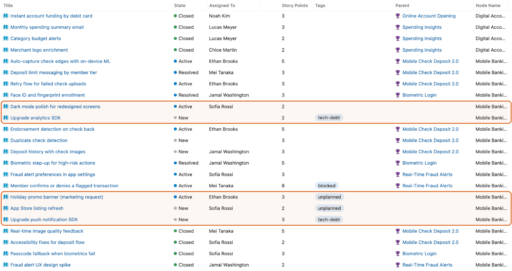
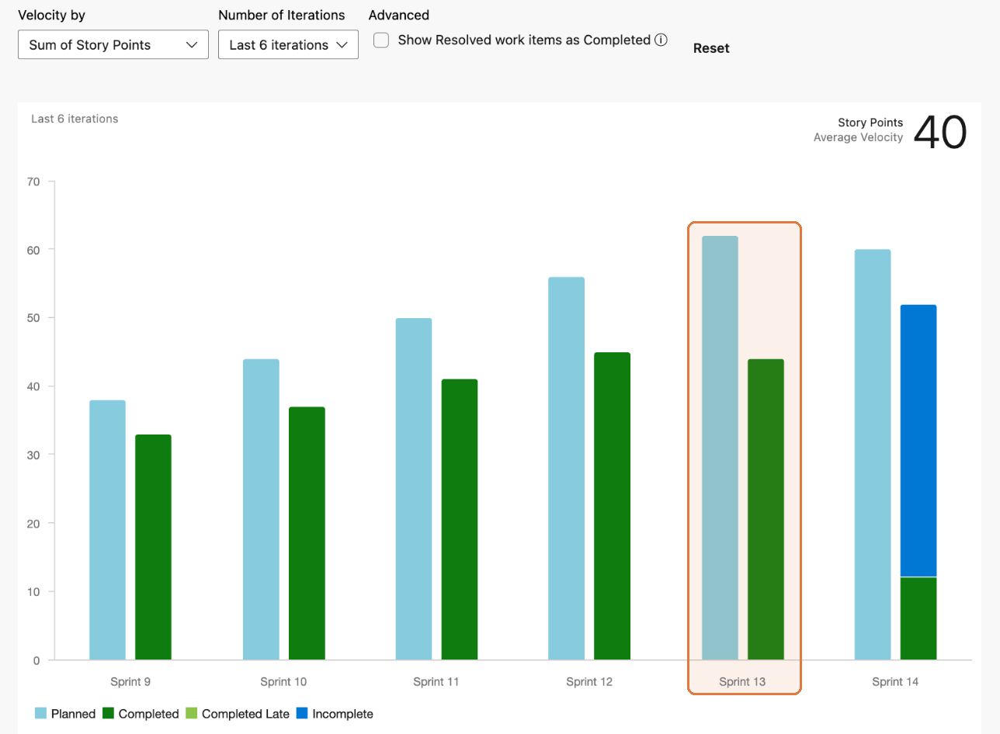
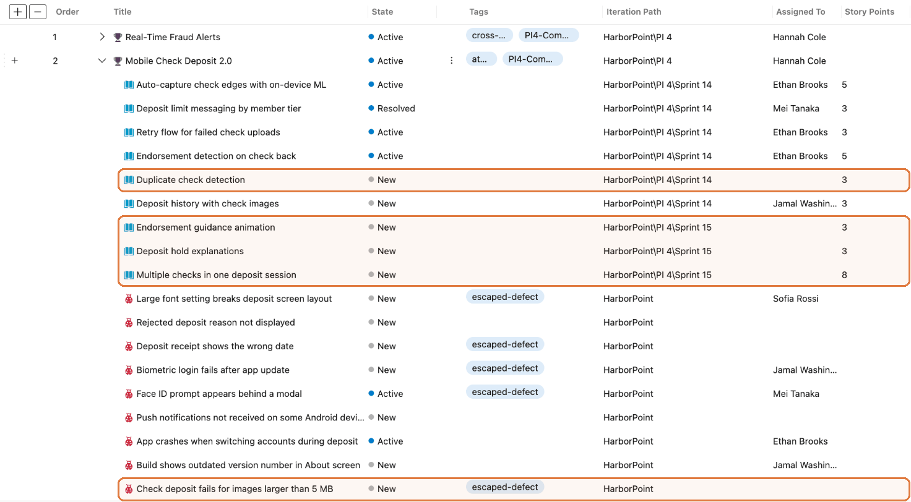
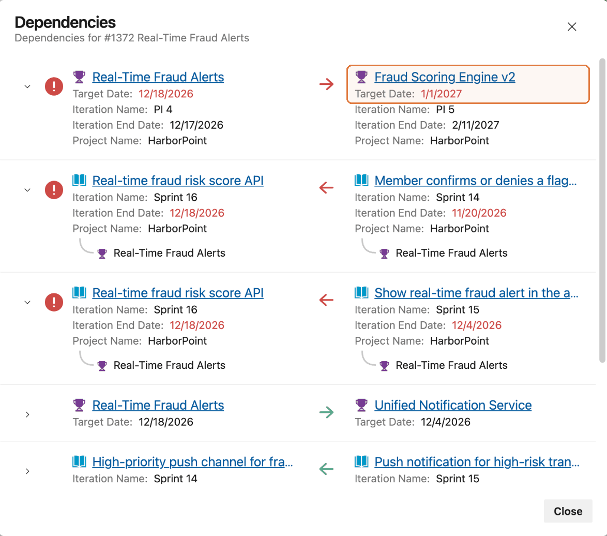
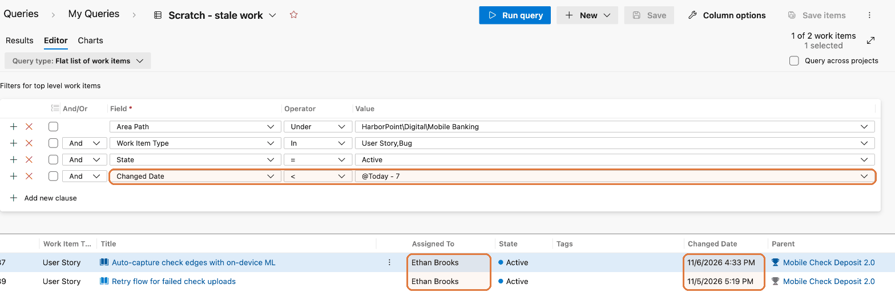

!!! briefing "Mission briefing"
    You took a week of leave you'd booked before you accepted the job. You're back, it's Sprint 14, week 2, and your inbox has 140 unread messages. One of them matters.

    Dana, the EVP, asked Priya why mobile banking has fallen behind. Priya needs an answer by ten: a Feature-level picture she can repeat to Dana, not a story-by-story tour. Every claim needs evidence you can open when Marcus asks "how do you know?"

    **Done looks like:** five bottom-line-up-front (BLUF) bullets on a wiki page, each backed by a view or query you can open in ten seconds. Parts 1–4 answer Priya's four questions in order: what each team is on, what shipped, what's unfinished, what needs us. Part 5 turns the answers into the bullets.

<strong>Priya Raman</strong>Director, Digital Banking · 7:41 AM

Welcome back. Bad timing, sorry. Dana stopped me last night: "Why has mobile banking fallen behind?" I need a readout from you at **10:00**. What each team is working on, what we shipped last sprint, what's unfinished, and what needs us. Feature level please, I don't need the story-by-story. Five bullets. If something's on fire, lead with it.

## What you'll walk away with

- See every team's current work at **Feature** level in minutes, including the work that serves no Feature
- Judge a sprint against the team's own plan, and find the carry-over the chart doesn't label
- Decide whether a Feature will make its date from where its remaining work sits, not from its progress bar
- Run a six-signal hunt for what needs a manager, and test every velocity number against Feature progress
- Turn that evidence into a five-bullet readout that leads with the bottom line and ends with a named ask

## Before you set sail

- **You'll read:** `Mobile Banking` and `Digital Accounts` closely, and the other four teams briefly. All read-only.
- **You'll create:** scratch queries in **My Queries** (your private folder; the shared `P##` folder comes in Lab 3), and one wiki page, `/Training/P##/Monday Readout`.
- **Shared queries are shared.** You'll add columns to queries in `Shared Queries/HarborPoint Reports`. Don't **Save** them. Use **Save as** into **My Queries** if you want to keep your version.
- **Team context matters today.** Sprint views, Velocity and `@CurrentIteration` belong to one team. When a step names a team, check the team selector before you read a number.
- **Time-box:** 50 minutes. Protect the last 10 for the readout. Five honest bullets at 10:00 beat twelve thorough ones at 10:20.

## Part 1 — Who's on what, right now

**The question:** what is each team working on, at Feature level? Answer it for all six before you explain one, so you know whether Mobile's problem is Mobile's alone.

!!! speedrun "Speed run · 8 minutes"
    For each of the six delivery teams, list the **Features** its Sprint 14 stories serve, and how much of the sprint serves **no Feature at all**. Ignore bugs for now. One line per team.

??? pilot "Harbor Pilot · Hint 1: Take a bearing"
    You don't need six sprint boards. A shared query already lists the current sprint for every team. It just doesn't show the one column you need.

??? pilot "Harbor Pilot · Hint 2: Set the heading"
    Open **Boards › Queries** › **All** › `Shared Queries/HarborPoint Reports/Program - Current sprint (all teams)`. **Column options**: add `Parent` and `Node Name` (`Story Points` is already there). The query returns user stories only, sorted by **Area Path**, so each team's rows sit together and the parent titles are easy to scan. Don't **Save** over the shared query.

    The slower route: **Boards › Sprints**, pick each team, `Sprint 14`, **Backlog** tab, **Column Options** › add `Parent`.

??? pilot "Harbor Pilot · Hint 3: Bring it into port (full solution)"
    | Team | Features this sprint (stories, points) | Serving no Feature |
    |:--|:--|:--|
    | Mobile Banking | Mobile Check Deposit 2.0 (8, 29) · Biometric Login (3, 11) · Real-Time Fraud Alerts (3, 13) | **5 stories, 12 points** |
    | Digital Accounts | Online Account Opening (5, 17) · Spending Insights (3, 7) | 1 story, 2 points |
    | Security | Audit Evidence Automation (4, 14) · Access Review Automation (2, 7) · Fraud Scoring Engine v2 (2, 7) · Adaptive Multi-Factor Authentication (2, 8) | none |
    | Core Platform | Unified Notification Service (3, 6) · Member API Gateway (2, 8) · Real-Time Fraud Alerts (1, 5) | 1 story, 3 points |
    | Branch Experience | In-Branch Digital Onboarding (3, 10) · Lobby Check-In & Queue Management (3, 7) | 1 story, 2 points |
    | Member Support | Omnichannel Service Requests (5, 13) · Secure Messaging & Chat (3, 10) | none |

    Outside Mobile, three things deserve a question:

    - **Security has four Features in flight** with six people, and 21 of its 36 points go to the two Compliance Features.
    - **Real-Time Fraud Alerts appears twice**, in Mobile Banking and Core Platform, but has no Security story this sprint, though Security owns part of it.
    - **Member Support has `Service request status tracker` twice**: one Active, one New and unassigned. That's a duplicate, and it double-counts scope. (Day 3 has a whole lab on Member Support's data.)

    **So what?** Mobile's 12 unaligned points, the most of any team, are your first clue to Dana's question. Keep Fraud Alerts in mind for Part 3. The other two can wait until after 10:00.

<figure class="hp-shot" data-shot="lab02-current-sprint-by-feature" markdown>

<i></i><i></i><i></i>Boards › Queries › Shared Queries › HarborPoint Reports › Program - Current sprint (all teams)

{ loading=lazy }

<figcaption markdown>Mobile Banking's Sprint 14, with **Parent** added. Five stories (12 points) have no Feature at all: two `unplanned` asks, two `tech-debt` upgrades and a polish task.</figcaption>
</figure>

!!! checkpoint "Checkpoint"
    - [ ] I have one line per team: its Sprint 14 Features and its unaligned work
    - [ ] I noted at least one thing outside Mobile Banking worth a question

!!! takeaway "Takeaway"
    Start wide: see every team's work by Feature, including the work that serves no Feature, before you explain any one team.

## Part 2 — What shipped in Sprint 13

**The question:** what did each team deliver last sprint, against what it planned? "Fallen behind" is a claim about the past, so check Sprint 13 before you look at Sprint 14.

**Features delivered.** Open `Shared Queries/HarborPoint Reports/Portfolio - Features by target date` and add `Closed Date` and `Node Name` columns (don't save). One Feature closed in Sprint 13: **`Paperless Statements & Documents`**, Digital Accounts. Mobile Banking closed none. Its last delivered Feature was `Mobile App Redesign`, at the end of Sprint 11.

**Planned against completed.** Now compare each team with its own plan.

1. **Boards › Backlogs**, team `Mobile Banking`, level **Stories**, then the **Analytics** tab.
2. On the **Velocity** card, select **View full report**. The report opens on **Count of Work Items**: set **Velocity by** to **Sum of Story Points** and keep **Last 6 iterations**. Your choice is saved for you only.
3. Hover over the Sprint 13 bars. Then switch the team selector to `Digital Accounts` and do the same.

<figure class="hp-shot" data-shot="lab02-mobile-velocity" markdown>

<i></i><i></i><i></i>Boards › Backlogs › Mobile Banking › Analytics › Velocity

{ loading=lazy }

<figcaption markdown>Mobile Banking, Sum of Story Points. Sprint 13 was planned at **62** and completed **44**. Sprint 14 is still in flight, so most of its bar is Incomplete.</figcaption>
</figure>

**You should see:**

| Team | Sprint 13 planned | Sprint 13 completed | Share of plan |
|:--|:-:|:-:|:-:|
| Mobile Banking | 62 | 44 | **71%** |
| Digital Accounts | 26 | 26 | 100% |

Mobile's 18-point gap is six stories that didn't finish and moved into Sprint 14 on its first day. The chart doesn't show them as **Incomplete** in Sprint 13, because they no longer belong to Sprint 13. Carry-over appears only as the gap between the light **Planned** bar and the green **Completed** bar. Read the gap, not the green.

To see one carried story's journey, open `Auto-capture check edges with on-device ML` and select **History**. Its **Iteration Path** moved from Sprint 12 to Sprint 13, then from Sprint 13 to Sprint 14. It has been "nearly done" for three sprints.

!!! note "Why not just query for carry-over?"
    The query editor's **Was Ever** operator doesn't support **Iteration Path**. Use the **Velocity** report for the size of the gap and each item's **History** for the evidence.

!!! challenge "Challenge: Two teams, one verdict"
    Mobile Banking completed 44 points last sprint. Digital Accounts completed 26. A colleague says, "So Mobile delivered 70% more than Digital Accounts." Write a one-line reply, and say which team had the better sprint.

??? pilot "Harbor Pilot · Hint 1: Take a bearing"
    What is a Story Point a unit *of*? Is a Mobile point the same size as a Digital Accounts point?

??? pilot "Harbor Pilot · Hint 2: Bring it into port (full solution)"
    *"Points are each team's own yardstick, so you can't compare them across teams. Against its own plan, Digital Accounts delivered 100% and closed a Feature; Mobile delivered 71% and carried six stories."* Digital Accounts had the better sprint.

    **So what?** A team's velocity is for forecasting that team's work, and nothing else. Never rank teams by points. Day 2 has a full lab, [Lab 6](../day-2/lab-06-which-team-needs-help.md), on why the "faster" team here is the one that needs help.

!!! checkpoint "Checkpoint"
    - [ ] I can name the Feature that closed in Sprint 13, and Mobile's last delivered Feature
    - [ ] I have Mobile's and Digital Accounts' Sprint 13 planned and completed points
    - [ ] I found the story that has carried over twice, and the History that proves it

!!! takeaway "Takeaway"
    Judge a sprint against the team's own plan, and read the gap between Planned and Completed: that's where carry-over hides.

Mobile was busy last sprint: 44 points. Part 3 asks what that busyness bought.

## Part 3 — What's unfinished, Feature by Feature

**The question:** which Features are unfinished, and will they make their dates? This is the question Dana actually asked. Look at Mobile Banking through its Features first, and drop to stories only for evidence.

1. **Boards › Backlogs**, team `Mobile Banking`, level **Features**. **View options**: **In Progress Items** On, **Completed Child Items** On.
2. **Column Options**: make sure you have `Target Date`, `Tags`, **Progress by Story Points** and **Sum of Story Points**. Column choices are per backlog, so the ones you set on `Digital Portfolio` in Lab 1 may not be here.

**You should see** three Features in flight and one not started:

| Feature | Due | Progress (points) | Left | Tags |
|:--|:--|:-:|:-:|:--|
| `Mobile Check Deposit 2.0` | end of **Sprint 14** | 61% | 36 points | `PI4-Committed` `at-risk` |
| `Biometric Login` | end of Sprint 16 | 53% | 24 points | `PI4-Committed` `cross-team` |
| `Real-Time Fraud Alerts` | end of Sprint 16 | **4%** | 49 points | `PI4-Committed` `cross-team` |
| `Member-to-Member Transfers` | end of Sprint 20 | *(no children)* | | `PI5-Candidate` |

`Mobile Check Deposit 2.0` is due in a few working days, so start there.

!!! challenge "Challenge: Will Mobile Check Deposit 2.0 make it?"
    Give a yes or no, and three pieces of evidence that would convince Marcus. Stay at Feature level, and drop to stories only for the evidence.

??? pilot "Harbor Pilot · Hint 1: Take a bearing"
    61% says nothing about time. Ask where the remaining 36 points *are*: which sprint they're planned in, what state they're in, and who has them.

??? pilot "Harbor Pilot · Hint 2: Set the heading"
    Expand `Mobile Check Deposit 2.0` on the Features backlog and add `Iteration Path`, `State`, `Assigned To` and `Story Points` columns. Compare the remaining points with how much Mobile has completed so far this sprint (the Sprint 14 bar on the Velocity report).

??? pilot "Harbor Pilot · Hint 3: Bring it into port (full solution)"
    **No.** The evidence:

    1. **The team's own plan already says no.** Of the 36 points left, **14 are scheduled for Sprint 15**, after the Feature's Target Date: `Endorsement guidance animation`, `Deposit hold explanations` and `Multiple checks in one deposit session`. Nobody moved the date.
    2. **What's left in Sprint 14 isn't moving.** The other 22 points sit in six stories: two Active but untouched for over a week (both Ethan Brooks's), one Active, one Resolved and waiting for the only tester, and two not started, one unassigned. Mobile has closed 12 points across *all* its work this sprint.
    3. **There's a Priority 1 bug on it that nobody owns.** `Check deposit fails for images larger than 5 MB`, filed this sprint, is a child of this Feature. A Feature with an open P1 escaped defect isn't done, whatever the bar says.

    **So what?** The miss isn't news to the team, but it is news to the portfolio: the Feature is still due this sprint, still `PI4-Committed`, and the only warning is a tag. Re-forecast **now**, and offer Priya a choice: move the Target Date, or ship what's done and split the Sprint 15 stories into a follow-up.

<figure class="hp-shot" data-shot="lab02-f2-children-iterations" markdown>

<i></i><i></i><i></i>Boards › Backlogs › Mobile Banking › Features › Mobile Check Deposit 2.0 expanded

{ loading=lazy }

<figcaption markdown>The team's own plan already says *no*: **14 points sit in Sprint 15**, after the Feature's due date. In Sprint 14, one story has no owner, two haven't started, and the Priority 1 bug at the bottom has no one assigned.</figcaption>
</figure>

**`Biometric Login` is roughly on track.** 24 points are left with two and a half sprints to go, and 8 of them are already built, waiting in **Resolved** for testing. One story belongs to Security, in Sprint 15. The risk is the test queue, not the build.

**`Real-Time Fraud Alerts` should worry you most.** It serves priority number one, and it's 4% done. To see why:

1. Open **Boards › Delivery Plans** › `HarborPoint Program Plan` and find its card in the Mobile Banking row. The chain-link badge on the card is **red**.
2. Select the badge. Its predecessor, `Fraud Scoring Engine v2` (Security), now ends in Sprint 17, a sprint after Fraud Alerts is due.
3. In Mobile's sprint, `Member confirms or denies a flagged transaction` is tagged `blocked`. Its Discussion says *"UI done; can't integrate until Security's risk-score API exists."*

Note it and move on. You'll take this apart on Day 2 in [Lab 7](../day-2/lab-07-cross-team-bottleneck.md).

<figure class="hp-shot" data-shot="lab02-program-plan-f9-badge" markdown>

<i></i><i></i><i></i>Boards › Delivery Plans › HarborPoint Program Plan › Dependencies (red badge on Real-Time Fraud Alerts)

{ loading=lazy }

<figcaption markdown>The predecessor, `Fraud Scoring Engine v2`, now targets **1/1/2027**, the end of Sprint 17. That's two weeks after Fraud Alerts is due, so the row is flagged red.</figcaption>
</figure>

**One level down: where the work is waiting.** **Boards › Boards**, team `Mobile Banking`, level **Stories**. The **Resolved** column holds three stories (11 points) alongside some Resolved bugs, all waiting for Ava Patel, the team's only QA engineer: `Deposit limit messaging by member tier` (6 days), `Face ID and fingerprint enrollment` (5 days) and `Biometric step-up for high-risk actions` (2 days). Finished code that nobody can test is inventory, not progress.

!!! checkpoint "Checkpoint"
    - [ ] I have a yes/no on `Mobile Check Deposit 2.0` with three pieces of evidence
    - [ ] I saw the red dependency badge on `Real-Time Fraud Alerts` and know which Feature it waits on
    - [ ] I know how many finished stories are waiting for testing, and who they're waiting for

!!! takeaway "Takeaway"
    A progress bar is not a forecast. Whether a Feature makes its date depends on where its remaining work is scheduled, what state it's in and who has it.

You've already tripped over an unowned P1, stale stories and a test queue. Part 4 hunts for that kind of thing on purpose.

## Part 4 — What needs you

**The question:** what won't fix itself unless a manager steps in? A Monday is about that handful of items, and six signals usually find them.

!!! predict "Make a call"
    Before you build a single query, write down one number. Mobile closed 44 points in Sprint 13, close to its best ever. **What share of those 44 points do you think moved a Feature?** Keep your guess. Signal E checks it.

!!! challenge "Challenge: The signals hunt"
    For **Mobile Banking**, find the evidence for each signal below. Build each one as a quick query and save it in **My Queries** as `Scratch - <signal>`, so you can open it in front of Priya. For each signal, write one line: the count, the item or person that matters, and the Feature it puts at risk. Most of those lines go straight into your readout.

    | # | Signal | What you're looking for |
    |:-:|:--|:--|
    | A | Urgency nobody owns | Open Priority 1 bugs with no one assigned |
    | B | One person holding too much | Who has the most Active items |
    | C | Work nobody has touched | Active items unchanged for over a week |
    | D | Work that arrived after planning | This sprint's items tagged `unplanned` |
    | E | Effort that serves no Feature | Last sprint's completed stories with no parent |
    | F | Quality debt | Open bugs in total, and how bad |

??? pilot "Harbor Pilot · Hint 1: Set the heading"
    Every query starts with **Area Path** **Under** `HarborPoint\Digital\Mobile Banking`. Then each signal needs one or two more clauses:

    - **A:** Bug, Priority 1, not Closed; add the `Assigned To` column and look for blanks.
    - **B:** State Active; **Column options** › **Sorting** by `Assigned To`.
    - **C:** State Active and **Changed Date** `<` `@Today - 7`. Run it once as is, then add **Work Item Type** **In** `User Story,Bug`, and compare.
    - **D:** **Iteration Path** `=` `@CurrentIteration` with team `Mobile Banking`, and **Tags** **Contains** `unplanned`.
    - **E:** User Story, State Closed, **Iteration Path** `=` `@CurrentIteration - 1` with team `Mobile Banking`; add `Parent` and `Story Points` columns.
    - **F:** Bug, not Closed; add `Severity` and `State` columns.

??? pilot "Harbor Pilot · Hint 2: Bring it into port (full solution)"
    **Boards › Queries** › **New** › **New query**. **Query type**: **Flat list of work items** for all six. Each starts with:

    | And/Or | Field | Operator | Value |
    |:--|:--|:--|:--|
    | | Area Path | Under | `HarborPoint\Digital\Mobile Banking` |

    Then add the clauses below, run, and save to **My Queries**.

    **A · Urgency nobody owns**

    | And/Or | Field | Operator | Value |
    |:--|:--|:--|:--|
    | And | Work Item Type | = | `Bug` |
    | And | Priority | = | `1` |
    | And | State | <> | `Closed` |

    Columns: `Assigned To`, `Parent`, `Severity`, `Tags`. **4** open P1 bugs. One has no owner: `Check deposit fails for images larger than 5 MB`, parent `Mobile Check Deposit 2.0`, tagged `escaped-defect`, filed on day 2 of this sprint.

    **B · One person holding too much**

    | And/Or | Field | Operator | Value |
    |:--|:--|:--|:--|
    | And | State | = | `Active` |

    **Column options** › **Sorting**: `Assigned To`. **Ethan Brooks** has **6** Active items, against 4 for the next busiest people: four stories, including both stale ones and the `unplanned` promo banner, and two bugs, including the Critical deposit crash. They split between `Mobile Check Deposit 2.0` and work with no Feature at all.

    **C · Work nobody has touched**

    | And/Or | Field | Operator | Value |
    |:--|:--|:--|:--|
    | And | State | = | `Active` |
    | And | Changed Date | < | `@Today - 7` |
    | And | Work Item Type | In | `User Story,Bug` |

    **2** stories, both on `Mobile Check Deposit 2.0`, both Ethan's: `Auto-capture check edges with on-device ML` (last changed 9 days ago) and `Retry flow for failed check uploads` (10 days).

    Without the last clause you also get **two Features**, `Mobile Check Deposit 2.0` and `Biometric Login`, untouched for one and three weeks. That's not neglect: nobody edits a Feature while its stories move. A Feature's own **Changed Date** says nothing about activity; its health lives in its children and its rollup.

    **D · Work that arrived after planning**

    | And/Or | Field | Operator | Value |
    |:--|:--|:--|:--|
    | And | Iteration Path | = | `@CurrentIteration` (team `Mobile Banking`) |
    | And | Tags | Contains | `unplanned` |

    **2** stories, **5 points**: `Holiday promo banner (marketing request)` (3, added on day 3, Ethan) and `App Store listing refresh` (2, added on day 4). Neither serves a Feature. The sprint started at 60 points and is now at 65.

    **E · Effort that serves no Feature**

    | And/Or | Field | Operator | Value |
    |:--|:--|:--|:--|
    | And | Work Item Type | = | `User Story` |
    | And | State | = | `Closed` |
    | And | Iteration Path | = | `@CurrentIteration - 1` (team `Mobile Banking`) |

    Columns: `Parent`, `Story Points`. **12** stories, **44** points, matching Sprint 13's velocity. **6** of them, **23 points**, have an empty Parent: **52%** of last sprint's completed effort served no Feature.

    **F · Quality debt**

    | And/Or | Field | Operator | Value |
    |:--|:--|:--|:--|
    | And | Work Item Type | = | `Bug` |
    | And | State | <> | `Closed` |

    Columns: `Severity`, `Priority`, `State`. **42** open bugs: 3 Critical, 11 High. **30** of the 42 are still New. Five sprints ago, at the end of Sprint 9, the number was 9. You'll chart that climb in [Lab 4](lab-04-sprint-delivery-report.md).

    **So what?** Five of the six signals land on `Mobile Check Deposit 2.0` or on work that serves no Feature. That isn't six problems. It's one, and it's your bottom line: Mobile's effort is leaking away from the Feature due this week.

<figure class="hp-shot" data-shot="lab02-stale-query" markdown>

<i></i><i></i><i></i>Boards › Queries › My Queries › Scratch - stale work

{ loading=lazy }

<figcaption markdown>Four clauses, two answers. Both stories belong to Ethan Brooks, both serve the Feature due this sprint, and neither has been touched in over a week.</figcaption>
</figure>

!!! reef "Reef ahead: “Their velocity is near its highest ever, so they're fine”"
    Sprint 13 velocity was 44 points, second only to Sprint 12 and up from 33 in Sprint 9. Now set signal E beside it: **23 of those 44 points served no Feature**, and only 11 moved `Mobile Check Deposit 2.0`, the Feature due this sprint. Check your call: 21 of 44 points, under half, moved any Feature at all.

!!! insight "Lighthouse insight: Feature progress is the truth serum for velocity"
    Velocity measures **estimates completed**, not value delivered. It can't tell you what the points were spent on. Feature progress rises only when work someone *decided* was valuable gets finished. A busy team that's behind on everything that matters looks exactly like a high-velocity team, until you ask which Features moved.

!!! checkpoint "Checkpoint"
    - [ ] I have six scratch queries in **My Queries**, one per signal, each with a count
    - [ ] For each signal I can name the item or person that matters most, and the Feature at risk
    - [ ] I can explain why high velocity and a Feature that's behind aren't a contradiction

!!! takeaway "Takeaway"
    Six quick signals find what won't fix itself, and each should end at a Feature. When velocity looks fine and the Features aren't moving, believe the Features.

Your six lines already tell one story. Part 5 writes it down.

## Part 5 — The 10:00 readout

**The question:** what do you tell Priya? It's 9:40, and you already have every number you need. The readout isn't new work. It's Parts 1–4, cut to five bullets.

!!! challenge "Challenge: The 10:00 readout"
    Write **exactly five** bullets for Priya, bottom line first. Each one draws on work you've already done:

    | Bullet | What it says | Your evidence |
    |:--|:--|:--|
    | 1 · Bottom line | Dana's answer, in one sentence | The pattern across Parts 1–4 |
    | 2 · Shipped | Sprint 13, against plan | Part 2: Velocity report, `Portfolio - Features by target date` |
    | 3 · Unfinished | Which Features will miss, and why | Part 3: Mobile Banking Features backlog, `HarborPoint Program Plan` |
    | 4 · Needs us | What won't fix itself | Part 4: your six scratch queries |
    | 5 · Asks | Something specific, from a named person | Whoever can fix bullets 3 and 4 |

    Every claim in bullets 2–4 carries a number. No story titles unless one is the evidence. No adjectives you can't back with a view.

!!! deliverable "Deliverable"
    A wiki page `/Training/P##/Monday Readout` with your five bullets and, under them, links to the evidence in the table's last column.

    1. Open **Overview › Wiki** and find `Training`.
    2. Your `P##` page doesn't exist yet. Hover over `Training`, open its **⋯** menu, choose **Add sub-page**, name it `P##` and save.
    3. Add `Monday Readout` beneath `P##` the same way.

    For a starting shape, see `/Templates/Executive Briefing (BLUF)`.

??? pilot "Harbor Pilot · Hint 1: Take a bearing"
    BLUF means the reader can stop after any bullet and still have the most important thing. Ask yourself what Priya will repeat to Dana in one breath. That's bullet 1.

??? pilot "Harbor Pilot · Hint 2: Set the heading"
    Mobile isn't behind because it isn't working: its points are high. It's behind because its effort is spread across unaligned work, interrupted mid-sprint, and stuck waiting for one tester and one dependency. Say that, and then say what you need to change it.

??? pilot "Harbor Pilot · Hint 3: Bring it into port (full solution)"
    A model readout. Yours can differ, but it should be this short and this specific.

    > 1. **Bottom line:** Mobile Banking isn't short of effort, it's short of *focus*. `Mobile Check Deposit 2.0` will miss its end-of-Sprint-14 date (61% done, 36 points left, 14 of them already scheduled for Sprint 15), and we should re-forecast it today rather than at sprint review.
    > 2. **Shipped:** Sprint 13 delivered `Paperless Statements & Documents` (Digital Accounts, 26 of 26 points). Mobile completed 44 of 62 planned points (71%) and carried six stories; **52% of its completed points served no Feature**.
    > 3. **Unfinished:** `Biometric Login` is roughly on track for Sprint 16 if testing keeps pace. `Real-Time Fraud Alerts`, priority number one, is 4% done and blocked on a Security API that now lands after its Sprint 16 date. That needs a cross-team decision, not more effort from Mobile.
    > 4. **Needs us:** a Priority 1 escaped defect on Check Deposit with **no owner**; Ethan Brooks holding **6** active items, two of them stale for over a week; **11 points** of finished work waiting on our one tester; **5 points** of unplanned work added mid-sprint; **42** open bugs, up from 9 five sprints ago.
    > 5. **Asks:** (a) Diego and Hannah assign the P1 today, freeze mid-sprint intake, and swarm on testing; (b) your agreement to move Check Deposit's date or split it, before Dana hears it from someone else; (c) 30 minutes with Aisha Karimi this week on the Fraud Alerts dependency.

    **So what?** Notice what the model never says: "the team needs to work harder." Every ask changes the system (focus, intake, testing, a dependency), not the effort, because the evidence says effort isn't the problem.

!!! checkpoint "Checkpoint"
    - [ ] `/Training/P##/Monday Readout` exists with exactly five bullets
    - [ ] Bullet 1 answers Dana's question in one sentence
    - [ ] Every number on the page links to, or names, the view or query it came from
    - [ ] Bullet 5 asks a named person for something specific

!!! takeaway "Takeaway"
    A readout is a request for decisions: lead with the bottom line, keep every number a click from its evidence, and end with a named ask.

## Knowledge check

**Mobile Banking's Sprint 13 velocity was 44 points, close to its highest ever. Its Feature due this sprint is 61% done. What best explains both being true?**

- [ ] The velocity chart is double-counting carried-over stories
- [x] Much of the completed effort went to work with no parent Feature, so points rose without moving the Features that matter
- [ ] Rollup progress lags velocity by one sprint
- [ ] The Feature's estimate is wrong and should be lowered

Velocity sums the estimates of everything closed, aligned or not. 23 of Mobile's 44 points last sprint had no parent Feature. Feature progress rises only when Feature work is finished, which is why it's the better test of whether a team is delivering what the portfolio needs.

**Three of Mobile's stories have sat in Resolved for two to six days, all waiting for the team's only tester. What's the most useful thing to do first?**

- [ ] Ask the developers to close the stories so progress reflects reality
- [ ] Ask the developers to pick up new stories while they wait
- [x] Treat testing as the constraint: get the team to swarm on testing, or find test capacity, before starting anything new
- [ ] Nothing. Resolved means the work is basically done

Closing untested work makes the bars look better and the product worse. Starting more work grows the queue in front of the tester. When finished work waits, the fastest way to deliver more is to help the bottleneck, not to feed it.

**Your stale-work query (`State = Active` and `Changed Date < @Today - 7`) found two stories. What can it miss?**

- [ ] Stories assigned to people who left the company
- [ ] Bugs, because Changed Date doesn't exist on bugs
- [x] Items that someone touched trivially, such as a comment or a tag, without any real progress
- [ ] Nothing. Changed Date is updated only when the State changes

Changed Date moves on **every** save, including a "still working on it" comment. The query finds items nobody has touched, not items nobody has progressed. For a sharper signal, pair it with the board: an item sitting in the same column for days is stuck, whatever its Changed Date says.

## Captain's log

!!! log "Captain's log"
    1. Back from a week away, how long does it take you to know what your teams are working on at Feature level? What would get that under 15 minutes?
    2. Which of the six signals would light up first in your own teams right now? Which one would you not have thought to look for?
    3. What share of your teams' effort last sprint served no Feature or Epic? How would you find out?
    4. When a Feature is going to miss, who usually knows first, and how long until the portfolio knows?
    5. Read your five bullets again. Which one would Marcus challenge with "how do you know?", and can you open the evidence in ten seconds?

!!! bonus "Extra knots"
    1. **The last PI scorecard.** Open `Portfolio - Features by target date`, add `Closed Date` and `Iteration Path`, and list what PI 3 delivered. Two Features closed. A third finished all of its work in PI 3 but was never closed. Which one, and how would it distort a "PI 3 delivered" slide?
    2. **The quiet team.** Run all six signals for `Digital Accounts` in five minutes: **Save as** each scratch query, then change the area to `HarborPoint\Digital\Digital Accounts` and the team on `@CurrentIteration`. What does a healthy team's hunt look like? (Hint: 4 open bugs.)
    3. **Keep watch.** **Follow** `Mobile Check Deposit 2.0` and `Real-Time Fraud Alerts` from their work item forms, so changes reach your inbox. What's the risk of following too many items?

!!! harbor "Back in your own harbor"
    Three moves for your first week back, about 30 minutes in your own Azure DevOps:

    1. **Run two signals on the team you worry about most.** In **My Queries**, build open Priority 1 bugs with a blank `Assigned To`, and Active items with **Changed Date** `<` `@Today - 7`. My Queries is your private folder, so nobody sees your scratch work until you choose to share it.
    2. **Read the gap, not the green.** Open that team's **Velocity** report from the **Analytics** tab, set **Velocity by** to **Sum of Story Points**, and compare **Planned** with **Completed** for each recent sprint. Your choice is saved for you only. Compare the team with its own plan, never with another team.
    3. **Ask which Features the points moved.** Query last sprint's Closed user stories with **Iteration Path** `=` `@CurrentIteration - 1` for that team, and add `Parent` and `Story Points` columns. Add up the points with an empty Parent, and take that number to the team lead as a question, not a verdict.

## Key takeaways

- **Start wide, at Feature level.** See every team's work by Feature, including the work that serves no Feature, before you explain any one team.
- **Compare a team with its own plan.** Velocity never compares across teams, and the gap between Planned and Completed is where carry-over hides.
- **A progress bar is not a forecast.** Whether a Feature makes its date depends on where its remaining work is scheduled, what state it's in and who has it.
- **Feature progress is the truth serum for velocity.** Six quick signals find what won't fix itself; when velocity looks fine and the Features aren't moving, believe the Features.
- **Lead with the bottom line, end with an ask.** Five bullets, every number a click from its evidence, and a named person asked for something specific.
