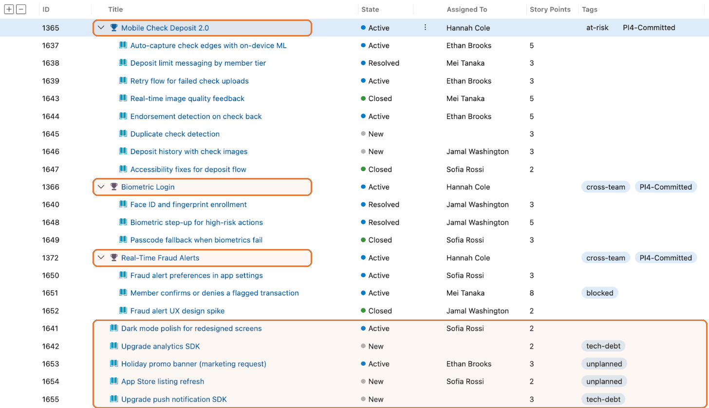
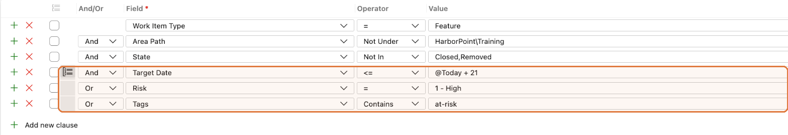
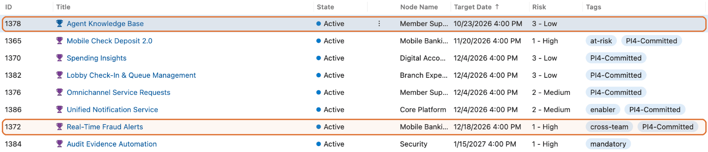
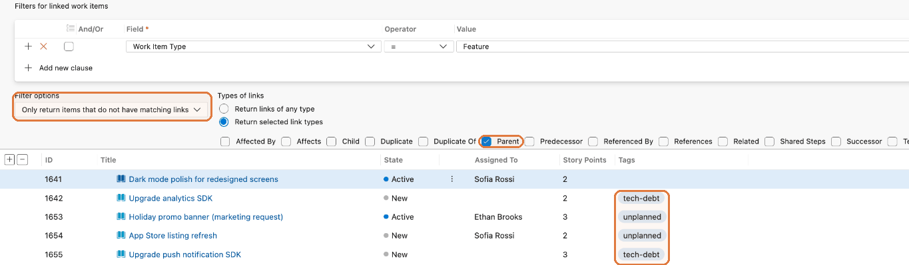
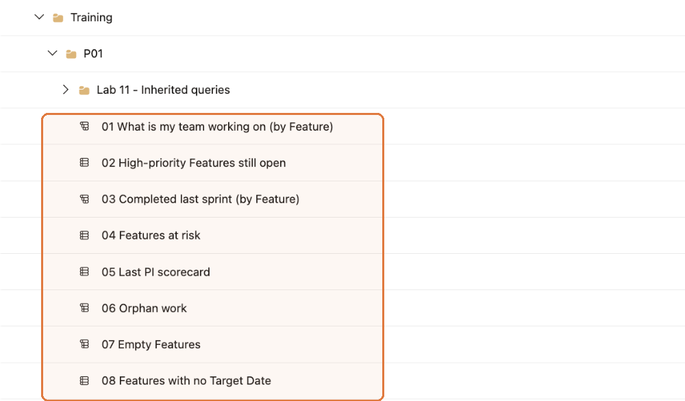

!!! briefing "Mission briefing"
    In Lab 2 you answered Priya's questions by hand, with scratch queries in **My Queries**. That works once; by the third Monday you'll have stopped.

    Now build the **toolkit**: shared, well-named queries that answer the five questions every manager gets asked, at Feature altitude, for anyone who opens them. Then add the queries most managers never think of: work serving *no* priority, and Features with *no* work.

    The clicking is easy; the definitions are the real work. What does "at risk" mean? Who is "my team"? Everyone who reuses a saved query inherits its definition, so it has to be right.

    **Done looks like:** eight queries in `Shared Queries/Training/P##`, each with a one-line judgment of its result:

    - **01–05**, the five questions: my team now (Part 1), high priority and done last sprint (Part 2), at risk (Part 3), last PI (Part 4)
    - **06–08**, the gaps: orphan work, empty Features, missing dates (Part 5)
    - each named so a VP could pick the right one without asking you, and shared where people will find it (Part 6)

<div class="msg" data-initials="RE" data-tone="teal" markdown>
<p class="msg-head"><strong>Ruth Ellison</strong><span>Program Manager, METP · 8:15 AM</span></p>

Thirty years, and every Monday somebody asks me the same five questions. What's the team on? What's high priority and still open? What finished last sprint? What's at risk? How did the last PI land? For twenty of those years I answered by hand. Don't be me. Build them once, put them where people can find them, and **name them like the question they answer**. And when one says "eight Features at risk", don't forward it. Read it.
</div>

## What you'll walk away with

- Queries that stay correct next sprint (`@CurrentIteration`, `@Today + n`, `Under`), without the team-parameter trap
- A rule for picking among the three query types, and the habit of checking a flat count against a tree by Feature
- A defensible at-risk definition, and the discipline to triage its result before forwarding it
- A PI scorecard that separates delivery problems from record problems
- Queries for **orphan work** and **empty Features**, every progress report's two blind spots
- A shared, well-named toolkit your dashboards, colleagues and this course can reuse

## Before you set sail

- **Access:** Basic. You have Contribute on `Shared Queries/Training`, and nowhere else in **Shared Queries**.
- **Find (or create) your folder (2 minutes):** **Boards › Queries**, **All** tab, expand `Shared Queries/Training`. Your instructor may have pre-created `P##` (holding a `Lab 11 - Inherited queries` sub-folder for Day 3). If not, select **New folder** in the toolbar, enter the **Name** `P##`, and pick `Shared Queries/Training` as its location. Every query in this lab goes there: your Day 2 dashboards and the Day 3 capstone reuse them.
- **Read-only:** queries are views, so nothing you build changes anyone's work. Never bulk-edit from results in this lab.
- **The sandbox fence:** thirty participant sandboxes under `HarborPoint\Training` hold copies of real Features. Every project-wide Feature query needs `Area Path` `Not Under` `HarborPoint\Training`, or your classmates' homework fills your portfolio.
- **Names are questions, minus the question mark.** Query names can't contain `?`, `/`, `\`, `:` or `*`. The number prefix keeps the folder in reading order.
- **Time-box:** 60 minutes. Protect Part 3: that's where the judgment lives.

**Pick the query type by the shape of the question.** Every toolkit query uses one of three types, set in the editor's **Query type** box:

| Query type | The question it answers | Your queries |
|---|---|---|
| **Flat list of work items** | "Which items match?" Lists, counts, sorting; the only chartable type | 02, 04, 05, 08 |
| **Tree of work items** | "What does this work serve?" Features with their stories nested underneath | 01, 03 |
| **Work items and direct links** | "What is linked to what, or *missing* a link?" | 06, 07 |

## Part 1 — What is my team working on, by Feature?

**The question:** which Features is my team's sprint actually serving? You answered it by eye in Lab 2. Now make it a query anyone can rerun next sprint.

!!! speedrun "Speed run · 6 minutes"
    Build and save `01 What is my team working on (by Feature)`: the **Features** that `Mobile Banking`'s **current sprint** stories serve, with those stories indented underneath. It must stay correct next sprint without editing.

<div class="timer" data-minutes="6" data-label="Speed run"></div>

??? pilot "Harbor Pilot · Hint 1: Take a bearing"
    "Features with their stories underneath" is a hierarchy question, so use the query type that draws hierarchies. "Correct next sprint" rules out typing `Sprint 14`.

??? pilot "Harbor Pilot · Hint 2: Set the heading"
    **Tree of work items**. Top level: Features. Linked items: User Stories in Mobile Banking's area, with `Iteration Path` `=` `@CurrentIteration` set to the **Mobile Banking** team. Choose **Match linked work items first**, so you climb from the sprint's stories to their Features instead of listing every Feature in the project.

??? pilot "Harbor Pilot · Hint 3: Bring it into port (full solution)"
    1. **Boards › Queries** › **New** › **New query**, **Query type** **Tree of work items**. Below the clause grids, set **Filter options** to **Match linked work items first**; leave **Type of tree** at **Parent/Child**.

    2. **Filters for top level work items**:

        | And/Or | Field | Operator | Value |
        |:--|:--|:--|:--|
        | | Work Item Type | = | `Feature` |

    3. **Filters for linked work items**:

        | And/Or | Field | Operator | Value |
        |:--|:--|:--|:--|
        | | Work Item Type | = | `User Story` |
        | And | Area Path | Under | `HarborPoint\Digital\Mobile Banking` |
        | And | Iteration Path | = | `@CurrentIteration` · team `Mobile Banking` |

        When you pick `@CurrentIteration`, a second box appears beneath the value, holding a team such as `[HarborPoint]\Mobile Banking`. It starts with your current team context; choose **Mobile Banking**.

    4. **Column options**: `Title`, `State`, `Assigned To`, `Story Points`, `Tags`. **Run query**, then **Expand all**.
    5. **Save** as `01 What is my team working on (by Feature)` in `Shared Queries/Training/P##`.

    **Expected result:** three Features with **14** stories beneath them: `Mobile Check Deposit 2.0` (8 stories), `Biometric Login` (3) and `Real-Time Fraud Alerts` (3), which serves priority number one, not Digital Banking's Epic.

    **So what?** The sprint serves three Features, and **some of it serves none**. Count that part next.

    ??? info "Under the hood: WIQL"
        ```sql
        SELECT [System.Id], [System.Title], [System.State],
               [System.AssignedTo], [Microsoft.VSTS.Scheduling.StoryPoints]
        FROM WorkItemLinks
        WHERE ([Source].[System.WorkItemType] = 'Feature')
          AND ([System.Links.LinkType] = 'System.LinkTypes.Hierarchy-Forward')
          AND ([Target].[System.WorkItemType] = 'User Story'
               AND [Target].[System.AreaPath] UNDER 'HarborPoint\Digital\Mobile Banking'
               AND [Target].[System.IterationPath] = @currentIteration('[HarborPoint]\Mobile Banking'))
        MODE (Recursive, ReturnMatchingChildren)
        ```
        The saved form also carries the team's ID inside the `@currentIteration(...)` parameter. Tree queries ignore `ORDER BY`.

<figure class="hp-shot" data-shot="lab03-q1-tree" markdown>
<div class="hp-shot__bar" aria-hidden="true"><i></i><i></i><i></i><span>Boards › Queries › Shared Queries › Training › P## › 01 What is my team working on (by Feature)</span></div>

{ loading=lazy }

<figcaption markdown>Three Features with 14 stories nested beneath them, and then **five stories hanging loose at the bottom**, with no Feature above them. That's 12 points of this sprint serving no part of the portfolio.</figcaption>
</figure>

**Now count.** Mobile Banking's Sprint 14 holds **19** stories; three Features hold 14. The other **five hang loose** at the bottom, flush left: *Match linked work items first* climbs from every matching story to its parent, and these five have none.

They're the 12 orphan points you spotted in Lab 2's Part 1. Here they show, at the bottom where nobody looks; in a Feature rollup they don't exist. Part 5 hunts them down.

!!! reef "Reef ahead: `@CurrentIteration` picks a sprint, not a team"
    HarborPoint's teams share one set of sprints (`HarborPoint\PI 4\Sprint 14` and so on). The team parameter only tells Azure DevOps *whose calendar* to read to work out which sprint is current; it doesn't filter to that team's work. Drop the `Area Path` clause and the query returns all six teams' Sprint 14.

    The opposite mistake is quieter. Point the parameter at a team whose calendar doesn't include today's sprint (one set up only for future planning, say), and Azure DevOps treats its **next** sprint as current: your "this sprint" query plausibly returns next sprint's work. Always check the team parameter, especially after **Save as**: copies keep the original team.

!!! checkpoint "Checkpoint"
    - [ ] `Shared Queries/Training/P##` exists
    - [ ] `01 What is my team working on (by Feature)` returns 3 Features and 14 stories
    - [ ] I can explain why 5 of Mobile Banking's 19 sprint stories sit at the bottom with no Feature above them

!!! takeaway "Takeaway"
    `@CurrentIteration` keeps a query true next sprint, but it picks a sprint, not a team: pair it with an area clause and check whose calendar it reads.

## Part 2 — What's high priority, and what got done?

**The questions:** what have we said matters most, and what did last sprint actually deliver? One is intent, the other evidence, and you'll be asked both every week.

### 02 High-priority Features still open

!!! predict "Make a call"
    Write down two guesses. **How many open Features are marked Priority 1?** And if two competed for the same team, what would decide which comes first? The list and the notes under it test both.

Build a **Flat list of work items**, because this is a plain "which items match?" question:

| And/Or | Field | Operator | Value |
|:--|:--|:--|:--|
| | Work Item Type | = | `Feature` |
| And | Area Path | Not Under | `HarborPoint\Training` |
| And | Priority | = | `1` |
| And | State | Not In | `Closed,Removed` |

Add columns `Node Name` (the last segment of the Area Path: here, the owning team), `State`, `Target Date` and `Tags`. Save it as `02 High-priority Features still open`.

**You should see 5 Features:** `Mobile Check Deposit 2.0`, `Instant Card Controls`, `Real-Time Fraud Alerts`, `Fraud Scoring Engine v2` and `Audit Evidence Automation`.

**So what?** Read the list as a manager, not a query-writer:

- **Two of the five are Security's**, the team you'll find on Day 2 spending most of its sprint on mandatory exam work.
- **One hasn't started.** `Instant Card Controls` is New, tagged `leadership-ask`, due by the end of Sprint 17.
- **All five say Priority 1, so the field ranks nothing.** It's [Lab 1](lab-01-explore-the-program.md)'s lesson again: the order is the decision. Use Priority to *find* candidates, and backlog rank to choose between them.

### 03 Completed last sprint (by Feature)

!!! challenge "Challenge: What did Digital Banking finish last sprint?"
    Build a query that lists the stories **Closed** in **last sprint** by **both** Digital teams, and rolls forward by itself when Sprint 15 starts. Run it as a flat list and note the count. Then switch it to a tree grouped by Feature, and save that as `03 Completed last sprint (by Feature)`.

    Which Features advanced? Which finished? And what does the gap between the two counts tell you?

??? pilot "Harbor Pilot · Hint 1: Take a bearing"
    "Last sprint" relative to now is a macro with an offset. "Both Digital teams" is one area with its children.

??? pilot "Harbor Pilot · Hint 2: Set the heading"
    `Iteration Path` `=` `@CurrentIteration - 1` with team `Mobile Banking` (sprints are shared, so either Digital team gives the same answer), `Area Path` `Under` `HarborPoint\Digital`, `State` `=` `Closed`, `Work Item Type` `=` `User Story`. For the tree, change **Query type**: those clauses move to the linked-items grid, and `Work Item Type = Feature` goes on top.

??? pilot "Harbor Pilot · Hint 3: Bring it into port (full solution)"
    **Flat version** (**Flat list of work items**):

    | And/Or | Field | Operator | Value |
    |:--|:--|:--|:--|
    | | Work Item Type | = | `User Story` |
    | And | Area Path | Under | `HarborPoint\Digital` |
    | And | State | = | `Closed` |
    | And | Iteration Path | = | `@CurrentIteration - 1` · team `Mobile Banking` |

    Type the offset straight into the value box: `@CurrentIteration - 1`. The team box appears beneath it, as before.

    **Expected:** **22** stories: Mobile Banking closed 12 (44 points), Digital Accounts 10 (26 points).

    **Tree version:** **Tree of work items**, **Match linked work items first**, top level `Work Item Type = Feature`, and the four clauses above in the linked grid. Save as `03 Completed last sprint (by Feature)`.

    **Expected:** five Features with **15** stories nested beneath them, and **7** loose at the bottom: `Mobile Check Deposit 2.0` (3), `Biometric Login` (3), `Online Account Opening` (5), `Spending Insights` (2) and `Paperless Statements & Documents` (2), the one that **closed** in Sprint 13.

    **So what?** 22 − 15 = **7 orphan stories**, six of them Mobile's: the 23 of 44 points you found with signal E in Lab 2. Now one saved query shows it every sprint.

!!! note "What the query editor can't tell you: carry-over"
    As in Lab 2, **Was Ever** doesn't support **Iteration Path** (or **Area Path**), so carry-over lives in the **Velocity** report and each item's **History**, not in a query.

!!! checkpoint "Checkpoint"
    - [ ] `02 High-priority Features still open` returns 5 Features
    - [ ] `03 Completed last sprint (by Feature)` shows 5 Features and 15 stories; the flat list holds 22
    - [ ] I can say in one sentence what the 7-story gap means

!!! takeaway "Takeaway"
    A flat count shows how busy a team was; a tree by Feature shows what the work bought. When the first is much bigger, ask what the team did instead.

## Part 3 — Which Features are at risk?

**The question:** which Features should leadership worry about? People will forward this query, so get it right. "At risk" isn't an Azure DevOps field; it's a definition you write, and everyone who uses the query inherits it.

!!! challenge "Challenge: Define “at risk” in one query"
    Build `04 Features at risk`. A Feature is at risk if it is **not finished** and **any** of these is true:

    - its Target Date falls within the next **21 days**
    - its **Risk** is `1 - High`
    - someone tagged it `at-risk`

    Sort by Target Date. Then, **before reading further**, write the one sentence you'd tell Priya about the result.

??? pilot "Harbor Pilot · Hint 1: Take a bearing"
    Three alternatives, one requirement: an **Or** inside a group, joined to the rest by **And**. Without the group, the Or clauses leak and finished Features flood in.

??? pilot "Harbor Pilot · Hint 2: Set the heading"
    Tick the three alternative clauses, select **Group selected clauses**, and set the *first* grouped clause's **And/Or** to **And** (it applies to the whole group). Use `@Today + 21` for the date. Don't forget the sandbox fence.

??? pilot "Harbor Pilot · Hint 3: Bring it into port (full solution)"
    **Flat list of work items**:

    | Group | And/Or | Field | Operator | Value |
    |:-:|:--|:--|:--|:--|
    | | | Work Item Type | = | `Feature` |
    | | And | Area Path | Not Under | `HarborPoint\Training` |
    | | And | State | Not In | `Closed,Removed` |
    | ┌ | And | Target Date | <= | `@Today + 21` |
    | │ | Or | Risk | = | `1 - High` |
    | └ | Or | Tags | Contains | `at-risk` |

    Columns: `Title`, `State`, `Node Name`, `Target Date`, `Risk`, `Tags`. **Column options** › **Sorting**: `Target Date` ascending. Save as `04 Features at risk`.

    **Expected result: 8 Features.** `Agent Knowledge Base`, `Mobile Check Deposit 2.0`, then `Spending Insights`, `Omnichannel Service Requests`, `Lobby Check-In & Queue Management` and `Unified Notification Service` (all due at the end of Sprint 15), then `Real-Time Fraud Alerts` and `Audit Evidence Automation`, there because of their Risk.

    **So what?** Eight matches is not eight risks. **Don't send this list until you've sorted it**: the reef below shows how.

    ??? info "Under the hood: WIQL"
        ```sql
        SELECT [System.Id], [System.Title], [System.State], [System.AreaPath],
               [Microsoft.VSTS.Scheduling.TargetDate], [Microsoft.VSTS.Common.Risk], [System.Tags]
        FROM WorkItems
        WHERE [System.TeamProject] = @project
          AND [System.WorkItemType] = 'Feature'
          AND NOT [System.AreaPath] UNDER 'HarborPoint\Training'
          AND [System.State] NOT IN ('Closed', 'Removed')
          AND ( [Microsoft.VSTS.Scheduling.TargetDate] <= @today + 21
                OR [Microsoft.VSTS.Common.Risk] = '1 - High'
                OR [System.Tags] CONTAINS 'at-risk' )
        ORDER BY [Microsoft.VSTS.Scheduling.TargetDate]
        ```

<figure class="hp-shot" data-shot="lab03-q4-editor" markdown>
<div class="hp-shot__bar" aria-hidden="true"><i></i><i></i><i></i><span>Boards › Queries › Shared Queries › Training › P## › 04 Features at risk › Editor</span></div>

{ loading=lazy }

<figcaption markdown>The bracket beside **Target Date** marks a group: three **Or** alternatives joined to the rest by one **And**. Without it, the Or clauses leak and closed Features flood the list.</figcaption>
</figure>

<figure class="hp-shot" data-shot="lab03-q4-results" markdown>
<div class="hp-shot__bar" aria-hidden="true"><i></i><i></i><i></i><span>Boards › Queries › Shared Queries › Training › P## › 04 Features at risk › Results</span></div>

{ loading=lazy }

<figcaption markdown>Eight Features, sorted by Target Date. `Agent Knowledge Base` is still Active a month past its date. `Real-Time Fraud Alerts`, the portfolio's top priority, is here only because someone set **Risk**: it has no `at-risk` tag.</figcaption>
</figure>

**Why +21 and not +30?** `@Today` moves daily, so a date window is a moving target. In week 2 of Sprint 14, 21 days reaches into Sprint 16 but stops short of its last day, when five Features are due. A 30-day window crosses that line partway through this course, and the list jumps from 8 to 12 without a single Feature changing. Pick the window on purpose.

Now check your sentence against the evidence: **Boards › Backlogs**, team `HarborPoint Team`, **Features** level, with a **Progress by Story Points** rollup column (a per-user setting, so it's safe).

!!! reef "Reef ahead: “Eight Features at risk, escalate them all”"
    If your sentence was "we have eight Features at risk", you just forwarded a query. Look at what the eight are:

    | Why it's on the list | Features | What it really is |
    |---|---|---|
    | Due soon, but nearly done | `Spending Insights` (88%), `Lobby Check-In & Queue Management` (85%), `Unified Notification Service` (82%) | Probably fine: confirm and move on |
    | Past its target, every child Closed | `Agent Knowledge Base` (100%, target was Sprint 12) | **A data problem**: delivered, never closed. Its team returns in Lab 11 |
    | Due soon, data you can't trust | `Omnichannel Service Requests` | Its team's states and estimates are unreliable: unknown, not "at risk" |
    | **Real delivery risk** | `Mobile Check Deposit 2.0` (61%, due this sprint), `Real-Time Fraud Alerts` (4%, priority one), `Audit Evidence Automation` (51%, mandatory exam work) | **These three are your message** |

    And only `Mobile Check Deposit 2.0` carries the `at-risk` tag. `Real-Time Fraud Alerts`, 4% done and the portfolio's top priority, made the list only because someone set its Risk field. **Tags depend on humans.** A query filters what people remembered to record; it isn't a sensor.

!!! insight "Lighthouse insight: a query is a reusable question, so name it like one"
    `04 Features at risk` will outlive this sprint and probably your role. Whoever opens it next inherits your definition of risk without seeing it, so the name must carry the question, and the name or description must show the window, so readers know what "soon" means.

!!! checkpoint "Checkpoint"
    - [ ] `04 Features at risk` returns 8 Features, sorted by Target Date
    - [ ] I sorted the 8 into nearly done, data problem, untrustworthy, and real risk (3)
    - [ ] I can explain why `Real-Time Fraud Alerts` belongs on the list though nobody tagged it

!!! takeaway "Takeaway"
    A query result is a shortlist, not a verdict: triage it before you forward it, because a filter only finds what people remembered to record.

## Part 4 — How did the last PI land?

**The question:** what did PI 3 (Sprints 9 to 12) complete, and what's still open? Leadership wants a scorecard, and its number is the one people will quote.

Build `05 Last PI scorecard` as a **Flat list of work items**:

| And/Or | Field | Operator | Value |
|:--|:--|:--|:--|
| | Work Item Type | In | `Feature,User Story` |
| And | Area Path | Not Under | `HarborPoint\Training` |
| And | Iteration Path | Under | `HarborPoint\PI 3` |

Columns: `Work Item Type`, `Title`, `State`, `Node Name`, `Iteration Path`. Sort by `Work Item Type`, then `State`.

`Under` makes this work. Features are planned against the PI node (`HarborPoint\PI 3`) and stories against its sprints; `Under` catches the node and everything below it, where `=` would return only the Features. A flat list fits: you want every match, sortable and chartable.

**Read the Features first.** Three were planned for PI 3: `Mobile App Redesign` and `Online Appointment Scheduling`, both Closed, and `Agent Knowledge Base`, still **Active** (Part 3's data problem). Did PI 3 deliver two Features or three? Functionally three; the record says two. Someone has to decide which number the PI report uses, and fix the record.

**Then the stories.** Nearly all are Closed. The five exceptions are all Member Support's, all in Sprint 12, which ended weeks ago: three still **Active** (`Escalation rules for priority members`, `Agent presence indicator`, `Request attachment virus scanning`) and two in **Resolved** (`Request status change audit log`, `Request priority levels`). Open work in a closed PI is forgotten, or finished and never closed. Neither is a delivery problem, but both make reports lie.

!!! reef "Reef ahead: “open” means more than `<> Closed`"
    The quick "still open" is `State <> Closed`. It also counts **Removed** items, descoped and never to be done, and **Resolved** ones, which may be finished and waiting to be closed. Use `State Not In Closed,Removed` for "not finished", and look at Resolved separately. One of Leo's dashboard queries makes this exact mistake; you'll audit it in Lab 11.

!!! checkpoint "Checkpoint"
    - [ ] `05 Last PI scorecard` shows 3 PI 3 Features: 2 Closed and 1 still Active
    - [ ] I can name the team whose PI 3 stories aren't Closed, and why that's a data problem, not a delivery one

!!! takeaway "Takeaway"
    Open work in a closed PI is usually a record problem, not a delivery one, so decide which number is true and fix the record before it goes in a report.

## Part 5 — The queries nobody thinks to write

**The question:** what is missing from the picture? These three queries look for gaps: work with no Feature, Features with no work, and Features with no date.

!!! challenge "Challenge: Find the orphans"
    Save `06 Orphan work`: every **User Story** in **Mobile Banking**'s **current sprint** with **no parent Feature**. You'll need the query type you haven't used yet. How many stories, and how many points?

??? pilot "Harbor Pilot · Hint 1: Take a bearing"
    "Has no link of a certain kind" is a question about links, not fields or hierarchy. One query type is built for exactly that.

??? pilot "Harbor Pilot · Hint 2: Set the heading"
    **Work items and direct links**. Top level: Mobile Banking's current-sprint stories. Linked items: Features, through the **Parent** link only. Then find the filter option that returns items **without** matching links.

??? pilot "Harbor Pilot · Hint 3: Bring it into port (full solution)"
    **Query type**: **Work items and direct links**.

    **Filters for top level work items**:

    | And/Or | Field | Operator | Value |
    |:--|:--|:--|:--|
    | | Work Item Type | = | `User Story` |
    | And | Area Path | Under | `HarborPoint\Digital\Mobile Banking` |
    | And | Iteration Path | = | `@CurrentIteration` · team `Mobile Banking` |

    **Filters for linked work items**: `Work Item Type` `=` `Feature`.

    **Filter options** (below the clause grids): **Only return items that do not have matching links**. **Types of links**: **Return selected link types**, ticking only **Parent** in the link-type checkboxes.

    Columns: `Title`, `State`, `Assigned To`, `Story Points`, `Tags`. Save as `06 Orphan work`.

    **Expected: 5 stories, 12 points.** `Dark mode polish for redesigned screens`, `Upgrade analytics SDK`, `Holiday promo banner (marketing request)`, `App Store listing refresh` and `Upgrade push notification SDK`. Two are tagged `unplanned` and arrived mid-sprint; two are tagged `tech-debt`.

    Widen it to `Area Path` `Under` `HarborPoint\Digital` and you'll find **6**: Digital Accounts has one.

    **So what?** The five loose stories from your Part 1 tree now have a list of their own, which Lab 5 turns into a dashboard tile. **Once it's counted, someone has to answer for it.**

<figure class="hp-shot" data-shot="lab03-q6-orphans" markdown>
<div class="hp-shot__bar" aria-hidden="true"><i></i><i></i><i></i><span>Boards › Queries › Shared Queries › Training › P## › 06 Orphan work (Work items and direct links)</span></div>

{ loading=lazy }

<figcaption markdown>The one query type that can ask *what's missing*: **Only return items that do not have matching links**, with only **Parent** ticked. Five stories, 12 points: two `unplanned` asks and two `tech-debt` upgrades.</figcaption>
</figure>

**Judgment:** not all orphan work is bad; SDK upgrades are real hygiene. The problem is that it's **invisible**: it moves no Feature, so it reads as "the team is slow" when the team is busy with work nobody prioritized. The fix isn't a ban but a home: give tech debt its own Feature, and make mid-sprint requests an explicit trade-off.

!!! challenge "Challenge: Find the empty Feature"
    Save `07 Empty Features`: Features (outside the sandboxes, not Removed) with **no child work items at all**. What did you find, and is it a problem *yet*?

??? pilot "Harbor Pilot · Hint 1: Take a bearing"
    Same query type as the orphans, pointing the other way: ask Features about their children instead of stories about their parent.

??? pilot "Harbor Pilot · Hint 2: Set the heading"
    Top level: fenced, non-Removed Features. Linked: stories and bugs. Which single link type points *down*?

??? pilot "Harbor Pilot · Hint 3: Bring it into port (full solution)"
    **Query type**: **Work items and direct links**. **Filters for top level work items**:

    | And/Or | Field | Operator | Value |
    |:--|:--|:--|:--|
    | | Work Item Type | = | `Feature` |
    | And | Area Path | Not Under | `HarborPoint\Training` |
    | And | State | <> | `Removed` |

    **Filters for linked work items**: `Work Item Type` `In` `User Story,Bug`. **Filter options**: **Only return items that do not have matching links**. **Types of links**: **Return selected link types**, with only **Child** ticked.

    **Expected: 1 Feature.** `Member-to-Member Transfers`: Mobile Banking, Sprints 17 to 20, Business Value 20, zero stories.

    **So what?** It isn't late; it hasn't started. But PI 5 planning begins in Sprint 17, and **a Feature with no stories can't be sized or forecast**. It's a planning risk, yours to raise with Hannah Cole now.

!!! speedrun "Speed run · 3 minutes: the trick question"
    Which Features have **no Target Date**? Build it, run it, and decide whether to save it.

<div class="timer" data-minutes="3" data-label="Speed run"></div>

??? pilot "Harbor Pilot · Hint 1: Take a bearing"
    `Is Empty` works only on text and HTML fields. For a date, there's another way to say "blank".

??? pilot "Harbor Pilot · Hint 2: Set the heading"
    `Target Date` `=` with the **Value** left empty means "has no value". Add the Feature type and the sandbox fence.

??? pilot "Harbor Pilot · Hint 3: Bring it into port (full solution)"
    **Flat list of work items**: `Work Item Type = Feature` · `Area Path Not Under HarborPoint\Training` · `Target Date =` *(blank)*.

    **Expected: zero.** All 24 of HarborPoint's Features have a Start and a Target Date, which is why Delivery Plans and your at-risk query work at all. Good news, **if the query is right.** Prove it: change the operator to `<>` (blank value means "has a value") and you should get all **24**.

    **So what?** **A zero you haven't tested is just a hope.** Save it as `08 Features with no Target Date` anyway: an empty query today is a smoke alarm for the day someone adds an undated Feature.

!!! checkpoint "Checkpoint"
    - [ ] `06 Orphan work` returns 5 stories (12 points) for Mobile Banking's current sprint
    - [ ] `07 Empty Features` returns `Member-to-Member Transfers`
    - [ ] I proved my zero-result query by flipping its operator and getting 24

!!! takeaway "Takeaway"
    Progress reports show only work linked to a Feature, so query for what's missing, and test every zero before you trust it.

## Part 6 — Make the toolkit travel

**The question:** how will anyone else find and use it? A toolkit nobody opens is a hobby.

<figure class="hp-shot" data-shot="lab03-toolkit-folder" markdown>
<div class="hp-shot__bar" aria-hidden="true"><i></i><i></i><i></i><span>Boards › Queries › All › Shared Queries › Training › P##</span></div>

{ loading=lazy }

<figcaption markdown>The finished toolkit: eight questions, numbered in reading order, in a shared folder where dashboards can use them. The icons tell you the query type at a glance: flat, tree or direct links.</figcaption>
</figure>

- **Favorite the ones you'll use:** the star next to `01`, `04` and `06` on the **All** tab puts them on your **Favorites** tab.
- **Send the link, not a screenshot:** **More actions** (…) › **Copy query URL** gives anyone in the project the live result. **My Queries** links work only for you.
- **Email a snapshot:** **More actions** › **Email query**. Recipients must be individual project members; emails to yourself aren't delivered.
- **Follow what matters:** **Follow** `Real-Time Fraud Alerts` to be notified when it changes. A query with `ID In @Follows` becomes your watchlist.
- **Coming up:** in Lab 5 these become dashboard tiles, which accept only **shared** queries.

### Your macro and operator cheat sheet

| Use | When | Watch out |
|---|---|---|
| `@CurrentIteration` / `@CurrentIteration - 1` | Iteration Path, `=` | Its team parameter picks the calendar, not the work: add an area clause. A team without today's sprint silently uses its next one |
| `@Today + n` / `@Today - n` | Any date field | Moves daily. Choose the window deliberately and name it |
| `@TeamAreas` | Area Path, `=` only | Web portal only: not Excel, the REST API, or notification filters |
| `Under` / `Not Under` | Area and Iteration Path | Includes the node and everything below it: ideal for PIs and team trees |
| `In` / `Not In` | Any field | Comma-separated values: `Closed,Removed` |
| `Contains` | Tags | One clause per tag. Can't find items with *no* tags. Matches only the spelling you type |
| `Contains Words` | Title, Description, other long text | Faster full-text search, for text, not tags |
| `=` *(blank)* / `<>` *(blank)* | Non-text fields | "Has no value" / "has a value". `Is Empty` works only on text fields |
| `Was Ever` | State, Assigned To | **Not** Iteration Path or Area Path. Carry-over lives in Velocity and History |

!!! takeaway "Takeaway"
    A query helps only when others can find it and trust it: save it shared, name it like the question it answers, and send the live link, not a screenshot.

## Knowledge check

<div class="quiz" markdown>

**`04 Features at risk` returns 8 Features. Priya asks for "the at-risk list" for Dana. What do you send?**

- [ ] The query link, since it's live and always current
- [ ] All 8 Features, because they all matched the definition
- [x] The 3 real delivery risks with a line of evidence each, noting that 1 is a data problem and 1 can't be assessed yet
- [ ] Only the Features tagged `at-risk`, since those are the ones teams flagged themselves

<div class="quiz-why" markdown>
A query is a high-recall shortlist, not a verdict: three of the eight are nearly done, one is finished but never closed, and one has data you can't trust. The tag-only option is worse still: it drops `Real-Time Fraud Alerts`, the number one priority at 4% done.
</div>

</div>

<div class="quiz" markdown>

**A colleague copies your `03 Completed last sprint (by Feature)` with Save as, points its team parameter at a planning team that selects only future sprints, and gets 8 stories instead of 22, all from Sprint 14. What happened?**

- [ ] Most of last sprint's stories were reopened
- [x] The planning team's calendar doesn't include today's sprint, so its "current" sprint is the next one, and `@CurrentIteration - 1` lands on this sprint
- [ ] Tree queries can't use macros reliably
- [ ] Save as drops the Area Path clause

<div class="quiz-why" markdown>
`@CurrentIteration` reads a team's sprint calendar. A team that doesn't select today's sprint quietly gets its *next* sprint as "current", so the query returns real-looking results from the wrong sprint. Check the team parameter, and sanity-check the results' Iteration Path column.
</div>

</div>

<div class="quiz" markdown>

**Last sprint, Digital Banking closed 22 stories, but your tree by Feature shows only 15. What does the gap most likely tell you?**

- [ ] The tree query is broken
- [ ] Seven stories were closed in the wrong sprint
- [x] Seven stories had no parent Feature, so they advanced no portfolio priority
- [ ] Tree queries only show the first 15 results

<div class="quiz-why" markdown>
A Parent/Child tree shows only children that have a parent. The flat list counts everything closed; the tree counts what moved a Feature. Mobile Banking's orphans carried 23 of 44 points, more than half the sprint.
</div>

</div>

## Captain's log

!!! log "Captain's log"
    1. Which of the five standard questions do *you* get asked most, and how long does it take to answer today?
    2. Write your organization's definition of "at risk" in one sentence. Could you express it as a query? If not, what's missing from your data?
    3. How much of your teams' work last sprint served no Feature? Have you ever measured it?
    4. Which tag or field in your reports relies on someone remembering to set it?
    5. Who else would benefit from your toolkit, and where would they look for it?

!!! bonus "Extra knots"
    1. **The silent slip.** `Fraud Scoring Engine v2` is Priority 1, and earlier this sprint its Target Date was pushed back two sprints, yet it's not on your at-risk list. Why not? Sketch a clause that would catch it. (Hint: the query editor has no clean one. What does that tell you about where "the date moved" lives?)
    2. **Program-wide orphans.** Save a copy of `06 Orphan work` as `06b Orphan work (all teams)`. Replace the area clause with `Area Path` `Not Under` `HarborPoint\Training`, and set the team parameter on `@CurrentIteration` to `HarborPoint Team`. Which team has the most orphans this sprint, and does it matter?
    3. **Late deliveries.** Use a field-to-field comparison (`Closed Date` `>` **[Field]** `Target Date`) to find Features that closed after their target. What does an empty result mean here, and how would you test it?

!!! harbor "Back in your own harbor"
    Three moves for your first week back, about 30 minutes in your own Azure DevOps:

    1. **Save one question where others can find it.** Build the question you're asked most as a query, and save it in a **Shared Queries** folder where you have Contribute (ask your admin for one if you don't). Name it like the question, minus the question mark: shared queries are visible project-wide, so a vague name misleads people you'll never meet.
    2. **Find your team's orphan work.** Build a **Work items and direct links** query: one team's current-sprint user stories on top, `Work Item Type` `=` `Feature` below, **Only return items that do not have matching links**, and only **Parent** ticked. It returns the work no Feature report will ever show you.
    3. **Define "at risk" once, on purpose.** Build one at-risk query with a grouped **Or** (a Target Date window with `@Today + n`, a Risk value, an `at-risk` tag) and put the window in its name. Then read every result before you send it.

## Key takeaways

- **A macro picks a sprint, not a team.** `@CurrentIteration` keeps a query true next sprint. Pair it with an area clause, and check whose calendar it reads.
- **Busy is not bought.** A flat count shows activity; a tree by Feature shows what the work bought. **Flat** for lists and charts, **tree** for "what does this serve?", **direct links** for "what's missing?".
- **A result is a shortlist, not a verdict.** Triage every at-risk result before you forward it. A filter finds only what people remembered to record, so distrust your tags.
- **Fix the record before the report.** Open work in a closed PI is usually forgotten or finished-but-never-closed. Decide which number is true, then fix the state.
- **Query for what's missing.** Orphan work and empty Features are every progress report's blind spots. Test every zero by flipping its operator.
- **Name it like the question.** A saved query is a definition everyone inherits. Save it shared, make its window explicit, and send the link, not a screenshot.
