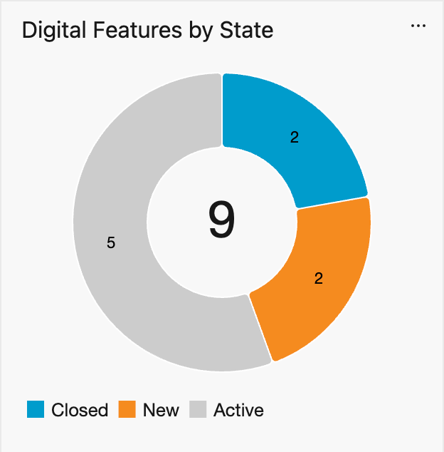
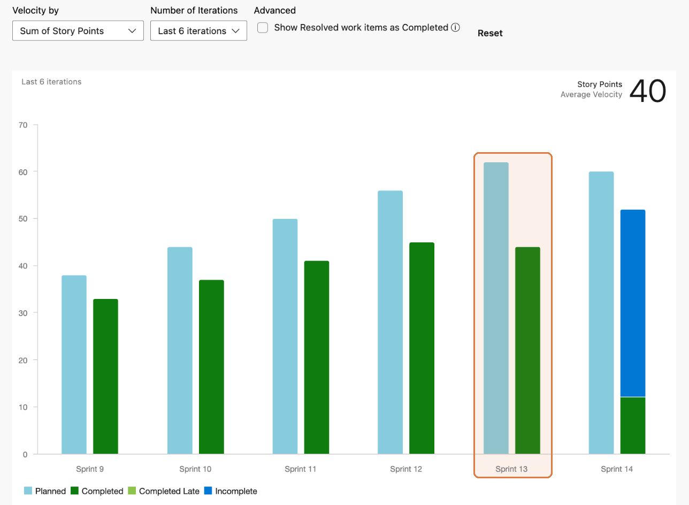
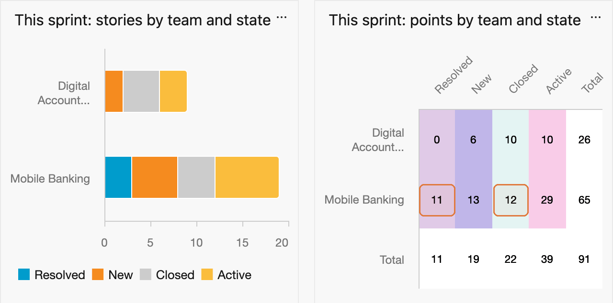
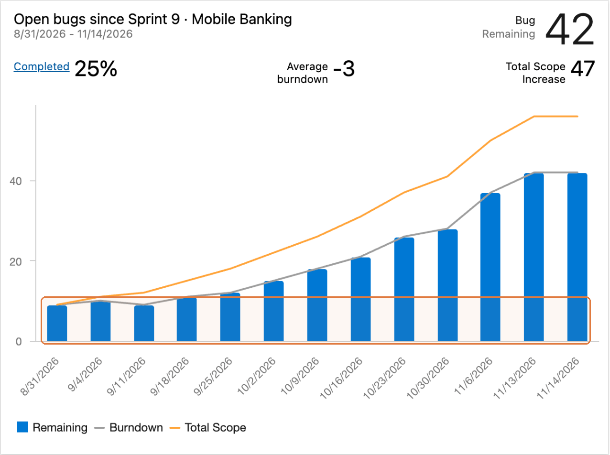
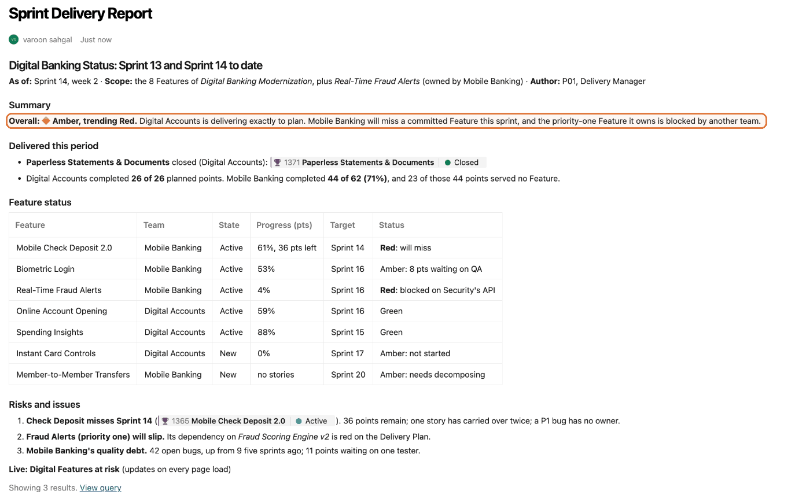

!!! briefing "Mission briefing"
    Leadership wants a Digital Banking update: what was delivered, what's outstanding, and what's at risk. The evidence is already scattered across your query toolkit, two teams' Velocity reports and a portfolio backlog. Now it has to become something a busy executive can read in two minutes and trust.

    Charts are the obvious tool, and the most dangerous one. A chart persuades before anyone checks it. The same data can say "on track" or "in trouble" depending on what you count, the window you pick and what you compare. So you'll build the charts, deliberately make some of them lie, and then write a report that survives the CIO asking "how do you know?"

    **Done looks like**, one line per Part:

    1. The Digital portfolio charted, and your report's scope decided
    2. Each Digital team read against its own plan, and this sprint charted by team and state
    3. The bug trend read over five sprints, not one week
    4. Two charts that lie with real data, each paired with the honest view
    5. The wiki page `/Training/P##/Sprint Delivery Report`: a RAG status you can defend, a Feature table, risks and asks

<div class="msg" data-initials="PR" data-tone="teal" markdown>
<p class="msg-head"><strong>Priya Raman</strong><span>Director, Digital Banking · 1:10 PM</span></p>

Dana wants a Digital Banking update for her staff meeting: what we delivered last sprint, where this sprint stands, what's outstanding and what's at risk. **One page.** Use charts if they help, not if they decorate. Marcus will be in the room, so every number needs to survive "how do you know?" And please don't hand me a green status unless it's actually green.
</div>

## What you'll walk away with

- Decide a report's scope out loud, and name each chart for the one question it answers
- Read each team against its own plan, within the limits of what query charts can draw
- Treat the bug backlog as unfinished work, and read its trend
- Spot how true data tells a false story: counts versus size, cherry-picked windows, mismatched scales, percentages without a deadline
- Write a one-page status report with a RAG rating you can defend and asks that name a person

## Before you set sail

- **Access:** Basic. If you can't see a **Charts** tab on a saved query, you have Stakeholder access. Tell your instructor.
- **Charts work only on saved flat queries.** Tree and direct-link queries can't be charted. Save every chart query in `Shared Queries/Training/P##` (you created it in [Lab 3](lab-03-query-toolkit.md); if not, create it now). Charts on **My Queries** are visible only to you, and they can't be added to a dashboard.
- **Names for today:** `10 Digital Features (chart)`, `11 Digital stories this sprint (chart)`, `12 Open Digital bugs (chart)`.
- **Team views you'll read:** `Mobile Banking` and `Digital Accounts` (Velocity), and `Digital Portfolio` (Features backlog). Report settings and column options are per user, so adjust freely.
- **Time-box:** 50 minutes. Save 15 for the report in Part 5. That's the deliverable, and the charts exist to serve it.

## Part 1 — What does Digital Banking's portfolio look like?

Before you report on "Digital Banking", decide what it includes. Your first chart forces the choice.

!!! speedrun "Speed run · 8 minutes"
    Build `10 Digital Features (chart)`: every **Feature** owned by a team under `HarborPoint\Digital`, with a **pie chart by State**. Then answer: how many Features, and how many in each state?

<div class="timer" data-minutes="8" data-label="Speed run"></div>

??? pilot "Harbor Pilot · Hint 1: Take a bearing"
    A flat query, saved to your shared folder first. The chart lives on the query's **Charts** tab.

??? pilot "Harbor Pilot · Hint 2: Set the heading"
    `Work Item Type` `=` `Feature` and `Area Path` `Under` `HarborPoint\Digital`. Save it, then **Charts** › **New chart** › **Pie**, **Group by** `State`, **Aggregation** **Count** of work items.

??? pilot "Harbor Pilot · Hint 3: Bring it into port (full solution)"
    1. **Boards › Queries** › **New** › **New query**, **Flat list of work items**:

        | And/Or | Field | Operator | Value |
        |:--|:--|:--|:--|
        | | Work Item Type | = | `Feature` |
        | And | Area Path | Under | `HarborPoint\Digital` |

    2. **Column options**: `Title`, `State`, `Node Name`, `Target Date`, `Tags`. **Save** as `10 Digital Features (chart)` in `Shared Queries/Training/P##`.
    3. **Charts** › **New chart** (if it's greyed out, open **Results** once so the query runs, then come back). In **Configure chart**, pick **Pie** under **Chart type**, **Name** it `Digital Features by State`, set **Group by** to `State` and leave **Aggregation** at **Count** of work items. Select **Save chart**.

    **Expected:** **9** Features. **Active 5** (`Mobile Check Deposit 2.0`, `Biometric Login`, `Online Account Opening`, `Spending Insights`, `Real-Time Fraud Alerts`), **Closed 2** (`Mobile App Redesign`, `Paperless Statements & Documents`) and **New 2** (`Member-to-Member Transfers`, `Instant Card Controls`).

    **So what?** Lab 1 counted eight. Find out why before either number goes in your report.

<figure class="hp-shot" data-shot="lab04-features-pie" markdown>
<div class="hp-shot__bar" aria-hidden="true"><i></i><i></i><i></i><span>Boards › Queries › Shared Queries › Training › P## › 10 Digital Features (chart) › Charts</span></div>

{ loading=lazy }

<figcaption markdown>Nine Features by Area Path: five Active, two Closed, two New. Lab 1 counted *eight* under the Epic. The ninth is `Real-Time Fraud Alerts`, built by a Digital team but serving another Epic.</figcaption>
</figure>

**Wait: nine?** Lab 1 counted **8** Features under *Digital Banking Modernization*. The ninth, `Real-Time Fraud Alerts`, sits in a Digital area because Mobile Banking builds it. But it serves the number one Epic, *Fraud Detection & Security*.

Neither number is wrong. They answer different questions:

| Scope | Answers | Count |
|---|---|---|
| **By Area Path** (who builds it) | "What are my teams delivering?" | 9 |
| **By Epic** (what it serves) | "How is the Digital Banking initiative doing?" | 8 |

Leadership asked about the *initiative*, so your report covers the 8. But the ninth belongs to Mobile Banking, it's priority #1, and it's in trouble. A report scoped strictly to the Epic would leave out the most important thing your teams are building. **Decide your scope out loud**, and put it on the page.

!!! insight "Lighthouse insight: every chart answers exactly one question"
    Before you build a chart, write the question it answers in its title. "Digital Features by State" is a title. "Is the Digital Banking initiative on track?" is a question, and a pie by state can't answer it: it shows how many Features sit in each state, not how much work is left or when it's due. If the chart can't answer the question in its title, you need a different chart.

!!! checkpoint "Checkpoint"
    - [ ] `10 Digital Features (chart)` has a pie showing 9 Features: Active 5, Closed 2, New 2
    - [ ] I can explain the difference between the 9 (area) and the 8 (Epic), and I've decided which one my report uses

!!! takeaway "Takeaway"
    "Who builds it" and "what it serves" give different counts, and both are right, so choose your scope before you chart and say it on the page.

## Part 2 — What got done, against what was planned?

The first question in any status meeting: did each team deliver what it said it would, and is this sprint going the same way?

### Read the Velocity reports

For each Digital team: **Boards › Backlogs**, pick the team, **Stories** level, the **Analytics** tab, then **View full report** on the **Velocity** card. The report opens on **Count of Work Items**, so set **Velocity by** to **Sum of Story Points**. Hover over a sprint's bars to read **Planned**, **Completed** and **Incomplete**.

Fill in Sprint 13:

| Team | Planned (pts) | Completed (pts) | Completed ÷ Planned |
|---|---|---|---|
| Mobile Banking | | | |
| Digital Accounts | | | |

<figure class="hp-shot" data-shot="lab04-velocity-mobile" markdown>
<div class="hp-shot__bar" aria-hidden="true"><i></i><i></i><i></i><span>Boards › Backlogs › Mobile Banking › Analytics › Velocity</span></div>

{ loading=lazy }

<figcaption markdown>Completed points climb from 33 to 45, then dip to **44** against **62** planned in Sprint 13. Planned grows faster than Completed every sprint.</figcaption>
</figure>

!!! predict "Make a call"
    **Which team delivered more last sprint?** Commit to an answer before you open the hint.

??? pilot "Harbor Pilot · Hint: the numbers"
    | Team | Planned | Completed | Completed ÷ Planned |
    |---|---|---|---|
    | Mobile Banking | 62 | 44 | **71%** |
    | Digital Accounts | 26 | 26 | **100%** |

    **So what?** The trend matters as much as the sprint. Mobile's completion rate has fallen every sprint: 87%, 84%, 82%, 80%, then 71%. Digital Accounts has completed at least 89% of its plan in each of the last five sprints, and all of it in three.

    **Rising points, flat count.** Switch **Velocity by** to **Count of Work Items**. Mobile's bars flatten to roughly a dozen stories a sprint, while its points climbed from 33 to 45. You'll take that apart in [Lab 6](../day-2/lab-06-which-team-needs-help.md).

!!! reef "Reef ahead: “Mobile delivered 44, Digital Accounts only 26”"
    If you answered "Mobile Banking", you compared two teams' Story Points as if they were the same currency. They aren't. Each team sizes its own work, so 44 Mobile points and 26 Digital Accounts points compare no better than 44 euros and 26 dollars. The only fair comparison is each team **against its own plan**. On that measure, Digital Accounts did everything it promised and Mobile Banking missed by almost a third.

    Three more things the Velocity chart won't say out loud:

    - **Planned is a day-one snapshot.** The 5 points Mobile added mid-sprint in Sprint 14 never appear as planned work.
    - **Resolved isn't Completed.** Mobile has 11 points in Resolved right now, waiting for its one tester.
    - **Bugs with no sprint are invisible.** Velocity counts only what was planned into a sprint. Mobile's bugs sit on the backlog with no sprint, so however many get fixed, they never show up here.

### Chart this sprint, by team and state

1. Build `11 Digital stories this sprint (chart)` as a flat query:

    | And/Or | Field | Operator | Value |
    |:--|:--|:--|:--|
    | | Work Item Type | = | `User Story` |
    | And | Area Path | Under | `HarborPoint\Digital` |
    | And | Iteration Path | = | `@CurrentIteration` · team `Mobile Banking` |

    Columns: `Title`, `State`, `Node Name`, `Story Points`, `Parent`. Save it.

2. **New chart** › **Stacked bar**: **Y-axis** `Node Name`, **Group by** `State`, **Count** of work items. **Name**: `This sprint: stories by team and state`.
3. **New chart** › **Pivot table**: **Rows** `Node Name`, **Columns** `State`, **Aggregation** **Sum** of `Story Points`. **Name**: `This sprint: points by team and state`.

**You should see:**

| Team | Closed | Resolved | Active | New | Total |
|---|---|---|---|---|---|
| Mobile Banking | 4 stories · 12 pts | 3 · 11 pts | 7 · 29 pts | 5 · 13 pts | **19 · 65 pts** |
| Digital Accounts | 4 · 10 pts | – | 3 · 10 pts | 2 · 6 pts | **9 · 26 pts** |

<figure class="hp-shot" data-shot="lab04-sprint-pivot" markdown>
<div class="hp-shot__bar" aria-hidden="true"><i></i><i></i><i></i><span>Boards › Queries › Shared Queries › Training › P## › 11 Digital stories this sprint (chart) › Charts</span></div>

{ loading=lazy }

<figcaption markdown>Two charts on one query. Mobile Banking has **Closed 12** of its 65 points with **11 more sitting in Resolved**; Digital Accounts has closed 10 of 26 with nothing queued for test.</figcaption>
</figure>

**So what?** We're six or seven days into a ten-day sprint. Digital Accounts has closed 38% of its points, with a normal amount of work in flight. Mobile Banking has closed **18%**. Even if all three Resolved stories pass QA today, it reaches 35%, with 29 points still Active and 13 not started. This sprint is going the way the last one went.

!!! info "What query charts can't do"
    Plan your report around these limits, not into them:

    | You want to… | Reality |
    |---|---|
    | Chart a tree or direct-links query | Not possible. **Flat** queries only |
    | Group by **Parent**, **Tags** or **Title** | Not offered on the Queries page, even when they're columns. (Dates are offered. The **Chart for Work Items** dashboard widget can group by Tags, Lab 5) |
    | Group by team | Use **Node Name**. Area Path and Iteration Path show only the last segment, so same-named nodes merge |
    | Show more than 8 categories | The rest roll up into *(other)* |
    | Trend a big query | Keep trend queries to 1,000 items or fewer |
    | Show progress % per Feature | Not a chart. Use the backlog's rollup columns |

!!! checkpoint "Checkpoint"
    - [ ] I recorded Sprint 13 Planned vs Completed for both teams (62/44 and 26/26)
    - [ ] My pivot shows Mobile Banking at 12 of 65 points Closed and 11 in Resolved
    - [ ] I can say why comparing the two teams' velocity is meaningless

!!! takeaway "Takeaway"
    Story Points are each team's private currency, so judge a team by Completed ÷ Planned and its trend, never by its points against another team's.

## Part 3 — What's outstanding: the quality trend

Unfinished stories are only half of what's outstanding. The other half is the bug backlog, and it quietly eats next sprint's capacity.

1. Build `12 Open Digital bugs (chart)`:

    | And/Or | Field | Operator | Value |
    |:--|:--|:--|:--|
    | | Work Item Type | = | `Bug` |
    | And | Area Path | Under | `HarborPoint\Digital` |
    | And | State | <> | `Closed` |

    Columns: `Title`, `State`, `Priority`, `Severity`, `Node Name`, `Assigned To`. (Bugs have no Removed state, so `<> Closed` is safe here.) Save it.

2. **New chart** › **Stacked bar**: **Y-axis** `Node Name`, **Group by** `Priority`, **Count** of work items. **Name** it `Open Digital bugs by priority` and select **Save chart**.

**You should see 46 open bugs today:** **42** in Mobile Banking and **4** in Digital Accounts. Mobile's 42 break down as Priority 1: **4**, Priority 2: **14**, Priority 3: **18**, Priority 4: **6**. Three are Severity **1 - Critical**.

That's a snapshot. The question a manager needs answered is *which way is it heading?*

!!! predict "Make a call"
    Mobile Banking has 42 open bugs today. **How many do you think it had at the start of Sprint 9, five sprints ago?** And will Digital Accounts' trend tell the same story or a different one? Write down both guesses, then check them on the dashboard.

Now open **Overview › Dashboards** › `HarborPoint Program Overview` and scroll to the bottom. The program office has pinned two **Burndown** widgets there, one per Digital team, counting **open bugs week by week since the start of Sprint 9**. The blue bars are bugs still open at the end of each week. The orange **Total Scope** line is every bug filed in that window.

<figure class="hp-shot" data-shot="lab04-bug-trend" markdown>
<div class="hp-shot__bar" aria-hidden="true"><i></i><i></i><i></i><span>Overview › Dashboards › Burndown widget · Mobile Banking · Bugs · weekly since Sprint 9</span></div>

{ loading=lazy }

<figcaption markdown>Open Mobile Banking bugs, week by week: **9 at the start of Sprint 9, 42 today.** The orange Total Scope line keeps pulling away from the bars, so bugs are being filed faster than they're fixed.</figcaption>
</figure>

**You should see** Mobile Banking's bars climb from **9** to **42**, steepening in Sprint 13. Digital Accounts' widget stays low and flat, ending at **4**.

!!! info "Why not a trend chart on your query?"
    The **Charts** tab offers trend types too (**Stacked area**, **Area**, **Line**, with a **Rolling period** of up to a year). They replay the work-tracking store's change log, and HarborPoint's history was loaded in one go, so here they start on the day the environment was built.

    **Burndown**, **Burnup**, **Velocity**, **CFD** and the cycle-time widgets read **Analytics**, which uses each change's business date. Prefer them for trends in your own projects too: they span many sprints, filter by team, and show total scope alongside the open count.

**So what?** In Sprint 13, Mobile opened 13 bugs and closed 2. A team doing that isn't finishing work. It's moving it from the sprint backlog to the bug backlog. A nearly fivefold rise in open bugs over five sprints is what "velocity going up" looks like from the other side.

!!! checkpoint "Checkpoint"
    - [ ] I read the bug trend on the Program Overview: Mobile Banking climbing from 9 to 42, Digital Accounts flat at about 4
    - [ ] I know how many of Mobile's open bugs are Priority 1 (4) and Critical (3)

!!! takeaway "Takeaway"
    Open bugs are unfinished work: a team that files them faster than it fixes them is moving work off the sprint, not finishing it.

## Part 4 — Make the chart lie

Before you write up the evidence, see how easily true data tells a false story. You'll spot a misleading chart faster once you've built one.

!!! challenge "Challenge: Make the chart lie, then make it honest"
    Pick **two** of these headlines and build a chart (or set up a report view) that genuinely seems to support each one, using only real HarborPoint data:

    1. **"Mobile Banking is on track."**
    2. **"The bug situation is under control."**
    3. **"Mobile Banking delivers 70% more than Digital Accounts."**

    For each, write down: **what makes it misleading**, and **what you'd show instead**.

??? pilot "Harbor Pilot · Hint 1: Take a bearing"
    Lies in charts come from three places: **what you count** (items or size), **when you look** (the time window), and **what you compare** (things on different scales).

??? pilot "Harbor Pilot · Hint 2: Set the heading"
    1. Open `10 Digital Features (chart)`, **Save as** a copy with the area narrowed to Mobile Banking, and look at its pie.
    2. On the Program Overview's Mobile bug widget, cover everything except the last two bars.
    3. Open both teams' Velocity reports side by side and read only the Sprint 13 Completed bars.

??? pilot "Harbor Pilot · Hint 3: Bring it into port (full solution)"
    | Headline | The lie | The trap | Show this instead |
    |---|---|---|---|
    | "Mobile is on track" | Pie of Mobile's 5 Features by State: 1 Closed, 3 Active, 1 New. "Four out of five done or under way" | **Counting items, not size.** Every Feature gets an equal slice. That hides that `Mobile Check Deposit 2.0` is due *this sprint* with 36 points left, and that `Real-Time Fraud Alerts` is at 4% | A Feature table with progress by points, remaining points and Target Date |
    | "Bugs are under control" | The last week of the bug trend: 42, then 42. "Bugs have stabilized" | **A cherry-picked window.** Over five sprints it's 9 → 42 | The full window since Sprint 9, plus opened versus closed per sprint (Sprint 13: 13 opened, 2 closed) |
    | "Mobile delivers 70% more" | Sprint 13 Completed: 44 vs 26 | **Mismatched scales.** Points are team-specific (the Part 2 reef), and Mobile's own points are inflating while its story count stays flat | Each team against its own plan: 71% vs 100%, with the five-sprint trend |

    **So what?** The tell is the same every time: the chart answers a narrower question than its headline claims. Before you forward any chart, including your own, ask what its headline would need to be true.

!!! reef "Reef ahead: “61% done”"
    The fourth trap hides in Feature tables: **a percentage without a deadline.** `Mobile Check Deposit 2.0` is 61% complete by Story Points. That sounds like solid progress. But it's due at the **end of this sprint**, and 61% of 93 points leaves **36 points** with a few working days to go. That's more than a full sprint of Mobile's work on this Feature. A percentage without a deadline is a mood, not a status. Always report **what's left against the time left**.

!!! checkpoint "Checkpoint"
    - [ ] I built at least two misleading views from real data
    - [ ] For each one, I wrote what makes it misleading and what I'd show instead

!!! takeaway "Takeaway"
    A true chart lies through what it counts, when it looks and what it compares, so check all three before you trust one, and report what's left against the time left.

## Part 5 — Write the one-page report

Now answer what Dana actually asked: what's true, what it means, and what you need from her. She has two minutes.

!!! challenge "Challenge: Digital Banking Status, Sprint 13 and Sprint 14 to date"
    Write one page with:

    1. **Overall status** (Red, Amber or Green) and a **one-sentence justification**
    2. **Delivered** in Sprint 13
    3. **Feature progress**: a table of Digital Banking's Features with state, progress, Target sprint and a status for each
    4. **Top risks** (three at most), each with its evidence
    5. **Asks and decisions**: what you need, from whom, by when

    State your scope (the 8 Features of the Epic, plus `Real-Time Fraud Alerts` because Mobile Banking owns it) and the as-of point (Sprint 14, week 2).

!!! deliverable "Deliverable"
    A wiki page `/Training/P##/Sprint Delivery Report`.

    1. **Overview › Wiki** › open `/Templates/Status Report`, select **Edit**, copy its Markdown, then close without saving.
    2. Go to your `/Training/P##` page (you created it in Lab 2), open its **⋯** menu › **Add sub-page**, and name it `Sprint Delivery Report`. Paste the template and fill it in. Its eight headings map onto the five parts above: **Summary** (1), **Delivered this period** and **Delivery health** (2), **Feature status** (3), **Risks and issues** and **Dependencies** (4), **Asks** (5). Keep **Sources**: it's where "how do you know?" gets answered.
    3. **Live data:** the wiki can embed a query's results as a live table. Copy the query's ID from its URL (the long code after `/query/`), then type these two lines into the page:

        ```text
        :::query-table 851900e9-bdd6-4099-8b23-3e0ff3827cd8
        :::
        ```

        Swap in your own ID. Try it with `04 Features at risk`: the page shows *Showing 8 results* and the rows, and it updates every time someone opens the page.
    4. **Charts:** the wiki can't embed a live query chart. Paste a screenshot, and label it with the as-of sprint, because it won't update.

    !!! tip "Wiki tip: `#` plus a number is a link"
        In the wiki (and in work item Discussion), `#1365` turns into a live link to work item 1365, with its title and state. That's a gift for evidence: link the Feature, don't just name it. It's also a trap. Write "priority #1" and the page links to whatever work item happens to be number 1. Write "priority one" instead.

??? pilot "Harbor Pilot · Hint 1: Take a bearing"
    Start with the bottom line, then the evidence. For progress, open the **Digital Portfolio** Features backlog with a **Progress by Story Points** rollup column (from Lab 1). Your Lab 3 queries already hold the risks.

??? pilot "Harbor Pilot · Hint 2: Set the heading"
    Rate each **team and Feature** separately before you rate the whole. Digital Accounts is green on every measure you looked at. Mobile Banking is not. An honest overall rating can't average those away. Your strongest risks each have two independent pieces of evidence.

??? pilot "Harbor Pilot · Hint 3: Bring it into port (full solution)"
    A model one-pager. Yours can differ on judgment calls, but not on facts.

    **Overall: Amber, trending Red.** Digital Accounts is delivering exactly to plan. Mobile Banking will miss a committed Feature this sprint, and the priority-one Feature it owns is blocked by another team.

    **Delivered in Sprint 13:** `Paperless Statements & Documents` closed. Digital Accounts completed 26 of 26 planned points, advancing Online Account Opening and Spending Insights. Mobile Banking completed 44 of 62 (71%), advancing Mobile Check Deposit 2.0 and Biometric Login, but 23 of those 44 points were work with no parent Feature.

    | Feature | Team | State | Progress (pts) | Target | Status |
    |---|---|---|---|---|---|
    | Mobile Check Deposit 2.0 | Mobile Banking | Active | 61%, 36 pts left | Sprint 14 | **Red**: will miss |
    | Biometric Login | Mobile Banking | Active | 53% | Sprint 16 | Amber: 24 pts left, work waiting on QA |
    | Real-Time Fraud Alerts *(serves Fraud Detection & Security)* | Mobile Banking | Active | 4% | Sprint 16 | **Red**: blocked on Security's risk-score API |
    | Online Account Opening | Digital Accounts | Active | 59% | Sprint 16 | Green |
    | Spending Insights | Digital Accounts | Active | 88% | Sprint 15 | Green |
    | Instant Card Controls | Digital Accounts | New | 0% | Sprint 17 | Amber: not started, 105 pts plus 4 unestimated stories |
    | Member-to-Member Transfers | Mobile Banking | New | no stories yet | Sprint 20 | Amber: needs decomposing before PI 5 planning |
    | Paperless Statements & Documents | Digital Accounts | Closed | 100% | Sprint 13 | Delivered |
    | Mobile App Redesign | Mobile Banking | Closed | 100% | Sprint 11 | Delivered |

    **Top risks**

    1. **Check Deposit misses Sprint 14.** 36 points remain. One story has carried over twice, and a Priority 1 bug on the Feature has no owner.
    2. **Fraud Alerts (priority one) will slip.** Its dependency on `Fraud Scoring Engine v2` is red on the Delivery Plan, and Mobile's confirm/deny story is already blocked waiting for Security.
    3. **Mobile Banking's quality debt.** 42 open bugs, up from 9 five sprints ago, 3 of them Critical. 11 points are waiting on a single tester, and plan completion has fallen to 71%.

    **Asks**

    - **Priya and Hannah Cole, this week:** agree a new date or a reduced scope for Check Deposit, before the sprint ends rather than after.
    - **Simone Laurent:** a decision on the Fraud Alerts dependency. Options to follow (Lab 7).
    - **Priya:** support for protecting Mobile's capacity. That means no mid-sprint intake, time reserved for bugs, and help with testing.

    *Evidence: `Shared Queries/Training/P##` queries 03, 04, 06, 10 to 12, and the Mobile Banking and Digital Accounts Velocity reports.*

    **So what?** If Dana reads only the first line and the asks, she should know what's wrong and what she has to decide.

<figure class="hp-shot" data-shot="lab04-status-report" markdown>
<div class="hp-shot__bar" aria-hidden="true"><i></i><i></i><i></i><span>Overview › Wiki › Training › P## › Sprint Delivery Report</span></div>

{ loading=lazy }

<figcaption markdown>A model one-pager: a colour **with a sentence**, scope and as-of stated up front, a Feature table, three evidenced risks and a live query table. Typing `#1365` turned into a live link to the Feature.</figcaption>
</figure>

!!! reef "Reef ahead: the watermelon"
    The easiest status to write is **Green**: most Features are Active, one closed last sprint, and one team is flawless. That's a watermelon: green on the outside, red on the inside. The second easiest is **Amber with no explanation**, which averages a red team and a green team into a color that describes neither. If you can't name the evidence for your color, you've chosen a mood.

!!! insight "Lighthouse insight: a status report is a request for decisions"
    Dana doesn't need to know that charts exist. She needs to know what's true, what it means, and what you need from her. Every risk on the page should end in an ask, and every ask should name a person. A report that informs but asks for nothing hands all the risk back to you.

!!! checkpoint "Checkpoint"
    - [ ] `/Training/P##/Sprint Delivery Report` exists, with an overall RAG and a one-sentence justification
    - [ ] My Feature table includes remaining work and Target sprint, not only a percentage
    - [ ] Each of my risks has evidence, and each ask names a person

!!! takeaway "Takeaway"
    A status color is only as good as the sentence next to it, and every risk on the page should end in an ask with a name on it.

## Knowledge check

<div class="quiz" markdown>

**Mobile Banking completed 44 points in Sprint 13 and Digital Accounts completed 26. What can you conclude?**

- [ ] Mobile Banking is about 70% more productive
- [ ] Digital Accounts needs help to catch up
- [x] Nothing about relative output. Compare each team with its own plan: 71% versus 100%
- [ ] The teams should agree on a common point scale so they can be compared

<div class="quiz-why" markdown>
Story Points are a team's private yardstick. Comparing them across teams is like comparing prices in two currencies without an exchange rate. Normalizing points across teams sounds tidy, but it invites gaming (Goodhart's law) and still says nothing about value. Commitment reliability and trends within a team are the fair comparisons.
</div>

</div>

<div class="quiz" markdown>

**`Mobile Check Deposit 2.0` is 61% complete and due at the end of this sprint. What's the most useful way to report it?**

- [ ] "61% complete, progressing well"
- [x] "36 points remain with a few days left in the sprint, so it will miss. A new date or a reduced scope is needed"
- [ ] "Amber"
- [ ] "8 stories in the sprint, 2 closed"

<div class="quiz-why" markdown>
A percentage without a deadline hides the question leadership cares about: will it land? Remaining work against remaining time answers it, and naming the decision turns a status into an action.
</div>

</div>

<div class="quiz" markdown>

**Over the last week, Mobile Banking's open bugs held flat at 42. Over five sprints, they've gone from 9 to 42. Which view belongs in the status report?**

- [ ] The one-week view, because it's the most current
- [ ] Neither. Bug counts are a team-level concern, not a leadership one
- [x] The five-sprint view, because the trend is the message and a short window hides it
- [ ] Whichever one Mobile Banking prefers

<div class="quiz-why" markdown>
The time window is a choice, and it decides the story. The window should match the question: "is quality getting worse?" needs the long view. A nearly fivefold rise in open bugs, with 3 Critical, is a delivery risk to everything Mobile touches, so it belongs in front of leadership.
</div>

</div>

## Captain's log

!!! log "Captain's log"
    1. Think of the last status report you sent. Which number in it would struggle with "how do you know?"
    2. Which chart in your organization's regular reporting compares things that aren't on the same scale?
    3. What would happen if you reported Amber, with a clear sentence, when your organization expects Green?
    4. Who chooses the time windows on your team's charts? Was it a decision or a default?

!!! bonus "Extra knots"
    1. **The PI view.** **Save as** `11` as `11b Digital stories in PI 4 (chart)` and change the iteration clause to `Iteration Path` `Under` `HarborPoint\PI 4`. Build a **Stacked bar** of `Node Name` by `State`. Which team is the only one with a Resolved segment, and what does that tell you about where its work is waiting?
    2. **Who's carrying the load?** Build a flat query of Mobile Banking's **Active** user stories and bugs, then a **Bar** chart by `Assigned To`. How many active items does Ethan Brooks hold, and what does that suggest about context switching on Check Deposit?
    3. **Preview Lab 5.** On any of today's charts, open its menu and select **Add to dashboard**. It's only offered because the query is shared. Which of today's charts would earn a place on an executive dashboard, and which wouldn't?

!!! harbor "Back in your own harbor"
    Three moves for your first week back, about 30 minutes in your own Azure DevOps:

    1. **Chart one question from a shared query.** Take a saved flat query in a shared folder (charts on **My Queries** are visible only to you), open **Charts** › **New chart**, and name the chart for the one question it answers.
    2. **Put each team next to its own plan.** Open each team's **Velocity** report, set **Velocity by** to **Sum of Story Points**, and note Completed ÷ Planned for recent sprints. Report that ratio and its trend, never one team's points against another's.
    3. **Give your last status color a sentence.** Open the last status report you sent and write one line of evidence next to its RAG color. For each Feature on it, replace the percentage with what's left against the time left: remaining points and Target Date.

## Key takeaways

- **Scope before charts.** "Who builds it" (area) and "what it serves" (Epic) give different counts, and both are right. Pick one, say it on the page, and name each chart for the one question it answers.
- **Each team against its own plan.** Story Points are a team's private currency. Report Completed ÷ Planned and its trend, never one team's points against another's.
- **Bugs are unfinished work.** A team that files bugs faster than it fixes them is moving work off the sprint, not finishing it.
- **True data, false story.** Charts lie through what they count, when they look and what they compare. Report what's left against the time left, over a window that fits the question.
- **A color needs a sentence.** A RAG status is only as good as its evidence, and a status report is a request for decisions, each with a person's name on it.
