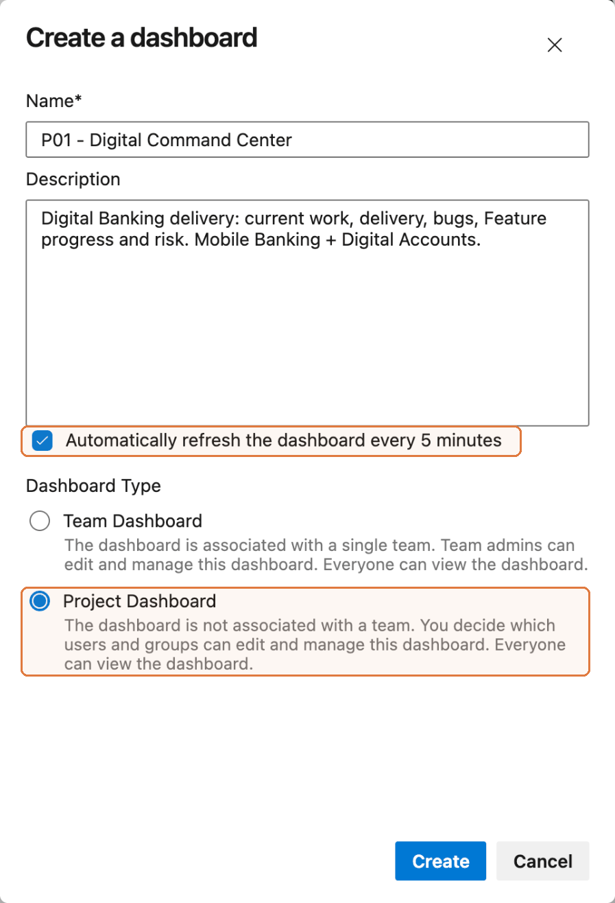
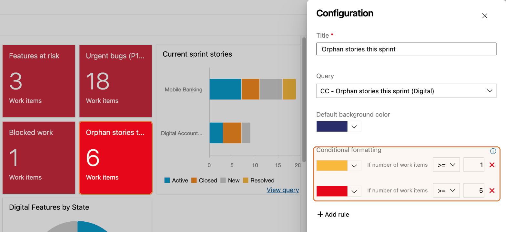
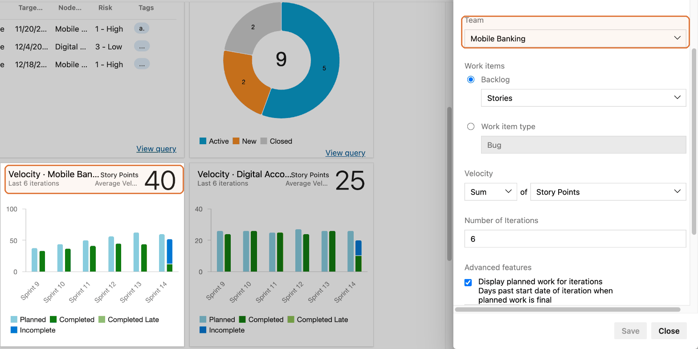
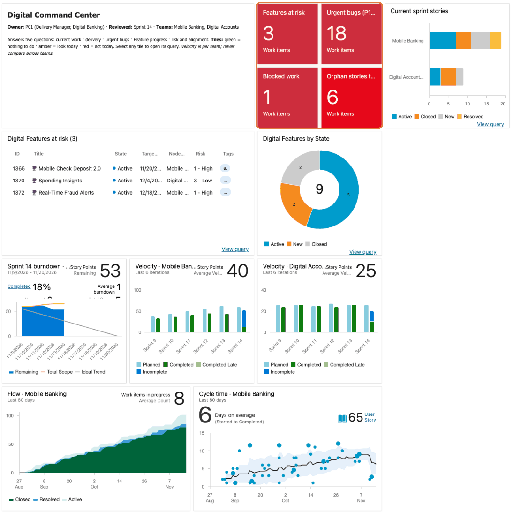
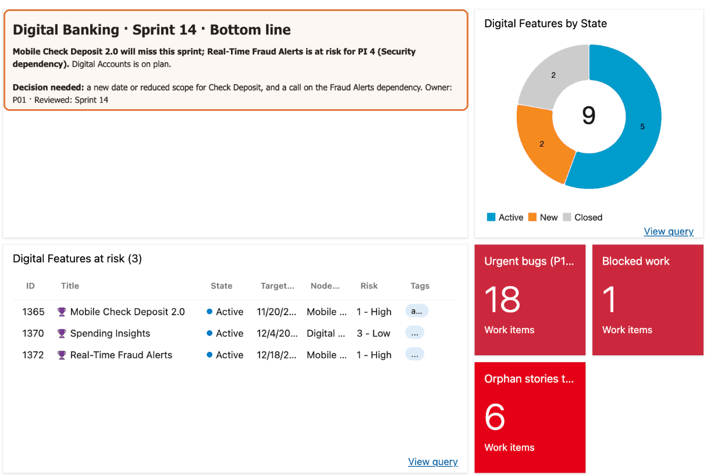

!!! briefing "Mission briefing"
    Yesterday you answered Priya one query at a time. That won't scale to every Monday, or to Priya asking at 7:40 while you're on the train.

    Today you build the **Digital Command Center**: one project dashboard for current work, delivered Features, urgent bugs, Feature progress and risk, built from your [Lab 3](../day-1/lab-03-query-toolkit.md) query toolkit plus a few Analytics widgets.

    Then the harder part: you cut it down. Dana Whitfield doesn't want thirteen widgets. She wants to know whether Digital is on course and what you need from her.

    **Done looks like:**

    - five written questions the page must answer (Part 1)
    - `P## - Digital Command Center`, with a header and every widget tied to one of those questions (Parts 2–4)
    - `P## - Digital Banking Exec View`, six widgets or fewer (Part 5)
    - a partner who answers your five questions from your dashboard in thirty seconds (Part 6)

<div class="msg" data-initials="PR" data-tone="teal" markdown>
<p class="msg-head"><strong>Priya Raman</strong><span>Director, Digital Banking · 8:05 AM</span></p>

Your queries yesterday were exactly right. Now I'd like to stop asking for them. Can you build me one page I can open before any meeting that tells me what's in flight, what landed, what's broken and what's at risk across both digital teams? If Dana could read a version of it without a translator, even better.
</div>

## What you'll walk away with

- Design a dashboard from its questions, not from the widget catalog
- Give it a header: owner, freshness, color meanings
- Wire shared queries into tiles, lists and charts, check each query's scope, and set meaningful thresholds
- Point each Analytics widget (Velocity, Sprint Burndown, Cumulative Flow, Cycle Time) at the right team, and show which
- Cut a manager's dashboard down to an executive's view, and defend what you dropped
- Keep a dashboard honest: ownership, refresh, edit rights and a review cadence

## Before you set sail

- **Access:** Basic, as a Contributor. You can create **project dashboards** and edit only your own. You won't touch any team's dashboard, including Leo's.
- **Your ID** is set (the **Crew** chip), and `Shared Queries/Training/P##/` holds `04 Features at risk` and `06 Orphan work` from [Lab 3](../day-1/lab-03-query-toolkit.md). Skipped Lab 3? Fallbacks are in Part 3.
- **Team context:** you pick `Mobile Banking` and `Digital Accounts` *inside each widget's configuration* and never change their team settings, backlogs or boards.
- **You'll create:** two project dashboards and six small queries in `Shared Queries/Training/P##/`, all prefixed `CC - ` so they sort together.
- **Time-box:** 60 minutes. Parts 3 and 4 are the build. Protect 15 minutes for Parts 5 and 6, where the judgment lives.

!!! warning "Dashboards are public in this project"
    Every project member can **view** every dashboard; there are no private ones. Build as if Priya, Leo and Dana will open yours, because they can.

## Part 1 — Start with questions, not widgets

What is this page *for*? The most common dashboard is a wall of every widget the builder found. Nobody can read a wall, so decide the questions before you open the catalog.

!!! challenge "Challenge: Five questions"
    Write down the **five questions** your Command Center must answer for Priya, one line each, in her words. Next to each, write **who acts on the answer** and **how often** they'd look. Keep the list: Part 6 tests the dashboard against it.

    Constraint: at least one question is about **Features**, not stories, and at least one is about what could go wrong *next* sprint.

??? pilot "Harbor Pilot · Hint 1: Take a bearing"
    Start from the course outline: *current work, completed items, outstanding bugs, delivery progress, potential risks*. Turn each phrase into a question Priya would ask, with a time window.

??? pilot "Harbor Pilot · Hint 2: Set the heading"
    Good questions have a **scope** (both digital teams), a **window** (this sprint, the last five sprints, the next three weeks) and an **action**. "How many bugs are there?" has no action. "Are there urgent bugs nobody is fixing?" does.

??? pilot "Harbor Pilot · Hint 3: Bring it into port (full solution)"
    A model list. Yours can differ; the shape matters more than the words.

    | # | Question | Who acts | How often |
    |:-:|:--|:--|:--|
    | Q1 | **What are both teams working on this sprint, and is the sprint on track?** | You, with Diego and Grace | Daily |
    | Q2 | **What have we delivered, and is delivery steady?** | You and Priya | Every sprint |
    | Q3 | **Are there urgent bugs, and are they growing?** | Engineering managers | Daily |
    | Q4 | **How are the Digital Features progressing toward their target dates?** | Priya, Product Owners | Weekly |
    | Q5 | **What's at risk or blocked, and is our effort going where the portfolio needs it?** | You, escalating to Priya | Twice a week |

    Q4 and Q5 are Feature questions; Q5's second half is the orphan-work signal you queried in [Lab 3](../day-1/lab-03-query-toolkit.md).

    **So what? This list is your spec:** Part 3 turns it into a widget plan, and Part 6 tests the page against it.

!!! insight "Lighthouse insight: a dashboard is a set of answers"
    A widget that answers no one's question is decoration; two that answer the same one are noise. When the dashboard grows, and it will, the five questions are your **removal test**.

!!! checkpoint "Checkpoint"
    - [ ] I have five written questions, each with who acts and how often
    - [ ] At least one is about Features and one looks forward

!!! takeaway "Takeaway"
    Write the questions before you open the widget catalog: each one earns a widget its place, and a widget that answers none of them comes off.

## Part 2 — Create the dashboard and its header

Before it holds a number, the page must say whose it is, what it answers and how fresh it is.

!!! speedrun "Speed run · 6 minutes"
    Create a self-refreshing **project** dashboard named `P## - Digital Command Center`. Add a **Markdown** widget across the top: owner, purpose, last review, a color legend, and links to the Program Charter wiki page, the **HarborPoint Program Plan** and your query folder.

<div class="timer" data-minutes="6" data-label="Speed run"></div>

??? pilot "Harbor Pilot · Hint 1: Take a bearing"
    Dashboards live under **Overview**. The create dialog asks for a **Dashboard Type**: a *team* dashboard belongs to one team's admins, a *project* dashboard belongs to you.

??? pilot "Harbor Pilot · Hint 2: Set the heading"
    **Overview › Dashboards** › **+ New Dashboard**; auto-refresh is a checkbox in that dialog. In edit mode, search **Add Widget** for `Markdown`. Size is set in the widget's **Configuration** panel.

??? pilot "Harbor Pilot · Hint 3: Bring it into port (full solution)"
    1. **Overview › Dashboards** › **+ New Dashboard**.
    2. **Name** `P## - Digital Command Center`. **Description** `Digital Banking delivery: current work, delivery, bugs, Feature progress and risk. Mobile Banking + Digital Accounts.`
    3. Tick **Automatically refresh the dashboard every 5 minutes**.
    4. **Dashboard Type**: **Project Dashboard**. Select **Create**.
    5. Select **Edit**. In **Add Widget**, search `Markdown`, select it, then **Add**.
    6. Hover the widget, select **⋯** › **Configure**. Set **Width** as wide as fits your screen (try `6`) and **Height** `2`. Choose **Custom markdown** and paste the block below, replacing the placeholders with URLs from your browser's address bar.
    7. **Save**, then **Done Editing**.

    ```markdown
    ## Digital Command Center
    **Owner:** P## (Delivery Manager, Digital Banking) · **Reviewed:** Sprint 14 · **Teams:** Mobile Banking, Digital Accounts

    Answers five questions: current work · delivery · urgent bugs · Feature progress · risk and alignment.
    **Tiles:** green = nothing to do · amber = look today · red = act today. Select any tile to open its query.

    [Program Charter](<paste wiki page URL>) · [HarborPoint Program Plan](<paste plan URL>) · [My queries](<paste query folder URL>)
    ```

    **Expected result:** an empty dashboard with a header. **So what? A stranger can judge the page before reading a number.**

<figure class="hp-shot" data-shot="lab05-create-dialog" markdown>
<div class="hp-shot__bar" aria-hidden="true"><i></i><i></i><i></i><span>Overview › Dashboards › + New Dashboard</span></div>

{ loading=lazy }

<figcaption markdown>A **project** dashboard belongs to you, not to a team's admins. Tick auto-refresh so the page is never stale, and keep the name **under 32 characters** or the dialog won't let you create it.</figcaption>
</figure>

!!! checkpoint "Checkpoint"
    - [ ] `P## - Digital Command Center` exists as a project dashboard with auto-refresh on
    - [ ] Its Markdown header names the owner, the review sprint, the legend and three working links

!!! takeaway "Takeaway"
    Put the owner, the last review and the meaning of each color on the page itself, because a reader who can't see them will guess.

## Part 3 — Wire up the queries

Which numbers should turn red, and which items sit behind them? Query widgets give you both: counts that change color, and lists you can click into.

### The blueprint

The page you build in Parts 3 and 4, mapped to Part 1's model questions. Each section heading below names the question it serves.

| Question | Widget(s) that answer it | Built in |
|:--|:--|:-:|
| **Q1** Current work, on track? | Current sprint stories (chart) · Sprint 14 burndown · Mobile | 4a, 4b |
| **Q2** Delivered, steady? | Features by State (pie) · Velocity for each team | 4a, 4b |
| **Q3** Urgent bugs? | Urgent bugs tile | 3c |
| **Q4** Feature progress? | Digital Features at risk (list) · Features by State (pie) | 3b, 4a |
| **Q5** Risk and alignment? | Features at risk tile · Blocked tile · Orphans tile | 3a, 3c, 3d |
| *Why* Q1 or Q2 looks wrong | Cumulative Flow · Cycle Time (diagnostics) | 4b |

Your questions differ? Add a row for each. A widget that fits no row doesn't get built.

Query widgets need a **shared** query (not *My Queries*), and charts need a **flat list**. Anything in `Shared Queries/Training/P##/` qualifies.

### 3a. Q5 · The risk tile (and a trap)

??? info "Skipped Lab 3? Fallback definitions"
    Save each in `Shared Queries/Training/P##/`. They match Lab 3 exactly.

    **`04 Features at risk`** (Flat list of work items, sorted by Target Date)

    | Group | And/Or | Field | Operator | Value |
    |:-:|:--|:--|:--|:--|
    | | | Work Item Type | = | `Feature` |
    | | And | Area Path | Not Under | `HarborPoint\Training` |
    | | And | State | Not In | `Closed,Removed` |
    | ┌ | And | Target Date | <= | `@Today + 21` |
    | │ | Or | Risk | = | `1 - High` |
    | └ | Or | Tags | Contains | `at-risk` |

    Group the last three rows. **Expected:** 8 Features.

    **`06 Orphan work`** (Work items and direct links): top level `Work Item Type` `=` `User Story`, `Area Path` `Under` `HarborPoint\Digital\Mobile Banking`, `Iteration Path` `=` `@CurrentIteration` (team `Mobile Banking`); linked work items `Work Item Type` `=` `Feature`; **Filter options** **Only return items that do not have matching links**; **Types of links** **Return selected link types** with only **Parent** ticked. **Expected:** 5 stories.

1. **Edit** › **Add Widget** › search `Query Tile` › **Add**.
2. **Configure**: **Title** `Features at risk`. **Query**: `Shared Queries/Training/P##/04 Features at risk` (from Lab 3).
3. **Conditional formatting** › **+ Add rule**: amber **If number of work items** `>=` `1`. Add a second rule: red `>=` `3`. **Save**.

Before you read on, write one sentence: what would Priya conclude from that number?

!!! reef "Reef ahead: the right query on the wrong page"
    Your tile says **8**, in red. On a page titled *Digital Banking*, Priya reads "eight Digital Features are at risk". There are three: the Lab 3 query covers the **whole program**, so it also counts Member Support, Branch Experience, Security and Core Platform Features. Every widget inherits its query's or team's **scope**, and that must match the page title. Skip the check and the dashboard starts lying.

Fix it without breaking Lab 3:

4. Open `04 Features at risk` in **Boards › Queries**, add a clause **outside** the OR group: `And` `Area Path` `Under` `HarborPoint\Digital`. Use **Save as** (not **Save**) to `CC - Digital Features at risk`.
5. Back on the dashboard, point the tile at `CC - Digital Features at risk`.

**You should see 3:** `Mobile Check Deposit 2.0`, `Spending Insights` and `Real-Time Fraud Alerts`. Real-Time Fraud Alerts serves the Fraud Epic, but Mobile Banking owns it, so it's Digital's to deliver and belongs here.

??? info "Under the hood: WIQL"
    ```sql
    SELECT [System.Id], [System.Title], [System.State], [Microsoft.VSTS.Scheduling.TargetDate]
    FROM WorkItems
    WHERE [System.WorkItemType] = 'Feature'
      AND NOT [System.AreaPath] UNDER 'HarborPoint\Training'
      AND [System.State] NOT IN ('Closed', 'Removed')
      AND ( [Microsoft.VSTS.Scheduling.TargetDate] <= @Today + 21
            OR [Microsoft.VSTS.Common.Risk] = '1 - High'
            OR [System.Tags] CONTAINS 'at-risk' )
      AND [System.AreaPath] UNDER 'HarborPoint\Digital'
    ORDER BY [Microsoft.VSTS.Scheduling.TargetDate]
    ```

### 3b. Q4, Q5 · The at-risk list

A count says *how many*. Priya's next question is always *which ones*.

6. **Add Widget** › `Query Results` › **Add**. **Configure**: **Title** `Digital Features at risk`, **Query** `CC - Digital Features at risk`, **Width** `4`. Under **Display Columns**, move `Title`, `State`, `Target Date`, `NodeName`, `Risk` and `Tags` into **Selected columns** and drop `ID`.

    The widget offers only the saved query's columns. If one is missing, add it in the query's **Column options** and **Save** first.

Read the rows: `Spending Insights` is close to its Target Date but 88% done, `Mobile Check Deposit 2.0` is due this sprint at 61%, and `Real-Time Fraud Alerts` is 4% done. One count, three very different conversations.

### 3c. Q3, Q5 · Urgent bugs and blocked work

!!! predict "Make a call"
    Before you build these two tiles, write down a guess: **how many open Priority 1 and 2 bugs do the two digital teams have between them, and how do they split?** A number and a rough split is enough.

7. Create two flat queries in `Shared Queries/Training/P##/` and give each a Query Tile:

    **`CC - Open P1-P2 bugs (Digital)`** (Flat list of work items)

    | And/Or | Field | Operator | Value |
    |:--|:--|:--|:--|
    | | Work Item Type | = | `Bug` |
    | And | Area Path | Under | `HarborPoint\Digital` |
    | And | State | <> | `Closed` |
    | And | Priority | <= | `2` |

    **`CC - Blocked work (Digital)`** (Flat list of work items)

    | And/Or | Field | Operator | Value |
    |:--|:--|:--|:--|
    | | Area Path | Under | `HarborPoint\Digital` |
    | And | Tags | Contains | `blocked` |
    | And | State | Not In | `Closed,Removed` |

8. Tile rules: for bugs, amber `>=` `1`, red `>=` `10`. For blocked, red `>=` `1` (a blocked item is a request for help, and one is enough).

**Check your call.** The bugs tile shows **18** open P1/P2 bugs, all Mobile Banking's (4 Priority 1, 14 Priority 2); add `Node Name` as a column to see the split. **Blocked** shows **1**: Mobile Banking's `Member confirms or denies a flagged transaction`, waiting on Security's API. [Lab 7](lab-07-cross-team-bottleneck.md) pulls that thread.

### 3d. Q5 · The orphan tile

!!! challenge "Challenge: Orphans on the dashboard"
    Starting from your Lab 3 `06 Orphan work` query, add a Query Tile titled `Orphan stories this sprint` that counts **Digital stories in the current sprint with no parent Feature**, for both teams. Save its query as `CC - Orphan stories this sprint (Digital)`.

??? pilot "Harbor Pilot · Hint 1: Take a bearing"
    An orphan is a **missing link**, so this stays a *Work items and direct links* query. Only the **top-level** filters change.

??? pilot "Harbor Pilot · Hint 2: Set the heading"
    Widen the top-level area to all of `HarborPoint\Digital` and keep the sprint at `@CurrentIteration`. That macro needs a team: both digital teams share the same sprint nodes, so `Mobile Banking`'s current sprint is Sprint 14 for both.

??? pilot "Harbor Pilot · Hint 3: Bring it into port (full solution)"
    1. Open `06 Orphan work`, then **Save as** `CC - Orphan stories this sprint (Digital)`.
    2. **Filters for top level work items**:

        | And/Or | Field | Operator | Value |
        |:--|:--|:--|:--|
        | | Work Item Type | = | `User Story` |
        | And | Area Path | Under | `HarborPoint\Digital` |
        | And | Iteration Path | = | `@CurrentIteration` (team `Mobile Banking`) |

    3. **Filters for linked work items**: `Work Item Type` `=` `Feature`. **Filter options**: **Only return items that do not have matching links**. **Types of links**: **Return selected link types**, **Parent** only. **Save**.
    4. Add a Query Tile for it with amber `>=` `1` and red `>=` `5`.

    **Expected result: 6.** Five are Mobile Banking's (`Dark mode polish for redesigned screens`, `Upgrade analytics SDK`, `Holiday promo banner (marketing request)`, `App Store listing refresh`, `Upgrade push notification SDK`) and one is Digital Accounts' (`Statement search by date range`).

    **So what? Six orphans are not six problems.** SDK upgrades are legitimate unparented work; a marketing banner added on day 3 is a conversation about who may add work mid-sprint.

    ??? info "Under the hood: WIQL"
        ```sql
        SELECT [System.Id], [System.Title]
        FROM WorkItemLinks
        WHERE ([Source].[System.WorkItemType] = 'User Story'
               AND [Source].[System.AreaPath] UNDER 'HarborPoint\Digital'
               AND [Source].[System.IterationPath] = @currentIteration('[HarborPoint]\Mobile Banking'))
          AND ([System.Links.LinkType] = 'System.LinkTypes.Hierarchy-Reverse')
          AND ([Target].[System.WorkItemType] = 'Feature')
        MODE (DoesNotContain)
        ```

<figure class="hp-shot" data-shot="lab05-query-tile-config" markdown>
<div class="hp-shot__bar" aria-hidden="true"><i></i><i></i><i></i><span>Overview › Dashboards › P## - Digital Command Center › Edit › Query Tile › Configuration</span></div>

{ loading=lazy }

<figcaption markdown>Two **conditional formatting** rules turn a count into a signal: amber from 1, red from 5. A count of 6 matches both, and the tile shows red. List your rules from mild to severe.</figcaption>
</figure>

!!! insight "Lighthouse insight: a threshold is a policy"
    A tile that turns red at 10 bugs makes a rule: *ten urgent bugs is an emergency*. Did anyone agree? Put thresholds in the legend, agree them with the people they judge, and change them deliberately, or every color is your opinion wearing a uniform.

!!! checkpoint "Checkpoint"
    - [ ] My risk tile and list read `CC - Digital Features at risk` and show **3** Features
    - [ ] I have tiles for urgent bugs (at least 18), blocked work (1) and orphan stories this sprint (6), each with color rules
    - [ ] I can say which of my five questions each tile answers

!!! takeaway "Takeaway"
    A reused query brings its own scope, so check it against the page title, and put the list beside the count so every number comes with names.

## Part 4 — Add the charts and team metrics

Q1 and Q2 ask about trends: is the sprint on track, is delivery steady? Two query charts show the work's shape; five Analytics widgets show delivery and flow, each for exactly one **team**.

### 4a. Q1, Q2, Q4 · Two query charts

9. Create two flat queries and add a **Chart for Work Items** widget for each (**Add Widget** › `Chart for Work Items` › **Configure**). If you built `10 Digital Features (chart)` in [Lab 4](../day-1/lab-04-sprint-delivery-report.md), it already returns the same 9 Features: reuse it instead of the first query.

| Query (flat list) | Clauses | Chart |
|:--|:--|:--|
| `CC - Digital Features by State` | `Work Item Type` `=` `Feature` · `Area Path` `Under` `HarborPoint\Digital` · `State` `<>` `Removed` | **Pie**, **Group by** `State`, **Count** |
| `CC - Current sprint stories (Digital)` | `Work Item Type` `=` `User Story` · `Area Path` `Under` `HarborPoint\Digital` · `Iteration Path` `=` `@CurrentIteration` (team `Mobile Banking`) | **Stacked bar**, **Y-axis** `Node Name`, **Group by** `State`, **Count** |

Before saving, add `Node Name`, `State`, `Story Points`, `Parent` and `Tags` as columns on both: charts can only group by fields in the query.

**You should see:**

- **Features by State:** 9 Features. **Active 5**, **New 2**, **Closed 2**. The ninth is Real-Time Fraud Alerts, owned by Mobile (see 3a).
- **Current sprint stories:** Mobile Banking **19** (Closed 4, Resolved 3, Active 7, New 5) and Digital Accounts **9** (Closed 4, Active 3, New 2). Switch **Aggregation** to **Sum** of `Story Points` for a moment: 65 points against 26. Notice how much of Mobile's bar is *Resolved*; [Lab 6](lab-06-which-team-needs-help.md) comes back to it.

Unlike the Queries page, this widget can also **Group by** `Tags` (Extra knot 1).

### 4b. Q1, Q2 · Delivery and flow, one team at a time

10. Add these five Analytics widgets. Each arrives set to the default team, `HarborPoint Team`, with a plausible chart. For each, set **Team** first, then put the team's name in the **Title**. (In the **Team** box, select the text, type `Mobile Banking` and press **Enter**.)

| Widget | Title | Key settings |
|:--|:--|:--|
| **Velocity** | `Velocity · Mobile Banking` | **Team** `Mobile Banking` · **Work items** **Backlog** `Stories` · **Velocity** **Sum** of `Story Points` · **Number of Iterations** `6` · tick **Display planned work for iterations** |
| **Velocity** | `Velocity · Digital Accounts` | Same, with **Team** `Digital Accounts` |
| **Sprint Burndown** | `Sprint 14 burndown · Mobile Banking` | **Team** `Mobile Banking` · **Backlogs and work items** `Stories` · **Burndown On** **Sum** of `Story Points` · **Select Iteration** `@CurrentIteration` · tick **Show total scope** |
| **Cumulative Flow Diagram (CFD)** | `Flow · Mobile Banking` | **Team** `Mobile Banking` · **Backlog** `Stories` · **Time period** **Rolling period (days)** `80`, which reaches back to the start of Sprint 9 |
| **Cycle Time** | `Cycle time · Mobile Banking` | **Team** `Mobile Banking` · **Work items** **Work item type** `User Story` · **Rolling period (days)** `80` |

<figure class="hp-shot" data-shot="lab05-velocity-config" markdown>
<div class="hp-shot__bar" aria-hidden="true"><i></i><i></i><i></i><span>Overview › Dashboards › P## - Digital Command Center › Edit › Velocity › Configuration</span></div>

{ loading=lazy }

<figcaption markdown>**Team** is the field that matters most, and the widget never shows it unless you put it in the title. Set Team first, then name the widget after it.</figcaption>
</figure>

**You should see:**

- **Mobile Banking velocity:** Completed 33, 37, 41, 45, 44 for Sprints 9 to 13, against Planned 38, 44, 50, 56, 62. Sprint 14 shows 12 so far against 60 planned.
- **Digital Accounts velocity:** Completed 24, 26, 25, 24, 26 against Planned 26, 26, 25, 27, 26. Sprint 14 shows 10 so far.
- **Sprint burndown:** a **Total Scope Increase** of 5 points (60 became 65 mid-sprint) and 12 points completed.
- **CFD and Cycle Time:** just confirm they render; Lab 6 reads them.

The CFD includes bugs: Mobile Banking manages bugs with requirements, so its 42 open bugs flow through the same columns and compete for the same people. Leave them in.

!!! reef "Reef ahead: the widget that reports on the wrong team"
    Leave **Team** as offered and you may chart the program team, the default team or the last team you viewed, and every chart looks plausible. On `HarborPoint Team`, Velocity adds six teams' estimates into one meaningless number. Copied widgets keep their original team. The defense is step 10's habit: **Team first, title second.**

!!! reef "Reef ahead: velocity on a manager's wall"
    Two velocity charts side by side invite the comparison [Lab 4](../day-1/lab-04-sprint-delivery-report.md) ruled out: Mobile's 44 is not "better" than Digital Accounts' 26, because Story Points are each team's private currency. Keep both widgets in **separate columns** and add to your legend: *Velocity is per team; never compare across teams.*

### 4c. Arrange it

In edit mode, drag widgets into reading order. People read top-left first and rarely scroll. A layout that works:

| Row | Left | | | Right |
|:-:|:--|:--|:--|:--|
| 1 | **Header** (Markdown) | Tile: Features at risk | Tile: Urgent bugs | Tile: Blocked · Tile: Orphans |
| 2 | **Digital Features at risk** (Query Results, wide) | | Features by State (pie) | Current sprint stories |
| 3 | Sprint 14 burndown · Mobile | Velocity · Mobile | Velocity · Digital Accounts | |
| 4 | Flow · Mobile (CFD) | Cycle time · Mobile | | |

Top row: *is anything on fire?* Second row: *where are the Features?* Below the fold: diagnostics for when the top rows look wrong.

<figure class="hp-shot" data-shot="lab05-command-center-full" markdown>
<div class="hp-shot__bar" aria-hidden="true"><i></i><i></i><i></i><span>Overview › Dashboards › P## - Digital Command Center</span></div>

{ loading=lazy }

<figcaption markdown>Every team-scoped widget names its team in the title, and the tiles read **3 / 18 / 1 / 6**.</figcaption>
</figure>

!!! checkpoint "Checkpoint"
    - [ ] Features by State shows 9 Features (Active 5, New 2, Closed 2)
    - [ ] Current sprint stories shows Mobile Banking 19 and Digital Accounts 9, stacked by State
    - [ ] All five Analytics widgets read the right team and name it in the title
    - [ ] The tiles sit in the top row and the diagnostics below them

!!! takeaway "Takeaway"
    An Analytics widget reads exactly one team and looks plausible whichever team that is, so set Team first and name the team in the title.

## Part 5 — Cut it down for executives

Which widgets would Dana decide anything from? You need all thirteen on a bad Tuesday. Dana needs about five, every time.

!!! challenge "Challenge: The executive cut"
    Create `P## - Digital Banking Exec View` with **at most six widgets** from your Command Center. For each widget you **drop**, write one line on why; for each you **keep**, the question Dana would ask that it answers.

??? pilot "Harbor Pilot · Hint 1: Take a bearing"
    Ask of each widget: *does an executive decide anything from this, or does a team?* Executives decide **outcomes, dates, risks and trade-offs**. Teams decide sprints, flow and estimates.

??? pilot "Harbor Pilot · Hint 2: Set the heading"
    Avoid **Copy Dashboard**: it duplicates every query into a new Shared Queries folder, leaving two copies to maintain. Create an empty project dashboard and use **Copy to Dashboard** on each kept widget; those copies share the original queries.

??? pilot "Harbor Pilot · Hint 3: Bring it into port (full solution)"
    1. **Overview › Dashboards** › **+ New Dashboard** › **Name** `P## - Digital Banking Exec View`, **Project Dashboard**, auto-refresh on. **Create**.
    2. Back on the Command Center, **in normal view (not Edit)**, hover each kept widget and select **More actions** (**⋯**) › **Copy to Dashboard**. Type `Exec View` in the search box, pick `P## - Digital Banking Exec View` and select **OK**. Copies land at the end of the target dashboard; arrange them in **Edit** mode.
    3. Rewrite the Exec View's Markdown header as a bottom line, for example: *"Digital Banking, Sprint 14. Mobile Check Deposit 2.0 will miss this sprint; Real-Time Fraud Alerts is at risk for PI 4 (Security dependency). Decision needed: see risks below. Owner P##."*

    **A model cut (six):**

    | Keep | Dana's question |
    |:--|:--|
    | Markdown header, rewritten as a bottom line | "Are we going to make it, and what do you need from me?" |
    | Digital Features at risk (Query Results) | "Which commitments are in trouble?" |
    | Digital Features by State (pie) | "How much of the initiative is done, in flight, or not started?" |
    | Urgent bugs (tile) | "Is quality under control?" |
    | Blocked work (tile) | "Is anything stuck that I could unstick?" |
    | Orphan stories this sprint (tile) | "Is the effort going to our priorities?" |

    | Drop | Why |
    |:--|:--|
    | Both Velocity widgets | Team planning tools; side by side, they invite the cross-team comparison you warned against |
    | Sprint burndown | Sprint-tactical; it changes daily and an exec can't act on it |
    | CFD and Cycle Time | Diagnostics. Interpreting them is your job, delivered as a sentence in the header |
    | Current sprint stories | Story altitude. Execs live at Features |
    | The risk count tile | Redundant next to the three-row list |

    Reasonable people swap the orphan tile for a link to your status report, or the pie for a Features list sorted by Target Date.

    **So what? Keep nothing "just in case".** Every extra widget hides the important ones; the diagnostics stay on your Command Center.

<figure class="hp-shot" data-shot="lab05-exec-view" markdown>
<div class="hp-shot__bar" aria-hidden="true"><i></i><i></i><i></i><span>Overview › Dashboards › P## - Digital Banking Exec View</span></div>

{ loading=lazy }

<figcaption markdown>Six widgets, and the most important one is words: a **bottom line** and the **decision needed**. Everything else is evidence for that sentence.</figcaption>
</figure>

!!! insight "Lighthouse insight: managers need diagnostics; executives need decisions"
    A manager's dashboard is a cockpit: dense, diagnostic, read daily by someone who knows every gauge. An executive's is a windscreen: a few big things, each tied to a decision. A chart can't tell Dana "this will miss, and here's the choice". Your header can.

!!! checkpoint "Checkpoint"
    - [ ] `P## - Digital Banking Exec View` has at most six widgets, copied from the Command Center
    - [ ] Its header states a bottom line in one or two sentences
    - [ ] I have a one-line reason for every widget I dropped

!!! takeaway "Takeaway"
    An exec view keeps only what leads to an executive decision, and its most important widget is the sentence where you say what the numbers mean.

## Part 6 — Share it and keep it honest

Can someone else read your page cold, and will it still be true next month? A dashboard is a promise that someone keeps it true; make the promise explicit.

11. **Who can edit:** **Overview › Dashboards**, hover your Command Center row, **⋮** › **Security**. As creator you hold **Edit dashboard**, **Delete dashboard** and **Manage Permissions**; everyone in the project can already *view* it. Close the dialog without changing anything, unless you want to name a co-owner.
12. **Freshness:** confirm auto-refresh is on (**⋯** › **Dashboard settings**). Analytics widgets lag edits by up to about 30 seconds and trend widgets use daily snapshots, so "live" means "a few minutes old": fine for a manager.
13. **Ownership and cadence:** add one line to your header: `Reviewed every Monday before stand-up; thresholds agreed with Diego and Grace.` (Write what's true for you.)

!!! challenge "Challenge: The 30-second test"
    Pair up. Your partner opens your **Command Center** (**Overview › Dashboards**, filter by your `P##`). Read them your five Part 1 questions and start a 30-second timer. They answer from the dashboard alone, with no queries and no help from you. Then swap.

    Score one point per correct answer. Anything under 5/5 tells you which widget to fix, move or rename.

<div class="timer" data-minutes="1" data-label="30-second test: call time at 0:30"></div>

??? pilot "Harbor Pilot · Hint 1: Take a bearing"
    Notice *where* your partner hesitates. Unsure what a number means: a **title or legend** problem. Unsure where to look: a **layout** problem. A wrong answer: a **scope** problem.

??? pilot "Harbor Pilot · Hint 2: Set the heading"
    The usual fixes: titles that are questions or plain statements (`Urgent bugs (P1-P2, both teams)` beats `Query Tile`), team names in every team-scoped title, the answer to Q5 in the top row, and the diagnostics below the fold.

??? pilot "Harbor Pilot · Hint 3: Bring it into port (full solution)"
    Reference answers a good Command Center should give. [The blueprint](#the-blueprint) says where to look.

    | Question | Answer today |
    |:--|:--|
    | Q1 Current work, on track? | 28 stories across both teams; Mobile has 3 sitting in Resolved and added 5 points mid-sprint |
    | Q2 Delivered, steady? | Two Digital Features closed; Digital Accounts steady at 24 to 26 points; Mobile's planned vs completed gap is widening |
    | Q3 Urgent bugs? | At least 18 open P1/P2, essentially all Mobile's |
    | Q4 Feature progress? | 5 Active, 2 New, 2 Closed; Mobile Check Deposit 2.0 due now at 61% |
    | Q5 Risk and alignment? | 3 Features flagged (one is nearly done); 1 blocked story on Fraud Alerts; 6 orphan stories this sprint |

    **So what? Every miss names a fix:** a widget to retitle, move or re-scope. The fix matters more than the score.

!!! reef "Reef ahead: the dashboard nobody owns"
    In [Lab 11](../day-3/lab-11-dashboard-wrong.md), Leo's Member Support dashboard still shows last sprint as "current", and a director believes her team has collapsed. A stale dashboard is **worse than no dashboard**: no dashboard makes people ask, and a stale one answers them wrongly.

!!! checkpoint "Checkpoint"
    - [ ] I opened my dashboard's **Security** dialog and know who can edit it
    - [ ] My header names an owner and a review cadence
    - [ ] A partner scored my dashboard in the 30-second test, and I fixed at least one thing they stumbled on

!!! takeaway "Takeaway"
    A dashboard isn't finished until it has a named owner, its last review on the page, and a reader who can use it cold.

## Knowledge check

<div class="quiz" markdown>

**Your Command Center's "Features at risk" tile shows 8, but only three Digital Features are in trouble. What's the most likely cause?**

- [ ] The tile caches an old result until the dashboard refreshes
- [x] The tile's query covers the whole program, not the Digital area
- [ ] Query Tiles count child stories as well as Features
- [ ] The tile is bound to the wrong team

<div class="quiz-why" markdown>
A query widget inherits its query's scope, and nothing on the tile shows it. The page title says *Digital*; the query said *everything*.
</div>

</div>

<div class="quiz" markdown>

**A Velocity widget on a colleague's project dashboard shows about 150 points a sprint, far more than any single HarborPoint team. What do you check first?**

- [ ] Whether the teams have started inflating their estimates
- [ ] Whether the widget counts bugs
- [x] Which team the widget is configured for, because a program-level team adds up several teams' points
- [ ] Whether auto-refresh is turned on

<div class="quiz-why" markdown>
Team-scoped widgets read one team's area and sprints. Point one at the program team, whose area includes everyone's, and you get a sum of six private scales: accurate and meaningless.
</div>

</div>

<div class="quiz" markdown>

**Dana will look at your Exec View for a minute before a steering meeting. Which widget is the strongest candidate to drop?**

- [ ] The list of Digital Features at risk
- [ ] The Markdown header with the bottom line
- [x] The Sprint 14 burndown for Mobile Banking
- [ ] The blocked-work tile

<div class="quiz-why" markdown>
A sprint burndown is a team's daily steering tool and leads to no executive decision. The header and the risk list carry the decisions; the blocked tile is a direct "can you help?".
</div>

</div>

## Captain's log

!!! log "Captain's log"
    1. Could you write down the five questions your most-used dashboard answers? Could its owner?
    2. Which of your real widgets would fail the 30-second test: because of its title, its scope, or its existence?
    3. Who in your organization reads velocity as productivity? What would you put on the page instead?
    4. How often are your team's dashboards reviewed? Who would notice first if one went stale?
    5. If you could give your executive sponsor only three widgets, which would they be?

!!! bonus "Extra knots"
    1. **Group by tags.** Add a **Chart for Work Items** on `CC - Current sprint stories (Digital)` with **Group by** `Tags` and **Selected tags** `unplanned`, `tech-debt` and `blocked`. What share of Mobile Banking's sprint is work nobody planned? (Two `unplanned` stories, 5 points, both added after day 1.)
    2. **A release burnup.** Add a **Burnup** widget for **Teams** `Mobile Banking` and `Digital Accounts`, **Work items** backlog `Stories`, **Sum** of `Story Points`, plotted by **Iteration** from Sprint 13 to Sprint 16, with **Show total scope** on. Does the scope line climb faster than the completed line? What would that say about PI 4?
    3. **Critique the program's front window.** Apply today's tests to `HarborPoint Program Overview` (**Overview › Dashboards**): which question does each widget answer, does each team-scoped widget name its team, does each scope match the title? Name one widget to remove and one to add.

<!-- VERIFY: Extra knot 2 assumes the Burnup widget's Iteration plot interval accepts Sprint 13 to Sprint 16. -->

!!! harbor "Back in your own harbor"
    Three moves for your first week back, about 30 minutes in your own Azure DevOps:

    1. **Write the questions onto the page.** Create a **project dashboard** of your own (Contributors can) and put a **Markdown** widget across the top: the owner, the five questions it answers, a review date and a color legend. Anyone who can see the dashboard sees it, so write it for them.
    2. **Check every widget's scope.** On a dashboard you rely on, open the query behind each Query Tile and the **Team** setting of each Analytics widget, and compare them with the scope the page title promises. Fix the ones you own, put the team name in every team-scoped title, and send the owner a list of the rest.
    3. **Pair your risk count with its list.** Save a shared, flat-list query of your at-risk Features, scoped with `Area Path` `Under` your own area. Give it a **Query Tile** with written color rules and a **Query Results** widget beside it, so the count always comes with the names.

## Key takeaways

- **Design from questions.** Write the questions before you open the widget catalog. A widget that answers none comes off.
- **Say whose page it is.** Put the owner, the last review and the color meanings on the page, or readers will guess.
- **Check the scope, show the list.** A reused query brings its own scope: check it against the page title, and put the list beside every count.
- **Name the team in the title.** An Analytics widget reads one team and looks plausible whichever it is, so set Team first.
- **Executives need decisions.** Keep only what leads to an executive decision, and say in words what the numbers mean.
- **Upkeep is part of the build.** A stale dashboard is worse than none. Name an owner, show the last review, and delete what you stop maintaining.
