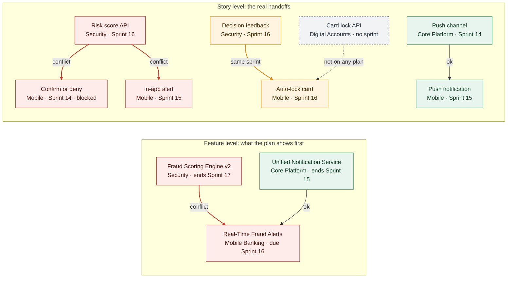

!!! briefing "Mission briefing"
    **Real-Time Fraud Alerts** is how HarborPoint will warn members within seconds that a transaction looks wrong, and let them confirm or deny it from the app. It sits under the portfolio's number one Epic, *Fraud Detection & Security*. Mobile Banking owns it, Security and Core Platform build parts of it, and it's due at the end of Sprint 16, the PI 4 System Demo. It is 4% done by Story Points.

    In Lab 2 you spotted a red dependency line on this Feature and moved on. Today you pull that thread. The Feature is yours to deliver, but the work it waits on sits in a team you don't manage. You can't fix that alone, and you're not meant to. Your job is to make the problem visible, find its real cause, and put decision-ready options in front of the person who owns the priority.

    **Done looks like:** a Delivery Plan that shows the conflict, a saved query that shows what the plan can't, an evidence trail for why it slipped, and an options matrix with a five-sentence recommendation.

<strong>Simone Laurent</strong>Chief Risk Officer · 7:48 AM

Fraud Alerts is the Executive Committee's number one priority and a committed PI 4 objective. This morning I heard, secondhand, that it's "a bit behind." I don't do secondhand. Tell me who's waiting on whom, how late it really is, and what my options are, with what each one costs. If a decision is mine, say so and I'll make it. I'm with Dana at four.

## What you'll walk away with

- Put a cross-team initiative on one calendar and read its dependency conflicts at Feature *and* story level
- Know what a Delivery Plan cannot show you (unlinked, unscheduled and off-plan work), and close the gap with a direct-links query
- Trace a slip to its root cause with evidence: history, sprint content, velocity and portfolio rank
- Turn a scheduling conflict into a portfolio decision: options with a date effect, a risk, a cost and a named decider

## Before you set sail

- **Access:** Basic, as a Contributor. You can create Delivery Plans but edit only the ones you create, which is why you build your own instead of touching the official **HarborPoint Program Plan**.
- **Your ID** is set (the **Crew** chip), and `Shared Queries/Training/P##/` exists. You made it in [Lab 3](../day-1/lab-03-query-toolkit.md); if not, create it now.
- **Team views you'll read but never change:** `Mobile Banking`, `Security` and `Core Platform` (plan rows and sprint data) and `HarborPoint Team` (the Epics backlog). Column options, view options and report settings are per user, so adjust those freely. The [environment map](../start/environment.md) has the team list.
- **You'll create:** the plan `P## - Fraud Alerts Plan`, the query `Fraud Alerts dependencies` and the wiki page `/Training/P##/Fraud Alerts Options`.
- **Time-box:** 55 minutes. If you fall behind, move faster through Parts 1 to 4 and protect 15 minutes for Part 6. The options are the point.

!!! warning "Look, but don't drag"
    A Delivery Plan is a live editing surface. Dragging a card moves the real work item to another sprint. Dragging a card's edge rewrites its Start or Target Date, for every team and every dashboard. The **+** in a sprint cell creates real work items. On this plan you **select** (badges, card edges, titles). You never **drag**.

## Part 1 — Put three teams on one calendar

Three teams, one Feature, one deadline. Get them onto the same chart before anyone argues about who is late.

!!! speedrun "Speed run · 8 minutes"
    Build a Delivery Plan named `P## - Fraud Alerts Plan` with:

    - the **Features** backlog of `Mobile Banking`, `Security` and `Core Platform`
    - a marker `PI 4 System Demo` on the last day of Sprint 16, and a marker `Regulatory exam fieldwork` on the first day of Sprint 18
    - cards that show their parent, their tags and a child rollup bar

??? pilot "Harbor Pilot · Hint 1: Take a bearing"
    Plans live under **Boards**. Each row of a plan is one team at one backlog level. Markers and card fields live in the plan's **Settings**.

??? pilot "Harbor Pilot · Hint 2: Set the heading"
    Create the plan first: its sprint cells show each sprint's dates, so you can read Sprint 16's last day and Sprint 18's first day before adding markers. In **Settings**, use **Markers** › **+ Add marker** (**Date**, **Label**, **Color**), then **Fields** for **Show Parent**, **Show Tags** and **Show child rollup data**.

??? pilot "Harbor Pilot · Hint 3: Bring it into port (full solution)"
    1. **Boards › Delivery Plans** › **New plan**.

        <!-- VERIFY: button label "+ New plan" (screenshot) vs "New Plan" (Learn text) -->

    2. **Name** `P## - Fraud Alerts Plan`. **Description** `Real-Time Fraud Alerts across Mobile Banking, Security and Core Platform`.
    3. In the team grid, set **Project** `HarborPoint`, **Team** `Mobile Banking`, **Backlog** `Features`. Select **+ Add team** twice more for `Security` and `Core Platform`, both at `Features`. Select **Create**.
    4. On the plan, note the dates shown in the **Sprint 16** and **Sprint 18** cells.
    5. **Settings** › **Markers** › **+ Add marker**: **Date** = the last day of Sprint 16, **Label** `PI 4 System Demo`. Add a second marker on the first day of Sprint 18, labeled `Regulatory exam fieldwork`. Pick colors that stand out.
    6. **Fields**: turn on **Show Parent**, **Show Tags** and **Show child rollup data**. Select **Save**.
    7. Expand every row with the arrow next to **Teams**, then **Zoom in** or **Zoom out** until Sprint 13 to Sprint 18 fill the screen.

    **Expected result:** `Real-Time Fraud Alerts` sits in the Mobile Banking row and ends right at your PI 4 System Demo marker. In the Security row, `Fraud Scoring Engine v2` runs a full sprint past it.

!!! checkpoint "Checkpoint"
    - [ ] `P## - Fraud Alerts Plan` shows three team rows at the Features level
    - [ ] Both markers sit where they belong: end of Sprint 16 and start of Sprint 18

## Part 2 — Read the red line

The plan stays quiet until you ask it a question. Ask it about Fraud Alerts.

1. Find `Real-Time Fraud Alerts` in the Mobile Banking row and look at the chain-link badge at the card's upper right. Green means "No dependency scheduling issues". Red means "Dependency scheduling conflicts detected".
2. Select the badge. The **Dependencies** dialog lists each predecessor and successor with its **Iteration Name**, **Iteration End Date** and **Project Name**, and the parent Feature and Epic underneath.
3. **Close** the dialog, then select the card's top or bottom edge to draw its lines. Black lines are fine. A red line with a ⊗ marks a conflict. Hover the line to compare the two items side by side.

<!-- VERIFY: whether the toolbar link-icon button ("Show and hide dependencies between work items") draws all lines at once; if so, offer it as a shortcut in step 3. Also check whether Fraud Scoring Engine v2 (the predecessor) shows a red badge too. -->

<!-- SHOT: lab07-dependencies-dialog | Dependencies dialog opened from the red badge on Real-Time Fraud Alerts in P## - Fraud Alerts Plan, listing Fraud Scoring Engine v2 (red !, end date in Sprint 17) and Unified Notification Service (no conflict) | crop: dialog only; highlight the red end date -->

**You should see** two predecessors:

| Predecessor | Team | Ends | Verdict |
|---|---|---|---|
| `Fraud Scoring Engine v2` | Security | Sprint 17 | **Red.** Ends a sprint *after* Fraud Alerts is due |
| `Unified Notification Service` | Core Platform | Sprint 15 | Fine |

<!-- VERIFY: what "Iteration End Date" shows for these Features (their Target Date, or the end of their PI node, PI 4 / PI 5). The conflict rule uses Target Date when set. -->

<!-- SHOT: lab07-plan-feature-red-line | Boards › Delivery Plans › P## - Fraud Alerts Plan; rows Mobile Banking, Security, Core Platform at Features level, all expanded, zoomed to Sprint 13 to Sprint 18; both markers visible; dependency lines drawn for Real-Time Fraud Alerts | crop: three rows plus the calendar bar; highlight the red line and its ⊗ between Fraud Scoring Engine v2 and Real-Time Fraud Alerts -->

The lines carry arrowheads, but don't use them to decide who waits on whom. The dialog names each side. Trust the dialog.

<!-- VERIFY: arrowhead direction. Research suggests the arrowhead points at the PREDECESSOR (the item depended on), which is counter-intuitive. Test with a simple A > B pair; if confirmed, add one sentence here saying which end is which. -->

Two more readings before you move on:

- **Look at your exam marker.** Which Security Features end *after* fieldwork begins? Both Compliance Features, `Audit Evidence Automation` and `Access Review Automation`, target the end of Sprint 18. The mandatory work isn't padded; it runs straight into the exam. Remember that when someone suggests Security "just pauses compliance for a sprint".
- **Make a prediction.** Based only on this line, how late is Fraud Alerts? Write down a one-line answer. You'll check it against the evidence in Part 5.

!!! checkpoint "Checkpoint"
    - [ ] My plan shows a red line between `Fraud Scoring Engine v2` and `Real-Time Fraud Alerts`, and I opened the **Dependencies** dialog
    - [ ] I can name the two Security Features that end after exam fieldwork begins
    - [ ] I wrote down my gut answer to "how late is it, really?"

## Part 3 — Drop below the waterline

The Feature line tells you *that* there's a problem. It can't tell you how big. Drop one level down to see why.

1. **Settings** › **Teams** › **+ Add team**, three times: `Mobile Banking`, `Security` and `Core Platform`, each with **Backlog** `Stories`. Drag each Stories row under its team's Features row.
2. **Field criteria** › **+ Add criteria**: `Work Item Type` `<>` `Bug`. Mobile Banking manages its 42 open bugs on the Stories backlog, and you don't need them here.
3. **Save**, expand all rows and zoom in on Sprints 14 to 16. Story cards now show their parent Feature.

Optional declutter: open the plan's **Filter** and set **Parent Work Item** to `Real-Time Fraud Alerts`. Filters are per user; clear them when you're done.

<!-- VERIFY: that the plan filter bar offers "Parent Work Item" (listed in the filter doc for plans, not visible in the screenshot). If not, drop this tip. -->

!!! challenge "Challenge: Map the chain"
    Fraud Alerts has eleven stories spread across three teams. Find every one of them that carries a dependency badge, and complete this map:

    | Predecessor (team, sprint) | Successor (team, sprint) | Red, fine or fragile? |
    |---|---|---|
    | | | |

    There are **four** links on your plan. Two are red. One isn't red but should still worry you. When you've mapped them, open the story that's already in progress and read its **Discussion**.

??? pilot "Harbor Pilot · Hint 1: Take a bearing"
    Look for cards whose parent reads `Real-Time Fraud Alerts`, and start with Security's Stories row in Sprint 16. Expand both team rows, or the lines between them can't be drawn.

??? pilot "Harbor Pilot · Hint 2: Set the heading"
    Open the **Dependencies** dialog on `Real-time fraud risk score API` (Security) and on `Auto-lock card after a member denies a transaction` (Mobile Banking). Compare end sprints. Equal end dates never count as a conflict, so ask yourself whether "not red" means "safe".

??? pilot "Harbor Pilot · Hint 3: Bring it into port (full solution)"
    | Predecessor | Successor | Verdict |
    |---|---|---|
    | `Real-time fraud risk score API` (Security, Sprint 16) | `Member confirms or denies a flagged transaction` (Mobile Banking, Sprint 14, Active, `blocked`) | **Red.** Mobile started two sprints before the thing it needs exists |
    | `Real-time fraud risk score API` (Security, Sprint 16) | `Show real-time fraud alert in the app` (Mobile Banking, Sprint 15) | **Red** |
    | `Alert decision feedback to fraud engine` (Security, Sprint 16) | `Auto-lock card after a member denies a transaction` (Mobile Banking, Sprint 16) | **Fragile.** Same sprint, so never flagged. It only works if Security finishes early and Mobile finishes late |
    | `High-priority push channel for fraud alerts` (Core Platform, Sprint 14) | `Push notification for high-risk transactions` (Mobile Banking, Sprint 15) | **Fine.** Core Platform delivers a sprint ahead |

    The confirm/deny story's Discussion says it plainly: *"UI done; can't integrate until Security's risk-score API exists."* Mobile isn't slow on this Feature. It's parked. That 4% measures a waiting room, not a work rate.

<!-- SHOT: lab07-plan-story-level | P## - Fraud Alerts Plan with Stories rows added for Mobile Banking, Security and Core Platform (field criteria Work Item Type <> Bug), zoomed to Sprint 14 to Sprint 16, lines drawn from Real-time fraud risk score API | crop: Security Stories and Mobile Banking Stories rows; highlight the two red lines to Member confirms or denies a flagged transaction (Sprint 14) and Show real-time fraud alert in the app (Sprint 15) -->

!!! insight "Lighthouse insight: ask what you actually depend on"
    The Feature line says Fraud Alerts waits for *all* of Fraud Scoring Engine v2, a 65-point Feature ending in Sprint 17. The story links say it waits for *one* 8-point story, the risk-score API, planned for Sprint 16. Those are very different negotiations. Feature-level links are good at spotting a problem and poor at sizing it, so drop one level before you escalate. The narrower the real dependency, the more options you have.

!!! reef "Reef ahead: green at the top, red underneath"
    Suppose Aisha had moved Fraud Scoring Engine v2 to end in Sprint 16 instead of 17. The Feature line would turn black, because equal end dates never count as a conflict, and every story-level red line would still be there. A badge compares two end dates on two cards. It knows nothing about the order of the work inside them, and it never flags a same-sprint handoff like decision feedback → auto-lock. A green Feature is a hypothesis. The stories are the evidence.

!!! checkpoint "Checkpoint"
    - [ ] My plan has six rows (three teams at Features and Stories level), with bugs filtered out
    - [ ] My map shows four links: two red, one fragile, one fine
    - [ ] I read the comment on the blocked confirm/deny story

## Part 4 — Find what the plan can't see

Your plan draws a line only when both items are on it, both have dates, and someone created a Predecessor/Successor link between them. Everything else is invisible. Time to ask the data directly.

!!! challenge "Challenge: Ask the data directly"
    Build a query that lists every Fraud Alerts story with a **Predecessor** or **Successor** link, with the linked item indented underneath, showing which team owns each item and which sprint it's in. Save it as `Fraud Alerts dependencies` in `Shared Queries/Training/P##/`. Then find the dependency your plan never showed you.

??? pilot "Harbor Pilot · Hint 1: Take a bearing"
    This is a question about *links*, so use the query type built for links. The top level is Fraud Alerts' children, and the **Parent** field accepts a work item ID.

??? pilot "Harbor Pilot · Hint 2: Set the heading"
    **Query type**: **Work items and direct links**. Top level: `Parent` `=` the ID of `Real-Time Fraud Alerts`. **Filter options**: **Only return items that have matching links**. **Types of links**: **Return selected link types**, with **Predecessor** and **Successor**. Add `Node Name` and `Iteration Path` as columns, because ownership and timing are the whole point.

??? pilot "Harbor Pilot · Hint 3: Bring it into port (full solution)"
    1. Open `Real-Time Fraud Alerts` (select its title on the plan) and note its **ID**.
    2. **Boards › Queries** › **New** › **New query**. Set **Query type** to **Work items and direct links**.

        <!-- VERIFY: "Query type" (current UI per research) vs "Type of query" (older screenshots); "+ New query" vs New > New query. -->

    3. **Filters for top level work items**, query type **Work items and direct links**:

        | And/Or | Field | Operator | Value |
        |:--|:--|:--|:--|
        | | Parent | = | *the ID of* `Real-Time Fraud Alerts` |

        <!-- VERIFY: Parent is offered as a clause field in the lab org. Fallback: ID In <F9's child IDs, copied from its Links tab>. -->

    4. **Filters for linked work items**: leave the default (any type).
    5. **Filter options**: **Only return items that have matching links**. **Types of links**: **Return selected link types**, ticking only **Predecessor** and **Successor**.

        <!-- VERIFY: exact wording of "Only return items that have matching links" and "Return selected link types" in New Boards Hub. -->

    6. **Column options**: `Work Item Type`, `Title`, `State`, `Node Name`, `Iteration Path`, `Assigned To`, `Tags`.
    7. **Run query**, then **Expand all**. **Save** it as `Fraud Alerts dependencies` in `Shared Queries/Training/P##`.

    **Expected result:** **7** of Fraud Alerts' 11 stories at the top level, with **9** linked rows beneath them. Every linked item is another Fraud Alerts story except one: `Card lock and unlock service and API`, Node Name `Digital Accounts`, State `New`, Iteration Path `HarborPoint`. That's the backlog root, which means **no sprint at all**. It is a predecessor of `Auto-lock card after a member denies a transaction` (Sprint 16).

    Want direction without guesswork? Run it again with only **Predecessor** ticked. You get just the four stories that wait on someone, and their five predecessors.

    <!-- VERIFY: with only Predecessor ticked, top-level items are the ones that HAVE predecessors (MB-15, MB-2, MB-4, MB-5) with 5 linked rows. -->

<!-- SHOT: lab07-direct-links-query | Boards › Queries › Shared Queries/Training/P##/Fraud Alerts dependencies, Results tab, Work items and direct links, Expand all; columns Work Item Type, Title, State, Node Name, Iteration Path | crop: results grid; highlight the Card lock and unlock service and API row (Digital Accounts, Iteration Path HarborPoint) -->

**So what?** Fraud Alerts has a fourth team, and nobody mentioned it. The auto-lock story waits on the first story of **Instant Card Controls**, Digital Accounts' Feature with the `leadership-ask` tag, and that story has no sprint. It sits in Digital Accounts' backlog behind their committed PI 4 work. It can never turn red, because it can never be late. It simply isn't planned. (You'll meet it again in [Lab 9](../day-3/lab-09-meet-the-deadline.md).)

<!-- VERIFY: what the Dependencies dialog on "Auto-lock card after a member denies a transaction" shows for a predecessor that is not on the plan and has no iteration dates (listed with no end date, or omitted). The text above works either way. -->

!!! reef "Reef ahead: the plan only knows what people told it"
    A Delivery Plan draws Predecessor/Successor links only, and only between items that are on the plan and have dates. **Related** links, unscheduled items and teams you didn't add never appear. Look at `Biometric Login` on your plan: it's tagged `cross-team`, and Security has a story under it in Sprint 15 (`Device binding risk signal`), yet there's no line anywhere. Maybe there's no dependency. Maybe nobody linked it. The plan can't tell the difference, and neither can you without asking Hannah and Aisha. A plan with no red lines is not a plan with no risk.

!!! checkpoint "Checkpoint"
    - [ ] `Shared Queries/Training/P##/Fraud Alerts dependencies` is saved and returns 7 top-level stories
    - [ ] I found the predecessor with no sprint, and I know which team owns it

## Part 5 — Follow the evidence to the root cause

A slipped date is a symptom. Simone will ask *why*, and "Security is busy" is not an answer. Bring evidence.

!!! speedrun "Speed run · 10 minutes"
    Five questions. Write one line of evidence for each, and note where you found it.

    1. **Who moved the API, when, and what reason did they record?**
    2. **When it moved, what else moved?**
    3. **Where is Security's capacity going this sprint?** Answer in points and as a share.
    4. **Is Security over-committed, or just unlucky?**
    5. **What does the portfolio say should come first, and what did HarborPoint promise for PI 4?**

??? pilot "Harbor Pilot · Hint 1: Take a bearing"
    Every answer sits in a view you already know: a work item's **History**, a team's sprint backlog, a team's **Velocity** report, a portfolio backlog and the wiki.

??? pilot "Harbor Pilot · Hint 2: Set the heading"
    1. `Fraud Scoring Engine v2` › **History** tab, and its **Discussion**.
    2. The `Real-Time Fraud Alerts` form (Target Date, Tags) and the Mobile stories on your plan.
    3. **Boards › Sprints**, team `Security`, `Sprint 14`, **Backlog** tab. Use **Column Options** to add `Parent` and `Tags`.
    4. **Boards › Backlogs**, team `Security`, **Stories** level, **Analytics** › **Velocity** › **View full report**. Then **View options** › **Side Pane** › **Planning** to read **Planned Effort** for Sprints 15 and 16. Look, don't drag.
    5. **Boards › Backlogs**, team `HarborPoint Team`, **Epics** level. Then **Overview › Wiki** › `Program` › `PI 4 Objectives`.

??? pilot "Harbor Pilot · Hint 3: Bring it into port (full solution)"
    | # | Evidence |
    |:-:|:--|
    | 1 | **Aisha Karimi** moved **Target Date** from the end of Sprint 15 to the end of Sprint 17 on day 2 of this sprint, with the comment *"Re-planned: exam-readiness work (F21/F22) takes priority until exam fieldwork in Sprint 18. The risk-score API for Fraud Alerts moves to Sprint 16. — AK"* (F21 and F22 are the two Compliance Features.) |
    | 2 | **No dates moved downstream.** Fraud Alerts still targets Sprint 16, still carries `PI4-Committed`, and has no `at-risk` tag. Its confirm/deny and in-app alert stories are still planned for Sprints 14 and 15. The re-plan lives in one work item and nowhere else. |
    | 3 | Security's Sprint 14 holds 10 stories and 36 points. Six are tagged `compliance`: **21 points, 58%**, all under the Compliance Epic. Four Features are in flight for six people, and **zero** points go to Fraud Alerts. |
    | 4 | **Planned** climbed 24, 25, 26, 30, 32, then 36 in Sprint 14, while **Completed** stayed between 20 and 22. Sprint 15 already holds 23 points. Sprint 16 holds 28, *including the API*, and loses two days to the company holiday. |
    | 5 | `Compliance: Examination Readiness` ranks **last of six** Epics, though it's mandatory with a fixed date. Simone owns it *and* the number one Epic. The PI 4 Objectives page lists Fraud Alerts as a **committed** objective. |

    **Root cause in one line:** Security quietly re-ranked its own work to protect a mandatory deadline the portfolio never ranked, and the cost landed on priority number one without anyone deciding it should.

    **And your Part 2 gut answer?** "One sprint late" is the best case. The API lands in Sprint 16 at the earliest, in Security's most overloaded sprint, and only then can Mobile integrate and test it, with one tester.

<!-- VERIFY: (a) whether the same History revision on Fraud Scoring Engine v2 also moved Iteration Path PI 4 > PI 5; (b) the PI 4 Objectives page lists Fraud Alerts as committed, and whether the risk-score API also appears on Security's objectives (useful debrief question either way); (c) Planning pane Planned Effort reads Security S15 = 23, S16 = 28 and Core Platform S15 = 12, S16 = 5; (d) whether Sprint 16 team days off (2) appear on the Capacity tab. -->

<!-- SHOT: lab07-f10-history | Fraud Scoring Engine v2 work item, History tab, the revision by Aisha Karimi on Sprint 14 day 2 | crop: revision detail; highlight Target Date old and new values, and the comment text -->

<!-- SHOT: lab07-security-sprint14 | Boards › Sprints, team Security, Sprint 14, Backlog tab with Parent, Tags and Story Points columns | crop: the grid; highlight the six compliance-tagged rows (21 of 36 points) -->

!!! insight "Lighthouse insight: dependency management is portfolio management"
    The red line runs between two teams, but the conflict is between two Epics: Fraud Detection & Security (ranked first) and Compliance (ranked last, but mandatory). Aisha made a reasonable call, and she made it alone, because the portfolio gave her no answer. Every cross-team dependency is a question about priority. If leaders don't answer it explicitly, the busiest team answers it for them, one sprint at a time, and everyone else finds out at the System Demo.

!!! checkpoint "Checkpoint"
    - [ ] I have one line of evidence for each of the five questions, with where I found it
    - [ ] I compared my Part 2 gut answer with the evidence

## Part 6 — Give Simone real options

Here's everything you traced, in one picture. No single Azure DevOps view shows all of it: the plan can't see the fourth team, and the query can't see the calendar.

!!! challenge "Challenge: The options matrix"
    Build a matrix with **at least five options** for getting Fraud Alerts back on course, plus a **do-nothing baseline** so Simone can see the cost of not deciding. For each option, fill in:

    | Option | What changes (which items, which teams) | Effect on Fraud Alerts' date | Risk | Who pays (which priority gives way) | Who decides |
    |---|---|---|---|---|---|

    Then write your **recommendation in exactly five sentences**: the bottom line, what you recommend, what it costs, the specific decision you need from Simone (and anyone else), and how you'll stop this happening again.

!!! deliverable "Deliverable"
    A wiki page `/Training/P##/Fraud Alerts Options` (a sub-page of your `P##` page under **Overview › Wiki**) with your matrix, your five sentences, and links to `P## - Fraud Alerts Plan` and your `Fraud Alerts dependencies` query. You'll build on it in [Lab 8](lab-08-executive-status-review.md).

<!-- VERIFY: label of the wiki page menu action for adding a sub-page (e.g., "Add sub-page"). -->

??? pilot "Harbor Pilot · Hint 1: Take a bearing"
    Options come in families. You can change the **sequence**, the **scope**, the **capacity**, the **date**, or the **dependency** itself, and you can fix the **system** that caused it. For "who decides", ask whose priority gives way. That person decides.

??? pilot "Harbor Pilot · Hint 2: Set the heading"
    Real levers, with numbers:

    - **Non-mandatory Security work** in Sprints 14 and 15: `Risk-based MFA policy engine` (5 points, unassigned, not started), `Passkey enrollment` (5) and `Merchant risk signals in scoring` (5). Adaptive MFA and Fraud Scoring Engine v2 sit in the same Epic as Fraud Alerts, so trading between them is Simone's call.
    - **Core Platform has room:** 12 points planned in Sprint 15 and 5 in Sprint 16, against a steady velocity of about 20. Check its **Planning** pane.
    - **The confirm/deny UI is already built.** It lacks only the API, so an agreed API contract lets Mobile keep moving.
    - **Auto-lock carries both fragile links**: the same-sprint feedback and the unscheduled card-lock API.
    - **Dates and ranks are fields.** Changing them is easy. Getting the right person to agree is the work.

??? pilot "Harbor Pilot · Hint 3: Bring it into port (full solution)"
    A model matrix. Yours can differ, as long as every row has a named decider and an honest cost.

    | Option | What changes | Effect on the date | Risk | Who pays | Who decides |
    |---|---|---|---|---|---|
    | **0. Do nothing** (baseline) | The API lands in Sprint 16; integration and testing follow | Misses PI 4, discovered at the System Demo | Maximum surprise; confirm/deny stays parked | Members, and trust in PI commitments | Nobody, which is the problem |
    | **1. Re-sequence Security** | Pull the API (8 points) into Sprint 15; defer 8 to 10 points of non-mandatory work such as `Risk-based MFA policy engine` and `Passkey enrollment` | Sprint 16 becomes possible, not certain | Sprint 15 already holds 23 points against a velocity of about 21; integration still lands late | Adaptive MFA slips toward PI 5 | Simone (both Features are hers), with Aisha |
    | **2. Contract-first** | Agree the API contract now; Mobile builds and tests against a mock | Doesn't move the API, but shortens everything after it | Contract changes cause rework | A little rework in Mobile | Hannah and Aisha |
    | **3. Descope the MVP** | Alerts and confirm/deny ship in PI 4; auto-lock moves to PI 5 | Makes Sprint 16 realistic for the MVP | Members still lock cards another way for a PI | Auto-lock waits a PI | Simone, with Hannah and Priya |
    | **4. Borrow Core Platform** | Core Platform takes the API plumbing or a non-mandatory Security story in Sprints 15 and 16 | Could pull the API forward without touching Adaptive MFA | Ramp-up, access to fraud systems, and its own enablers due in Sprints 15 and 16 | Core Platform's spare capacity | Nadia and Aisha, brokered by Ruth |
    | **5. Move the date** | Fraud Alerts' Target Date moves to Sprint 17 and the PI 4 objective is re-planned | Sprint 17, honestly | Fraud exposure lasts another sprint | PI 4 credibility | Dana and Simone |
    | **6. Fix the ranking** | Rank the Compliance Epic where reality has it, or reserve Security capacity for it explicitly through Sprint 18 | None this PI; prevents the next one | An uncomfortable conversation | Nothing new: it makes the existing cost visible | Simone and the Executive Committee, with Ruth |
    | **7. Question the link** | Ask whether the API needs Fraud Scoring Engine v2, or can serve today's scores first | Could decouple Fraud Alerts from the engine's Sprint 17 date | Rework when v2 lands | Security | Aisha and Hannah |

    **A model recommendation, in five sentences:**

    > As planned, Real-Time Fraud Alerts misses PI 4: Security moved the risk-score API to Sprint 16 to protect mandatory exam work, and Mobile's confirm/deny story is already blocked waiting for it. I recommend we hold the Sprint 16 date for a smaller MVP (alerts plus confirm/deny), move auto-lock to PI 5, and have Mobile build against an agreed API contract starting this week. That works only if the API lands in Sprint 15, which means deferring 8 to 10 points of Adaptive MFA work or borrowing Core Platform engineers, who have room in Sprints 15 and 16; exam work stays fully protected either way. Simone, both sides of that trade are your priorities, so the call is yours, and if you'd rather keep Adaptive MFA whole, we should formally move Fraud Alerts to Sprint 17 with Dana now instead of discovering it at the System Demo. Either way, let's rank the Compliance Epic where it really sits, or reserve Security capacity for it through Sprint 18, so leaders make this trade instead of one team absorbing it.

!!! reef "Reef ahead: “Just ask Security to work harder”"
    It's the most common option in real escalations, and the only one the evidence rules out. Security has completed about 21 points a sprint for five sprints while its plans grew by half, and its carry-over grew from 2 points to 12. Pressure doesn't create capacity. It creates carry-over, and the exam date doesn't move. If "Security stretches" made it into your matrix, replace it with a trade: name what Security stops doing, and who agreed.

!!! checkpoint "Checkpoint"
    - [ ] My matrix has at least five options plus a do-nothing baseline, each with a date effect, a risk, who pays and a named decider
    - [ ] My recommendation is five sentences, opens with the bottom line and asks Simone for one specific decision
    - [ ] It's saved at `/Training/P##/Fraud Alerts Options`

## Knowledge check

**Aisha moves Fraud Scoring Engine v2's Target Date back to the end of Sprint 16, the same day Fraud Alerts is due. What happens on your plan?**

- [ ] The Feature-level conflict and the story-level conflicts all clear
- [x] The Feature-level line turns black, and every story-level red line stays red
- [ ] The line stays red, because a predecessor must end before its successor, not on the same day
- [ ] The dependency link is removed, because the dates now match

Conflicts compare end dates only, and equal end dates are not a conflict. The risk-score API would still sit in Sprint 16, two sprints after the confirm/deny story that needs it. Fixing the line is not fixing the problem.

**Your plan shows no dependency lines for Biometric Login, a `cross-team` Feature with a Security story in Sprint 15. What can you safely conclude?**

- [ ] Biometric Login has no cross-team risk
- [ ] Security's part of Biometric Login is on schedule
- [x] Nothing yet: either there is no dependency, or nobody has linked it
- [ ] The plan is misconfigured

A plan draws only the Predecessor/Successor links people created, between items it can render. No line means no data, not no risk. The fix is a five-minute conversation and, if the dependency is real, a link.

**Security spends 58% of Sprint 14 on mandatory exam work while the number one priority waits. What's the best first move?**

- [ ] Ask Security to pause compliance work until Fraud Alerts ships
- [ ] Ask Security to fit the API in alongside everything else this sprint
- [x] Put the trade-off between the two Epics in front of Simone, who owns both, with options and their costs
- [ ] Move Real-Time Fraud Alerts to the Security team

The exam date is fixed and Security's output has been flat while its plans grew by half, so pausing compliance and pushing harder are both off the table. This isn't a scheduling dispute between two teams. It's an unmade decision between two priorities with the same owner.

## Captain's log

!!! log "Captain's log"
    1. Think of your most important cross-team initiative. Could you produce today's dependency map for it in 15 minutes? If not, what's missing: the links, the dates, or the teams on one plan?
    2. The last time a date moved in another team's tracker, how did your team find out, and how long did it take?
    3. Which mandatory or "keep the lights on" work in your portfolio isn't ranked anywhere, but quietly eats capacity?
    4. Who owns both sides of your hardest cross-team conflict? Have they been asked to choose?
    5. Which of today's options would your organization pick by default? Is it the one it should pick?

!!! bonus "Extra knots"
    1. **Watermelon check.** On your plan, add a styling rule (**Settings** › **Styles** › **+ Add styling rule**) with two criteria: `Work Item Type` `=` `Feature` and `Risk` `=` `1 - High`. Three cards light up. How many of them carry the `at-risk` tag, and what does that tell you about any dashboard tile that counts the tag?
    2. **A program dependency register.** Build a second direct-links query with top-level clauses `Work Item Type` `In` `Feature,User Story` and `Area Path` `Not Under` `HarborPoint\Training`, link types **Predecessor** and **Successor**, and **Only return items that have matching links**. Across the whole program you should find three Feature-level links and five story-level links. Add it to your Command Center from [Lab 5](lab-05-command-center.md) as a **Query Results** widget, which renders direct-link queries.
    3. **Prove the invisible.** Add `Digital Accounts` at the `Stories` level to your plan and look for `Card lock and unlock service and API`. Why isn't it there? What would have to change for the auto-lock dependency to turn red, and would that be good news or bad?

<!-- VERIFY: Extra knot 3 assumes an item in the root iteration with no Start/Target Date does not render on a plan. Extra knot 1 assumes Risk is selectable in plan styling rules. -->

## Key takeaways

- A red line tells you two end dates disagree. It doesn't tell you why, how much, or what to do. That part is your job.
- Read dependencies at two altitudes. The Feature line shows the portfolio problem; the story links show the real handoff, which is often narrower, and narrower means more options.
- No line is not no risk. Plans draw only Predecessor/Successor links between dated items on the plan, so pair every plan with a direct-links query.
- Cross-team bottlenecks are usually portfolio conflicts in disguise. When mandatory work isn't ranked, the busiest team ranks it for you, and priority number one pays.
- Bring options, not alarms: each with its effect on the date, its risk, who pays and who decides.
