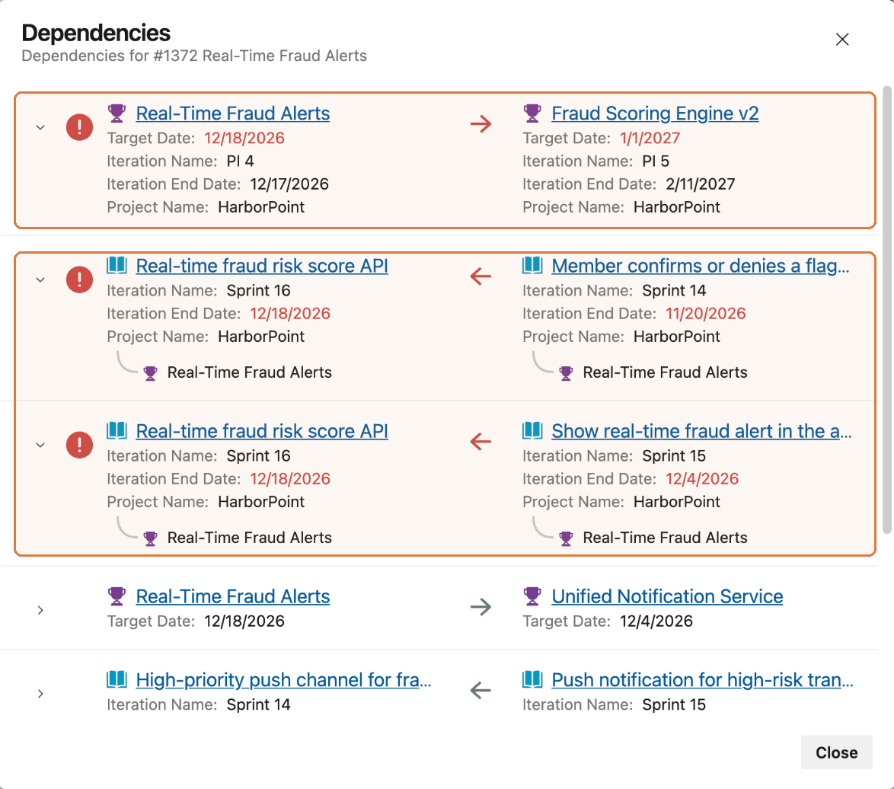
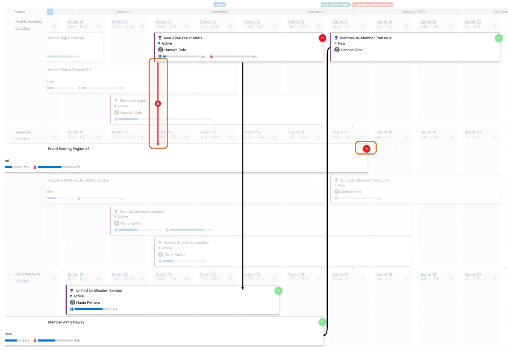
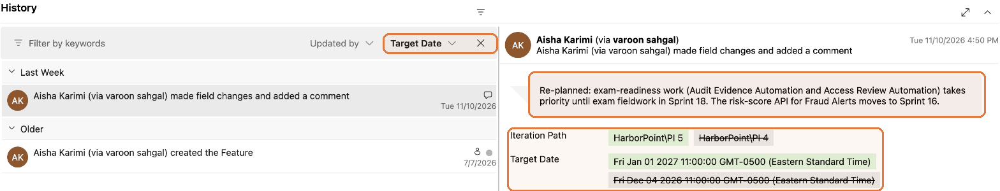
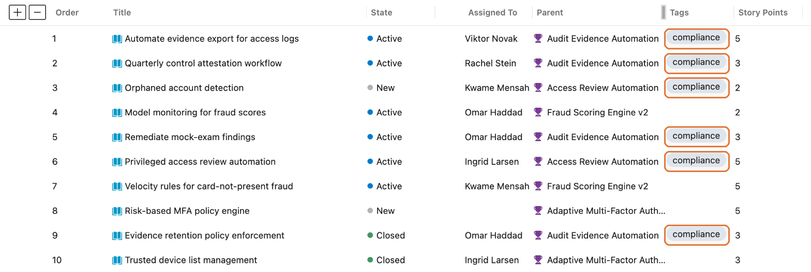
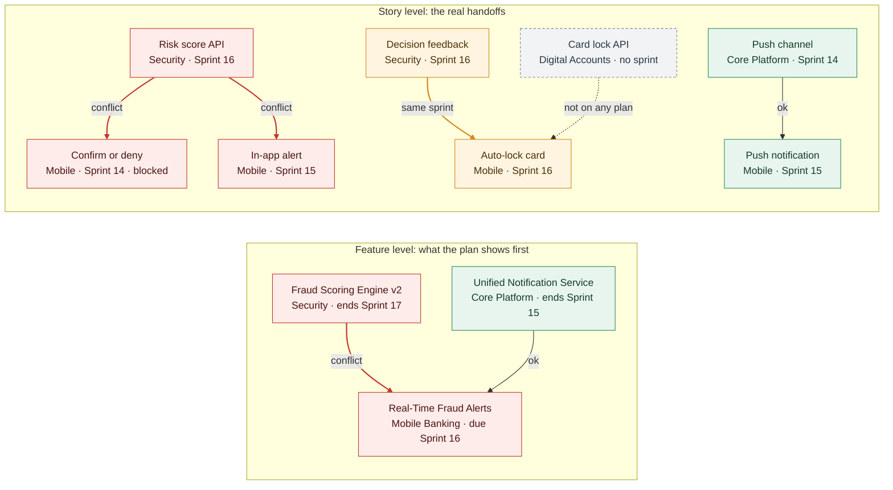

!!! briefing "Mission briefing"
    **Real-Time Fraud Alerts** will warn members within seconds that a transaction looks wrong, and let them confirm or deny it from the app. It sits under the number one Epic, *Fraud Detection & Security*. Mobile Banking owns it, Security and Core Platform build parts of it, and it's due at the end of Sprint 16, the PI 4 System Demo. It is 4% done by Story Points.

    You've seen it twice: a red dependency line in Lab 2, and the one **Blocked** story on your Command Center. Today you pull that thread. The work it waits on sits in a team you don't manage, so your job is to make the problem visible, find its cause, and put decision-ready options in front of the person who owns the priority.

    **Done looks like:**

    - **Parts 1–3:** a Delivery Plan that shows the conflict at two altitudes, Feature and story
    - **Part 4:** a saved query that shows the dependency the plan can't
    - **Part 5:** an evidence trail for why the date slipped
    - **Part 6:** an options matrix and a five-sentence recommendation for Simone

<strong>Simone Laurent</strong>Chief Risk Officer · 7:48 AM

Fraud Alerts is the Executive Committee's number one priority and a committed PI 4 objective. This morning I heard, secondhand, that it's "a bit behind." I don't do secondhand. Tell me who's waiting on whom, how late it really is, and what my options are, with what each one costs. If a decision is mine, say so and I'll make it. I'm with Dana at four.

## What you'll walk away with

- Put a cross-team initiative on one calendar, with the dates that matter marked
- Read a red dependency line for what it is: two end dates that disagree, and nothing more
- Size a dependency by dropping from the Feature line to the story links underneath
- Find what a Delivery Plan cannot show (unlinked, unscheduled and off-plan work) with a direct-links query
- Trace a slip to its root cause with evidence: history, sprint content, velocity and portfolio rank
- Turn a scheduling conflict into a portfolio decision: options with a date effect, a risk, a cost and a named decider

## Before you set sail

- **Access:** Basic, as a Contributor. You can create Delivery Plans but edit only your own, so you build one instead of touching the official **HarborPoint Program Plan**.
- **Your ID** is set (the **Crew** chip), and `Shared Queries/Training/P##/` exists from [Lab 3](../day-1/lab-03-query-toolkit.md); if not, create it now.
- **Read, never change:** `Mobile Banking`, `Security` and `Core Platform` (plan rows and sprint data) and `HarborPoint Team` (the Epics backlog). Column options, view options and report settings are per user, so adjust them freely. The [environment map](../start/environment.md) lists the teams.
- **You'll create:** the plan `P## - Fraud Alerts Plan`, the query `Fraud Alerts dependencies` and the wiki page `/Training/P##/Fraud Alerts Options`.
- **Time-box:** 55 minutes. If you fall behind, speed through Parts 1 to 4 and protect 15 minutes for Part 6: the options are the point.

!!! warning "Look, but don't drag"
    A Delivery Plan is a live editing surface. Dragging a card moves the real work item to another sprint; dragging its edge rewrites its Start or Target Date for every team and dashboard. The **+** in a sprint cell creates real work items. On this plan you **select** (badges, card edges, titles). You never **drag**.

## Part 1 — Put three teams on one calendar

Three teams, one Feature, one deadline. Get them onto one calendar before anyone argues about who is late.

!!! speedrun "Speed run · 8 minutes"
    Build a Delivery Plan named `P## - Fraud Alerts Plan` with:

    - the **Features** backlog of `Mobile Banking`, `Security` and `Core Platform`
    - a marker `PI 4 System Demo` on the last day of Sprint 16, and a marker `Regulatory exam fieldwork` on the first day of Sprint 18
    - cards that show their parent, their tags and a child rollup bar

??? pilot "Harbor Pilot · Hint 1: Take a bearing"
    Plans live under **Boards**. Each row is one team at one backlog level. Markers and card fields live in the plan's **Settings**.

??? pilot "Harbor Pilot · Hint 2: Set the heading"
    Create the plan first: its sprint cells show the dates you need for the markers. In **Settings**, use **Markers** › **+ Add marker** (**Date**, **Label**, **Color**), then **Fields** for **Show Parent**, **Show Tags** and **Show child rollup data**.

??? pilot "Harbor Pilot · Hint 3: Bring it into port (full solution)"
    1. **Boards › Delivery Plans** › **+ New plan**.

    2. **Name** `P## - Fraud Alerts Plan`. **Description** `Real-Time Fraud Alerts across Mobile Banking, Security and Core Platform`.
    3. In the team grid, set **Project** `HarborPoint`, **Team** `Mobile Banking`, **Backlog** `Features`. Select **+ Add team** twice more for `Security` and `Core Platform`, both at `Features`. Select **Create**.
    4. On the plan, note the dates shown in the **Sprint 16** and **Sprint 18** cells.
    5. **Settings** › **Markers** › **+ Add marker**: **Date** = the last day of Sprint 16, **Label** `PI 4 System Demo`. Add a second marker on the first day of Sprint 18, labeled `Regulatory exam fieldwork`. Pick colors that stand out.
    6. **Fields**: turn on **Show Parent**, **Show Tags** and **Show child rollup data**. Select **Save**.
    7. Expand every row with the arrow next to **Teams**, then **Zoom in** or **Zoom out** until Sprint 13 to Sprint 18 fill the screen.

    **Expected result:** `Real-Time Fraud Alerts`, in the Mobile Banking row, ends right at your PI 4 System Demo marker. In the Security row, `Fraud Scoring Engine v2` runs a full sprint past it.

!!! checkpoint "Checkpoint"
    - [ ] `P## - Fraud Alerts Plan` shows three team rows at the Features level
    - [ ] Both markers sit where they belong: end of Sprint 16 and start of Sprint 18

!!! takeaway "Takeaway"
    Put every contributing team on one calendar, with the dates that matter marked, before anyone argues about who is late.

## Part 2 — Read the red line

A Security Feature runs past the System Demo. Does that matter to Fraud Alerts? The plan stays quiet until you ask.

1. Find `Real-Time Fraud Alerts` in the Mobile Banking row and look at the chain-link badge at the card's upper right. Green means "No dependency scheduling issues"; red means "Dependency scheduling conflicts detected".
2. Select the badge. The **Dependencies** dialog lists each predecessor and successor with its **Iteration Name**, **Iteration End Date** and **Project Name**, with the parent Feature and Epic underneath.

<figure class="hp-shot" data-shot="lab07-dependencies-dialog" markdown>

<i></i><i></i><i></i>Boards › Delivery Plans › Dependencies for Real-Time Fraud Alerts

{ loading=lazy }

<figcaption markdown>One red Feature-level conflict, and beneath it the **story-level** truth: two Mobile stories planned in Sprints 14 and 15 depend on an API that lands in **Sprint 16**. The green row (Unified Notification Service) is fine.</figcaption>
</figure>

**You should see** two predecessors:

| Predecessor | Team | Ends | Verdict |
|---|---|---|---|
| `Fraud Scoring Engine v2` | Security | Sprint 17 | **Red.** Ends a sprint *after* Fraud Alerts is due |
| `Unified Notification Service` | Core Platform | Sprint 15 | Fine |

The conflict rule compares **Target Dates**. The dialog's **Iteration End Date** is the end of the PI the Feature is planned against (PI 4 or PI 5), not its target.

**Now draw the lines.** **Close** the dialog. Select the card's top or bottom edge, or the plan's link button (**Show and hide dependencies**) to draw every line at once. Black lines are fine; a red line with a ⊗ is a conflict, and both ends wear a red badge.

<figure class="hp-shot" data-shot="lab07-plan-feature-red-line" markdown>

<i></i><i></i><i></i>Boards › Delivery Plans › P## - Fraud Alerts Plan (dependencies shown)

{ loading=lazy }

<figcaption markdown>The toolbar's link button draws every dependency at once. One line is **red with a ⊗**: Fraud Alerts ends at the System Demo, and its predecessor runs a full sprint past it. The arrowhead points at the item being waited *on*. Black lines are fine.</figcaption>
</figure>

The arrowhead points at the **predecessor**, the opposite of how most people draw "A feeds B". If in doubt, the dialog names each side.

Two more readings:

- **Look at your exam marker.** Which Security Features end *after* fieldwork begins? Both Compliance Features, `Audit Evidence Automation` and `Access Review Automation`, target the end of Sprint 18: the mandatory work runs straight into the exam, unpadded. Remember that when someone says Security could "just pause compliance for a sprint".
- **Make a prediction.** Based only on this line, how late is Fraud Alerts? Write one line; Part 5 checks it.

!!! checkpoint "Checkpoint"
    - [ ] My plan shows a red line between `Fraud Scoring Engine v2` and `Real-Time Fraud Alerts`, and I opened the **Dependencies** dialog
    - [ ] I can name the two Security Features that end after exam fieldwork begins
    - [ ] I wrote down my gut answer to "how late is it, really?"

!!! takeaway "Takeaway"
    A red line tells you two end dates disagree. It doesn't tell you why, by how much, or what to do. That part is your job.

## Part 3 — Drop below the waterline

The Feature line says *that* there's a problem. How big is it? Drop one level down.

1. **Settings** › **Teams** › **+ Add team**, three times: `Mobile Banking`, `Security` and `Core Platform`, each with **Backlog** `Stories`. In that list, drag each Stories row under its team's Features row (this reorders plan rows only, not work).
2. **Field criteria** › **+ Add criteria**: `Work Item Type` `<>` `Bug`. Mobile Banking manages its 42 open bugs on the Stories backlog, and you don't need them here.
3. **Save**, expand all rows and zoom in on Sprints 14 to 16. Story cards now show their parent Feature.
4. **Declutter.** Mobile's Stories row holds every story it has ever done. Open the plan's **Filter** (the funnel next to the star), set **Parent Work Item** to `Real-Time Fraud Alerts`, then select the link button. Filters are per user; clear them when you're done.

!!! challenge "Challenge: Map the chain"
    Fraud Alerts has eleven stories across three teams. Find every one with a dependency badge, and complete this map:

    | Predecessor (team, sprint) | Successor (team, sprint) | Red, fine or fragile? |
    |---|---|---|
    | | | |

    There are **four** links on your plan. Two are red; one isn't red but should still worry you. Then open the story that's already in progress and read its **Discussion**.

??? pilot "Harbor Pilot · Hint 1: Take a bearing"
    Start with Security's Stories row in Sprint 16. Expand both team rows, or the lines between them can't be drawn.

??? pilot "Harbor Pilot · Hint 2: Set the heading"
    Open the **Dependencies** dialog on `Real-time fraud risk score API` (Security) and on `Auto-lock card after a member denies a transaction` (Mobile Banking), and compare end sprints. Equal end dates never count as a conflict. Does "not red" mean "safe"?

??? pilot "Harbor Pilot · Hint 3: Bring it into port (full solution)"
    | Predecessor | Successor | Verdict |
    |---|---|---|
    | `Real-time fraud risk score API` (Security, Sprint 16) | `Member confirms or denies a flagged transaction` (Mobile Banking, Sprint 14, Active, `blocked`) | **Red.** Mobile started two sprints before the thing it needs exists |
    | `Real-time fraud risk score API` (Security, Sprint 16) | `Show real-time fraud alert in the app` (Mobile Banking, Sprint 15) | **Red** |
    | `Alert decision feedback to fraud engine` (Security, Sprint 16) | `Auto-lock card after a member denies a transaction` (Mobile Banking, Sprint 16) | **Fragile.** Same sprint, so never flagged. It only works if Security finishes early and Mobile finishes late |
    | `High-priority push channel for fraud alerts` (Core Platform, Sprint 14) | `Push notification for high-risk transactions` (Mobile Banking, Sprint 15) | **Fine.** Core Platform delivers a sprint ahead |

    The confirm/deny story's Discussion says it plainly: *"UI done; can't integrate until Security's risk-score API exists."*

    **So what? Mobile isn't slow on this Feature. It's parked.** That 4% measures a waiting room, not a work rate, and one Security story holds the door shut.

<figure class="hp-shot" data-shot="lab07-plan-story-level" markdown>

<i></i><i></i><i></i>Boards › Delivery Plans › P## - Fraud Alerts Plan › Stories rows, filtered to Parent Work Item = Real-Time Fraud Alerts

{ loading=lazy }

<figcaption markdown>Below the waterline. Red badges: Mobile's **Member confirms** (Sprint 14) and **Show real-time alert** (Sprint 15) both wait on Security's **risk-score API** (Sprint 16). Green badge on **Auto-lock** (Sprint 16): same-sprint handoffs are never flagged, which is exactly why it's fragile.</figcaption>
</figure>

!!! insight "Lighthouse insight: ask what you actually depend on"
    The Feature line says Fraud Alerts waits for *all* of Fraud Scoring Engine v2, a 65-point Feature ending in Sprint 17. The story links say it waits for *one* 8-point story, the risk-score API, planned for Sprint 16. Those are very different negotiations, so drop one level before you escalate.

!!! reef "Reef ahead: green at the top, red underneath"
    A badge compares two cards' end dates and knows nothing about the order of work inside them. So a same-sprint handoff like decision feedback → auto-lock is never flagged, and a Feature line can turn black while every story-level red line beneath it stays red. A green Feature is a hypothesis; the stories are the evidence.

!!! checkpoint "Checkpoint"
    - [ ] My plan has six rows (three teams at Features and Stories level), with bugs filtered out
    - [ ] My map shows four links: two red, one fragile, one fine
    - [ ] I read the comment on the blocked confirm/deny story

!!! takeaway "Takeaway"
    Read dependencies at two altitudes: the Feature line finds the problem, the story links size it, and the narrower the real dependency, the more options you have.

## Part 4 — Find what the plan can't see

What doesn't the plan draw? A line appears only when both items are on the plan, both have dates, and someone created a Predecessor/Successor link between them. Everything else is invisible, so ask the data directly.

!!! predict "Make a call"
    Before you build the query, guess: **how many teams does Fraud Alerts really depend on, counting every team that owns a linked item?** And if your plan missed a dependency, **why**: no link, no sprint, or a team you didn't add?

!!! challenge "Challenge: Ask the data directly"
    Build a query that lists every Fraud Alerts story with a **Predecessor** or **Successor** link, the linked item indented underneath, showing each item's team and sprint. Save it as `Fraud Alerts dependencies` in `Shared Queries/Training/P##/`. Then find the dependency your plan never showed you.

??? pilot "Harbor Pilot · Hint 1: Take a bearing"
    It's a question about *links*, so use the query type built for links. The top level is Fraud Alerts' children; the **Parent** field accepts a work item ID.

??? pilot "Harbor Pilot · Hint 2: Set the heading"
    **Work items and direct links**, top level `Parent` `=` Fraud Alerts' ID, **Only return items that have matching links**, link types **Predecessor** and **Successor**. Add `Node Name` and `Iteration Path` as columns: ownership and timing are the point.

??? pilot "Harbor Pilot · Hint 3: Bring it into port (full solution)"
    1. Open `Real-Time Fraud Alerts` (select its title on the plan) and note its **ID**.
    2. **Boards › Queries** › **New** › **New query**. Set **Query type** to **Work items and direct links**.

    3. **Filters for top level work items**:

        | And/Or | Field | Operator | Value |
        |:--|:--|:--|:--|
        | | Parent | = | *the ID of* `Real-Time Fraud Alerts` |

        Type the ID straight into **Value**, for example `1372`.

    4. **Filters for linked work items**: leave the default (any type).
    5. **Filter options**: **Only return items that have matching links**. **Types of links**: **Return selected link types**, ticking only **Predecessor** and **Successor**.

    6. **Column options**: `Work Item Type`, `Title`, `State`, `Node Name`, `Iteration Path`, `Assigned To`, `Tags`.
    7. **Run query**, then **Expand all**. **Save** it as `Fraud Alerts dependencies` in `Shared Queries/Training/P##`.

    **Expected result:** **7** of Fraud Alerts' 11 stories at the top level, with **9** linked rows beneath them. Every linked item is another Fraud Alerts story except one: `Card lock and unlock service and API`, Node Name `Digital Accounts`, State `New`, Iteration Path `HarborPoint`, the backlog root: **no sprint at all**. It is a predecessor of `Auto-lock card after a member denies a transaction` (Sprint 16).

    For direction without guesswork, run it again with only **Predecessor** ticked: just the four stories that wait on someone, and their five predecessors.

<figure class="hp-shot" data-shot="lab07-direct-links-query" markdown>

<i></i><i></i><i></i>Boards › Queries › Shared Queries › Training › P## › Fraud Alerts dependencies (Work items and direct links)

{ loading=lazy }

<figcaption markdown>Every Fraud Alerts story with a Predecessor or Successor link, its partner indented below. One partner belongs to a **fourth team**: `Card lock and unlock service and API`, Digital Accounts, Iteration Path `HarborPoint`. No sprint at all, so it can never turn red on a plan.</figcaption>
</figure>

**So what? Fraud Alerts depends on four teams, not three, and nobody mentioned the fourth.** The missing link fails two of the plan's tests: no sprint, and a team not on the plan. Auto-lock waits on the first story of **Instant Card Controls**, Digital Accounts' `leadership-ask` Feature, unscheduled behind their committed PI 4 work. It can never turn red, because it can never be late: it isn't planned at all. (You'll meet it again in [Lab 9](../day-3/lab-09-meet-the-deadline.md).)

!!! reef "Reef ahead: the plan only knows what people told it"
    **Related** links, unscheduled items and teams you didn't add never appear on a plan. `Biometric Login` is tagged `cross-team`, and Security has a story under it in Sprint 15 (`Device binding risk signal`), yet there's no line anywhere. No dependency, or nobody linked it? The plan can't tell, and neither can you without asking Hannah and Aisha.

!!! checkpoint "Checkpoint"
    - [ ] `Shared Queries/Training/P##/Fraud Alerts dependencies` is saved and returns 7 top-level stories
    - [ ] I found the predecessor with no sprint, and I know which team owns it

!!! takeaway "Takeaway"
    No line is not no risk: a plan draws only the links people made between dated items on it, so pair every plan with a direct-links query.

## Part 5 — Follow the evidence to the root cause

You know who waits on whom. Why did the date slip? Simone will ask for the cause, and "Security is busy" is not an answer.

!!! speedrun "Speed run · 10 minutes"
    Five questions. Write one line of evidence for each, and where you found it.

    1. **Who moved the API, when, and what reason did they record?**
    2. **When it moved, what else moved?**
    3. **Where is Security's capacity going this sprint?** Answer in points and as a share.
    4. **Is Security over-committed, or just unlucky?**
    5. **What does the portfolio say should come first, and what did HarborPoint promise for PI 4?**

??? pilot "Harbor Pilot · Hint 1: Take a bearing"
    Every answer sits in a view you know: a work item's **History**, a sprint backlog, a **Velocity** report, a portfolio backlog and the wiki.

??? pilot "Harbor Pilot · Hint 2: Set the heading"
    1. `Fraud Scoring Engine v2` › **History** tab. Select the funnel above the list and set **Fields** to `Target Date` to keep only the revisions that touched it.
    2. The `Real-Time Fraud Alerts` form (Target Date, Tags) and the Mobile stories on your plan.
    3. **Boards › Sprints**, team `Security`, `Sprint 14`, **Backlog** tab. Use **Column Options** to add `Parent` and `Tags`.
    4. **Boards › Backlogs**, team `Security`, **Stories** level, **Analytics** › **Velocity** › **View full report**. Then **View options** › **Side Pane** › **Planning** to read **Planned Effort** for Sprints 15 and 16. Look, don't drag.
    5. **Boards › Backlogs**, team `HarborPoint Team`, **Epics** level. Then **Overview › Wiki** › `Program` › `PI 4 Objectives`.

??? pilot "Harbor Pilot · Hint 3: Bring it into port (full solution)"
    | # | Evidence |
    |:-:|:--|
    | 1 | **Aisha Karimi** moved **Target Date** from the end of Sprint 15 to the end of Sprint 17 on day 2 of this sprint, and moved the Feature from **PI 4** to **PI 5** in the same save, with the comment *"Re-planned: exam-readiness work (Audit Evidence Automation and Access Review Automation) takes priority until exam fieldwork in Sprint 18. The risk-score API for Fraud Alerts moves to Sprint 16."* Those are the two Compliance Features. |
    | 2 | **No dates moved downstream.** Fraud Alerts still targets Sprint 16, still carries `PI4-Committed`, and has no `at-risk` tag. Its confirm/deny and in-app alert stories are still planned for Sprints 14 and 15. The re-plan lives in one work item and nowhere else. |
    | 3 | Security's Sprint 14 holds 10 stories and 36 points. Six are tagged `compliance`: **21 points, 58%**, all under the Compliance Epic. Four Features are in flight for six people, and **zero** points go to Fraud Alerts. |
    | 4 | **Over-committed.** **Planned** climbed 24, 25, 26, 30, 32, then 36 in Sprint 14, while **Completed** stayed between 20 and 22. Sprint 15 already holds 23 points. Sprint 16 holds 28, *including the API*, and loses two days to the company holiday. |
    | 5 | `Compliance: Examination Readiness` ranks **last of six** Epics, though it's mandatory with a fixed date. Simone owns it *and* the number one Epic. The PI 4 Objectives page lists Fraud Alerts as a **committed** objective, and Security's own section lists the risk-score API as its share of that commitment. |

    **So what? The root cause in one line:** Security quietly re-ranked its own work to protect a mandatory deadline the portfolio never ranked, and the cost landed on priority number one without anyone deciding it should.

    **And your Part 2 gut answer?** "One sprint late" is the best case. The API lands in Sprint 16 at the earliest, Security's most overloaded sprint, and only then can Mobile integrate and test it, with the one tester you met in [Lab 6](lab-06-which-team-needs-help.md).

<figure class="hp-shot" data-shot="lab07-f10-history" markdown>

<i></i><i></i><i></i>Work item › Fraud Scoring Engine v2 › History, filtered by Fields: Target Date

{ loading=lazy }

<figcaption markdown>Filter History to the field you care about and the noise disappears. One revision by **Aisha Karimi**, day 2 of Sprint 14: a reason in the comment, the PI moved from 4 to 5, and the Target Date pushed a month.</figcaption>
</figure>

<figure class="hp-shot" data-shot="lab07-security-sprint14" markdown>

<i></i><i></i><i></i>Boards › Sprints › Security › Sprint 14 › Backlog (Parent, Tags, Story Points added)

{ loading=lazy }

<figcaption markdown>Where Security's sprint went: six `compliance` stories, **21 of 36 points**, all under the Compliance Epic. Four Features in flight for six people, and not one point for Fraud Alerts.</figcaption>
</figure>

!!! insight "Lighthouse insight: dependency management is portfolio management"
    The red line runs between two teams, but the conflict is between two Epics: Fraud Detection & Security (ranked first) and Compliance (ranked last, but mandatory). Aisha made a reasonable call, alone, because the portfolio gave her no answer. Every cross-team dependency is a priority question. If leaders don't answer it, the busiest team does, and everyone else finds out at the System Demo.

!!! checkpoint "Checkpoint"
    - [ ] I have one line of evidence for each of the five questions, with where I found it
    - [ ] I compared my Part 2 gut answer with the evidence

!!! takeaway "Takeaway"
    Most cross-team bottlenecks are priority decisions nobody made: when the portfolio doesn't rank the work, the busiest team ranks it for you.

## Part 6 — Give Simone real options

You have the chain and the cause. What can Simone actually decide? Start from everything you traced, in one picture no single Azure DevOps view shows: the plan can't see the fourth team, and the query can't see the calendar.

Read it left to right, from the item waited on to the item waiting (opposite to the plan's arrowheads). Red is a conflict, amber fragile, green fine; the dashed box is the dependency no plan will draw.

!!! challenge "Challenge: The options matrix"
    Build a matrix with **at least five options** for getting Fraud Alerts back on course, plus a **do-nothing baseline** that shows the cost of not deciding. For each option:

    | Option | What changes (which items, which teams) | Effect on Fraud Alerts' date | Risk | Who pays (which priority gives way) | Who decides |
    |---|---|---|---|---|---|

    Then write your **recommendation in exactly five sentences**: the bottom line, what you recommend, what it costs, the specific decision you need from Simone (and anyone else), and how you'll stop this happening again.

!!! deliverable "Deliverable"
    A wiki page `/Training/P##/Fraud Alerts Options` (a sub-page of your `P##` page under **Overview › Wiki**) with your matrix, your five sentences, and links to `P## - Fraud Alerts Plan` and your `Fraud Alerts dependencies` query. [Lab 8](lab-08-executive-status-review.md) turns it into risk 1 of your executive briefing.

??? pilot "Harbor Pilot · Hint 1: Take a bearing"
    Options come in families: change the **sequence**, the **scope**, the **capacity**, the **date** or the **dependency** itself, or fix the **system** that caused it. Whoever's priority gives way decides.

??? pilot "Harbor Pilot · Hint 2: Set the heading"
    Real levers, with numbers:

    - **Non-mandatory Security work** in Sprints 14 and 15: `Risk-based MFA policy engine` (5 points, unassigned, not started), `Passkey enrollment` (5) and `Merchant risk signals in scoring` (5). Adaptive MFA and Fraud Scoring Engine v2 share Fraud Alerts' Epic, so trading between them is Simone's call.
    - **Core Platform has room:** 12 points planned in Sprint 15 and 5 in Sprint 16, against a steady velocity of about 20 (check its **Planning** pane).
    - **The confirm/deny UI is already built** and lacks only the API, so an agreed API contract lets Mobile keep moving.
    - **Auto-lock carries both fragile links**: the same-sprint feedback and the unscheduled card-lock API.
    - **Dates and ranks are fields.** Changing them is easy; getting the right person to agree is the work.

??? pilot "Harbor Pilot · Hint 3: Bring it into port (full solution)"
    A model matrix. Yours can differ, as long as every row has a named decider and an honest cost.

    | Option | What changes | Effect on the date | Risk | Who pays | Who decides |
    |---|---|---|---|---|---|
    | **0. Do nothing** (baseline) | The API lands in Sprint 16; integration and testing follow | Misses PI 4, discovered at the System Demo | Maximum surprise; confirm/deny stays parked | Members, and trust in PI commitments | Nobody, which is the problem |
    | **1. Re-sequence Security** | Pull the API (8 points) into Sprint 15; defer 8 to 10 points of non-mandatory work such as `Risk-based MFA policy engine` and `Passkey enrollment` | Sprint 16 becomes possible, not certain | Sprint 15 already holds 23 points against a velocity of about 21; integration still lands late | Adaptive MFA slips toward PI 5 | Simone (both Features are hers), with Aisha |
    | **2. Contract-first** | Agree the API contract now; Mobile builds and tests against a mock | Doesn't move the API, but shortens everything after it | Contract changes cause rework | A little rework in Mobile | Hannah and Aisha |
    | **3. Descope the MVP** | Alerts and confirm/deny ship in PI 4; auto-lock moves to PI 5 | Makes Sprint 16 realistic for the MVP | Members still lock cards another way for a PI | Auto-lock waits a PI | Simone, with Hannah and Priya |
    | **4. Borrow Core Platform** | Core Platform takes the API plumbing or a non-mandatory Security story in Sprints 15 and 16 | Could pull the API forward without touching Adaptive MFA | Ramp-up, access to fraud systems, and its own enablers due in Sprints 15 and 16 | Core Platform's spare capacity | Nadia and Aisha, brokered by Ruth |
    | **5. Move the date** | Fraud Alerts' Target Date moves to Sprint 17 and the PI 4 objective is re-planned | Sprint 17, honestly | Fraud exposure lasts another sprint | PI 4 credibility | Dana and Simone |
    | **6. Fix the ranking** | Rank the Compliance Epic where reality has it, or reserve Security capacity for it explicitly through Sprint 18 | None this PI; prevents the next one | An uncomfortable conversation | Nothing new: it makes the existing cost visible | Simone and the Executive Committee, with Ruth |
    | **7. Question the link** | Ask whether the API needs Fraud Scoring Engine v2, or can serve today's scores first | Could decouple Fraud Alerts from the engine's Sprint 17 date | Rework when v2 lands | Security | Aisha and Hannah |

    **So what? Read down the last column.** Simone is named on four of the seven options, because she owns both priorities in conflict. This isn't a Security problem to escalate; it's her decision, and your job is to make it easy.

    **A model recommendation, in five sentences:**

    > As planned, Real-Time Fraud Alerts misses PI 4: Security moved the risk-score API to Sprint 16 to protect mandatory exam work, and Mobile's confirm/deny story is already blocked waiting for it. I recommend we hold Sprint 16 for a smaller MVP (alerts plus confirm/deny), move auto-lock to PI 5, and have Mobile build against an agreed API contract starting this week. That works only if the API lands in Sprint 15, by deferring 8 to 10 points of Adaptive MFA work or borrowing Core Platform engineers, who have room in Sprints 15 and 16; exam work stays fully protected either way. Simone, both sides of that trade are your priorities, so the call is yours; if you'd rather keep Adaptive MFA whole, we should formally move Fraud Alerts to Sprint 17 with Dana now, not discover it at the System Demo. Either way, let's rank the Compliance Epic where it really sits, or reserve Security capacity for it through Sprint 18, so leaders make this trade instead of one team absorbing it.

!!! reef "Reef ahead: “Just ask Security to work harder”"
    The most common option in real escalations is the one the evidence rules out. Security has completed about 21 points a sprint for five sprints while its plans grew by half and its carry-over grew from 2 points to 12. Pressure creates carry-over, not capacity, and the exam date doesn't move. If "Security stretches" is in your matrix, replace it with a trade: what Security stops doing, and who agreed.

!!! checkpoint "Checkpoint"
    - [ ] My matrix has at least five options plus a do-nothing baseline, each with a date effect, a risk, who pays and a named decider
    - [ ] My recommendation is five sentences, opens with the bottom line and asks Simone for one specific decision
    - [ ] It's saved at `/Training/P##/Fraud Alerts Options`

!!! takeaway "Takeaway"
    Bring options, not alarms: each with its effect on the date, its risk, who pays and a named decider.

## Knowledge check

**Aisha moves Fraud Scoring Engine v2's Target Date back to the end of Sprint 16, the same day Fraud Alerts is due. What happens on your plan?**

- [ ] The Feature-level conflict and the story-level conflicts all clear
- [x] The Feature-level line turns black, and every story-level red line stays red
- [ ] The line stays red, because a predecessor must end before its successor, not on the same day
- [ ] The dependency link is removed, because the dates now match

Conflicts compare end dates only, and equal end dates don't conflict. The risk-score API would still sit in Sprint 16, two sprints after the confirm/deny story that needs it. Fixing the line isn't fixing the problem.

**Your plan shows no dependency lines for Biometric Login, a `cross-team` Feature with a Security story in Sprint 15. What can you safely conclude?**

- [ ] Biometric Login has no cross-team risk
- [ ] Security's part of Biometric Login is on schedule
- [x] Nothing yet: either there is no dependency, or nobody has linked it
- [ ] The plan is misconfigured

A plan draws only the Predecessor/Successor links people created, between items it can render. No line means no data, not no risk. The fix is a five-minute conversation and, if the dependency is real, a link.

**Security spends 58% of Sprint 14 on mandatory exam work while the number one priority waits. What's the best first move?**

- [ ] Ask Security to pause compliance work until Fraud Alerts ships
- [ ] Ask Security to fit the API in alongside everything else this sprint
- [x] Put the trade-off between the two Epics in front of Simone, who owns both, with options and their costs
- [ ] Move Real-Time Fraud Alerts to the Security team

The exam date is fixed and Security's output has been flat while its plans grew by half, so pausing compliance and pushing harder are both off the table. This isn't a scheduling dispute between two teams; it's an unmade decision between two priorities with the same owner.

## Captain's log

!!! log "Captain's log"
    1. Could you produce today's dependency map for your most important cross-team initiative in 15 minutes? If not, what's missing: the links, the dates, or the teams on one plan?
    2. The last time a date moved in another team's tracker, how did your team find out, and how long did it take?
    3. Which mandatory or "keep the lights on" work in your portfolio isn't ranked anywhere, but quietly eats capacity?
    4. Who owns both sides of your hardest cross-team conflict? Have they been asked to choose?
    5. Which of today's options would your organization pick by default? Should it?

!!! bonus "Extra knots"
    1. **Watermelon check.** On your plan, add a styling rule (**Settings** › **Styles** › **+ Add styling rule**) with two criteria: `Work Item Type` `=` `Feature` and `Risk` `=` `1 - High`. Three cards light up. How many carry the `at-risk` tag, and what does that tell you about a dashboard tile that counts the tag?
    2. **A program dependency register.** Build a second direct-links query with top-level clauses `Work Item Type` `In` `Feature,User Story` and `Area Path` `Not Under` `HarborPoint\Training`, link types **Predecessor** and **Successor**, and **Only return items that have matching links**. Expect three Feature-level links and five story-level links. Add it to your [Lab 5](lab-05-command-center.md) Command Center as a **Query Results** widget, which renders direct-link queries.
    3. **Prove the invisible.** Add `Digital Accounts` at the `Stories` level to your plan and look for `Card lock and unlock service and API`. Why isn't it there? What would make the auto-lock dependency turn red, and would that be good news or bad?

!!! harbor "Back in your own harbor"
    Three moves for your first week back, about 30 minutes in your own Azure DevOps:

    1. **Put your cross-team initiative on one plan.** **Boards › Delivery Plans** › **+ New plan**, add each contributing team at the **Features** level, and add a marker for the date that matters, then use **Show and hide dependencies** to draw every line. Look, don't drag: moving a card changes the real work item for everyone.
    2. **Save a dependency query beside it.** Build a **Work items and direct links** query with `Parent` `=` your most important Feature's ID, **Only return items that have matching links**, and only **Predecessor** and **Successor** ticked. Add `Node Name` and `Iteration Path`, then look for any linked item with no sprint or from a team that isn't on your plan.
    3. **Ask who decided.** Pick one red line, open the predecessor's **History** and filter **Fields** to `Target Date` to see who moved it and why. Then ask whose priority gave way, and whether that person was the one who chose.

## Key takeaways

- **One calendar first.** Put every contributing team on one plan, with the dates that matter marked, before anyone argues about who is late.
- **A red line is a question.** It says two end dates disagree, not why, by how much, or what to do. That part is your job.
- **Read at two altitudes.** The Feature line finds the problem; the story links size it. The real handoff is often narrower, and narrower means more options.
- **No line is not no risk.** Plans draw only Predecessor/Successor links between dated items on the plan, so pair every plan with a direct-links query.
- **Bottlenecks are unmade decisions.** When the portfolio doesn't rank mandatory work, the busiest team ranks it for you, and priority number one pays.
- **Bring options, not alarms.** Give each one its effect on the date, its risk, who pays and a named decider.
