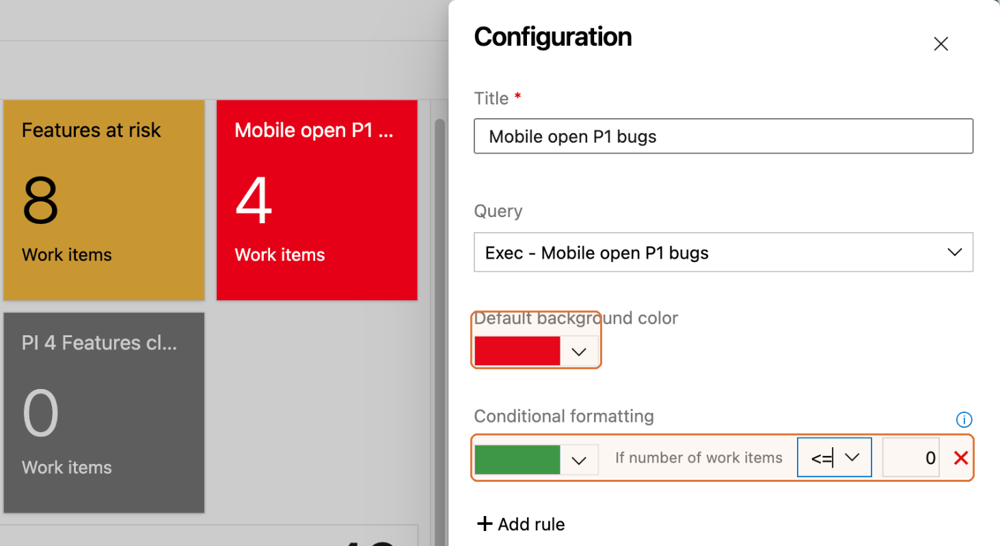
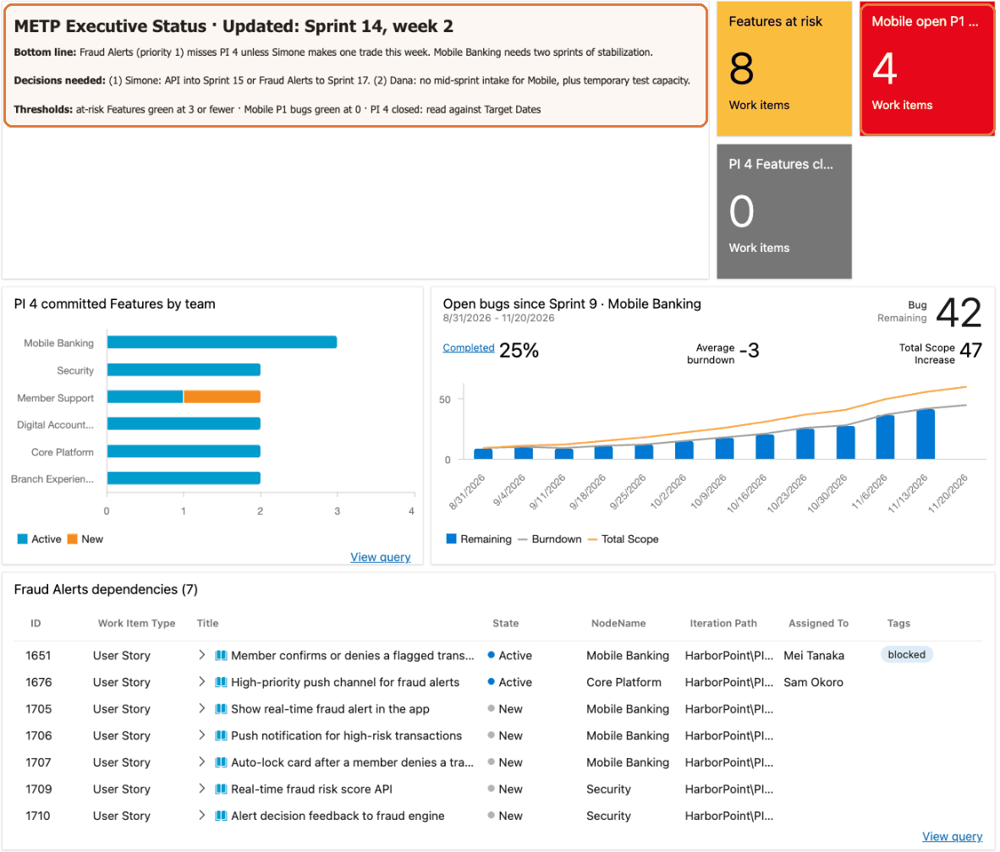
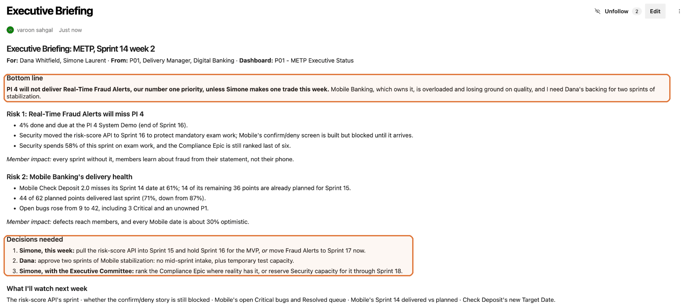

!!! briefing "Mission briefing"
    Thursday's Executive Committee has Project Lighthouse on its agenda for the wrong reasons: leadership has heard "delays" from three directions. Dana Whitfield, the program sponsor, wants one page from you that says which ones matter and what she should decide.

    You have more evidence than you can use: Lab 5's Command Center with a dozen widgets, Lab 6's verdict on Mobile Banking, Lab 7's options matrix for Real-Time Fraud Alerts. None of it is a briefing yet. Executives need the answer first, then the evidence, then the decisions only they can make.

    **Done looks like:** one briefing, built in five moves.

    1. **Two risks** you can defend against the alternatives (Part 1)
    2. **A seven-widget executive dashboard** where every widget points at a decision (Part 2)
    3. **A one-page bottom-line-up-front (BLUF) briefing** with owned asks (Part 3)
    4. **A three-minute delivery** that survives Dana's questions (Part 4)
    5. **A weekly and monthly review rhythm** that keeps it true (Part 5)

<div class="msg" data-initials="DW" data-tone="navy" markdown>
<p class="msg-head"><strong>Dana Whitfield</strong><span>EVP, Member Experience · 7:41 AM</span></p>

The Executive Committee is nervous about Lighthouse. "Delays" is all I keep hearing, and nobody can tell me which ones matter. I have ten minutes on Thursday. Priya says you have the clearest picture of Fraud Alerts and Mobile. Send me one page: are we going to make it, what are the two things that worry you most, and **what do you need me to decide?** No forty-slide decks, please.
</div>

## What you'll walk away with

- Separate the risks that threaten portfolio priorities from the noise, and defend your two picks against the alternatives
- Design an executive dashboard as an argument: each widget answers a question and points at a decision
- Write a one-page BLUF briefing in members' terms, with asks one named person can say yes or no to
- Answer an executive's hardest questions from the evidence, in under 30 seconds each
- Set up a weekly and monthly review rhythm that keeps the picture honest

## Before you set sail

- **Access:** Basic, as a Contributor. You can create project dashboards and edit only the ones you create.
- **From earlier labs** (each has a fallback below if you skipped it): your `P## - Digital Banking Exec View` dashboard from [Lab 5](lab-05-command-center.md), your `04 Features at risk` query from [Lab 3](../day-1/lab-03-query-toolkit.md), your `/Training/P##/Mobile Banking Help Plan` from [Lab 6](lab-06-which-team-needs-help.md), and your options page `/Training/P##/Fraud Alerts Options` and `Fraud Alerts dependencies` query from [Lab 7](lab-07-cross-team-bottleneck.md).
- **Team data you'll read but never change:** every delivery team. Your writes go to `Shared Queries/Training/P##/`, your own dashboard, and your wiki pages under `/Training/P##/`.
- **You'll create:** the dashboard `P## - METP Executive Status`, a few small queries, and the wiki page `/Training/P##/Executive Briefing`.
- **Time-box:** 45 minutes. Part 1 is 8, Part 2 is 12, Part 3 is 12, Part 4 is 7 and Part 5 is 6. If you're short on time, keep the dashboard to five widgets and protect Parts 3 and 4.

## Part 1 — Choose your two risks

**Which two risks deserve Dana's ten minutes?** She asked for two, not ten. Choosing is the hardest part of the job, so do it before you build anything. A dashboard built before you know your argument turns into a wall of widgets.

!!! challenge "Challenge: Triage the candidates"
    Here are seven things someone in the program has called "a delay" this week. Rank them by threat to the **portfolio priorities**, and pick the **two** you'd put in front of the Executive Committee. For each one you *don't* pick, write one line saying why.

    | Candidate | What people are saying |
    |---|---|
    | **Real-Time Fraud Alerts** | "A bit behind." 4% done, due at the PI 4 System Demo |
    | **Mobile Check Deposit 2.0** | Due at the end of this sprint, 61% done |
    | **Mobile Banking's open bugs** | "The bug count is getting silly" |
    | **Audit Evidence Automation** | Mandatory exam work, Risk `1 - High`, about half done |
    | **In-Branch Digital Onboarding** | Only 15% done |
    | **Member Support velocity** | "Their chart fell off a cliff: 18, 17, 19, then 13, then 8" |
    | **Fraud Scoring Engine v2** | Target Date moved back two sprints |

    Use any view you like: your Command Center, the Features backlogs, Velocity reports, your Lab 7 plan. Spend no more than 8 minutes. A good risk has three things: a **portfolio priority** at stake, **evidence** you can show, and a **decision** someone senior can make about it.

??? pilot "Harbor Pilot · Hint 1: Take a bearing"
    Some candidates are symptoms of the same cause, so group them before you rank them. Then ask of each one: which Epic does it serve, where does that Epic rank, and would anyone above Priya have to decide something?

??? pilot "Harbor Pilot · Hint 2: Set the heading"
    - Fraud Scoring Engine v2's slip *is* the Fraud Alerts problem. You traced it in Lab 7.
    - Check Deposit, the bug count and the falling commitment reliability all live in one team, which also owns Fraud Alerts.
    - For In-Branch Digital Onboarding, compare its **Start Date** and **Target Date** with how much is left and Branch Experience's velocity.
    - Before you believe a velocity cliff, ask what Azure DevOps counts as "completed". Open one of Member Support's past sprints and look for stories that are finished but not **Closed**.

??? pilot "Harbor Pilot · Hint 3: Bring it into port (full solution)"
    **Risk 1: Real-Time Fraud Alerts will miss PI 4.** It serves priority number one, *Protect every member*. It's 4% done (2 of 51 points) and due at the end of Sprint 16. Security moved the risk-score API to Sprint 16 to protect mandatory exam work, and Mobile's confirm/deny story is already `blocked` waiting for it. Fraud Scoring Engine v2's slip belongs here, as the cause. The decision is Simone's (Lab 7).

    **Risk 2: Mobile Banking's delivery health.** It threatens priority number two, *Digital that feels human*, and Fraud Alerts too, because Mobile owns it. Check Deposit misses this sprint at 61%. Mobile delivered 71% of planned points in Sprint 13, down from 87% five sprints ago. Open bugs rose from 9 to 42, 3 of them Critical, and three finished stories wait for the team's only tester. Those are symptoms. The team's health is the risk.

    **Why not the others?**

    - **Audit Evidence Automation** is real and immovable, but it is being protected: Security spends 58% of its sprint on exam work. Its cost shows up in Risk 1. Keep it on the watch list.
    - **In-Branch Digital Onboarding** started in Sprint 13 and targets Sprint 17. It has 28 points left and Branch Experience has delivered 16 to 18 points every sprint. It's early, not late.
    - **Member Support's cliff** is a data problem, not a delivery problem. Finished stories were left in **Resolved**, and one Closed story has no Story Points, so velocity undercounts them. You'll prove it in [Lab 11](../day-3/lab-11-dashboard-wrong.md). Tell Dana not to act on that chart yet.

    **So what?** Seven "delays" collapse into two risks with two different owners: a trade only Simone can make, and a team only Dana can protect. Everything else is a watch item or a data question, and your briefing can say so in one line.

!!! reef "Reef ahead: the loudest chart in the room"
    If Member Support made your top two, you're in good company: a velocity line that drops from 19 to 8 in two sprints looks like an emergency. It isn't. The team delivered about as much as ever; it just stopped closing its stories. Put that chart in front of an Executive Committee and you trigger a rescue nobody needs, aimed at a team that, in Carmen Diaz's words, "has never worked harder." Before you escalate a trend, ask how the number is made.

!!! checkpoint "Checkpoint"
    - [ ] I picked two risks, each tied to a portfolio priority, with evidence and a decision owner
    - [ ] I wrote one line for each candidate I rejected, including why Member Support's chart isn't one of them

!!! takeaway "Takeaway"
    A risk earns executive time only when a priority is at stake, the evidence holds up and someone senior can decide. A chart you can't explain is a question, not a risk.

## Part 2 — Build the executive view

**What does Dana need to see to believe your two risks?** Your Lab 5 exec view was a smaller Command Center, built to find problems. This one is the evidence for *your* two risks, plus the program's overall health, so every widget has to point at a decision.

Here's the target: seven widgets, each answering one question.

| # | Widget | Question it answers | Decision it informs |
|:-:|---|---|---|
| 1 | **Markdown**: the BLUF panel | What's the bottom line this week? | Everything below |
| 2 | **Query Tile**: Features at risk | How many Features need attention? | Where to look first |
| 3 | **Query Tile**: Mobile open P1 bugs | Are members hitting serious defects? | Mobile stabilization (Risk 2) |
| 4 | **Query Tile**: PI 4 committed Features closed | How much of what we promised is done? | PI 4 re-planning |
| 5 | **Chart for Work Items**: PI 4 committed Features by team and State | Where does our PI 4 commitment sit? | Which team needs a conversation |
| 6 | **Burndown**: Mobile open bugs, trend | Is quality getting better or worse? | Mobile stabilization (Risk 2) |
| 7 | **Query Results**: Fraud Alerts dependencies | Who is Fraud Alerts waiting on? | Simone's trade (Risk 1) |

Lay it out so the eye reads it in order: the BLUF panel across the top, the three tiles beneath it, then the two charts, then Fraud Alerts.

!!! predict "Make a call"
    Before you build tile 4, write down a guess. **How many of the Features tagged `PI4-Committed` are Closed today?** And if that number is low, **should the tile turn red?** Keep both answers. The tile and the reef that follows it will test them.

!!! speedrun "Speed run · 12 minutes"
    Create the project dashboard `P## - METP Executive Status` with the seven widgets above. Save every query in `Shared Queries/Training/P##/`. Give each tile **conditional formatting** that turns it red when the number is bad, and write your thresholds into the BLUF panel's legend. Leave the BLUF text as a placeholder; you'll write it in Part 3.

<div class="timer" data-minutes="12" data-label="Speed run"></div>

??? pilot "Harbor Pilot · Hint 1: Take a bearing"
    Fastest route: open `P## - Digital Banking Exec View` and use **⋯** › **+ Copy Dashboard**, then cut it down. Query widgets accept only **shared** queries, and charts need **flat-list** queries. Query Results is the one widget here that can show a direct-links query.

??? pilot "Harbor Pilot · Hint 2: Set the heading"
    You need four flat queries, plus Lab 7's direct-links query:

    - `04 Features at risk` (Lab 3)
    - `Exec - Mobile open P1 bugs`: Bugs under the Mobile Banking area, not Closed, Priority 1
    - `Exec - Mobile open bugs`: the same without the Priority clause
    - `Exec - PI 4 committed Features`: Features tagged `PI4-Committed`. Tile 4 uses a copy with `State = Closed` added.

    In the Query Tile configuration, set **Default background color** to your "bad" color and add a **+ Add rule** for the good case. For the bug trend, use a **Burndown** widget filtered to bugs, starting at the beginning of Sprint 9 (the same widget you read on the Program Overview in Lab 4).

??? pilot "Harbor Pilot · Hint 3: Bring it into port (full solution)"
    **1. The dashboard.** Either open `P## - Digital Banking Exec View` › **⋯** › **+ Copy Dashboard**, or go to **Overview › Dashboards** › **+ New Dashboard**. **Name** `P## - METP Executive Status`. **Dashboard Type** **Project Dashboard**. Tick **Automatically refresh the dashboard every 5 minutes**. If you copy, set **Select folder location for queries** to `Shared Queries/Training/P##`, then delete any widget that isn't in the table.

    **2. The queries.** **Boards › Queries** › **New query**, query type **Flat list of work items**. Save each in `Shared Queries/Training/P##/`.

    `Exec - Mobile open P1 bugs`:

    | And/Or | Field | Operator | Value |
    |:--|:--|:--|:--|
    | | Work Item Type | = | `Bug` |
    | And | Area Path | Under | `HarborPoint\Digital\Mobile Banking` |
    | And | State | <> | `Closed` |
    | And | Priority | = | `1` |

    **Expected result: 4.** Save, then delete the Priority clause and **Save as** `Exec - Mobile open bugs`. **Expected result: 42.**

    `Exec - PI 4 committed Features`:

    | And/Or | Field | Operator | Value |
    |:--|:--|:--|:--|
    | | Work Item Type | = | `Feature` |
    | And | Area Path | Not Under | `HarborPoint\Training` |
    | And | Tags | Contains | `PI4-Committed` |

    **Expected result: 13.** (The sandbox fence keeps practice copies in `HarborPoint\Training` out of the count.) Add `State` `=` `Closed` and **Save as** `Exec - PI 4 committed Features closed`. **Expected result: 0.**

    No `04 Features at risk` query from Lab 3? Build it now with the same name, flat list, sorted by Target Date:

    | Group | And/Or | Field | Operator | Value |
    |:-:|:--|:--|:--|:--|
    | | | Work Item Type | = | `Feature` |
    | | And | Area Path | Not Under | `HarborPoint\Training` |
    | | And | State | Not In | `Closed,Removed` |
    | ┌ | And | Target Date | <= | `@Today + 21` |
    | │ | Or | Risk | = | `1 - High` |
    | └ | Or | Tags | Contains | `at-risk` |

    **Expected result: 8** (Mobile Check Deposit 2.0, Spending Insights, Real-Time Fraud Alerts, Omnichannel Service Requests, Agent Knowledge Base, Lobby Check-In & Queue Management, Audit Evidence Automation, Unified Notification Service).

    No Lab 7 query? Build a flat list with `Parent` `=` *the ID of* `Real-Time Fraud Alerts` and columns `Title`, `State`, `Node Name`, `Iteration Path`, `Tags`. It returns its **11** stories, and you lose only the predecessor rows.

    **3. The widgets.** Select **Edit**, then add from the **Add Widget** pane. Select **Done Editing** when you're finished.

    | Widget | Configuration |
    |---|---|
    | **Markdown** | Width 6 (or wider), placeholder text for now |
    | **Query Tile** `Features at risk` (query `04 Features at risk`) | **Default background color** amber. Rule: **If number of work items** `<=` `3`, green |
    | **Query Tile** `Mobile open P1 bugs` | Default red. Rule: `<=` `0`, green |
    | **Query Tile** `PI 4 Features closed` | Default neutral grey, no rule (see the reef below) |
    | **Chart for Work Items** | Query `Exec - PI 4 committed Features`, **Chart type** **Stacked bar**, **Y-axis** `Node Name`, **Group by** `State` |
    | **Burndown** | Title `Open bugs since Sprint 9 · Mobile Banking`. **Teams** `Mobile Banking`. **Work items**: **Work item type** `Bug`. **Burndown on** **Count** of work items. **Start date** the first day of Sprint 9 (it's on the plan's sprint cells), **Plot interval** **Weeks**. Leave **Show total scope** on |
    | **Query Results** | Query `Fraud Alerts dependencies` (Lab 7) |

    **Expected result:** the tiles read **8**, **4** and **0**. The stacked bar shows **13** committed Features across six teams: Mobile Banking 3, and Digital Accounts, Security, Core Platform, Branch Experience and Member Support 2 each. All are **Active** except one **New** Feature in Member Support (`Secure Messaging & Chat`). The bug trend climbs from **9** at the start of Sprint 9 to **42**, and its orange Total Scope line keeps pulling away. When several Query Tile rules match, the **last** one in the list wins, so list them from mild to severe.

    **So what?** Every colored tile now points at one of your two risks. The one tile that could start a false alarm, PI 4 Features closed, stays grey on purpose.

<figure class="hp-shot" data-shot="lab08-tile-rules" markdown>
<div class="hp-shot__bar" aria-hidden="true"><i></i><i></i><i></i><span>Overview › Dashboards › P## - METP Executive Status › Query Tile › Configuration</span></div>

{ loading=lazy }

<figcaption markdown>Flip the usual pattern: make the **default** color the bad news (red) and write one rule for the good case (**green at 0**). The tile is red until the problem is actually gone. Operators on offer: `<`, `>`, `<=`, `>=`, `<>` and `=`.</figcaption>
</figure>

Before you move on, look at the stacked bar. One Member Support Feature is still **New** although its team is building it: another reason not to take Member Support's numbers at face value until Lab 11.

!!! reef "Reef ahead: a number with no baseline"
    "Zero of 13 committed Features closed" sounds like a fire. On its own, it isn't. PI 4 is four sprints long, you're in week 2 of the second, and Features usually close near their Target Dates. The tile means something only next to *when* each Feature is due: Check Deposit was due this sprint and won't close, which matters; the other 12 aren't due yet. That's why tile 4 has no red rule. Give every executive number a comparison: against plan, against last month, or against a threshold you wrote down.

!!! insight "Lighthouse insight: a dashboard is an argument for a decision"
    A Command Center helps you *find* problems, so it can afford twelve widgets. An executive view helps someone *decide*. Test each widget with one question: "If this number changed tomorrow, would Dana do anything differently?" If the answer is no, it belongs on your Command Center, not here.

!!! checkpoint "Checkpoint"
    - [ ] `P## - METP Executive Status` has at most seven widgets, each tied to a question in the table
    - [ ] My tiles read 8, 4 and 0, and two of them change color at a threshold I wrote down
    - [ ] Fraud Alerts' dependencies are visible without leaving the dashboard

!!! takeaway "Takeaway"
    Every widget on an executive view answers a question and points at a decision, and every number sits next to a threshold or a baseline.

## Part 3 — Write the BLUF

**What's the answer, and what do you need?** Your dashboard has a placeholder where those two sentences go. Now write them.

**Bottom line up front** means the answer comes first and the supporting detail follows, in order of importance. An executive should be able to stop reading after two sentences and still know what to do.

Before you write, translate. The Executive Committee doesn't think in Story Points. Connect each indicator to what it means for members and for HarborPoint.

!!! challenge "Challenge: From metric to member"
    Complete one line per indicator. The middle column is the hard one.

    | Indicator on your dashboard | What it means for members and the business | Decision it supports |
    |---|---|---|
    | Fraud Alerts 4% done, API in Sprint 16 | | |
    | Mobile open bugs 42, 3 Critical, 4 at P1 | | |
    | Mobile delivered 71% of plan | | |
    | Check Deposit misses its sprint | | |

??? pilot "Harbor Pilot · Hint 1: Take a bearing"
    Think about what members experience, not what teams experience. Who is exposed while a Feature isn't live? Who meets a defect? Which promise to the Executive Committee does a number put at risk?

??? pilot "Harbor Pilot · Hint 2: Set the heading"
    About 45% of the Mobile bugs created since Sprint 11 are tagged `escaped-defect`: members found them in production. Fraud Alerts is how members will learn within seconds that a transaction looks wrong. A 71% delivery rate means that any date built on Mobile's plan is about 30% optimistic.

??? pilot "Harbor Pilot · Hint 3: Bring it into port (full solution)"
    | Indicator | Member and business meaning | Decision |
    |---|---|---|
    | Fraud Alerts 4% done, API in Sprint 16 | Every sprint without it is another sprint in which members find out about fraud from their statement, not from their phone. It is priority number one and a committed PI 4 objective | Simone's trade, or a formal date move |
    | 42 open Mobile bugs, 3 Critical, 4 at P1 | Members are hitting defects in production, including a deposit failure on large check images that nobody owns yet. Each one costs trust and support calls | Mobile stabilization |
    | 71% of plan delivered | Every Mobile date is about 30% optimistic, including Fraud Alerts' integration work | Stop mid-sprint intake, re-plan honestly |
    | Check Deposit misses the sprint | A visible miss on priority number two. On its own it's small. As a pattern it's the story of the team | Re-plan its Target Date with Hannah |

    **So what?** The middle column is your briefing. An Executive Committee acts on "members find out about fraud from their statement", not on "4% done".

Now write. Open **Overview › Wiki** › `Templates` › `Executive Briefing (BLUF)` and copy its contents. On your `/Training/P##` page, open the **⋯** menu › **Add sub-page**, name it `Executive Briefing`, paste, and fill it in. Keep it to one page. The template's headings follow BLUF order: **Bottom line**, **Decisions needed**, **Top risks**, **Evidence**, **Options considered**, **What happens next**. The decisions sit second because they're what Dana reads for.

!!! deliverable "Deliverable"
    `/Training/P##/Executive Briefing`, one page, with:

    1. **Bottom line** in two sentences or fewer: are we going to make it, and what do you need?
    2. **Decisions needed**, each naming the decider (Dana, Simone, or both) and a choice they can say yes or no to
    3. **The two risks**, each with three lines of evidence and its member impact
    4. **Options** for each risk, short, with the one you recommend (link your Lab 7 options page and your Lab 6 help plan for detail)
    5. **What I'll watch next week**, as measurable signals
    6. A link to `P## - METP Executive Status`

    Then paste your two-sentence bottom line, the decisions needed and your thresholds legend into the dashboard's **Markdown** widget, with "Updated: Sprint 14, week 2" at the top.

??? pilot "Harbor Pilot · Hint 1: Take a bearing"
    Write the bottom line last, then move it to the top. Each decision should be something one person can say yes or no to. "Support for Mobile" is not a decision. "Approve no mid-sprint intake for Mobile for two sprints" is.

??? pilot "Harbor Pilot · Hint 2: Set the heading (model briefing)"
    > **Bottom line.** PI 4 will not deliver Real-Time Fraud Alerts, our number one priority, unless Simone makes one trade this week. Mobile Banking, which owns it, is overloaded and losing ground on quality, and I need Dana's backing for two sprints of stabilization.
    >
    > **Decisions needed.**
    > 1. **Simone, this week:** pull the risk-score API into Sprint 15 and hold Sprint 16 for the MVP, *or* move Fraud Alerts to Sprint 17 now. Both sides of the trade are your priorities.
    > 2. **Dana:** approve two sprints of Mobile stabilization: no mid-sprint intake, including marketing requests, and temporary test capacity.
    > 3. **Simone, with the Executive Committee:** rank the Compliance Epic where reality has it, or reserve Security capacity for it through Sprint 18.
    >
    > **Risk 1: Real-Time Fraud Alerts will miss PI 4.** It's 4% done and due at the PI 4 System Demo (end of Sprint 16). Security moved the risk-score API to Sprint 16 to protect mandatory exam work, and Mobile's confirm/deny screen is built but `blocked` until it arrives. Security spends 58% of this sprint on exam work, and the Compliance Epic is still ranked last of six. *Member impact:* every sprint without it, members learn about fraud from their statement, not their phone.
    >
    > **Risk 2: Mobile Banking's delivery health.** Mobile Check Deposit 2.0 misses its Sprint 14 date at 61%, with 14 of its remaining 36 points already planned for Sprint 15. Mobile delivered 44 of 62 planned points last sprint (71%, down from 87%), and open bugs rose from 9 to 42, including 3 Critical and an unowned P1. Three finished stories wait for the team's only tester. *Member impact:* defects reach members, and every Mobile date, including Fraud Alerts' integration, is about 30% optimistic.
    >
    > **Options.** For Fraud Alerts: pull the API into Sprint 15 by deferring 8 to 10 points of Adaptive MFA work, ship a smaller MVP (alerts plus confirm/deny) in PI 4, borrow Core Platform capacity, or move the date to Sprint 17. Detail: *Fraud Alerts Options*. For Mobile: stop mid-sprint intake, reserve capacity for bugs, add or borrow test capacity, and re-plan Check Deposit honestly. Detail: *Mobile Banking Help Plan*.
    >
    > **I'll watch next week:** the risk-score API's sprint; whether the confirm/deny story is still `blocked`; Mobile's open Critical bugs and the size of the Resolved queue; Mobile's Sprint 14 delivered-versus-planned; Check Deposit's new Target Date.

??? pilot "Harbor Pilot · Hint 3: Bring it into port (Markdown panel)"
    The panel is the BLUF in miniature. The widget renders CommonMark only, so no HTML.

    ```markdown
    ## METP Executive Status · Updated: Sprint 14, week 2
    **Bottom line:** Fraud Alerts (priority 1) misses PI 4 unless Simone makes one trade this week.
    Mobile Banking needs two sprints of stabilization.

    **Decisions needed:** (1) Simone: API into Sprint 15 or Fraud Alerts to Sprint 17.
    (2) Dana: no mid-sprint intake for Mobile, plus temporary test capacity.

    **Thresholds:** at-risk Features green at 3 or fewer · Mobile P1 bugs green at 0 ·
    PI 4 closed: read against Target Dates

    [Full briefing](<paste your Executive Briefing page URL>) · [Fraud Alerts options](<paste URL>)
    ```

    **So what?** Most people who open the dashboard will read only this panel, so it carries the answer and the asks. The evidence lives in the widgets below it.

<figure class="hp-shot" data-shot="lab08-exec-dashboard" markdown>
<div class="hp-shot__bar" aria-hidden="true"><i></i><i></i><i></i><span>Overview › Dashboards › P## - METP Executive Status</span></div>

{ loading=lazy }

<figcaption markdown>Seven widgets, each tied to a decision. The panel up top says the bottom line and the asks in words; the tiles carry written thresholds (amber 8, red 4, neutral 0); the bug trend and dependency list are the evidence.</figcaption>
</figure>

<figure class="hp-shot" data-shot="lab08-bluf-page" markdown>
<div class="hp-shot__bar" aria-hidden="true"><i></i><i></i><i></i><span>Overview › Wiki › Training › P## › Executive Briefing</span></div>

{ loading=lazy }

<figcaption markdown>The highlighted blocks are what Dana reads for: two sentences that answer *are we going to make it?* and *what do you need?*, and decisions that each name one decider and can be answered yes or no. Each risk carries three lines of evidence and a member impact.</figcaption>
</figure>

!!! reef "Reef ahead: RAG without evidence"
    "Overall status: Amber" tells an executive nothing they can act on, and a color picked by feel invites the watermelon: green outside, red inside. If your briefing has a RAG, attach the evidence and the rule that set it: "Red, because a committed PI 4 objective cannot land by its date without a decision." Better still, lead with the decision.

!!! checkpoint "Checkpoint"
    - [ ] My briefing's first two sentences answer "are we going to make it?" and "what do you need?"
    - [ ] Each risk has three lines of evidence and a member impact
    - [ ] Every decision names one decider and can be answered yes or no
    - [ ] The dashboard's Markdown panel carries the bottom line, the decisions and the thresholds

!!! takeaway "Takeaway"
    Lead with the answer and the ask, in members' words, and give every decision one named person who can say yes or no.

## Part 4 — Survive Dana's questions

**Will your briefing hold up when Dana pushes?** Pair up: one of you is Dana, the other briefs. Three minutes for the briefing, then Dana draws two cards. Swap roles. Working alone? Brief out loud against a timer, then answer two cards picked at random.

!!! challenge "Challenge: Dana's question cards"
    Dana picks any two. Answer each in under 30 seconds, using your dashboard or one click from it.

    1. **"Are we going to make it?"** Yes or no first, then the condition.
    2. **"How do you know?"** Show the evidence, not your opinion of it.
    3. **"What happens if we do nothing?"**
    4. **"Why didn't we know sooner?"**
    5. **"If I give you one more engineer, what changes?"**
    6. **"I saw Member Support's chart. Aren't they the real problem?"**

??? pilot "Harbor Pilot · Hint 1: Take a bearing"
    Each card is testing something: a straight answer (1), evidence (2), the cost of not deciding (3), the system behind the miss (4), the limits of adding people (5), and whether you fell for the trap (6).

??? pilot "Harbor Pilot · Hint 2: Bring it into port (model answers)"
    1. "Not as planned. Fraud Alerts makes PI 4 only if the risk-score API moves into Sprint 15. That's Simone's call this week."
    2. "Aisha's Target Date change and her comment on Fraud Scoring Engine v2, the blocked confirm/deny story, and Security's sprint: 21 of 36 points on exam work. It's all in the tile and the dependency list."
    3. "The API lands in Sprint 16, Mobile integrates and tests it after that with one tester, and we find out at the System Demo that our number one priority slipped into PI 5."
    4. "The re-plan was recorded on one work item, and nothing downstream moved: Fraud Alerts kept its date and its `PI4-Committed` tag. Nobody was forced to decide, because the Compliance Epic was never ranked. That's decision 3."
    5. "In Security, not much this PI: a new engineer needs weeks to be productive and slows the team at first. In Mobile, a tester helps faster than a developer, because finished work is queuing for QA. Trades beat headcount here."
    6. "No. Their delivery is steady at about 18 points a sprint. The drop is finished work left in Resolved and a missing estimate. We're checking the data this week, and I wouldn't act on that chart yet."

    **So what?** Every strong answer has the shape of the briefing: answer, evidence, decision. If one took more than a click to support, put that evidence on the dashboard.

!!! checkpoint "Checkpoint"
    - [ ] I delivered my briefing in three minutes or less
    - [ ] I answered two of Dana's cards from the dashboard or one click away
    - [ ] I changed at least one line of my briefing because of a question

!!! takeaway "Takeaway"
    Answer every executive question the way you wrote the page: the answer first, then the evidence, then the decision.

## Part 5 — Set the review rhythm

**How will this picture still be true next week?** A briefing is a snapshot, and Dana's next question will be "and next week?" Ruth's Program Charter lists the program's governance cadence, but a cadence on a wiki page doesn't keep a dashboard honest. A review with an owner, a time-box and a fixed agenda does.

!!! challenge "Challenge: Design two reviews, 30 minutes each"
    Design a **weekly delivery review** and a **monthly steering review**. For each: who attends, which dashboard and queries, the agenda, and what comes out of it. Each must fit in 30 minutes.

??? pilot "Harbor Pilot · Hint 1: Take a bearing"
    The two reviews answer different questions. Weekly asks "what changed and what's stuck?" for the people who can act this sprint. Monthly asks "are we still working on the right things?" for the people who own the priorities.

??? pilot "Harbor Pilot · Hint 2: Bring it into port (a model design)"
    | | Weekly delivery review | Monthly steering review |
    |---|---|---|
    | **Purpose** | Unblock and re-plan inside the PI | Decide trade-offs between priorities |
    | **Who** | You, Ruth, the six Product Owners or leads; Aisha and Hannah for cross-team items | Dana, Simone, Priya, Carmen, Hector, Marcus, Nadia, Ruth |
    | **Looks at** | `P## - Digital Command Center`, `04 Features at risk`, `Fraud Alerts dependencies`, open P1 bugs, your Delivery Plan | `P## - METP Executive Status`, the PI Objectives page, the Epic backlog order |
    | **Agenda** | 5 min: what changed since last week (dates, tags, scope). 15 min: red items and blocked dependencies, each leaving with an owner. 10 min: escalations to monthly | 5 min: BLUF. 15 min: the two or three decisions, with options. 10 min: priorities, rank and capacity across Epics |
    | **Output** | Updated dates and tags in Azure DevOps, a refreshed BLUF panel, an escalation list | Recorded decisions, an updated Epic rank, changes to PI objectives |
    | **Rule** | If a date moved in Azure DevOps, the dependent dates move in the same meeting | No decision without options and a named owner |

    **So what?** The rule in the last row is the lesson of Lab 7. The re-plan that hurt Fraud Alerts sat in plain view on one work item for days, and no review was looking at it.

!!! insight "Lighthouse insight: a dashboard decays unless someone owns it"
    A stale dashboard is worse than no dashboard, because people trust it. Give every executive view an owner, a weekly refresh of its Markdown panel with the date at the top, and a place in a recurring review. If the BLUF panel still says "Sprint 14" in Sprint 16, the dashboard is telling the Executive Committee something false in your name.

!!! checkpoint "Checkpoint"
    - [ ] My weekly and monthly reviews each have attendees, views, a 30-minute agenda and an output
    - [ ] At least one rule in my design would have caught the Fraud Scoring Engine v2 re-plan within a week

!!! takeaway "Takeaway"
    A dashboard stays honest only when someone owns it and a recurring review is built to notice when a date moves.

## Knowledge check

<div class="quiz" markdown>

**Member Support's velocity chart reads 18, 17, 19, 13, 8. What belongs in your executive briefing?**

- [ ] Member Support as risk 2: delivery has collapsed and needs intervention
- [ ] Nothing at all: it's Carmen's problem, not the program's
- [x] At most a line saying the drop is being checked as a data issue, with no action requested yet
- [ ] A request for Dana to add engineers to Member Support

<div class="quiz-why" markdown>
Velocity counts only **Closed** stories. Member Support left finished work in **Resolved** and missed an estimate, so the chart undercounts real delivery, which has stayed at about 18 to 19 points. Escalating an unverified trend aims leadership at the wrong problem. Mentioning it briefly gets ahead of the question, because Dana may well have seen the chart.
</div>

</div>

<div class="quiz" markdown>

**Which "decision needed" is written best?**

- [ ] "Leadership support for Fraud Alerts"
- [ ] "Security to prioritize Fraud Alerts"
- [x] "Simone: pull the risk-score API into Sprint 15 by deferring 8 to 10 points of Adaptive MFA work, or move Fraud Alerts to Sprint 17 now"
- [ ] "Approval to escalate the Fraud Alerts dependency"

<div class="quiz-why" markdown>
A good ask names one decider, offers a choice they can say yes or no to, and states its cost. The other three are requests for sympathy. They leave the real decision with a team that doesn't own both priorities.
</div>

</div>

<div class="quiz" markdown>

**Your executive dashboard has a tile reading "PI 4 committed Features closed: 0". What should you do with it?**

- [ ] Color it red: nothing has been delivered
- [x] Show it next to when those Features are due, and call out only the ones due now that won't close
- [ ] Remove it: executives don't need delivery counts
- [ ] Replace it with velocity, which shows the work being done

<div class="quiz-why" markdown>
Features close near their Target Dates, and most PI 4 Features aren't due yet. A count with no baseline creates a false alarm or, worse, false comfort. The honest signal is "one committed Feature, Mobile Check Deposit 2.0, is due this sprint and won't close."
</div>

</div>

## Captain's log

!!! log "Captain's log"
    1. Look at the last status report you sent upward. Could the reader find the decision you needed in the first two sentences?
    2. Which chart in your organization gets the most attention in leadership meetings? How is its number made, and when did someone last check?
    3. Name one widget on a dashboard you own that wouldn't change any decision if its number changed. Why is it still there?
    4. When a date moves in one team's backlog, which review in your organization is designed to notice it?
    5. Which decision is your sponsor not making because nobody has framed it as a choice with costs?

!!! bonus "Extra knots"
    1. **The 30-second test, executive edition.** Give your dashboard to someone who hasn't seen it. Can they tell you the bottom line and the two decisions in 30 seconds without your help? If not, what would you cut?
    2. **Trend the right thing.** Mobile's open bug count is a lagging signal. Add a Velocity widget for `Mobile Banking` with **Display planned work for iterations** on, and compare Planned with Completed across five sprints. Is the reliability trend a better early warning than the bug trend? Would you swap it in for one of your seven widgets?
    3. **Write Marcus's version.** Marcus Reed, the CIO, will ask "how do you know?" about every number. Add a short "Evidence" section to your briefing that links each claim to the query or work item behind it.

!!! harbor "Back in your own harbor"
    Three moves for your first week back, about 30 minutes in your own Azure DevOps:

    1. **Put the bottom line on the page.** On the dashboard your sponsor opens, add a **Markdown** widget across the top with an "Updated:" date, a two-sentence bottom line, the decisions needed (each with one named decider) and your thresholds. Everyone who can see the dashboard reads it, so refresh it every week.
    2. **Make bad news the default color.** On a Query Tile that tracks a problem, such as open P1 bugs, set **Default background color** to red and add one **+ Add rule** that turns it green at 0. When several rules match, the last one wins, so list them from mild to severe.
    3. **Check how your loudest chart is made.** Pick the chart that gets the most attention in leadership meetings. If it counts completed work, open one recent sprint and look for items that are finished but not **Closed**, or have no Story Points, before anyone acts on the trend.

## Key takeaways

- **Choose the argument first.** A risk earns executive time only with a priority at stake, evidence that holds up and a decision someone senior can make. Check how the loudest chart is made before you escalate it.
- **Every widget points at a decision.** Keep the executive view small, tie each widget to a question, and give every number a threshold or a baseline.
- **Answer first, in members' words.** Lead with the bottom line and the ask. "42 open bugs" means little to an Executive Committee; "members are finding defects in production" means a great deal. Every decision gets one named person.
- **Answer questions the same way.** Under pressure, give the answer first, then the evidence one click away, then the decision.
- **Someone owns the picture.** A dashboard decays unless an owner refreshes it in a recurring review that moves dependent dates when one date moves.
