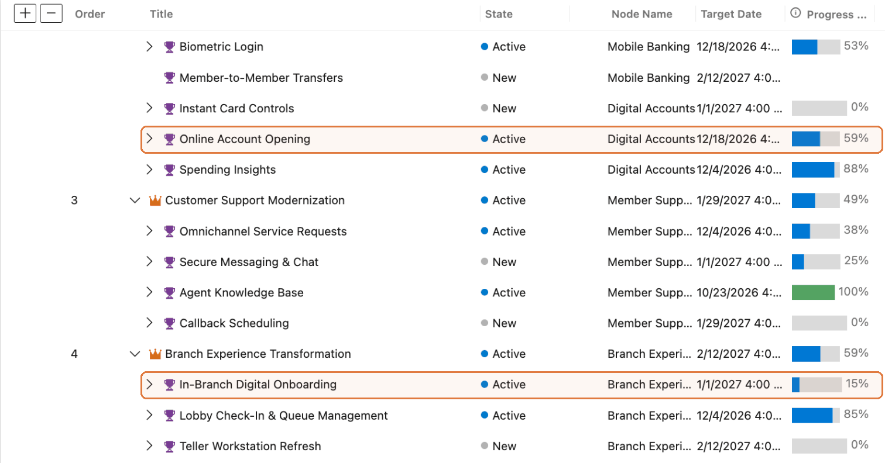
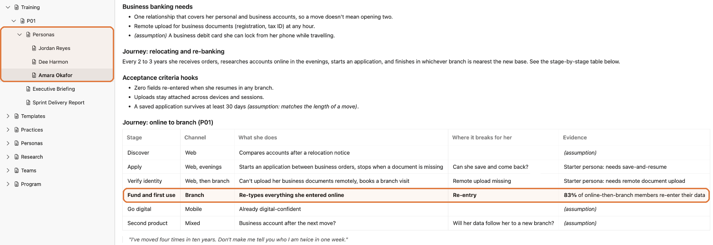
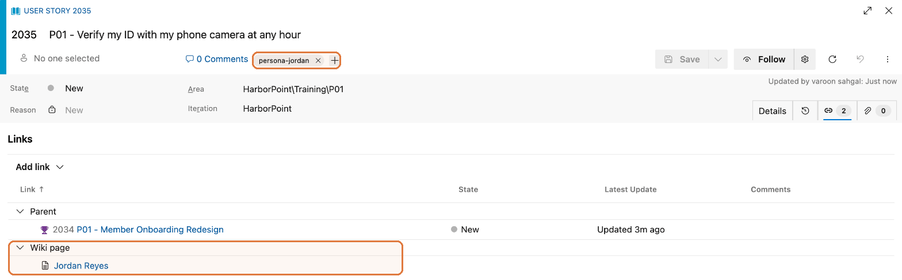
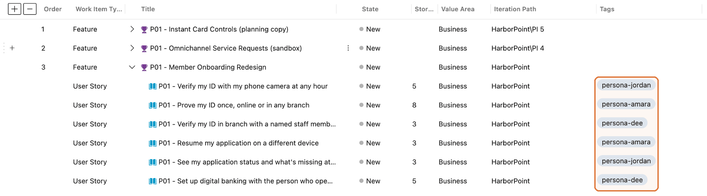

!!! briefing "Mission briefing"
    HarborPoint is redesigning how members join and take on new products. Today that experience is split in two. **Online Account Opening** belongs to Digital Accounts, under the Digital Banking Epic. **In-Branch Digital Onboarding** belongs to Branch Experience, under the Branch Epic. Two teams, two Product Owners, two backlogs, and one member who often crosses from one to the other halfway through.

    Ruth has handed you the program, and with it an argument between the branch champion and the digital director. Both have research numbers, and both are right about something. Your job is to make the argument about members instead of channels. You'll work along one chain, and each link feeds the next: **journey → personas → persona stories → scored priority.**

    **Done looks like:**

    - **Part 1:** you can name the two Features that split the journey, and the link that's missing between them
    - **Part 2:** three evidence-based personas in your wiki space, each with a journey map and at least one evidenced break
    - **Part 3:** a sandbox Feature `P## - Member Onboarding Redesign` with 6 to 9 persona-tagged stories, each with real acceptance criteria and a wiki link to its persona
    - **Part 4:** a transparent scoring table, an ordered backlog, and a recommendation that names your top 3 and why

<strong>Hector Alvarez</strong>VP, Branch Network · 8:14 AM

Before anyone designs onboarding around a phone: members we onboard in a branch hold **2.1 products** after a year. Digital-only members hold **1.4**. And **62%** of the over-60s we onboard in branch never switch on digital banking. That isn't their failure, it's ours. I'm not asking you to slow digital down. I'm asking you not to design Dee out of her own credit union.

<strong>Priya Raman</strong>Director, Digital Banking · 8:31 AM

Saw Hector's note. **58%** of new members start online, and **41%** of those applications die at ID verification. That's the leak. Fix the leak first, then we can talk about branches. Happy to be proven wrong with numbers.

## What you'll walk away with

- See one service as one journey across channels and teams, and find the handoffs nobody owns
- Build personas from behavior and evidence, not demographics, and tell a finding from an assumption
- Write persona stories whose acceptance criteria change what gets built, and know when a persona tag should become a field
- Prioritize with a transparent model that people argue with, instead of the loudest voice in the room
- Check what your model counts as value before you defend its answer

## Before you set sail

- **Access:** Basic access level, Contributor permissions, and team administrator of your own **P## Sandbox** team.
- **You'll read but never change:** the `Digital Accounts` and `Branch Experience` Features and stories, and the wiki pages `/Research/Onboarding Research Findings`, `/Personas/Dee Harmon`, `/Personas/Jordan Reyes`, `/Personas/Amara Okafor` and `/Templates/Persona Canvas`.
- **You'll create:**
    - wiki pages `/Training/P##/Personas/Dee Harmon`, `/Training/P##/Personas/Jordan Reyes`, `/Training/P##/Personas/Amara Okafor` and `/Training/P##/Onboarding Priorities`
    - the Feature `P## - Member Onboarding Redesign` and 6 to 9 User Stories in `HarborPoint\Training\P##`
    - the tags `persona-dee`, `persona-jordan` and `persona-amara`, spelled exactly like that
- **Time-box:** 55 minutes. Part 1: 6. Part 2: 15. Part 3: 17. Part 4: 17. If you're behind, write six stories instead of nine. Never skip Part 4.

## Part 1 — See the journey the portfolio splits

**Who already owns this journey, and where do the owners meet?** Personas are about members, but a manager starts with the portfolio. Find out who holds the problem today before you design anything.

!!! speedrun "Speed run · 6 minutes"
    Read-only. Answer three questions:

    1. Which **two** HarborPoint Features already serve member onboarding? For each one, give the owning team, the Epic it sits under, its State, its progress by Story Points and its target sprint.
    2. Which of their stories already tackle **ID verification**, **save-and-resume** and **re-entering data in branch**?
    3. Is there a **Predecessor/Successor** link between the two Features?

??? pilot "Harbor Pilot · Hint 1: Take a bearing"
    One Feature is about opening an account online. The other is about onboarding in a branch. The program-level team sees every team's Features in one backlog.

??? pilot "Harbor Pilot · Hint 2: Set the heading"
    **Boards › Backlogs**, team `HarborPoint Team`, **Features** level, **Parents** on, so you can see the Epics. Add **Progress by Story Points** (from **+ Add a rollup column** › **From quick list**), **Node Name** and **Target Date** with **Column Options**. Filter by keyword (`account opening`, then `onboarding`) to find them fast; while a filter is on, the backlog flattens and hides the Epics and rollups, so clear it (**×**) to read progress. Sandbox Features never show here, because `HarborPoint Team` leaves out the `Training` area. Expand each Feature to read its stories, and open its **Links** tab for dependencies.

??? pilot "Harbor Pilot · Hint 3: Bring it into port (full solution)"
    | | Online Account Opening | In-Branch Digital Onboarding |
    |---|---|---|
    | Owning team | Digital Accounts (PO Ben Adeyemi) | Branch Experience (PO Maya Johnson) |
    | Epic (portfolio rank) | Digital Banking Modernization (#2) | Branch Experience Transformation (#4) |
    | State · progress | Active · **59%** | Active · **15%** |
    | Target | End of Sprint 16 | End of Sprint 17 |
    | Business Value · Time Criticality | 13 · 8 | 13 · 8 |

    **Stories that already touch the journey:**

    - *ID verification:* `ID document capture with auto-crop` (Online Account Opening, Active in Sprint 14) and `ID scan at branch onboarding` (In-Branch Digital Onboarding, Sprint 15).
    - *Save-and-resume:* `Application save and resume` (Online Account Opening, Active in Sprint 14).
    - *Re-entering data in branch:* `Pre-fill member data from online application` (In-Branch Digital Onboarding, New, in Sprint 14).
    - *Worth noticing:* `Large-text and accessibility mode` and `Onboarding checklist for branch staff` (both In-Branch Digital Onboarding, later sprints).

    **Dependency link between the two Features: none.** Pre-fill in branch needs the data a member saved online, and nothing in Azure DevOps connects the two.

    **So what? The journey crosses two teams and two Epics, and the handoff between them has no owner and no link.** That handoff is where you'll find Amara in Part 2.

<figure class="hp-shot" data-shot="lab10-onboarding-features" markdown>

<i></i><i></i><i></i>Boards › Backlogs › HarborPoint Team › Features (Progress by Story Points, Target Date)

{ loading=lazy }

<figcaption markdown>Two halves of one member journey, in two teams and two Epics: **Online Account Opening** at 59% under Epic #2, **In-Branch Digital Onboarding** at 15% under Epic #4. Same Business Value, same Time Criticality, no link between them.</figcaption>
</figure>

!!! insight "Lighthouse insight: the member doesn't see your org chart"
    The portfolio rates the two Features equally, and only the Epic rank puts the online half of the journey two places ahead of the branch half. Now follow a member who starts online and finishes in a branch. The fix for re-entering data sits in one team's backlog. The data it depends on sits in another's. Neither Feature is wrong. The **journey** has no owner. Personas are the cheapest way to make a journey visible as one thing, before anyone redraws a team boundary.

!!! checkpoint "Checkpoint"
    - [ ] I can name both onboarding Features, their teams, their Epics and their progress
    - [ ] I found the branch pre-fill story and noticed it has no link to the online work it relies on

!!! takeaway "Takeaway"
    When two teams each own half of a member's journey, the handoff between them belongs to nobody, and that's usually where members fall through.

## Part 2 — Develop the personas

**Who are the members, and where exactly does the journey break for each?** Three starter personas live in the wiki, each with sections marked **To be developed**. You'll finish them in your own space, so a room full of managers doesn't overwrite one another.

| Persona | Who they are | What the starter page already says |
|---|---|---|
| **Dee Harmon** | 68, retired shipyard bookkeeper, member for 41 years | Branch-first, low digital confidence, wary of fraud, values a **named person** |
| **Jordan Reyes** | 24, first job as an apprentice marine electrician | Mobile-only, applies at **11 pm**, expects instant approval, **abandons at friction** |
| **Amara Okafor** | 37, military spouse who relocates every 2 to 3 years, runs a small online business | Starts online and **finishes in branch**. Needs **save-and-resume** and **remote document upload** |

1. Open **Overview › Wiki** › `Research` › `Onboarding Research Findings` and keep it in a second tab. Every claim you add today should trace back to it or to a starter persona.
2. Open `Templates` › `Persona Canvas` and note its sections.
3. Create your copies. Open `/Training/P##` (you created it in an earlier lab; create it now if not), use its **⋯** menu › **Add sub-page** to add `Personas`, and under it add one sub-page per persona with the persona's full name.
4. On each starter page, select **Edit**, copy the whole Markdown, and paste it into your copy. Then close the original **without saving**.
5. Fill every section marked **To be developed** (four or five per persona). Use the canvas as your checklist: a **Quote** in the member's own voice, **Goals**, **Frustrations**, **Behaviors**, **Channels and devices**, **Needs from this service**, **Journey**, **Acceptance criteria hooks** and **Evidence**. Keep every heading the starter page has, and add any canvas heading it lacks.

The research numbers you'll keep reaching for, all from `/Research/Onboarding Research Findings`:

| Finding | Number |
|---|---|
| New members who start online | **58%** |
| Online applications abandoned at **ID verification** | **41%** |
| Average branch onboarding time | **47 minutes** |
| Products held after 12 months: branch-onboarded vs digital-only | **2.1** vs **1.4** |
| Branch-onboarded members over 60 who never activate digital banking | **62%** |
| Members who start online, then visit a branch, and **re-enter their data** | **83%** of the time |

!!! challenge "Challenge: Map the journey, find the break"
    For each persona, add a short journey table to their page. Use these six stages as rows: **Discover**, **Apply**, **Verify identity**, **Fund and first use**, **Go digital**, **Second product (first 12 months)**.

    | Stage | Channel | What they do | Where it breaks for them | Evidence |
    |---|---|---|---|---|

    Every persona must have at least one **break**: a moment where HarborPoint loses them, slows them down or makes them repeat themselves. Each break needs a piece of evidence (a research number or a line from the starter persona). Anything without evidence goes in the table marked *(assumption)*.

??? pilot "Harbor Pilot · Hint 1: Take a bearing"
    The research hands you one break per persona. Find the number that describes each persona's worst moment: at the camera, in the branch chair, or halfway between.

??? pilot "Harbor Pilot · Hint 2: Set the heading"
    - **Jordan** breaks at **Verify identity**: online, late at night, with no one to ask. That's the 41%.
    - **Amara** breaks at the **handoff** between Apply (online) and Verify identity or Fund (branch). That's the 83% re-entry.
    - **Dee** breaks at **Go digital**. That's the 62%. Before you call it a break, though, check what she's *trying* to do. She may not want an app at all. She may want her fraud alerts to come from someone she trusts.

??? pilot "Harbor Pilot · Hint 3: Bring it into port (full solution)"
    A model journey for **Amara Okafor**. Yours can differ, as long as the break has evidence.

    | Stage | Channel | What she does | Where it breaks for her | Evidence |
    |---|---|---|---|---|
    | Discover | Web | Compares accounts after a relocation notice | | *(assumption)* |
    | Apply | Web, evenings | Starts an application between business orders, stops when a document is missing | Can she save and come back? | Starter persona: needs save-and-resume |
    | Verify identity | Web, then branch | Can't upload her business documents remotely, books a branch visit | Remote upload missing | Starter persona: needs remote document upload |
    | Fund and first use | Branch | Re-types everything she entered online | **Re-entry** | **83%** of online-then-branch members re-enter their data |
    | Go digital | Mobile | Already digital-confident | | *(assumption)* |
    | Second product | Mixed | Business account after the next move? | Will her data follow her to a new branch? | *(assumption)* |

    **Her quote:** *"I've moved four times in ten years. Don't make me tell you who I am twice in one week."* A quote is a design tool, not a fact. Don't invent a statistic to go with it.

    **So what? A break with evidence is a backlog candidate. A break marked *(assumption)* is a research question, not a story.** Amara's re-entry break carries the 83%, so it goes forward to Part 3.

<figure class="hp-shot" data-shot="lab10-persona-wiki" markdown>

<i></i><i></i><i></i>Overview › Wiki › Training › P## › Personas › Amara Okafor

{ loading=lazy }

<figcaption markdown>Your own copies, under your own page. Amara's journey has one break that matters, **Fund and first use**, and it carries evidence: 83% of online-then-branch members re-enter their data. Everything unproven says *(assumption)*.</figcaption>
</figure>

!!! reef "Reef ahead: designing for the average member"
    Average the three personas and you get a 43-year-old with medium digital confidence who applies in the early evening and is happy in either channel. Nobody like that walks into Port Haven, and nobody's break is visible in that average. "58% start online" also means 42% don't, and those 42% include the members Hector says hold the most products. Design for the extremes, and the middle usually comes along.

!!! checkpoint "Checkpoint"
    - [ ] My three persona pages exist under `/Training/P##/Personas/` with every **To be developed** section completed
    - [ ] Each persona has a journey table with at least one break backed by evidence
    - [ ] Anything I made up is marked *(assumption)*

!!! takeaway "Takeaway"
    A persona is only as strong as its evidence: tie every break to a number, and label everything else an assumption.

## Part 3 — Put the personas into Azure DevOps

**How does a persona change what the team actually builds?** A persona that lives only in the wiki is a poster. On a story it can appear in three places, and only one changes the product:

| Where the persona appears | What it does |
|---|---|
| The **title** | Tells the team who the story is for |
| The **tag** | Lets you filter, count and chart the work by persona |
| The **acceptance criteria** | Sets what the team builds and tests against |

**Acceptance criteria** are the conditions a story must meet to count as done: *Given* a situation, *When* the member does something, *Then* this must happen. If Dee's needs aren't in them, they don't ship. Work in your sandbox only.

### Create the Feature

1. **Boards › Backlogs**, team `P## Sandbox`, **Features** level. Select **New Work Item**, choose `Feature`, and title it `P## - Member Onboarding Redesign`.
2. Open it and set:
    - **Area Path** `HarborPoint\Training\P##` and **Iteration Path** `HarborPoint`, which leaves it unscheduled
    - **Business Value**, **Time Criticality** and **Effort**: your judgment, on the same scales the portfolio uses. Both real onboarding Features have Business Value 13 and Time Criticality 8. Decide whether yours is more or less urgent, and write one sentence in the **Description** saying why.
    - **Description**: the purpose of the Feature, links to your three persona pages, and one line on which Epic you'd put it under
3. **Save**. Leave **Parent** empty: the real Epics are read-only for you, and choosing one is a decision in its own right (see the Captain's log).

### Write persona-driven stories

Add the stories as children of your Feature: on the Features backlog, hover its row and select the **+** at the left (**Add: User Story, Bug**) › **User Story**. A story created this way already has its Parent link, and it inherits the Feature's Area and Iteration. For each story:

- **Title** in the member's voice, prefixed `P## - `
- **Tags**: exactly one of `persona-dee`, `persona-jordan` or `persona-amara`
- **Acceptance Criteria**: 2 or 3 Given/When/Then statements, specific to that persona
- **Story Points**: a rough estimate. Use the real stories you found in Part 1 as anchors (for example, `ID document capture with auto-crop` is a 5)
- **Iteration Path** `HarborPoint`. Stories added with the row **+** inherit it from the Feature. Stories created any other way pick up your sandbox's default, the current sprint, so check it before you save.
- **A link to the persona's wiki page**: save the story first, then open its **Links** tab (the chain icon next to **History**) › **Add link** › **Existing item**. Set **Link type** to **Wiki page**, select **Find page**, and filter by the persona's name. Pick *your* copy under `Training › P## › Personas`, select **Add link**, then **Save**. Don't look for Wiki page in the **Related Work** panel on the Details tab: it offers only work-item link types.

!!! warning "Tags are forever (almost)"
    Tags can't be renamed or deleted in the web UI, and the spelling is matched exactly. Type `persona-amara` on one story and `persona_amara` on the next, and you've built two personas. Copy the tag from the list in this lab. You'll see what three spellings of one idea do to a dashboard in [Lab 11](lab-11-dashboard-wrong.md).

<figure class="hp-shot" data-shot="lab10-story-form" markdown>

<i></i><i></i><i></i>Work item › User Story › Links tab

{ loading=lazy }

<figcaption markdown>A persona-driven story: one `persona-jordan` tag, a Parent link to your Feature, and a **Wiki page** link to Jordan's persona, added from the **Links** tab.</figcaption>
</figure>

!!! challenge "Challenge: One capability, three personas"
    Write **ID verification** as **three different stories**, one per persona, each with its own acceptance criteria:

    - **Dee**, in branch, with a staff member alongside her
    - **Jordan**, by phone camera at 11 pm
    - **Amara**, saving her progress, uploading documents remotely, and finishing in branch without re-entering anything

    Then add a comment to your Feature that answers one question: why would the generic story *"As a member, I want to verify my identity so that I can open an account"* fail two of these three members?

    Finish with **3 to 6 more stories** (6 to 9 in total) that fix the other breaks on your journey maps.

??? pilot "Harbor Pilot · Hint 1: Take a bearing"
    Ask what "done" means *to that member*: the time of day, the channel, who's with them, and what they must never have to do twice.

??? pilot "Harbor Pilot · Hint 2: Set the heading"
    Shape each story as *As [persona] [situation], I want [capability] so that [outcome they care about]*. Make at least one criterion measurable: a time, a count of steps, or "zero fields re-entered". Make at least one protect the persona from their worst moment: Dee's fraud worry, Jordan's abandonment, Amara's repetition.

??? pilot "Harbor Pilot · Hint 3: Bring it into port (full solution)"
    **Dee** (`persona-dee`): *As Dee, joining a new product in my branch, I want a named staff member to verify my ID with me so that I know exactly who has my documents.*

    - Given Dee is with a staff member, when her ID is scanned, then she sees the staff member's name on the confirmation and gets a printed or emailed receipt.
    - Given verification fails, when the staff member retries, then Dee is never asked to come back another day for the same check.

    **Jordan** (`persona-jordan`): *As Jordan, applying on my phone late at night, I want to capture my ID with the camera and get a decision in minutes so that I don't give up and try another bank.*

    - Given it's 11 pm, when Jordan captures his ID, then he sees an accept or retry result within a few minutes, with no call-back required.
    - Given the image is blurry, when capture fails, then the app tells him how to fix it on the spot instead of rejecting the application.

    **Amara** (`persona-amara`): *As Amara, starting online and finishing in branch, I want to upload my documents from anywhere and have the branch see everything I entered so that I prove who I am once.*

    - Given Amara saved her application online, when she arrives at any branch, then staff open it with zero fields re-entered.
    - Given she uploads documents remotely, when she resumes later on another device, then the uploads are still attached.

    **So what? A generic story passes testing and fails members.** Its natural implementation is the online camera flow, which is Jordan's. Dee gets a channel she doesn't trust and no named person. Amara gets verified online, then re-verified in branch, because nothing says her data must follow her. The three stories share a capability; only their acceptance criteria differ, and that difference is what gets built.

    **More stories that fit the journeys:** Jordan sees his application status and what's missing at any hour. Amara resumes on a different device. Dee gets digital banking set up in branch by the person who opened her account, with fraud alerts explained. Branch onboarding is shortened from 47 minutes for members who started online.

!!! insight "Lighthouse insight: tags today, a field when it's settled"
    A tag is free and instant, and you can filter boards and queries by it. It also can't be made required, and it drifts the moment two people spell it differently. A custom **Persona** picklist on an inherited process is consistent, can be required, and charts cleanly. It also needs a Project Collection Administrator to add it, and it changes **every project** that uses that process, immediately. Use tags while you're still learning which personas matter. Move to a field once the list is stable and someone owns it. Either way, write the vocabulary down where people will see it.

!!! checkpoint "Checkpoint"
    - [ ] `P## - Member Onboarding Redesign` exists in `HarborPoint\Training\P##` with Business Value, Time Criticality, Effort and a Description
    - [ ] It has 6 to 9 child stories, each with one persona tag, Given/When/Then criteria, Story Points and a Wiki link to its persona
    - [ ] Three of them are ID verification, and my Feature comment explains why one generic story would fail

!!! takeaway "Takeaway"
    A title and a tag only label a story. The acceptance criteria are what the team builds and tests, so that's where a persona changes the product.

## Part 4 — Prioritize by member impact

**Which fix goes first, and can you defend the order to both Hector and Priya?** You now have 6 to 9 stories and three personas competing for the top. Hector and Priya will each read your order as a verdict on their channel, so make the reasoning visible enough that they argue with your inputs, not with you.

<figure class="hp-shot" data-shot="lab10-sandbox-backlog" markdown>

<i></i><i></i><i></i>Boards › Backlogs › P## Sandbox › Stories (Parents on)

{ loading=lazy }

<figcaption markdown>Your starting point: one Feature, six stories, three personas, in the order you wrote them. The three ID-verification stories sit side by side: one capability, built three different ways. Scoring will pull them apart.</figcaption>
</figure>

!!! predict "Make a call"
    Before you score anything, write down two guesses. **Which persona's story will finish at the top** of your table? And will your top 3 lean **branch, digital or a mix**? You'll find out whether the arithmetic agrees with you, and then whether you agree with the arithmetic.

!!! challenge "Challenge: Score it, then defend it"
    1. Create the wiki page `/Training/P##/Onboarding Priorities` with this table, one row per story:

        | Story | Persona | Journey stage | Reach (1–3) | Impact (1–3) | Confidence | Effort (points) | Score |
        |---|---|---|---|---|---|---|---|

        **Score = Reach × Impact × Confidence ÷ Effort.** **Reach** is how many members this break touches. **Impact** is how much fixing it changes what happens to them. Use **Confidence** 1.0 when a research number supports your inputs, 0.8 when it partly does, and 0.5 when it's an assumption. Next to every Reach and Impact, cite the number you used.

    2. Order your stories in the sandbox: **Boards › Backlogs**, team `P## Sandbox`, **Stories** level, **Parents** on. Collapse your other sandbox Features and drag your stories into score order under `P## - Member Onboarding Redesign`. Clear any filter first, because a filtered backlog can't be reordered.
    3. Under the table, justify your **top 3** in one sentence each, with a number in every sentence.

??? pilot "Harbor Pilot · Hint 1: Take a bearing"
    Each persona has one headline number. Ask which one describes the most members, and which one describes the deepest loss. Those two aren't always the same story.

??? pilot "Harbor Pilot · Hint 2: Set the heading"
    - **Reach:** online starters are 58% of new members, so Jordan-type breaks score high. Amara-type members are a slice of that 58%, and the research doesn't say how big, so lower your confidence rather than your guess. Dee-type members are a smaller group, but it's the group with the 62%.
    - **Impact:** losing 41% of applications at one step is maximum funnel impact. Re-entering data 83% of the time is high friction, though not always a lost member.
    - **Effort:** your Story Points. A cheap fix with medium reach can beat an expensive one with high reach.

??? pilot "Harbor Pilot · Hint 3: Bring it into port (full solution)"
    An illustrative table. The inputs are judgments, and yours can differ, but every one should have a reason.

    | Story | Persona | Stage | Reach | Impact | Conf. | Effort | Score |
    |---|---|---|:-:|:-:|:-:|:-:|:-:|
    | Camera ID capture with a decision in minutes | Jordan | Verify | 3 (58% start online) | 3 (41% abandon here) | 1.0 | 5 | **1.80** |
    | Application status and what's missing, any hour | Jordan | Apply | 3 | 2 | 0.8 | 3 | **1.60** |
    | Branch opens the online application, zero re-entry | Amara | Fund | 2 (a slice of the 58%) | 3 (83% re-enter) | 0.8 | 3 | **1.60** |
    | Digital set up in branch by a named person | Dee | Go digital | 2 (62% of over-60s) | 2 | 1.0 | 3 | **1.33** |
    | Staff-assisted ID check with a named receipt | Dee | Verify | 1 | 2 | 0.8 | 2 | **0.80** |
    | Shorter branch onboarding for online starters | Amara | Fund | 2 | 2 (47 min) | 0.8 | 5 | **0.64** |
    | Remote document upload with resume on any device | Amara | Verify | 2 | 3 | 0.8 | 8 | **0.60** |

    **A model top 3:** (1) Camera ID capture, because it attacks the single biggest leak, 41% of the 58% who start online. (2) Zero re-entry in branch, which wins the 1.60 tie because 83% of the members who cross channels repeat themselves today, and the In-Branch Digital Onboarding pre-fill story already exists to build it. (3) Status at any hour, a cheap 3-pointer that keeps the 58% from going quiet after applying.

    **So what? Every story in that top 3 serves a member who started online. Dee isn't in it.** Read the reef below before you send it.

!!! reef "Reef ahead: equating digital adoption with value"
    If your top 3 is all digital, check what you were measuring. Reach × funnel impact counts **heads through the door**. It doesn't count what happens next. Branch-onboarded members hold **2.1** products after a year, and digital-only members hold **1.4**. A model that leaves that out will steadily trade relationship depth for login counts, and call it progress. The 62% of over-60s who never activate digital may not be a failure to fix, either. They may be well-served members who become exposed if branches change.

    Add one more column, **Value per member (1–3)**, and re-score. If Dee's story climbs, your model didn't change the facts. It changed the **objective**, and choosing the objective is a leadership decision. The portfolio already names both candidates: *Digital that feels human* (priority 2) and *Branches as relationship hubs* (priority 4).

!!! reef "Reef ahead: the loudest stakeholder picks"
    Order the backlog by whoever wrote last, and it changes every week. Send the scoring table to both Hector and Priya and ask, "Which input is wrong?" A disagreement about one Reach score is a ten-minute conversation. A disagreement about channels takes a whole PI.

!!! deliverable "Deliverable"
    `/Training/P##/Onboarding Priorities` with:

    - your scoring table, with the number behind every input, and the optional Value column
    - your top 3, one sentence each
    - a **three-sentence recommendation** to Priya and Hector: what goes first and why, which real Feature should own each of your top 3 (Online Account Opening or In-Branch Digital Onboarding), and the one decision you need from them, such as a single owner for the onboarding journey or a link between the two Features
    - links to your three persona pages and your sandbox Feature

!!! checkpoint "Checkpoint"
    - [ ] `/Training/P##/Onboarding Priorities` has a scored row for every story, with evidence for each input
    - [ ] My sandbox stories are in score order under my Feature
    - [ ] My recommendation names an owner Feature for each of my top 3 and asks for one decision

!!! takeaway "Takeaway"
    A visible scoring model moves the argument from people to inputs, but what the model counts as value is a leadership decision, not arithmetic.

## Knowledge check

**Your team's backlog has one story: "As a member, I want to verify my identity so that I can open an account." What's the strongest objection?**

- [ ] It has no Story Points
- [x] It hides three different definitions of done, so it will be built for one channel and fail the members in the others
- [ ] It should be a Feature, not a story
- [ ] Identity verification belongs to Security, not to onboarding

"The member" is an average, and averages get built for the most visible case. Dee, Jordan and Amara each need a different "done", and only acceptance criteria make those differences testable.

**Branch-onboarded members hold 2.1 products after a year, and digital-only members hold 1.4. What can you safely conclude?**

- [ ] Branch onboarding causes members to buy more products
- [ ] Digital onboarding should be scaled back
- [x] The two groups differ in value, but the number alone can't tell you why. The members who choose a branch may be different people to begin with
- [ ] The digital channel has a defect

It's a correlation between a channel and an outcome, and members choose their channel. The number is a strong reason to keep relationship depth in your model. It isn't proof that moving everyone into a branch would add products. Ask the research team how the groups compare before anyone builds a strategy on it.

**Leadership wants to report on "work by persona" across every team, every quarter. When does a custom Persona field beat tags?**

- [ ] Always, because fields are more professional than tags
- [ ] Never, because tags are free and flexible
- [x] When the persona list is stable, the report really matters, and someone owns the process change, which applies to every project on that process
- [ ] When a team asks for it

A field brings consistency and can be required, but it's a governance change made by a Project Collection Administrator, and it lands everywhere at once. Tags are right while you're still learning. The trigger to switch is a stable vocabulary plus a report someone will act on.

## Captain's log

!!! log "Captain's log"
    1. Pick a journey your members or customers take across two of your teams. Who owns the whole journey today? If the answer is "nobody", where does that show up first: in complaints, rework or dropped handoffs?
    2. Which of your backlog's stories are written for "the user"? Which real people would the acceptance criteria fail?
    3. Your sandbox Feature had no parent Epic. In your organization, would it sit under the digital Epic or the branch Epic, and who would make that call?
    4. Whose voice set your backlog order last quarter? Could you show the reasoning on one page?
    5. What does your organization count as "value" in its channel metrics: logins, adoption, products, retention? Which of those would Dee agree with?

!!! bonus "Extra knots"
    1. **Persona coverage chart.** Save a flat query `Shared Queries/Training/P##/Onboarding by persona` (`Area Path` `Under` `HarborPoint\Training\P##`, `Work Item Type` `=` `User Story`, `Tags` `Contains` each persona tag, grouped with **Or**). Add a **Chart for Work Items** widget to a `P##` dashboard, grouped by **Tags**, with **Sum** of Story Points. Is any persona starved of effort? (Group-by-tags may need a preview feature; see the [query cookbook](../resources/query-cookbook.md).)
    2. **Feature-level WSJF-lite** (a cut-down Weighted Shortest Job First: cost of delay over size). Compute (Business Value + Time Criticality) ÷ Effort for Online Account Opening (13 + 8 over 56) and In-Branch Digital Onboarding (13 + 8 over 33). Which scores higher, and what does it say that the lower-scoring one sits under the higher-ranked Epic?
    3. **A persona story template.** As team admin of `P## Sandbox`, open **Project settings › Boards › Team configuration**, **Templates** tab, and create a User Story template that pre-fills an Acceptance Criteria skeleton (*Given… When… Then…*) and your sandbox area. The editor's field list includes **Tags (Add)**, so a template *can* stamp a persona tag on every new story. Would you want it to, or should a person choose the persona each time?

!!! harbor "Back in your own harbor"
    Three moves for your first week back, about 30 minutes in your own Azure DevOps:

    1. **Find a journey nobody owns.** Pick one service your customers use across two of your teams. Find the Feature each team owns for it on the Features backlog and open its **Links** tab. If there's no **Predecessor/Successor** link between them, the handoff has no owner: write down who should own it.
    2. **Draft one persona page.** Under your own page in **Overview › Wiki**, use **Add sub-page** to start one persona with a **Quote**, **Goals**, **Frustrations**, **Needs from this service** and one journey break backed by a number you already have. Mark everything else *(assumption)*. Wiki pages are shared, so anyone on the project can read it and improve it.
    3. **Rewrite one generic story with its Product Owner.** Find a story written for "the user" and, together, add Given/When/Then acceptance criteria for the person it would fail. Link it to your persona page from its **Links** tab (**Add link** › **Existing item** › **Wiki page**), and if you add a persona tag, agree the spelling first: tags can't be renamed or deleted in the web UI.

## Key takeaways

- **The journey has no owner.** The breaks hide at the handoffs between channels, and those handoffs often fall between two teams' Features.
- **Personas run on evidence.** A persona is a set of behaviors, goals and breaks backed by evidence. Mark everything else as an assumption.
- **Acceptance criteria are where personas bite.** A persona changes what gets built only when it reaches the acceptance criteria. One generic story usually serves one persona and fails the rest.
- **Make priority arguable.** A visible scoring model turns "branch vs digital" into "which input is wrong?"
- **Check the objective, not just the arithmetic.** Counting heads through the door and counting relationship value give different orders, and choosing between them is a leadership decision.
