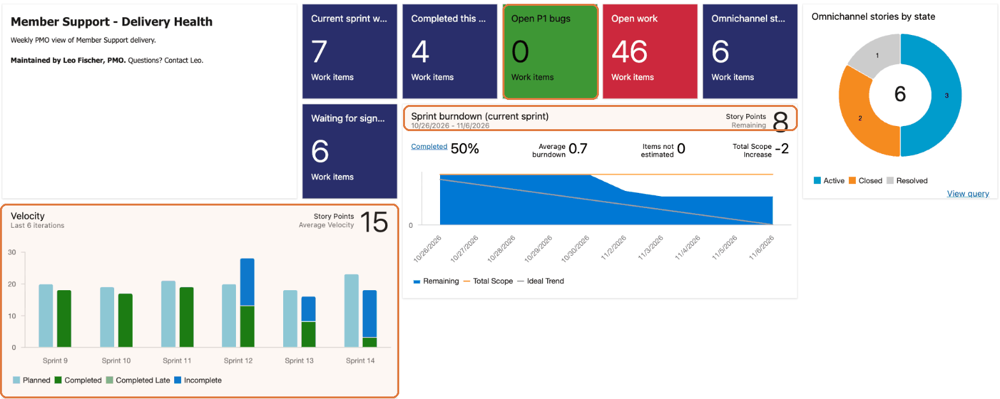
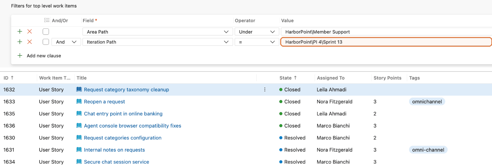
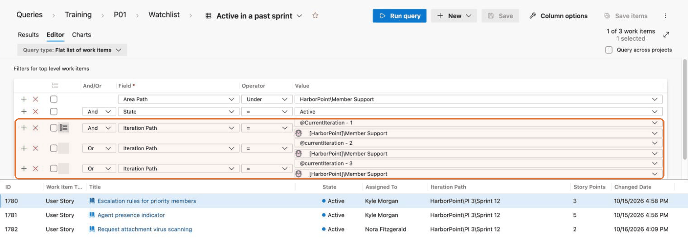

!!! briefing "Mission briefing"
    The **Member Support - Delivery Health** dashboard has been circulating with the program pack. Its velocity chart reads 18, 17, 19, then 13, then 8. Its open-work tile keeps climbing, and it shows zero open P1 bugs. It says Member Support has fallen off a cliff in two sprints. Some people already believe it.

    You saw a hint of this in Lab 3, when a Member Support Feature turned up in your at-risk query although its work finished a PI ago. Somewhere between what the team did and what the dashboard shows, the record broke. Find where, prove it, repair a copy in your sandbox, and stop it happening again, all without touching Member Support's real items.

    **Done looks like:**

    1. A defect ledger with evidence for at least 8 of the 12 defects (Part 1)
    2. A reconciled velocity: 13 and 8 traced back to 18 and 19 (Part 2)
    3. A repaired sandbox record (Part 3)
    4. Fixed queries, with before-and-after numbers on `P## - Sandbox Health` (Part 4)
    5. A data-quality watchlist (Part 5)
    6. Five practices and a 15-minute weekly routine that prevent all of it (Part 6)

<div class="msg" data-initials="CD" data-tone="coral" markdown>
<p class="msg-head"><strong>Carmen Diaz</strong><span>Director, Member Support · 7:36 AM</span></p>

Your dashboard says we've collapsed. My team has never worked harder. We've been an engineer short since Kyle left in Sprint 12, and we still ship every sprint. I've had two calls this week asking whether Member Support needs "intervention". Either the dashboard is wrong or I am, and I'd like to know which before Dana reads it again.
</div>

<div class="msg" data-initials="LF" data-tone="gold" markdown>
<p class="msg-head"><strong>Leo Fischer</strong><span>PMO Reporting Analyst · 7:52 AM</span></p>

That's my dashboard, sorry. I set it up for the Sprint 13 review and I've been on four other reports since. The queries are in `Shared Queries/PMO Reporting`. You can open them, but you can't save over them, so please Save As into your own folder if you change anything. I'll fix the real one with whatever you find. Be gentle with me.
</div>

## What you'll walk away with

- Trace every dashboard tile to the data, query, widget or permission behind it, and spot the dozen ways each one lies
- Tell a **delivery** problem from a **data** problem in minutes, with arithmetic Azure DevOps already holds
- Fix the record at its source, with a reason on every change
- Rewrite queries so they survive next sprint, and prove the fix with before-and-after numbers
- Build a small watchlist that catches bad data before it reaches an executive
- Choose governance levers by cost and reach, without turning hygiene into surveillance

## Before you set sail

- **Read-only today:** everything that belongs to Member Support: the **Member Support - Delivery Health** dashboard (you can view it, not edit it), Leo's queries in `Shared Queries/PMO Reporting/`, and Member Support's backlog, board, items and **Velocity** report.
- **Yours to fix:** the miniature copy in your sandbox. Its Feature is `P## - Omnichannel Service Requests (sandbox)` in `HarborPoint\Training\P##`, and every item title starts `P## - `. Your copies of Leo's queries are in `Shared Queries/Training/P##/Lab 11 - Inherited queries/`.
- **One shared corner:** two of your sandbox bugs were deliberately filed in the parent area `HarborPoint\Training`, alongside everyone else's. Touch only the ones with **your** prefix.
- **Your sandbox isn't only Lab 11.** Any query scoped to `HarborPoint\Training\P##` also picks up Lab 9's `P## - Instant Card Controls (planning copy)` (20 stories, four unestimated) and Lab 10's `P## - Member Onboarding Redesign` stories. This lab's expected counts are for the **Lab 11 set only**: add the **Parent** column and ignore rows under those two Features, or add `Parent` `Not In` *their two IDs*. Leave Lab 9's unestimated stories alone.
- **You'll create:** fixed queries prefixed `Fixed - ` in `Shared Queries/Training/P##/`, a `Watchlist` sub-folder, the project dashboard `P## - Sandbox Health`, and the wiki page `/Training/P##/Dashboard Remediation`.
- **Time-box:** 60 minutes. Part 1: 18. Part 2: 5. Part 3: 12. Part 4: 10. Part 5: 7. Part 6: 8. If you fall behind, build three watchlist queries instead of six. Protect Part 6.

## Part 1 — Read the dashboard like a detective

What is this dashboard claiming, and where does each claim break? Start where Dana starts: read it cold, then go behind every tile.

!!! speedrun "Speed run · 4 minutes"
    Open **Overview › Dashboards** and find **Member Support - Delivery Health**. Don't open anything behind it yet. Write down, in plain words, the **five claims** the dashboard makes about Member Support, the way an executive skimming it would read them.

<div class="timer" data-minutes="4" data-label="Speed run"></div>

??? pilot "Harbor Pilot · Hint 1: Take a bearing"
    One claim per tile: velocity trend, current sprint, completed work, open work, open P1 bugs, omnichannel progress, burndown. Read the titles as the dashboard's author meant them.

??? pilot "Harbor Pilot · Hint 2: Bring it into port (full solution)"
    Roughly: (1) velocity has collapsed from about 18 to 8 in two sprints; (2) the team completed little in the "current" sprint, and the burndown agrees; (3) open work keeps growing; (4) quality is fine, with zero open P1 bugs; (5) omnichannel progress is modest.

    **So what?** Most of it is false. The most dangerous claim is the one that's false in the *reassuring* direction: zero P1 bugs.

<figure class="hp-shot" data-shot="lab11-ms-dashboard" markdown>
<div class="hp-shot__bar" aria-hidden="true"><i></i><i></i><i></i><span>Overview › Dashboards › Member Support - Delivery Health (team dashboard)</span></div>

{ loading=lazy }

<figcaption markdown>Leo's page, as Carmen sees it. Velocity collapsing to **13** and **8**, a green **0** P1 bugs, and a "current sprint" burndown whose dates say **10/26 to 11/6**: last sprint. Every number here is real. Most of them are wrong.</figcaption>
</figure>

Now go behind every tile. Leo's dashboard has **twelve** planted defects, spread across the **data** (the items), the **queries**, the **widgets** and **permissions**.

!!! predict "Make a call"
    Write down two guesses. Of the twelve defects, **how many live in the data** rather than in Leo's queries, widgets and permissions? And how many points did Member Support **truly finish in Sprint 13**, which the chart shows as 8? Hint 3 below settles the first; Part 2 settles the second.

!!! challenge "Challenge: The defect hunt"
    Find **at least 8 of the 12** defects without changing anything that belongs to Member Support. Running a query never changes data, so build any read-only queries you like in **My Queries** or your `P##` folder.

    Copy this **defect ledger** into a notes file and fill it as you go. You'll tick the last column in Parts 3 and 4, and paste it into your wiki page in Part 6.

    | # | Defect | Type (data / query / widget / permission) | Evidence (item, query clause or widget setting) | Effect on the dashboard | Fixed in sandbox |
    |:-:|---|---|---|---|:-:|
    | 1 | | | | | |
    | 2 | | | | | |
    | 3 | | | | | |
    | 4 | | | | | |
    | 5 | | | | | |
    | 6 | | | | | |
    | 7 | | | | | |
    | 8 | | | | | |
    | 9 | | | | | |
    | 10 | | | | | |
    | 11 | | | | | |
    | 12 | | | | | |

    **Scoring:** 1 point for each defect with evidence, plus 1 for the right type: 24 points available. 20 or more is harbor-master work. Under 12, open Hint 1.

??? pilot "Harbor Pilot · Hint 1: Eleven places a defect can hide"
    Check each of these for Member Support (`Area Path` `Under` `HarborPoint\Member Support`):

    1. **States.** Is "done" work really Closed?
    2. **Estimates.** Do finished and upcoming stories have Story Points?
    3. **People.** Is everyone in **Assigned To** still here? (Check `/Program/Team Directory` and Carmen's message.)
    4. **Iterations.** Is active work sitting in a sprint that has ended?
    5. **Areas.** Is Member Support work filed outside its area?
    6. **Tags.** Is one idea spelled more than one way?
    7. **Feature states.** Do the Features' states match their children?
    8. **Duplicates.** Is any story on the backlog twice?
    9. **Query logic.** In each PMO query's **Editor** tab, what does each clause really ask?
    10. **Widget settings.** Which sprint is each sprint-based widget showing?
    11. **Permissions.** Does every tile load for you?

??? pilot "Harbor Pilot · Hint 2: The detective's kit"
    Flat queries in **Boards › Queries**, all with `Area Path` `Under` `HarborPoint\Member Support` unless noted. Add **Iteration Path**, **Story Points**, **Tags**, **Assigned To** and **Changed Date** as columns.

    | Looking for | Clauses to add |
    |---|---|
    | Done but not closed | `Work Item Type` `=` `User Story`, `State` `=` `Resolved` |
    | Missing estimates | `Work Item Type` `=` `User Story`, `Story Points` `=` *(leave Value blank)*, `State` `<>` `Removed` |
    | A departed owner | `Assigned To` `Contains` `Kyle Morgan` |
    | Zombies | `Work Item Type` `=` `User Story`, `State` `=` `Active`, `Changed Date` `<` `@Today - 14` (drop the type and you also get the Epic and two Features, which nobody edits while their stories move) |
    | Misfiled work (**drop the area clause**) | `Area Path` `=` `HarborPoint` |
    | Tag drift | three queries: `Tags` `Contains` `omnichannel`, then `omni-channel`, then `omnichanel` |
    | Duplicates | sort by **Title**, or `Title` `Contains Words` `status tracker` |

    For **Feature states**, open **Boards › Backlogs**, team `Member Support`, **Features** level, and add **Progress by Story Points**. For **widgets**, read the date range on the burndown. For **query logic**, open each `PMO Reporting` query and select **Editor**.

??? pilot "Harbor Pilot · Hint 3: Bring it into port (full solution)"
    | # | Defect | Type | Evidence | Effect |
    |:-:|---|---|---|---|
    | 1 | **Done but left in Resolved** | Data | 6 stories in **Resolved**: 2 from Sprint 12 (5 points), 3 from Sprint 13 (8 points) and `Unified request intake form` in Sprint 14 | Velocity credits only Closed work: 13 and 8 instead of 18 and 19 |
    | 2 | **Missing Story Points** | Data | `Request category taxonomy cleanup` is Closed in Sprint 13 with no points (it should be 3), plus 3 New stories: `Member notifications on request updates`, `Agent workload balancing`, `Co-browse for complex requests` | Velocity undercounts by 3, and any forecast is unreliable |
    | 3 | **Departed owner** | Data | 4 items assigned to **Kyle Morgan**, who left in Sprint 12: 2 Active (`Escalation rules for priority members`, `Agent presence indicator`) unchanged for 25+ days, plus 2 New under Callback Scheduling | Work looks staffed. Nobody is doing it |
    | 4 | **Zombies in a past sprint** | Data | 3 stories still **Active** in **Sprint 12**: Kyle's two plus `Request attachment virus scanning` (Nora Fitzgerald) | Invisible on the current board, but counted as open work |
    | 5 | **Wrong area** | Data | 2 **Priority 1** bugs at the root area `HarborPoint`: `Chat disconnects after 60 seconds`, `Service request emails sent twice` | The **Open P1 bugs** tile shows **0** |
    | 6 | **Tag drift** | Data | `omnichannel` on 6 stories, `omni-channel` on 3, `omnichanel` on 2 | The omnichannel tile counts 6 of 11 |
    | 7 | **Feature states not maintained** | Data | **Secure Messaging & Chat** is **New**, though its children are 2 Closed, 1 Resolved and 2 Active. **Agent Knowledge Base** is **Active** at 100%, with all 15 children Closed and a target of Sprint 12 | Portfolio views show finished work as in flight, and started work as not started |
    | 8 | **Duplicate** | Data | `Service request status tracker` twice: one Active (Leila Ahmadi), one New and unassigned, created on Sprint 14 day 1 | Scope is double-counted |
    | 9 | **Hard-coded sprint** | Query | `MS - Current sprint work` and `MS - Completed this sprint` use `Iteration Path` `=` `HarborPoint\PI 4\Sprint 13` | "Current" is last sprint |
    | 10 | **"Open" means `<> Closed`** | Query | `MS - Open work` uses `State` `<>` `Closed` | It counts 4 Removed and 6 Resolved items as open: **10** too many |
    | 11 | **Burndown on the wrong sprint** | Widget | The Sprint Burndown widget is set to Sprint 13, not `@CurrentIteration` | A finished sprint, presented as now |
    | 12 | **Private query on a shared dashboard** | Permission | A tile bound to a query in its author's **My Queries** | Everyone but Leo sees an error instead of a number |

    `MS - Open P1 bugs` is correct as a query. Its zero comes from data filed in the wrong place, which is why #5 is a data defect.

    **So what?** Eight of the twelve live in the data, not in Leo's work, so fixing his queries alone would leave the dashboard wrong. Renumber your ledger to match this table; the rest of the lab uses these numbers.

    <!-- VERIFY (needs a second account): the exact error a participant sees on the "Waiting for sign-off" tile, which is bound to the instructor's My Queries. It renders normally for the account that ran the provisioner. -->

<figure class="hp-shot" data-shot="lab11-leo-query-editor" markdown>
<div class="hp-shot__bar" aria-hidden="true"><i></i><i></i><i></i><span>Boards › Queries › Shared Queries › PMO Reporting › MS - Current sprint work › Editor</span></div>

{ loading=lazy }

<figcaption markdown>Hard-coded, in plain sight: the "current sprint" is typed in as **Sprint 13**. It was right for two weeks and has been quietly wrong ever since. The results hold two more defects: a Closed story with no points, and two spellings of one tag.</figcaption>
</figure>

!!! checkpoint "Checkpoint"
    - [ ] I wrote down the dashboard's five claims before I investigated
    - [ ] My defect ledger has at least 8 defects, each with evidence and a type
    - [ ] I renumbered my ledger to match Hint 3
    - [ ] I changed nothing that belongs to Member Support

!!! takeaway "Takeaway"
    Before you believe a tile, open what's behind it. Dashboards break in their data, queries, widgets and permissions; the chart is usually the one part that's right.

## Part 2 — Rebuild the true numbers

Did Member Support's delivery collapse, or did its record? Carmen asked a yes-or-no question. Answer it with arithmetic.

!!! challenge "Challenge: Reconcile 13 and 8"
    Open **Boards › Backlogs**, team `Member Support`, **Stories** level, **Analytics** › **Velocity** › **View full report**, with **Velocity by** set to **Sum of Story Points**. Explain, point by point, how a team that truly finished **18** points in Sprint 12 and **19** in Sprint 13 shows **13** and **8**. Then say what happened to **Planned** over the same sprints.

??? pilot "Harbor Pilot · Hint 1: Take a bearing"
    Velocity credits one thing: points on stories that reached **Closed** within the sprint. List every way a finished story can fail that test.

??? pilot "Harbor Pilot · Hint 2: Bring it into port (full solution)"
    | Sprint | Truly done | Left in Resolved | Closed with no points | Velocity shows |
    |---|:-:|:-:|:-:|:-:|
    | 12 | 18 | −5 (2 Omnichannel Service Requests stories) | | **13** |
    | 13 | 19 | −8 (3 stories: 5 points of Omnichannel Service Requests, 3 of Secure Messaging & Chat) | −3 (taxonomy cleanup) | **8** |

    **Planned** barely moved (20, then 18). The blue **Incomplete** stacks on Sprints 12 and 13 show where the points went; your "done but not closed" query from Part 1 names the same items.

    **So what?** The team didn't plan less and didn't finish less. The **recording** of completion fell.

<figure class="hp-shot" data-shot="lab11-velocity-ms" markdown>
<div class="hp-shot__bar" aria-hidden="true"><i></i><i></i><i></i><span>Boards › Backlogs › Member Support › Analytics › Velocity (Sum of Story Points)</span></div>

{ loading=lazy }

<figcaption markdown>Read the blue. The **Incomplete** segments in Sprints 12 and 13 are finished stories left in Resolved, plus zombie stories never moved out of sprints that have ended. The green collapse to 13 and 8 is a recording problem, with the evidence stacked right on top of it.</figcaption>
</figure>

!!! insight "Lighthouse insight: the chart is right, the data is wrong"
    Nothing here is a bug in Azure DevOps. Velocity does exactly what it promises: it sums Story Points on Closed items. Every number on Leo's dashboard is computed correctly from records that are wrong. A dashboard is a **contract**. The team promises to keep states, estimates, owners, sprints and areas true. The report promises to read them faithfully. When either side breaks the deal, the chart stays crisp and confident, and it's wrong.

!!! reef "Reef ahead: blaming the team for a reporting defect"
    Did your speed-run list say "Member Support is in trouble"? That's the trap, and two people fell into it this week by calling Carmen about "intervention". The team kept finishing 18 to 19 points a sprint, one engineer down. What fell apart was **closing** work and **keeping records**, and Leo's queries amplified it. There is a real conversation to have about hygiene. "Your delivery collapsed" isn't it: open with that and you lose Carmen's trust and learn nothing about the cause.

!!! checkpoint "Checkpoint"
    - [ ] I can show, point by point, how 18 became 13 and 19 became 8
    - [ ] I can tell Carmen in one sentence that her delivery didn't collapse, and what did break

!!! takeaway "Takeaway"
    When velocity falls off a cliff while Planned holds steady, suspect the record of "done" before you suspect the team.

## Part 3 — Repair the record in your sandbox

You've proven the record is wrong. Can you make it true? Your sandbox holds a miniature of Member Support's mess: one Feature, 13 stories, 3 bugs and 2 Removed items, with defects 1 to 8 planted in it. Fix the data first; the queries come in Part 4.

1. **Record your "before" numbers.** In **Boards › Queries**, run each query in `Shared Queries/Training/P##/Lab 11 - Inherited queries/` and write down its count:

    | Inherited query | Before (expected) |
    |---|---|
    | `Current sprint work` | **4** (the Sprint 13 stories) |
    | `Completed this sprint` | **2** (5 points, one of them unestimated) |
    | `Open P1 bugs` | **0** |
    | `Open work` | **14** Lab 11 rows: the Feature, 10 stories, the 2 Removed items and the 1 correctly filed bug (`State <> Closed` lets Removed through). Your Lab 9 and Lab 10 rows come on top |
    | `Omnichannel stories` | **3** |

2. **Open the full set.** Save a scratch **Flat list of work items** query in **My Queries**:

    | Group | And/Or | Field | Operator | Value |
    |:-:|:--|:--|:--|:--|
    | | | Area Path | Under | `HarborPoint\Training\P##` |
    | ┌ | Or | Area Path | = | `HarborPoint\Training` |
    | └ | And | Title | Contains | `P##` |

    Add the columns **Work Item Type**, **State**, **Assigned To**, **Iteration Path**, **Area Path**, **Story Points**, **Tags**, **Parent** and **Changed Date**. Sort by **Parent** so the Lab 9 and Lab 10 rows sit together, out of your way.

!!! challenge "Challenge: Repair the record"
    Fix all eight data defects in your sandbox, and tick ledger rows 1 to 8 as you go. Each fix that changes an owner, a sprint or a state gets a one-line **Discussion** comment saying why. In real life, that comment is what stops someone undoing your fix next week.

??? pilot "Harbor Pilot · Hint 1: Take a bearing"
    Work through your ledger, rows 1 to 8, and find each defect's twin in the sandbox. For each one, decide the **true** state of the world before you click: is it done, who owns it, when will it happen, where does it belong?

??? pilot "Harbor Pilot · Hint 2: Set the heading"
    - Multi-select rows in query results and use **Edit** to change State or Iteration Path on several at once. Rows stay **bold** until you select **Save items**.
    - Kyle Morgan has left, so **unassign** his items. Don't assign them to yourself to make the report look staffed.
    - A zombie nobody is working on belongs in the backlog (`Iteration Path` `HarborPoint`), in **New**.
    - For the duplicate, keep the item with work in progress and remove the other, leaving a link so the history makes sense.

??? pilot "Harbor Pilot · Hint 3: Bring it into port (full solution)"
    | # | Sandbox item(s) | Fix |
    |:-:|---|---|
    | 1 | `P## - Request intake form`, `P## - Request status page` (Resolved, Sprint 13) | **State** `Closed`. Comment: *"Finished in Sprint 13; closing so it counts as done."* |
    | 2 | `P## - Category taxonomy cleanup` (Closed, no points), `P## - Member notifications` (New, no points) | **Story Points** `3` on the first (its real twin is a 3). Estimate the second, and comment *"Estimate to confirm at refinement."* |
    | 3 | `P## - Escalation rules`, `P## - Presence indicator` (Kyle Morgan) | Clear **Assigned To**. Comment: *"Kyle Morgan left in Sprint 12. Needs an owner decision from the PO."* |
    | 4 | The same two plus `P## - Attachment scanning` (Active, Sprint 12) | **Iteration Path** `HarborPoint`, **State** `New`. Comment: *"Not in progress; back to the backlog for re-planning."* |
    | 5 | `P## - Chat disconnects after 60 seconds`, `P## - Request emails sent twice` (P1 bugs in `HarborPoint\Training`) | **Area Path** `HarborPoint\Training\P##`. Only yours. |
    | 6 | `P## - Request status page` (`omni-channel`), `P## - Secure file upload` (`omnichanel`) | Remove the wrong tag with its **x** and add `omnichannel` |
    | 7 | `P## - Omnichannel Service Requests (sandbox)` (New) | **State** `Active`. It has Closed and Active children. |
    | 8 | `P## - Routing rules engine`, twice | On the **New** one: **Links** › **Add link** › **Existing item**, **Link type** **Duplicate Of** (type `Dupl` to filter), pointing at the Active one. Then **State** `Removed`, with a comment. |

    The link list offers both **Duplicate** and **Duplicate Of**. Read them from the item you're standing on: this item is a *Duplicate Of* the one that survives. Get it backwards and the history says the real work was the copy.

    **So what?** Each fix restores the truth, not a better-looking number. Unassigning Kyle's work makes the team look *less* staffed, which is the point: now someone must decide who owns it.

!!! warning "Don't fix Member Support"
    Every defect in Member Support's real data is a two-click fix. Leave them. Those items are Carmen's team's record, everyone in the room shares them, and an outsider fixing them without the team is how working agreements die. Your findings go to Carmen and Leo in Part 6.

!!! checkpoint "Checkpoint"
    - [ ] I recorded the five "before" counts before I changed anything
    - [ ] My Lab 11 set has no Resolved stories, no unestimated stories, no Kyle Morgan, no Active items in Sprint 12, no misfiled P1 bugs, one spelling of `omnichannel`, an Active Feature and one `Routing rules engine`
    - [ ] Every owner, sprint or state change carries a comment

!!! takeaway "Takeaway"
    Fix data at its source with a comment that says why, and leave another team's record for that team to fix.

## Part 4 — Fix the queries and prove it

The data is true now. Would Leo's queries still tell the truth next sprint? This Part fixes ledger rows 9 to 11; row 12 you'll prevent in Part 6.

In **Boards › Queries**, open each inherited query, change it, and use **More actions** › **Save as** into `Shared Queries/Training/P##/` with the prefix `Fixed - `. Keep the originals so you can compare.

!!! challenge "Challenge: Five queries, honestly"
    Rewrite all five inherited queries so they would survive next sprint, next quarter and the next reorganization. Then add one new one, `Fixed - Completed last sprint`. Before you save that one, switch its macro's team to **P## Sandbox**, run it, and explain what happens.

??? pilot "Harbor Pilot · Hint 1: Take a bearing"
    Two defects are about **time** (a sprint typed in by hand), one is about **meaning** (what "open" means), and one is about **vocabulary** (tags). One of the five queries was never wrong.

??? pilot "Harbor Pilot · Hint 2: Set the heading"
    Use `@CurrentIteration` and `@CurrentIteration - 1`. Pick `@CurrentIteration` from the **Value** list; for `- 1`, type `@CurrentIteration - 1` and choose **Use "@CurrentIteration - 1"**. Either way a second box appears underneath with the **team**. Use `State` `Not In` `Closed,Removed`. For tags, use a grouped **Or** across the three spellings. And when your sandbox team chokes on `- 1`, look at which sprints it selected in Lab 9.

??? pilot "Harbor Pilot · Hint 3: Bring it into port (full solution)"
    All are **Flat list of work items**, and all keep `Area Path` `Under` `HarborPoint\Training\P##`.

    | Saved as | Change | Expected, after Part 3 |
    |---|---|---|
    | `Fixed - Current sprint work` | `Iteration Path` `=` `@CurrentIteration`, team `Member Support`; add `State` `<>` `Removed` | **4** stories: `Routing rules engine`, `Chat transcript export`, `Secure file upload`, `Typing indicators` |
    | `Fixed - Completed this sprint` | Same, plus `State` `=` `Closed` | **1**: `Chat transcript export` |
    | `Fixed - Completed last sprint` *(new)* | `@CurrentIteration - 1`, team `Member Support`, plus `State` `=` `Closed` | **4** stories, **13** points (it was 2 stories and 5 points) |
    | `Fixed - Open P1 bugs` | None. The query was right; the data was wrong | **2** |
    | `Fixed - Open work` | `State` `Not In` `Closed,Removed`; `Work Item Type` `In` `User Story,Bug` | **10** Lab 11 rows (7 stories, 3 bugs), plus your Lab 9 and Lab 10 stories unless you added the `Parent` `Not In` clause |
    | `Fixed - Omnichannel stories` | `State` `<>` `Removed`, plus the grouped tag clauses below | **5** |

    | Group | And/Or | Field | Operator | Value |
    |:-:|:--|:--|:--|:--|
    | | | Area Path | Under | `HarborPoint\Training\P##` |
    | | And | State | <> | `Removed` |
    | ┌ | And | Tags | Contains | `omnichannel` |
    | │ | Or | Tags | Contains | `omni-channel` |
    | └ | Or | Tags | Contains | `omnichanel` |

    **Why the sandbox team fails on `- 1`:** `@CurrentIteration` means "*this team's* sprint whose dates include today", and `- 1` means "the one before it *in this team's own sprint list*". Your sandbox team selected Sprints 14 to 20 in Lab 9, so `@CurrentIteration` works (the same 4 rows as Member Support), but there's nothing before Sprint 14. Azure DevOps refuses with *VS403721: The specified team hasn't scheduled an iteration for '@CurrentIteration - 1'*. In the real fix, Leo would use team `Member Support`.

    After your tag clean-up, the original one-tag query also returns 5. The Or-group is a bridge; the vocabulary is the fix.

    **So what?** A macro is only as good as the team's sprint list behind it, and **Save as** keeps the old team. Check the team box every time you reuse a query.

??? info "Under the hood: WIQL for the current-sprint fix"
    ```sql
    SELECT [System.Id], [System.Title], [System.State], [Microsoft.VSTS.Scheduling.StoryPoints]
    FROM WorkItems
    WHERE [System.TeamProject] = @project
      AND [System.AreaPath] UNDER 'HarborPoint\Training\P##'
      AND [System.IterationPath] = @currentIteration('[HarborPoint]\Member Support')
      AND [System.State] <> 'Removed'
    ```

!!! reef "Reef ahead: fixing the chart instead of the data"
    The fastest way to make **Open P1 bugs** show 2 is to widen it to `Area Path` `Under` `HarborPoint\Training`. Try it: you get every participant's misfiled bugs, up to **60** across 30 sandboxes. On the real dashboard, `Under HarborPoint` pulls in every team's P1 bugs. A query that compensates for bad data gets wrong in a new way each time the data changes. Fix the data, keep the query honest, and catch misfiled work with a watchlist (Part 5).

### Validate on a dashboard

Build a project dashboard, **Overview › Dashboards** › **+ New Dashboard**, named `P## - Sandbox Health` (**Project Dashboard**). Add:

- a **Markdown** widget: owner (you), purpose, review cadence ("every Monday"), the definitions *done = Closed* and *open = not Closed or Removed*, and your before-and-after table
- **Query Tile** widgets for each `Fixed - ` query. Give `Fixed - Open P1 bugs` a rule that turns it red at 1 or more.
- a **Sprint Burndown** widget: **Team** `Member Support`, **Select Iteration** `@CurrentIteration`. That's defect 11, fixed on a dashboard you own.

Tick ledger rows 9 to 11.

<figure class="hp-shot" data-shot="lab11-sandbox-health" markdown>
<div class="hp-shot__bar" aria-hidden="true"><i></i><i></i><i></i><span>Overview › Dashboards › P## - Sandbox Health</span></div>

{ loading=lazy }

<figcaption markdown>Before and after, on one page. **Open P1 bugs** turns red at 2 because the bugs now live where the query looks. **Completed last sprint** says 4 (13 points), where Leo's report said 2. The burndown is on **Sprint 14**. **Open work** reads 36 because the tile counts your Lab 9 and Lab 10 stories too; the Lab 11 rows are the 10 in the table.</figcaption>
</figure>

!!! checkpoint "Checkpoint"
    - [ ] Six `Fixed - ` queries are saved in `Shared Queries/Training/P##/`, and `Fixed - Completed last sprint` returns 4 stories and 13 points
    - [ ] I can explain why `@CurrentIteration - 1` fails for my sandbox team but works for Member Support
    - [ ] `P## - Sandbox Health` shows before and after, and its burndown is on Sprint 14

!!! takeaway "Takeaway"
    An honest query uses macros for time, explicit state lists for meaning and one vocabulary for tags, and it never compensates for bad data.

## Part 5 — Build a watchlist

How will you know next month that the record has drifted again? Fixing the data once is a cleanup. Catching it every week is management. A watchlist is a handful of queries whose healthy answer is **zero**.

!!! challenge "Challenge: Six queries that should say zero"
    In **Boards › Queries**, create the folder `Shared Queries/Training/P##/Watchlist` and build **at least three** of these against **Member Support's real area**. Running queries is read-only. Record each count:

    1. Active work nobody has touched in 14 days
    2. Stories that have sat in Resolved for more than 5 days
    3. Stories with no Story Points that aren't Removed
    4. Active work still sitting in one of the last three sprints
    5. Open work assigned to someone who has left
    6. Anything filed at the project's root area

??? pilot "Harbor Pilot · Hint 1: Take a bearing"
    Each is a date clause, a blank-value clause or an iteration macro, and you built most of them in the Part 1 detective's kit. Name them so a team lead understands each in two seconds.

??? pilot "Harbor Pilot · Hint 2: Bring it into port (full solution)"
    All flat, with `Area Path` `Under` `HarborPoint\Member Support` except #6.

    | # | Name | Clauses | Member Support today |
    |:-:|---|---|:-:|
    | 1 | `Stale active work` | `Work Item Type` `In` `User Story,Bug`; `State` `=` `Active`; `Changed Date` `<` `@Today - 14` | **3** |
    | 2 | `Resolved but not closed` | `Work Item Type` `=` `User Story`; `State` `=` `Resolved`; `Resolved Date` `<` `@Today - 5` | **5**, rising to **6** from Sprint 14's second Wednesday, when `Unified request intake form` passes 5 days in Resolved |
    | 3 | `Unestimated stories` | `Work Item Type` `=` `User Story`; `Story Points` `=` *(blank)*; `State` `<>` `Removed` | **4** |
    | 4 | `Active in a past sprint` | `State` `=` `Active`; grouped **Or**: `Iteration Path` `=` `@CurrentIteration - 1`, `- 2`, `- 3`, each with team `Member Support` | **3** |
    | 5 | `Assigned to a leaver` | `Assigned To` `Contains` `Kyle Morgan`; `State` `Not In` `Closed,Removed` | **4** |
    | 6 | `Root-area work` | `Area Path` `=` `HarborPoint` (no Under) | **2** |

    **So what?** Number 5 is the weakest, because a query can't know who has left. The durable fix is an off-boarding step: *reassign open work before the last day*. Number 6 works for every team at once, so put it on the program dashboard.

<figure class="hp-shot" data-shot="lab11-watchlist" markdown>
<div class="hp-shot__bar" aria-hidden="true"><i></i><i></i><i></i><span>Boards › Queries › Shared Queries › Training › P## › Watchlist › Active in a past sprint</span></div>

{ loading=lazy }

<figcaption markdown>Three grouped **Or** clauses, `@CurrentIteration - 1`, `- 2` and `- 3`, each pinned to team **Member Support** in the box underneath. The healthy answer is zero. Today it's **3**: two of them still carry Kyle Morgan's name.</figcaption>
</figure>

!!! checkpoint "Checkpoint"
    - [ ] My `Watchlist` folder holds at least three queries, each with today's Member Support count
    - [ ] I can say which watchlist query a process rule could replace, and which it couldn't

!!! takeaway "Takeaway"
    A few team-level queries whose healthy answer is zero, looked at weekly, catch bad data before it reaches an executive.

## Part 6 — Make it stop happening

Which practices would have stopped all twelve defects, and which are worth what they cost? Carmen doesn't need a better chart. She needs a team that keeps its record true and a PMO that reads it carefully.

The levers below differ in **reach**. Each row touches more people, and is harder to undo, than the ones above it; the last changes every project at once. Start as high in the table as works.

| Lever | What it prevents here | Who can set it up | Watch out for |
|---|---|---|---|
| **Working agreement and Definition of Done** (`/Practices/Working Agreements and Definition of Done`) | #1, #2, #7: "Done means Closed. Estimate before Active. The PO closes the Feature." | The team | It already exists; Member Support hasn't adopted it. An agreement nobody reads is decoration |
| **Team work item templates** | #2, #6: pre-filled area, tags and criteria skeleton | Team members, for their own team | Team-scoped; other teams don't see them |
| **Notifications and Follow** | #7, #8: Follow the Features you report on, and subscribe to state changes in your area | Anyone (personal); team admins (team subscriptions) | Notification filters don't support `@CurrentIteration`. Too many emails and people stop reading |
| **Off-boarding checklist** | #3: reassign open work before someone's last day | The line manager | Nobody owns it until someone writes it down |
| **Dashboard ownership and review** | #9, #11: a named owner, a "last reviewed" line, a monthly widget check | The dashboard owner | A dashboard with no owner decays one sprint at a time |
| **Shared queries and permissions** | #12: dashboard tiles only from shared folders the audience can read | Folder owners (**Security** on the folder) | Viewers without **Read** on a query see an error, not a number |
| **Inherited process rules**, for example on User Story: `A work item state changes to` `Active` › `Make required` `Story Points` | #2 | Project Collection Administrators | Applies **automatically to every project** on that process, so try it on a test process first. Rules **can't** target Area or Iteration Path, so #4 and #5 still need the watchlist |

<!-- VERIFY (needs an inherited process; the vsahgal org has none, and creating one is an org-wide change): the exact dropdown labels in User Story › Rules › New rule. Microsoft's rule reference confirms the actions "Make required" / "Make read-only", that Area Path can't be selected, and that customizations reflect automatically in every project on the process. -->

!!! reef "Reef ahead: hygiene police"
    Once a watchlist exists, someone will want it per person, ranked, in the weekly pack: "Nora has a stale item." Then people game the record instead of keeping it true: they close early, split stories to look busy, and leave out work that's hard to estimate. Goodhart's law works on data quality too. Keep the watchlist **team-level**, look at it **with** the team, and measure success by how fast items leave it, not by who put them there.

!!! deliverable "Deliverable"
    The wiki page `/Training/P##/Dashboard Remediation` with:

    1. **Your defect ledger** from Part 1, with your score
    2. **The reconciliation**: 18 → 13 and 19 → 8, explained in two lines
    3. **Before and after** from your sandbox, with a link to `P## - Sandbox Health`
    4. **Five practices that would have prevented this.** Each one names the defects it prevents, who owns it, and what it costs.
    5. **A 15-minute weekly hygiene routine**: what is looked at, by whom, in which order, and what happens to each finding
    6. **A five-sentence note to Carmen and Leo**: the bottom line first, what broke, what you recommend, what you need from each of them, and what you'll check next week

??? pilot "Harbor Pilot · Hint 1: Take a bearing"
    Group the twelve defects by **who could have stopped them**: the team (states, estimates, duplicates), a manager (leavers, zombies), the dashboard owner (queries, widgets, permissions) and the platform (rules, templates). One practice per group is a good start.

??? pilot "Harbor Pilot · Hint 2: Bring it into port (full solution)"
    **Five practices (model):**

    1. **Adopt the Definition of Done, ending in Closed.** The PO closes stories at the sprint review, and the Feature when its last child closes. Prevents #1 and #7. Owners: Isaac Thompson and the team. Cost: five minutes a sprint.
    2. **Estimate before Active, enforced lightly.** A team agreement first; a `Make required` `Story Points` rule only if the agreement fails, and only after the process owner tests it on a copy. Prevents #2.
    3. **Close every sprint properly.** On the last day, move unfinished work to the next sprint or the backlog; resolve duplicates at refinement. Prevents #4 and #8.
    4. **Off-board the work, not just the person.** Reassign or unassign open items before someone leaves, and run `Root-area work` and `Assigned to a leaver` monthly. Prevents #3 and #5.
    5. **Give every dashboard an owner and a contract.** Shared queries only, macros instead of typed sprints, "open" and "done" defined on the dashboard, a monthly widget review, and a tag vocabulary on the wiki. Prevents #6 and #9 to #12.

    **The 15-minute Monday routine (model):** the team lead and PO open `P## - Sandbox Health` (or its real equivalent). Minutes 0 to 5: the six watchlist tiles; anything above zero gets fixed on the spot or gets a named owner. Minutes 5 to 10: Feature states against their rollup; close or activate as needed. Minutes 10 to 15: one dashboard check, rotating weekly between queries, widgets and permissions. Findings go into the team's own backlog, not a status report.

    **So what?** Four of the five are habits a team or dashboard owner can start on Monday. Only the optional rule in practice 2 needs an administrator, and it lands on every project at once, which is why it comes last.

!!! checkpoint "Checkpoint"
    - [ ] `/Training/P##/Dashboard Remediation` has all six sections
    - [ ] Each of my five practices names the defects it prevents, an owner and a cost

!!! takeaway "Takeaway"
    Pick the cheapest lever that works: team agreements before process rules, and team-level counts, never per-person scores.

## Knowledge check

<div class="quiz" markdown>

**A team's velocity drops from 19 to 8 in one sprint, and its Planned line is flat. What do you check first?**

- [ ] Whether the team needs extra capacity
- [ ] Whether the Velocity widget is set to the right team
- [x] Whether finished work actually reached Closed, with Story Points, in that sprint
- [ ] Whether the team has been inflating its estimates

<div class="quiz-why" markdown>
Velocity sums points on Closed items only. A sudden drop with flat planning is usually a recording problem: work left in Resolved, points left blank, items parked in old sprints. Check the data before you diagnose the team.
</div>

</div>

<div class="quiz" markdown>

**"Open P1 bugs" shows 0, and you find two P1 bugs filed at the project root. What's the best fix?**

- [ ] Change the tile's query to `Area Path Under HarborPoint` so it catches them
- [x] Move the bugs into the team's area, keep the query as it is, and add a root-area check to a watchlist
- [ ] Delete the tile, because it can't be trusted
- [ ] Add a Markdown note under the tile saying the real number is 2

<div class="quiz-why" markdown>
Widening the query pulls in every team's P1 bugs, and a note goes stale the day the data changes. Fix the record at its source, and make the class of defect visible so it can't hide again.
</div>

</div>

<div class="quiz" markdown>

**Which of today's defects could an inherited process rule actually prevent?**

- [ ] Active stories left behind in a past sprint
- [x] Stories moving to Active with no Story Points
- [ ] Work filed at the root area
- [ ] Three spellings of the same tag

<div class="quiz-why" markdown>
Rules can make a field required on a state change, but they can't target Area Path or Iteration Path, and they don't govern tag vocabulary. The others need agreements and a watchlist. Even the rule that works applies to every project on the process, so it's a governance decision, not a quick fix.
</div>

</div>

## Captain's log

!!! log "Captain's log"
    1. Which dashboard in your organization would you least like to audit the way you audited Leo's today? What's the first query you'd run?
    2. When a team's numbers look bad in your status pack, what happens next: a conversation with the team, or a conversation about the team?
    3. What does "done" mean in your tools today, and does every team mean the same thing?
    4. Which governance change would you make centrally, and which would you leave to teams? Where's the line between hygiene and micromanagement for you?

!!! bonus "Extra knots"
    1. **The honest late bar.** Add a **Velocity** widget for team `Member Support` to `P## - Sandbox Health` with **Highlight work completed late** on. If Carmen's team closed its old Resolved stories today, would Sprints 12 and 13 jump back to 18 and 19, or show the work as late? Which would you rather show Dana?
    2. **Program-wide hygiene.** Copy watchlist #1 and #3 with the area clause set to `Area Path` `Not Under` `HarborPoint\Training`. Which other teams appear, and does Mobile Banking's stale work show up at 14 days or only at 7?
    3. **Write the tag vocabulary.** Draft a short `/Training/P##/Tag Vocabulary` page with the canonical tags from today and from [Lab 10](lab-10-personas.md), who may add a new tag, and how a misspelling gets retired. Tags can't be renamed in the web UI. What does that mean for your process?

<!-- Facilitator: Velocity credits work to the sprint in its Iteration Path. With "Highlight work completed late" on, items Closed after that sprint's end date are drawn as a separate "Completed Late" segment. So Sprints 12 and 13 climb back toward 18 and 19, with the late part visibly marked. That is the honest bar to show Dana. -->

!!! harbor "Back in your own harbor"
    Three moves for your first week back, about 30 minutes in your own Azure DevOps:

    1. **Audit one tile before your next report.** Open the dashboard your leadership reads most, pick one tile, and read its query's **Editor** tab. Look for a sprint typed in by hand instead of `@CurrentIteration`, and "open" written as `State` `<>` `Closed`. Running a query never changes data.
    2. **Build three queries whose healthy answer is zero.** Create a `Watchlist` folder under **Shared Queries** (not **My Queries**, which are private, so their tiles show everyone else an error) and save: Active work with `Changed Date` `<` `@Today - 14`, stories in Resolved for more than 5 days, and anything filed at the project's root area.
    3. **Look at the counts with the team, not about the team.** Spend 15 minutes with one team lead and Product Owner going through the watchlist together. Anything above zero gets fixed on the spot or gets a named owner, and the counts stay team-level, never per person.

## Key takeaways

- **Open what's behind the tile.** A dashboard can break in its data, its queries, its widgets or its permissions. The chart itself is usually the one part that's right.
- **Suspect the record before the team.** Delivery rarely collapses in one sprint; hygiene often does. Falling velocity with flat Planned is the tell.
- **Fix data at the source.** Change the item, say why in its Discussion, and leave another team's record for that team to fix.
- **Make queries honest, not clever.** Macros for time, explicit state lists for "open", one tag vocabulary, and no compensating for bad data.
- **Watch for zero.** A few team-level queries whose healthy answer is zero, reviewed weekly, catch bad data before it reaches an executive.
- **Governance has a cost and a reach.** Team agreements are cheap and local. Process rules land on every project at once. Per-person hygiene scores get gamed.
