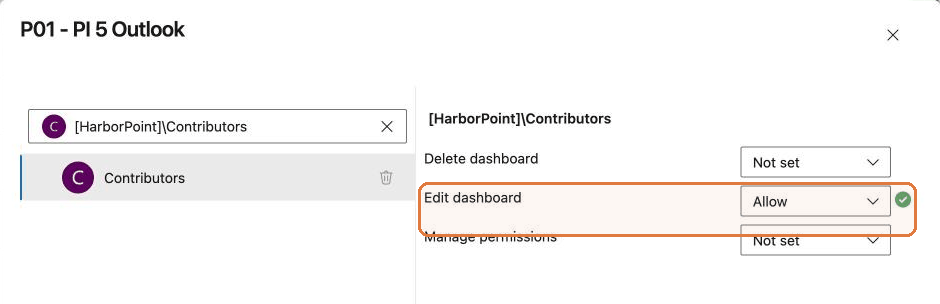
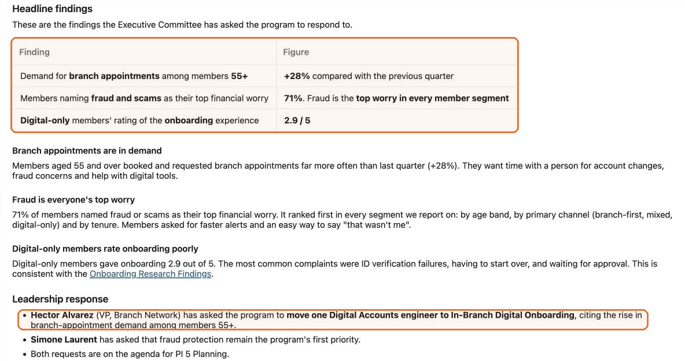
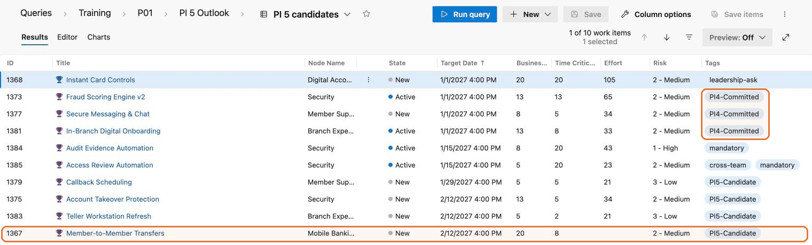

!!! briefing "Mission briefing"
    Ruth Ellison retires at the end of PI 4. You've been acting in her role since this morning, and this afternoon the whole program lands on your desk. You and your crew are acting **Program Managers for the Member Experience Transformation Program** (METP). The Executive Committee meets in 150 minutes. They've named six concerns, and they want one thing: **a realistic outlook for PI 5 (Sprints 17 to 20), and the decisions they must make to get it.**

    Every view, query and metric you need is one you used in Labs 1 to 11. What's new: nobody tells you which ones, the concerns tangle into each other, and halfway through, the instructor changes the facts. Welcome to PI planning week.

    **Done looks like:** six phases, each with one product. An **evidence board** (Phase 1), a saved `PI 5 candidates` query (Phase 2), the crew dashboard `P## - PI 5 Outlook` (Phase 3), a **PI 5 worksheet** of capacity versus demand (Phase 4), a **decision table** (Phase 5) and a one-page BLUF briefing at `/Training/P##/PI 5 Outlook` (Phase 6). Then a five-minute presentation that survives three minutes of executive questions.

<strong>Ruth Ellison</strong>Program Manager, METP · 12:58 PM

My handover note, the short version. **Six things keep me up at night:** Fraud Alerts may miss PI 4. Mobile Banking's unfinished work keeps growing. We haven't met a sprint commitment there in a while. Security is the knot every dependency runs through. Hector and Priya are pulling the program in two directions, branch and digital. And Dana needs a PI 5 outlook she can defend upstairs. My advice, for what thirty years is worth: **don't trust a number until you know who typed it**, and never give an executive a single date. It's all in the data. Good luck, Captain.

<strong>Dana Whitfield</strong>EVP, Member Experience · 1:04 PM

Executive Committee in 150 minutes. Give me a **realistic outlook for PI 5** and the **decisions you need from us**. Not a status report, I've had plenty. Tell me what we'll deliver, how sure you are, what it costs, and what we're choosing *not* to do. If there's bad news, I want it first.

## What you'll walk away with

- Turn six vague concerns about a multi-team program into evidence (a Feature, a number, a source) in under half an hour
- Choose which numbers you'll forecast from, and name the one you refuse to use
- Put a whole program's argument on one dashboard of eight widgets or fewer
- Build a capacity-versus-demand outlook for a whole PI as ranges, and absorb a change in the facts without starting over
- Turn business value, member research and personas into trade-off decisions, each with a cost and an owner
- Brief executives in confidence bands, with a decision table: what you need, from whom, and by when

## Before you set sail

**Form a crew of 3 or 4.** Pick one person as **host**. The crew's dashboard, wiki page and queries live under the host's participant ID.

!!! warning "`P##` shows *your* ID, not your host's"
    This site fills in `P##` with the reader's own ID, so on a crewmate's screen it shows *theirs*. Write your host's ID here: **Host ID: ______**. Wherever this page says `P##`, crewmates use the host's ID.

**Host setup (5 minutes, before the clock starts):**

1. Create the project dashboard `P## - PI 5 Outlook` (**Overview › Dashboards** › **New Dashboard**, type **Project Dashboard**). Or copy your Lab 8 dashboard `P## - METP Executive Status` with **⋮** › **Copy Dashboard**, and point its queries at a new folder.
2. Give your crew edit rights: in the dashboard directory, open the dashboard row's **⋮** › **Security**, search for each crewmate, select them, and set **Edit dashboard** to **Allow**. It saves the moment you choose, with a green tick and no Save button. Close and reopen the dialog to check.
3. Create the query folder `Shared Queries/Training/P##/PI 5 Outlook`. Every participant can save into it: Contribute on `Shared Queries/Training` flows down to every folder beneath.
4. Create the wiki page `/Training/P##/PI 5 Outlook` from `/Templates/Executive Briefing (BLUF)`. Any Contributor can edit wiki pages, so the whole crew can write in it.

<figure class="hp-shot" data-shot="lab12-dashboard-security" markdown>

<i></i><i></i><i></i>Overview › Dashboards › ⋮ › Security (P## - PI 5 Outlook)

{ loading=lazy }

<figcaption markdown>Search for a crewmate (or, as here, a group), select them, and set **Edit dashboard** to **Allow**. The green tick means it's saved: there's no Save button.</figcaption>
</figure>

**Suggested crew roles.** Combine roles in a crew of three. Everyone investigates in Phase 1.

| Role | Owns |
|---|---|
| **Navigator** | The evidence board: every claim has a number and a source |
| **Analyst** | Queries and metrics |
| **Cartographer** | The dashboard |
| **Quartermaster** | Capacity, forecast and the PI 5 worksheet |
| **Captain** | The briefing, the decision table and the presentation |

**The rules haven't changed.** The six real teams' data, ordering, estimates and settings are read-only. For any what-if (re-ordering, re-estimating, forecasting), use your sandbox. Your `P## - Instant Card Controls (planning copy)` from Lab 9 is still there.

**Reuse everything.** Each phase below also names the earlier lab whose lesson it puts to work.

| You built | In |
|---|---|
| Query toolkit (`04 Features at risk`, `06 Orphan work`, …) | [Lab 3](../day-1/lab-03-query-toolkit.md) |
| `P## - Digital Command Center` | [Lab 5](../day-2/lab-05-command-center.md) |
| Mobile Banking case file and help plan | [Lab 6](../day-2/lab-06-which-team-needs-help.md) |
| `P## - Fraud Alerts Plan`, `Fraud Alerts dependencies`, options matrix | [Lab 7](../day-2/lab-07-cross-team-bottleneck.md) |
| `P## - METP Executive Status` and executive briefing | [Lab 8](../day-2/lab-08-executive-status-review.md) |
| Card Controls capacity math and forecast | [Lab 9](lab-09-meet-the-deadline.md) |
| Personas and value model | [Lab 10](lab-10-personas.md) |
| Defect log and data-quality watchlist | [Lab 11](lab-11-dashboard-wrong.md) |

Widgets copy between dashboards: hover a widget, select **⋯** › **Copy to Dashboard**, and pick `P## - PI 5 Outlook`.

## The voyage plan

Six phases, each with a timer. Minute marks count from the start of Phase 1, and your instructor may stretch or squeeze them.

| Phase | Minutes | Clock | You produce |
|---|:-:|:-:|---|
| 1 · Investigate | 25 | 0–25 | Evidence board: the six concerns, each tied to Features, teams and numbers |
| 2 · Analyze | 20 | 25–45 | The `PI 5 candidates` query, a throughput figure you trust for each team, and the one number you won't forecast from |
| 3 · Visualize | 25 | 45–70 | `P## - PI 5 Outlook` dashboard, 8 widgets or fewer |
| 4 · Plan | 25 | 70–95 | PI 5 worksheet: capacity versus demand, as ranges. **The curveball lands here.** |
| 5 · Prioritize | 20 | 95–115 | Ranked PI 5 candidates and a decision table |
| 6 · Recommend | 20 | 115–135 | BLUF briefing page and the presentation running order |
| Present | 5 + 3 per crew | after | Five minutes to brief, three minutes of exec question cards |

!!! tip "Pace yourselves"
    Crews that lose this lab lose it in Phase 1 by investigating everything. Find the evidence for each concern, write it down, move on.

## Phase 1 — Investigate

**What does the data say about each of the six concerns?** Answer that before anyone forecasts, because every later phase builds on these findings.

**You learned this in [Lab 1](../day-1/lab-01-explore-the-program.md) and [Lab 6](../day-2/lab-06-which-team-needs-help.md):** the backlog order is a decision, and no single chart is a finding.

!!! challenge "Challenge: The evidence board"
    In your wiki page, build an **evidence board** with one row per concern, at Feature altitude:

    | Leadership concern | Which Features and teams | Evidence (a number, and where you found it) | How much do you trust it? |
    |---|---|---|---|
    | A major Feature may miss its delivery target | | | |
    | One team has a growing backlog of incomplete work | | | |
    | Recent sprint commitments have not been met | | | |
    | Dependencies between teams are causing delays | | | |
    | Member priorities are shifting between branch and digital | | | |
    | Executives need a realistic outlook for the next PI | | | |

    Add two short lists underneath: **what HarborPoint delivered recently** (last sprint and last PI), and **one risk leadership didn't name** (there's more than one). Then decide: **which finding would you put in front of Dana first?**

??? pilot "Harbor Pilot · Hint 1: Take a bearing"
    You already have answers for four of the six concerns: your Lab 2 readout, Lab 6 case file and Lab 7 options page. Start there and check that nothing has changed. For "shifting priorities", the wiki holds something you haven't read yet, under **Research**. For "recently delivered", ask which Features closed in Sprint 13 and in PI 3, and which one *should* have.

??? pilot "Harbor Pilot · Hint 2: Set the heading"
    - **Portfolio:** **Boards › Backlogs**, team `HarborPoint Team`, **Epics** level, then **Features** with rollup columns. Compare the order of Epics with `/Program/Program Charter`.
    - **Commitments and carry-over:** each team's **Velocity** report (Planned versus Completed and Incomplete), team by team.
    - **Dependencies:** the official **HarborPoint Program Plan** (look for the **PI 5 Planning** marker), plus your Lab 7 plan and query.
    - **Branch versus digital:** **Overview › Wiki** › `Research` › `Member Pulse Survey Q3`.
    - **Committed outcomes:** `/Program/PI 4 Objectives`.
    - For the risk nobody named, look at the portfolio's *shape* (rank, empty Features, data you proved wrong yesterday), not at a single team.

<figure class="hp-shot" data-shot="lab12-pulse-survey" markdown>

<i></i><i></i><i></i>Overview › Wiki › Research › Member Pulse Survey Q3

{ loading=lazy }

<figcaption markdown>Three findings, and they pull in different directions: **+28%** branch demand from members 55+, **71%** naming fraud their top worry in *every* segment, and digital-only onboarding at **2.9 / 5**. Hector's request sits underneath. Read all three before you pick a side.</figcaption>
</figure>

!!! checkpoint "Minimum evidence"
    - [ ] Every concern on our board names at least one Feature or team **and** a number with its source
    - [ ] We listed what was delivered in Sprint 13 and in PI 3, and we noted one Feature whose state disagrees with reality
    - [ ] We wrote down the three Member Pulse Survey findings and Hector's request
    - [ ] We found at least one risk that isn't on leadership's list

!!! takeaway "Takeaway"
    A concern becomes a finding only when it names a Feature, a number and where that number came from, and the risk that hurts most is often the one nobody named.

## Phase 2 — Analyze

**Which numbers will you stake the forecast on?** The evidence board says *what*. Some of HarborPoint's numbers are honest, and some you proved wrong yesterday.

**You learned this in [Lab 6](../day-2/lab-06-which-team-needs-help.md) and [Lab 11](lab-11-dashboard-wrong.md):** velocity measures estimates, not speed, and when a team's numbers fall off a cliff, suspect the record before the team.

!!! predict "Make a call"
    Before you build the query, write down two guesses in ten seconds. **How many open Features** will land in PI 5? And will **Real-Time Fraud Alerts** be one of them? Then build `PI 5 candidates` and check.

!!! challenge "Challenge: Find the PI 5 landing zone, then pick your instruments"
    1. Save a query `PI 5 candidates` in `Shared Queries/Training/P##/PI 5 Outlook` that lists every open Feature targeted at PI 5, with the columns an executive trade-off needs.
    2. Ask the question the query can't answer: **which work isn't on that list but is going to land in PI 5 anyway?** List it.
    3. For each of the six teams, choose **one throughput measure** you'd trust for forecasting (velocity in points, count of stories, or a corrected figure) and write one sentence on why. Name **one number in the environment you refuse to forecast from**, and why.

??? pilot "Harbor Pilot · Hint 1: Take a bearing"
    A Feature's **Iteration Path** is the PI that contains its target sprint, so the landing zone is a query on Iteration Path. For "what will land anyway", compare Target Dates with what you know about progress and dependencies. For throughput, think of Mobile Banking's points (Lab 6) and Member Support's velocity chart (Lab 11).

??? pilot "Harbor Pilot · Hint 2: Set the heading"
    **Query type:** Flat list of work items (so it can feed charts and tiles).

    | And/Or | Field | Operator | Value |
    |:--|:--|:--|:--|
    | | Work Item Type | = | `Feature` |
    | And | Area Path | Not Under | `HarborPoint\Training` |
    | And | State | Not In | `Closed,Removed` |
    | And | Iteration Path | Under | `HarborPoint\PI 5` |

    **Columns:** `Title`, `Node Name`, `State`, `Target Date`, `Business Value`, `Time Criticality`, `Effort`, `Risk`, `Tags`. Sort by `Target Date`.

    The `Not Under HarborPoint\Training` clause keeps your crew's sandbox copies out. Expect **ten** Features, and read them closely, because they're not all new work:

    - **Six of the seven candidates.** Real-Time Fraud Alerts isn't there: its Iteration Path is still PI 4. Its spill is exactly what question 2 asks about.
    - **Two mandatory compliance Features** (`Audit Evidence Automation`, `Access Review Automation`): Security's exam work, already spoken for.
    - **Two PI 4 commitments whose Target Date slid into Sprint 17**: `Fraud Scoring Engine v2` (7 of its points sit in Sprint 17) and `Secure Messaging & Chat`. Their `PI4-Committed` tag says it: work promised for PI 4 is quietly landing in PI 5.

    **Throughput:** open **Velocity** in each team's **Backlogs › Analytics**, and switch Mobile Banking's to **Count of Work Items**. For Member Support, use the corrected history from your Lab 11 defect log, not the chart.

    **So what? Four of the ten are already spoken for, and the work that will hurt most (the Fraud Alerts spill) isn't on the list at all.** A landing-zone query shows what's targeted, not what's coming.

<figure class="hp-shot" data-shot="lab12-pi5-candidates" markdown>

<i></i><i></i><i></i>Boards › Queries › Shared Queries › Training › P## › PI 5 Outlook › PI 5 candidates

{ loading=lazy }

<figcaption markdown>Ten Features land in PI 5, and three carry `PI4-Committed`: work promised for PI 4 that now finishes in Sprint 17. The bottom row has the joint-highest Business Value and **no Effort at all**. You can't forecast what nobody has sized.</figcaption>
</figure>

!!! insight "Lighthouse insight: the forecast is only as good as its worst input"
    A PI outlook multiplies throughput by sprints and compares the result with estimates. Each of those three inputs has a HarborPoint trap: Mobile Banking's points are inflated, Member Support's velocity is a data defect, and one PI 5 Feature has no estimate at all. Choosing your instruments isn't housekeeping before the analysis. It *is* the analysis.

!!! checkpoint "Minimum evidence"
    - [ ] `PI 5 candidates` is saved in our crew folder and shows Business Value, Time Criticality and Effort
    - [ ] We listed at least two Features that will spill into PI 5 although they target PI 4
    - [ ] We have a throughput figure for each of the six teams, and we can say why we trust it
    - [ ] We named one number we refuse to forecast from

!!! takeaway "Takeaway"
    Decide which numbers you trust before you forecast, because an inflated, defective or missing input flows straight into an executive commitment.

## Phase 3 — Visualize

**Can Dana see your argument before you say it?** You know which numbers you trust. Now put them on the screen you'll present from in the Executive Committee.

**You learned this in [Lab 5](../day-2/lab-05-command-center.md) and [Lab 8](../day-2/lab-08-executive-status-review.md):** a dashboard is a set of answers, not a set of widgets, and executives want the answer first.

!!! challenge "Challenge: Eight widgets, one argument"
    Build `P## - PI 5 Outlook` with **8 widgets or fewer**. Before adding any widget, write in a **Markdown** widget the **four questions** this dashboard answers for Dana. Every other widget must answer one of them. At least one widget must show a **trend**, and at least one must show **PI 5 demand by team**.

    Then run the **30-second test** from Lab 5: a member of another crew opens your dashboard cold. Can they say what you're going to recommend?

??? pilot "Harbor Pilot · Hint 1: Take a bearing"
    Steal shamelessly from your own work. Your Lab 5 Command Center and Lab 8 exec view already hold widgets for at-risk Features, P1 bugs and Mobile Banking's trends: copy them across with **Copy to Dashboard**. What's new is PI 5: candidates, demand by team, and the Features that aren't ready.

??? pilot "Harbor Pilot · Hint 2: Set the heading"
    A layout many strong crews land on (yours can differ):

    | Row | Left | Middle | Right |
    |---|---|---|---|
    | 1 | **Markdown**: BLUF and the four questions | **Query Tile**: PI 5 candidates (count) | **Query Tile**: open P1 bugs, program-wide |
    | 2 | **Query Results**: `PI 5 candidates` with value and Effort columns | (wide) | **Chart for Work Items**: PI 5 candidates by `Node Name` |
    | 3 | **Velocity**: Mobile Banking, Count of Work Items | **Chart for Work Items**: open Mobile Banking bugs, trend | **Markdown**: the decisions you need, with owners |

    Team-scoped widgets need the right **Team** in their configuration. A wrong team is the most common capstone defect.

<figure class="hp-shot" data-shot="lab12-crew-dashboard" markdown>

<i></i><i></i><i></i>Overview › Dashboards › P## - PI 5 Outlook (one reference crew&#x27;s answer)

{ loading=lazy }

<figcaption markdown>Eight widgets, one argument. The bottom line and the four questions come first, the Mobile Banking evidence is on the right (12 stories a sprint by count; open bugs from 9 to 42), and the decisions sit at the bottom, each with a name and a sprint. Yours can look different. It should be just as easy to read cold.</figcaption>
</figure>

!!! checkpoint "Minimum evidence"
    - [ ] `P## - PI 5 Outlook` has 8 widgets or fewer, and a Markdown widget states the four questions it answers
    - [ ] Every team-scoped widget names its team, and we checked each one
    - [ ] Someone outside our crew passed the 30-second test

!!! takeaway "Takeaway"
    An executive dashboard makes one argument: if a widget doesn't answer one of the questions written at the top, take it off.

## Phase 4 — Plan

**What can PI 5 actually hold?** This is where the outlook gets built: capacity on one side, demand on the other, dependencies across the middle, and ranges, not dates.

**You learned this in [Lab 9](lab-09-meet-the-deadline.md):** velocity is a rate, not a promise. Subtract what's already spoken for, and answer with a range.

!!! warning "Curveball incoming"
    At about minute 70, your instructor hands each crew **one curveball** (see [Curveballs](#curveballs) below). Don't open the cards until you're told. When yours arrives, add a row to your worksheet called **"After the curveball"** and show what changes. Don't start over.

!!! challenge "Challenge: The PI 5 outlook worksheet"
    Complete both tables in your wiki page.

    **A. Capacity: what each team can realistically take on in PI 5 (Sprints 17 to 20)**

    | Team | Recent throughput (your Phase 2 choice) | Gross PI 5 (× 4 sprints) | Adjustments (holiday, mandatory work, bugs, ramp-up, spill from PI 4) | Usable range for new Feature work |
    |---|---|---|---|---|
    | Mobile Banking | | | | |
    | Digital Accounts | | | | |
    | Security | | | | |
    | Core Platform | | | | |
    | Branch Experience | | | | |
    | Member Support | | | | |

    **B. Demand: the PI 5 candidates**

    | Candidate | Team(s) | Business Value / Time Criticality | What's left, and how sure is the estimate? | Dependencies | Fits? (yes / tight / no / can't tell) |
    |---|---|---|---|---|---|
    | Member-to-Member Transfers | | | | | |
    | Instant Card Controls (after the MVP) | | | | | |
    | Real-Time Fraud Alerts (whatever spills from PI 4) | | | | | |
    | Account Takeover Protection | | | | | |
    | Callback Scheduling | | | | | |
    | Teller Workstation Refresh | | | | | |
    | In-Branch Digital Onboarding (remainder) | | | | | |

    End with one sentence per team: **fits, tight, or over**.

??? pilot "Harbor Pilot · Hint 1: Take a bearing"
    Start from roughly **4 × recent throughput** for each team, then subtract what's already spoken for. Three adjustments matter most: Security carries mandatory exam work until fieldwork in Sprint 18, Mobile Banking's points don't mean what they used to, and Member Support's real throughput isn't what its chart says. Also subtract the company holiday in Sprint 17, the Sprint 17 that Digital Accounts already spends on the Card Controls MVP (Lab 9), and anything from PI 4 that won't finish on time.

??? pilot "Harbor Pilot · Hint 2: Set the heading"
    - **Capacity inputs:** each team's **Velocity** report, your Lab 9 capacity math and `/Teams/Digital Accounts Availability`. In the **P## Sandbox** team, `P## - Instant Card Controls (planning copy)` and **Forecasting** let you test the Card Controls remainder at different velocities.
    - **Demand inputs:** your `PI 5 candidates` query (Effort, Business Value, Time Criticality), each Feature's children with **Sum of Story Points** and **Progress by Story Points** rollup columns on the Features backlog, and Lab 7's dependency query.
    - **Dependencies:** on the **HarborPoint Program Plan**, select the dependency badge on each PI 5 candidate. One candidate depends on a Core Platform Feature. One has no children to depend on anything.
    - **Ranges:** give a low and a high for every team. The low is what happens if this PI looks like the last two sprints. The high is what happens if the fixes you recommend work.

??? pilot "Harbor Pilot · Hint 3: Bring it into port (reference worksheet; open it only after you've filled yours)"
    A reference, not *the* answer. The ranges are reasoned judgments from the environment's data. Crews who reason differently from the same evidence can score just as well.

    **A. Capacity (PI 5, before any curveball)**

    | Team | Throughput | Gross | Adjustments | Usable for new Feature work |
    |---|---|---|---|---|
    | Mobile Banking | ~12 stories a sprint (count flat while points rose 33 → 45) | ~48 stories | Holiday; a reserve for 42 open bugs (3 Critical); PI 4 spill; orphan intake (52% of Sprint 13 points) | **Roughly half the gross**, if intake is controlled. Don't forecast in points |
    | Digital Accounts | 25 pts (24–26) | ~100 | Sprint 17 goes to the Card Controls MVP (Lab 9). Sprints 18 to 20 ≈ 75, minus ~10% bugs and support; new hire Wes Turner is upside, not plan | **~65 to 70 pts**. **~55** if Hector gets an engineer (one of five, about a fifth of capacity) |
    | Security | ~21 pts | ~84 | ~50% mandatory in Sprints 17 and 18; holiday; Fraud Scoring Engine v2's tail (7 pts in Sprint 17); recent carry-over of 9 to 12 pts | **~45 to 60 pts**, mostly in Sprints 19 and 20 |
    | Core Platform | ~20 pts | ~80 | Holiday; its share of Member-to-Member Transfers is unknown | **~60 to 75 pts**, the program's spare capacity |
    | Branch Experience | ~17 pts (16–18) | ~68 | Holiday; the In-Branch Digital Onboarding remainder | **~60 to 65 pts** before In-Branch Digital Onboarding and Teller Workstation Refresh |
    | Member Support | ~18 pts *true* (the chart's 13 and 8 are data, not delivery) | ~72 | Holiday; data clean-up; Secure Messaging & Chat and Omnichannel Service Requests spill in | **~45 to 60 pts** |

    **B. Demand**

    | Candidate | Value (BV/TC) | What's left | Verdict |
    |---|---|---|---|
    | Member-to-Member Transfers (Mobile Banking + Core Platform) | 20 / 8 | **No children, no Effort** | **Can't tell.** Decompose it in Sprint 16 or don't commit it. Its dependency on Member API Gateway (ends Sprint 16) is fine |
    | Instant Card Controls after the MVP (Digital Accounts) | 20 / 20 | 61 pts + 4 unestimated stories | **Tight.** Fits only if Digital Accounts keeps all five engineers and the four unknowns are small |
    | Real-Time Fraud Alerts spill (three teams) | 20 / 20 | Depends on the Lab 7 decision: auto-lock alone, or most of the Feature | **Tight** for Security; auto-lock also waits on Digital Accounts' unscheduled card-lock API |
    | Account Takeover Protection (Security) | 13 / 5 | 34 pts, 8 stories | **Fits** in Sprints 19 and 20, after the exam |
    | Callback Scheduling (Member Support) | 5 / 5 | 21 pts, 6 stories; 2 still assigned to Kyle Morgan, who left in Sprint 12 | **Fits** once those two stories get a real owner |
    | Teller Workstation Refresh (Branch Experience) | 5 / 2 | 21 pts, 5 stories | **Fits** |
    | In-Branch Digital Onboarding remainder (Branch Experience) | 13 / 8 | 28 of 33 pts left today (15% done); targets Sprint 17 | **Fits** in Branch Experience's own capacity. It's back-loaded, not under-staffed |

    **So what? Branch Experience, Core Platform and Member Support have room. Digital Accounts and Security are tight. Mobile Banking can't take on new Feature work until it stabilizes, and the most valuable new Feature, Member-to-Member Transfers, can't be forecast at all.**

!!! reef "Reef ahead: forecasting from the chart you proved wrong"
    Did your worksheet give Member Support around 10 to 13 points a sprint, because that's what its velocity chart shows lately? Then you hit the reef you charted yesterday: the 13 and the 8 are stories left in **Resolved** and a missing estimate, not a team in collapse. Giving Mobile Banking ~45 points a sprint "because that's its velocity" is the same trap in reverse. One chart understates delivery and the other overstates it.

!!! reef "Reef ahead: the Feature with nothing inside"
    Member-to-Member Transfers has the joint-highest Business Value on the PI 5 list and **no child stories**. Marking it "fits" is guessing. Leaving it out drops the Feature leadership will ask about first. The honest entry is "can't forecast yet", plus a decision: who decomposes it, with Core Platform, before PI 5 Planning.

!!! checkpoint "Minimum evidence"
    - [ ] Every team in table A has a range (low and high) with its adjustments written down
    - [ ] Every candidate in table B has a verdict: fits, tight, no, or can't tell
    - [ ] We can name the PI 5 candidate that can't be forecast, and say why
    - [ ] We added an "After the curveball" row and said what changed

!!! takeaway "Takeaway"
    Usable capacity is gross throughput minus what's already spoken for, always as a range, and a plan built that way absorbs a curveball instead of starting over.

## Phase 5 — Prioritize

**What *should* PI 5 hold, and who has to agree?** The worksheet says what *could* fit. This is where Hector, Priya, the survey and your personas meet.

**You learned this in [Lab 10](lab-10-personas.md) and [Lab 7](../day-2/lab-07-cross-team-bottleneck.md):** personas and a value score make a trade-off arguable, and most bottlenecks are priority decisions nobody made.

!!! challenge "Challenge: Rank the candidates and build the decision table"
    1. **Rank the seven PI 5 candidates.** Use a transparent value model: Business Value plus Time Criticality divided by Effort (the Feature-level score from Lab 10's Extra knots), or your own model, as long as you can show the arithmetic. Then adjust the ranking, in writing, for the **Member Pulse Survey Q3** and for **at least two of your Lab 10 personas**.
    2. **Decide Hector's request.** He wants one Digital Accounts engineer moved to In-Branch Digital Onboarding. Say yes, no or "yes, but", and show the cost in your worksheet.
    3. **Build a decision table** with 3 to 5 decisions the Executive Committee must make:

    | Decision needed | Options | We recommend | Evidence | Who decides | Needed by |
    |---|---|---|---|---|---|

??? pilot "Harbor Pilot · Hint 1: Take a bearing"
    The survey cuts both ways. One finding favors the branch, one favors fraud protection, and one says digital-only onboarding is letting members down. Ask which candidates serve the members who worry most, and remember that the portfolio already ranks those priorities. For Hector's request, check whether Branch Experience is actually short of capacity, and what Digital Accounts would stop doing.

??? pilot "Harbor Pilot · Hint 2: Set the heading"
    - **Value inputs:** the `Business Value`, `Time Criticality` and `Effort` columns in your `PI 5 candidates` query. For a Feature that's partly done, score the *remaining* effort as well as the original, and see whether the ranking moves.
    - **Members:** `/Research/Member Pulse Survey Q3`, your `/Training/P##/Personas/` pages, and `/Research/Onboarding Research Findings`. Which persona is fraud-wary? Which one would use card controls and transfers at 11 pm? Which one needs large text in a branch?
    - **Hector's request:** compare Branch Experience's capacity range with what's left on In-Branch Digital Onboarding. Look at that Feature's children: one of them pre-fills member data from Digital Accounts' online application. Is the real need a person, or that person's knowledge?
    - **Portfolio:** compare the Epic order on the `HarborPoint Team` Epics backlog with where capacity actually goes. One decision belongs on every crew's table.

??? pilot "Harbor Pilot · Hint 3: Bring it into port (reference ranking; several are defensible)"
    **Value model (BV + TC) ÷ Effort, using the Feature fields:**

    | Candidate | BV + TC | Effort | Score | Notes |
    |---|:-:|:-:|:-:|---|
    | Real-Time Fraud Alerts | 40 | 51 | **0.78** | Priority-one Epic |
    | In-Branch Digital Onboarding | 21 | 33 | **0.64** | |
    | Account Takeover Protection | 18 | 34 | **0.53** | |
    | Callback Scheduling | 10 | 21 | **0.48** | |
    | Instant Card Controls | 40 | 105 | **0.38** | **0.66** on the remaining 61 pts |
    | Teller Workstation Refresh | 7 | 21 | **0.33** | First to give way |
    | Member-to-Member Transfers | 28 | — | **n/a** | Can't score what isn't sized |

    **Survey and persona adjustments:** fraud is the top worry in every segment (71%), so Fraud Alerts, Account Takeover Protection and the card lock stay on top. Dee (fraud-wary, branch-first) and the +28% branch demand back In-Branch Digital Onboarding and its large-text mode. Jordan is the member for Card Controls and transfers. Digital-only onboarding at 2.9/5 is a reason to *protect* Digital Accounts, not to take an engineer from it.

    **Hector's request:** "Yes, but". Branch Experience has the capacity. What it needs is Digital Accounts' *knowledge* for `Pre-fill member data from online application`. Offer time-boxed pairing instead of a transfer that costs Card Controls a fifth of its capacity.

    **Typical decision table rows:**

    1. Rank the Compliance Epic where reality puts it, or reserve Security capacity explicitly through exam fieldwork (Simone and the Executive Committee).
    2. Fraud Alerts' PI 4 MVP and date, from Lab 7 (Simone and Dana).
    3. Hector's request (Priya and Hector, with Dana as tiebreaker).
    4. No new Feature work for Mobile Banking until its quality bar and WIP limits hold, and Member-to-Member Transfers decomposed with Core Platform in Sprint 16 (Priya, with Diego and Nadia).
    5. What PI 5 *won't* do, e.g. Teller Workstation Refresh moves out if anything slips (Hector).

    **So what? Every row gives something up: Security's exam reserve, a fifth of Card Controls' capacity, Mobile Banking's new work. A value score can't make those calls. Only the named decider can, so the table, not the ranking, is what you take into the room.**

!!! reef "Reef ahead: the loudest request wins"
    Hector made the most specific request in the room, with a survey number behind it. That's what makes it dangerous. "+28% branch demand" is a reason to care about branch members, not evidence that Branch Experience lacks engineers. And the transfer quietly cuts the leadership-ask Feature that guards against the survey's #1 worry. If your table approved it without a cost, add the cost.

!!! insight "Lighthouse insight: priorities you don't rank get ranked for you"
    You've now seen it three times: Security ranked its own work for the exam, Mobile Banking's intake decided what its sprints held, and Hector's request would quietly re-rank Digital Accounts. In each case the trade-off was real, and nobody with the authority made it. The point of a PI outlook isn't the forecast. It's getting the right people to make the trade-offs on purpose, with the cost in front of them.

!!! checkpoint "Minimum evidence"
    - [ ] Our ranking shows its arithmetic and at least one adjustment for the survey or personas
    - [ ] Our answer to Hector shows what it costs Digital Accounts
    - [ ] Our decision table has 3 to 5 rows, each with a named decider and a "needed by" sprint

!!! takeaway "Takeaway"
    A ranking is only an input; the deliverable is each trade-off as a decision, with its cost and a named owner.

## Phase 6 — Recommend

**Could Dana act on your page in five minutes?** Everything you've built comes down to one page. Bad news first. Ranges, not dates. Decisions, not updates.

**You learned this in [Lab 8](../day-2/lab-08-executive-status-review.md):** the answer first, then the risks that matter, then a decision one named person can say yes or no to.

!!! challenge "Challenge: The PI 5 outlook briefing"
    Finish `/Training/P##/PI 5 Outlook` from the BLUF template. It must fit on one screen without scrolling, or close to it:

    1. **Bottom line** (2 to 3 sentences): what PI 5 can realistically deliver, and the biggest condition attached.
    2. **The outlook**, in three confidence bands: **Committed** (we'd bet on it), **Likely** (if the decisions below go our way), **Not committed** (and why).
    3. **Top three risks**, each with its evidence and what you'll watch.
    4. **The decision table** from Phase 5.
    5. **What we will not do in PI 5**, and who has been told.
    6. **Your curveball**: one line on how it changed the outlook.

    Link the dashboard, your `PI 5 candidates` query and the evidence board. Then agree your **presentation running order**: who speaks, for how long, and who takes which kind of question.

??? pilot "Harbor Pilot · Hint 1: Take a bearing"
    Reread Dana's message. She asked for four things: what we'll deliver, how sure we are, what it costs, and what we won't do. If a sentence in your briefing answers none of them, cut it. Your Lab 8 briefing is a good skeleton.

??? pilot "Harbor Pilot · Hint 2: Set the heading"
    Write the confidence bands from your worksheet verdicts: "fits" usually means Committed, "tight" means Likely, and "can't tell" means Not committed. A strong bottom line usually has the shape *"We can deliver X and Y in PI 5 with high confidence; Z depends on decision D; W can't be committed until it's sized."* Every risk needs a metric you'll watch weekly, and it should already be on your dashboard.

!!! deliverable "Deliverables"
    - Dashboard `P## - PI 5 Outlook` (host's ID), 8 widgets or fewer
    - Wiki page `/Training/P##/PI 5 Outlook`: BLUF, outlook bands, risks, decision table, "will not do", curveball note
    - Query `Shared Queries/Training/P##/PI 5 Outlook/PI 5 candidates`
    - A five-minute presentation, ready to run

!!! checkpoint "Minimum evidence"
    - [ ] Our bottom line comes first, and it contains no single delivery date for anything uncertain
    - [ ] Every item in the outlook sits in a confidence band
    - [ ] Every decision has a named decider, and our "will not do" list has at least one item
    - [ ] The briefing links the dashboard and the query, and a crewmate who didn't write it can present it

!!! takeaway "Takeaway"
    An outlook is a set of bets with odds: commit what's sized and staffed, tie the rest to named decisions, and say plainly what can't be committed yet.

## The Executive Committee

Now find out whether the outlook holds up under questions. Each crew gets **five minutes** to brief and **three minutes** of questions. The instructor and other crews play the Executive Committee and draw from the question cards below. Present from your dashboard and briefing page, not from slides.

### Exec question cards

The committee draws two or three per crew, and you won't know which. Prepare for all of them.

| # | Asked by | The question |
|:-:|---|---|
| 1 | **Dana Whitfield** | "Bottom line: will PI 5 deliver what we need? Yes, no, or it depends, and on what?" |
| 2 | **Marcus Reed** | "How do you know? Which number in your briefing would you bet your job on, and which one wouldn't you?" |
| 3 | **Simone Laurent** | "If exam fieldwork moved a sprint earlier tomorrow, what breaks first, and who would tell me?" |
| 4 | **Hector Alvarez** | "Members over 55 are booking branch appointments 28% more. Why isn't the branch first?" |
| 5 | **Carmen Diaz** | "Did your outlook use the dashboard that says my team collapsed? What number did you use instead?" |
| 6 | **Dana Whitfield** | "What happens if we make none of these decisions today?" |
| 7 | **Marcus Reed** | "Mobile Banking has the highest velocity in the program. Why aren't you giving them more?" |
| 8 | **Priya Raman** | "What do I tell Digital Accounts on Monday about Hector's request?" |
| 9 | **Ruth Ellison** | "What's the one thing in this program that nobody is measuring, and should be?" |

??? info "What strong answers have in common (open after your crew has presented)"
    - They **start with the answer**, then give the evidence: "Yes, if…", "No, because…".
    - They name the **source**: "Digital Accounts' Velocity report, five sprints at 24 to 26 points".
    - They put **uncertainty in numbers**: "45 to 60 points; we're planning on 45".
    - They **turn a challenge into a decision**: "If you want the branch first, the cost is X. Is that the trade you want?"
    - On card 7, they never compare velocity across teams. Mobile Banking's points are inflated, and it carries 42 open bugs.

### Scoring rubric

Score each criterion from 1 to 4 (maximum 20). Crews score themselves first, then the instructor scores. The gap is part of the debrief.

| Criterion | 1 · Adrift | 2 · Coasting | 3 · On course | 4 · Master navigator |
|---|---|---|---|---|
| **Evidence** | Claims without sources | Some numbers, few sources; at least one number is wrong | Every claim has a number and a source | Every claim has a source, *and* the crew says which data it distrusts and why |
| **Insight** | Restates the six concerns | Finds the obvious risks (Fraud Alerts, Mobile Banking) | Connects the risks to a root cause (portfolio ranking, quality debt, data hygiene) | Finds what leadership didn't ask about (unranked mandatory work, an undecomposed Feature, false data) and makes it actionable |
| **Realism of forecast** | Single dates, 100% capacity | Ranges for some teams; ignores mandatory work or bad data | Ranges for every team, adjusted for holiday, mandatory work, bugs and spill | Ranges with stated assumptions and confidence bands, and the curveball absorbed without starting over |
| **Prioritization by value and personas** | Order of the loudest stakeholder | A value model, applied mechanically | A transparent value model adjusted for the survey and at least two personas | The trade-offs are explicit, with what each choice costs, which members it serves, and what won't happen |
| **Communication** | Status report; decisions buried | BLUF attempted; decisions vague | BLUF, decision table with deciders, fits in five minutes | Executives could make the decisions in the room; answers to the question cards are crisp and honest |

## Curveballs

!!! warning "Instructor cards"
    **One curveball per crew**, injected at about minute 70, the start of Phase 4. Different crews can get different cards, which makes the presentations more interesting. Open yours only when it's called.

??? note "Curveball A: The examiners move up the date"
    **Simone Laurent, 2:41 PM:** "The regulator has moved exam fieldwork to start in **Sprint 17**, not Sprint 18. Non-negotiable. I need to know today what that does to the program."

    Think through: the compliance Features target Sprint 18 and lose a sprint. The pre-exam crunch lands in Sprint 16, alongside the risk-score API that Fraud Alerts waits on. What happens to Security's range and to the Fraud Alerts spill? Who decides?

??? note "Curveball B: The branch gets reinforcements"
    **Hector Alvarez, 2:41 PM:** "Great news: the board approved **two more branch onboarding staff** for PI 5. I need In-Branch Digital Onboarding live in every branch in PI 5 so they have something to use. And I'm renewing my request for a Digital Accounts engineer."

    Think through: are branch staff delivery capacity? What does In-Branch Digital Onboarding need to go live in every branch? Does this change your answer on the engineer, or just make it more urgent to give one?

??? note "Curveball C: Sev 1 on mobile deposit"
    **Diego Ramirez, Mobile Banking, 2:41 PM:** "`App crashes when switching accounts during deposit` is now hitting members in production at scale. It's a **1 - Critical**. We'll need the whole team on the fix and hardening for **all of Sprint 15**."

    Think through: Mobile Banking loses a sprint of PI 4. What happens to Mobile Check Deposit 2.0 and the Mobile stories of Real-Time Fraud Alerts? How much now spills into PI 5, and what does that do to Member-to-Member Transfers?

## Knowledge check

**Your worksheet shows Member Support with room for about 50 points of new work in PI 5, but its velocity chart reads 18, 17, 19, 13, 8. An executive challenges the number. What's the strongest reply?**

- [ ] "Fair point. We'll use the average of the chart, about 15 points a sprint."
- [ ] "We'll use the last sprint, 8, to be safe."
- [x] "The last two bars are a data defect: finished stories left in Resolved and a missing estimate. The team's real throughput is about 18, and fixing the data is one of our recommendations."
- [ ] "Velocity charts are always wrong, so we didn't use them."

"Being safe" with bad data isn't conservative. It's wrong in a different direction, and it starves a healthy team of work. The strong answer names the defect, gives the corrected figure and its source, and turns the problem into an action: the Lab 11 lesson under executive pressure.

**Hector asks for one Digital Accounts engineer for In-Branch Digital Onboarding. Branch Experience's capacity covers the Feature's remaining points. What's the best response?**

- [ ] Approve it: the survey shows branch demand is up 28%
- [ ] Decline it: digital is a higher-ranked priority than branch
- [x] Offer the knowledge the Feature needs (time-boxed pairing on the Digital Accounts integration), and show what a full transfer would cost Instant Card Controls
- [ ] Ask Digital Accounts to absorb the request by working harder

"Approve" and "decline" both skip the real question: what does the Feature need, and what does each answer cost? The need is knowledge of Digital Accounts' online application, not headcount. Time-boxed pairing serves branch members without cutting a fifth of the capacity Card Controls depends on.

## Facilitator reference: a strong answer

??? pilot "Harbor Pilot · After the presentations: one strong answer, in outline"
    There's no single right answer. Crews that reason well from the evidence will land in different places, and that's the point of the debrief. A strong answer usually looks something like this.

    **Bottom line.** PI 5 can deliver the fraud-protection work and the branch onboarding with high confidence, and most of Instant Card Controls if Digital Accounts keeps its team. Member-to-Member Transfers can't be committed until it's sized, and Mobile Banking needs to stabilize before it takes on new Features.

    - **Committed:** Account Takeover Protection, In-Branch Digital Onboarding, Callback Scheduling (once Kyle Morgan's stories have owners), the Card Controls MVP by Sprint 17.
    - **Likely:** the rest of Instant Card Controls by Sprint 20; the Fraud Alerts spill in Sprint 17. Both depend on decisions below.
    - **Not committed:** Member-to-Member Transfers (not decomposed). Teller Workstation Refresh is the first to give way.

    **Top risks:** Security as the single point of failure until the exam ends; Mobile Banking's quality debt (42 open bugs, 3 Critical, 71% reliability); reporting data that is wrong in places. **Decisions:** the five rows in the Phase 5 reference. **Avoided:** single dates, 100% capacity, forecasting from bad data, and comparing velocity across teams.

## Captain's log

!!! log "Captain's log"
    1. Which of the six concerns would your own leadership raise first? Could you build its evidence board from your own data in 25 minutes?
    2. Where in your portfolio is mandatory or "keep the lights on" work unranked but quietly eating capacity?
    3. Which number in your current reporting would you refuse to forecast from, if you were honest? Who types it?
    4. When did you last give an executive a range instead of a date? What happened?
    5. **Your first 30 days back at work.** Write three commitments: one *query* you'll build on your real project, one *dashboard* change (or a widget you'll remove), and one *conversation* about a trade-off nobody has decided. Date each one, and tell someone in this room.

!!! bonus "Extra knots"
    1. **Absorb a second curveball.** Take another crew's card and update your outlook in 10 minutes.
    2. **The PI 5 plan.** Build `P## - PI 5 Outlook Plan` with all six teams at the **Features** level, a **PI 5 Planning** marker (start of Sprint 17) and a styling rule for the `PI5-Candidate` tag. Which candidate has a dependency line, and which has nothing to draw?
    3. **Re-score with your own model** (WSJF, cost of delay, a weighted scorecard). If the ranking doesn't change, what does that say about models versus inputs?

!!! harbor "Back in your own harbor"
    Three moves for your first week back, about 30 minutes in your own Azure DevOps. They give your 30-day commitments in the Captain's log something to stand on:

    1. **Choose your instruments.** For each team you report on, open **Velocity** in its **Backlogs › Analytics** and compare **Sum of Story Points** with **Count of Work Items**. Write one line per team: the throughput measure you'd forecast from, and the number you refuse to. Report settings are per user, so nobody else's view changes.
    2. **Find the Feature with nothing inside.** On your Features backlog, add **Sum of Story Points** and **Progress by Story Points** from **+ Add a rollup column**, plus **Business Value** and **Effort** with **Column Options**. Any high-value Feature with no child stories or no Effort can't be forecast yet: note who should decompose it, and by when.
    3. **Sort next quarter into three bands.** List the Features your leadership expects next, and put each one in **Committed**, **Likely** or **Not committed**. Beside every Likely item, write the decision or condition it depends on. That list is the first draft of your next outlook.

## Key takeaways

- **Evidence before opinion.** A concern becomes a finding only when it names a Feature, a number and that number's source. The risk that hurts most is often the one nobody named.
- **Choose your instruments first.** Inflated points, data defects and unsized Features flow straight into executive commitments, so decide which numbers you trust before you forecast.
- **One dashboard, one argument.** Write the executive's questions at the top, and take off any widget that doesn't answer one of them.
- **Capacity is what's left.** Gross throughput minus holidays, mandatory work, bugs and spill, stated as a range. A plan built that way absorbs a curveball without starting over.
- **Decisions, not rankings.** Value, member research and personas make a trade-off arguable. The deliverable is a decision with a cost and a named owner.
- **An outlook is bets with odds.** Commit what's sized and staffed, tie the rest to named decisions, and say plainly what can't be committed yet.
