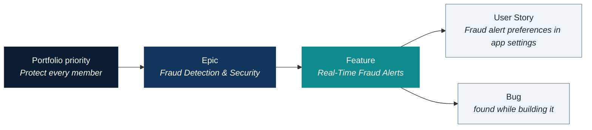

# Meet HarborPoint

**HarborPoint Financial** is a member-owned financial cooperative, founded in 1952 by dockworkers and harbor pilots in the port city of **Port Haven**. It still runs on the promise in its tagline: *"Steady hands. Safe harbor."*

For three days, its transformation program is your program. Everything on this page also lives in the Azure DevOps project, so treat this as your briefing pack, not as the answer key. Many labs ask you to find these facts in Azure DevOps yourself, because that's the skill.

  
<h3>1.9 million members</h3>
Members, not customers. HarborPoint people say "members" and so do the labs.

  
<h3>74 branches</h3>
Branches still matter here, especially to long-standing members who value a named person.

  
<h3>~3,100 employees · $38B in assets</h3>
Big enough for a real portfolio, small enough that everyone knows who owns what.

## Project Lighthouse

The **Member Experience Transformation Program (METP)**, nicknamed **Project Lighthouse**, is a multi-year program to modernize how members bank, get help and stay safe. It's the work you'll manage, observe and report on all week.

<strong>Priya Raman</strong>Director, Digital Banking · 8:10 AM

Glad you're here. I need someone who can tell me where Digital Banking **really** stands, at Feature level, without a forty-slide deck. You start Monday. Actually, you start today.

### The FY2027 portfolio priorities

The Executive Committee ranked four strategic priorities for FY2027. Each one is an **Epic** in Azure DevOps, with an executive owner. Two more Epics sit beside them: an enabler the others depend on, and a mandatory regulatory item with a date nobody can move.

  
1
Protect every member

<strong>Fraud Detection &amp; Security</strong> · Simone Laurent, Chief Risk Officer

  
2
Digital that feels human

<strong>Digital Banking Modernization</strong> · Priya Raman, Director, Digital Banking

  
3
Effortless support

<strong>Customer Support Modernization</strong> · Carmen Diaz, Director, Member Support

  
4
Branches as relationship hubs

<strong>Branch Experience Transformation</strong> · Hector Alvarez, VP, Branch Network

  
E
Enabler: a platform that scales

<strong>Platform Foundations</strong> · Nadia Petrova, Platform Lead

  
!
Mandatory: the regulatory exam

<strong>Compliance: Examination Readiness</strong> · Simone Laurent. Exam fieldwork begins in Sprint 18. The date is non-negotiable.

### How strategy reaches the teams

Every piece of work should trace upward to a priority. When it doesn't, that's worth a question.

**You live at the Feature level.** Features are where strategy meets delivery: big enough to matter to an executive, small enough for one team to own. Stories and bugs are the evidence you drop down to when a Feature needs explaining. This course never uses Tasks.

## The initiatives and their Features

Six Epics, twenty-four Features. Each Feature has one **owning team** (its Area Path) and a **Target** sprint (its Target Date is the last day of that sprint). Some Features also have work in other teams. Finding out which ones, and how far along each Feature is, is your job in the labs.

=== "Fraud Detection & Security"

    *Detect and stop fraud in real time, harden sign-in, and protect accounts from takeover.*

    | Feature | Owning team | Target |
    |:--|:--|:--|
    | Real-Time Fraud Alerts | Mobile Banking | Sprint 16 |
    | Fraud Scoring Engine v2 | Security | Sprint 17 |
    | Adaptive Multi-Factor Authentication | Security | Sprint 16 |
    | Account Takeover Protection | Security | Sprint 20 |

=== "Digital Banking Modernization"

    *A modern mobile and online experience: deposits, sign-in, transfers, card controls, account opening and insights.*

    | Feature | Owning team | Target |
    |:--|:--|:--|
    | Mobile App Redesign | Mobile Banking | Sprint 11 |
    | Mobile Check Deposit 2.0 | Mobile Banking | Sprint 14 |
    | Biometric Login | Mobile Banking | Sprint 16 |
    | Member-to-Member Transfers | Mobile Banking | Sprint 20 |
    | Instant Card Controls | Digital Accounts | Sprint 17 |
    | Online Account Opening | Digital Accounts | Sprint 16 |
    | Spending Insights | Digital Accounts | Sprint 15 |
    | Paperless Statements & Documents | Digital Accounts | Sprint 13 |

=== "Customer Support Modernization"

    *One consistent way to get help across channels, with secure messaging, better agent knowledge and callbacks.*

    | Feature | Owning team | Target |
    |:--|:--|:--|
    | Omnichannel Service Requests | Member Support | Sprint 15 |
    | Secure Messaging & Chat | Member Support | Sprint 17 |
    | Agent Knowledge Base | Member Support | Sprint 12 |
    | Callback Scheduling | Member Support | Sprint 19 |

=== "Branch Experience Transformation"

    *Branches as relationship hubs: appointments, lobby check-in, in-branch digital onboarding and teller tools.*

    | Feature | Owning team | Target |
    |:--|:--|:--|
    | Online Appointment Scheduling | Branch Experience | Sprint 12 |
    | In-Branch Digital Onboarding | Branch Experience | Sprint 17 |
    | Lobby Check-In & Queue Management | Branch Experience | Sprint 15 |
    | Teller Workstation Refresh | Branch Experience | Sprint 20 |

=== "Platform Foundations"

    *The shared services the other initiatives build on. Value Area: Architectural.*

    | Feature | Owning team | Target |
    |:--|:--|:--|
    | Unified Notification Service | Core Platform | Sprint 15 |
    | Member API Gateway | Core Platform | Sprint 16 |

=== "Compliance: Examination Readiness"

    *Mandatory work for the regulatory exam. Added to the portfolio in Sprint 12. Fieldwork begins in Sprint 18.*

    | Feature | Owning team | Target |
    |:--|:--|:--|
    | Audit Evidence Automation | Security | Sprint 18 |
    | Access Review Automation | Security | Sprint 18 |

!!! insight "Lighthouse insight"
    A target sprint is a promise, not a status. This table tells you **when** each Feature is due. Only Azure DevOps can tell you **how much is left**, and only if you read it carefully. Hold the two side by side and most status questions answer themselves.

## The cast

These are the people who will message you, ask you hard questions, and occasionally disagree with each other. Learn their voices: a good briefing is written for its reader.

  
<h3>Dana Whitfield</h3>
<strong>EVP, Member Experience · METP sponsor.</strong> Bottom line first. "Are we going to make it? What do you need from me?"

  
<h3>Marcus Reed</h3>
<strong>Chief Information Officer.</strong> Skeptical of vanity metrics. His favorite question: "How do you know?"

  
<h3>Simone Laurent</h3>
<strong>Chief Risk Officer.</strong> Owns fraud and exam readiness. Zero tolerance for surprises, and for secondhand news.

  
<h3>Priya Raman</h3>
<strong>Director, Digital Banking.</strong> Your manager on Days 1 and 2. Sharp, busy, fair. Sends short messages and expects short answers.

  
<h3>Hector Alvarez</h3>
<strong>VP, Branch Network.</strong> A former branch manager. Champions in-branch members, especially older ones.

  
<h3>Carmen Diaz</h3>
<strong>Director, Member Support.</strong> Fiercely protective of her team. Has no patience for reports that don't match what she sees on the floor.

  
<h3>Ruth Ellison</h3>
<strong>Program Manager, METP.</strong> A 30-year veteran with a dry wit. Retiring at the end of PI 4. On Day 3 you step into her shoes.

  
<h3>Leo Fischer</h3>
<strong>PMO Reporting Analyst.</strong> Builds many of the program's reports. Well-meaning and overloaded.

### The delivery teams

Six delivery teams build Project Lighthouse. You'll see these names in **Assigned To**. You are not a member of any of these teams: you observe their work read-only and do your hands-on work in your own sandbox.

| Team | Leads | Engineers and QA |
|:--|:--|:--|
| **Mobile Banking** | Diego Ramirez (Engineering Manager) · Hannah Cole (Product Owner) | Ethan Brooks (Sr. iOS), Mei Tanaka (Android), Jamal Washington, Sofia Rossi, Ava Patel (QA) |
| **Digital Accounts** | Grace Liu (Engineering Manager) · Ben Adeyemi (Product Owner) | Olivia Grant, Noah Kim, Fatima Hassan, Lucas Meyer, Chloe Martin (QA) |
| **Security** | Aisha Karimi (Security Engineering Lead and Product Owner) | Viktor Novak, Rachel Stein, Omar Haddad, Ingrid Larsen, Kwame Mensah |
| **Core Platform** | Nadia Petrova (Platform Lead and Product Owner) | Sam Okoro, Julia Weber, Arjun Mehta, Elena Popescu |
| **Branch Experience** | Maya Johnson (Product Owner) · Daniel Park (Engineering Manager) | Zoe Clarke, Ravi Shankar, Tomas Herrera |
| **Member Support** | Isaac Thompson (Product Owner) | Leila Ahmadi, Marco Bianchi, Nora Fitzgerald |

A Feature's **Assigned To** is its owning team's Product Owner. When you need to know who owns a Feature, that's where to look.

## The program calendar

Sprints are **two weeks** (ten working days, Monday to Friday). A **PI** (Program Increment) is **four sprints**, about eight weeks. The course runs during **Sprint 14, week 2**. Labs never use calendar dates, only sprint and PI names.

```mermaid
flowchart LR
    subgraph PI3["PI 3 · last PI (complete)"]
        direction LR
        S9["Sprint 9"] --- S10["Sprint 10"] --- S11["Sprint 11"] --- S12["Sprint 12"]
    end
    subgraph PI4["PI 4 · current PI"]
        direction LR
        S13["Sprint 13<br/>previous sprint"] --- S14["Sprint 14<br/>YOU ARE HERE"] --- S15["Sprint 15"] --- S16["Sprint 16<br/>PI 4 System Demo"]
    end
    subgraph PI5["PI 5 · next PI"]
        direction LR
        S17["Sprint 17<br/>PI 5 Planning"] --- S18["Sprint 18<br/>exam fieldwork"] --- S19["Sprint 19"] --- S20["Sprint 20"]
    end
    PI3 --> PI4 --> PI5
    classDef past fill:#eef1f4,stroke:#9aa7b3,color:#3a4752
    classDef now fill:#0f8b8d,stroke:#0b6f71,color:#ffffff
    classDef key fill:#fff4e0,stroke:#d4881c,color:#4a3008
    class S9,S10,S11,S12 past
    class S14 now
    class S16,S17,S18 key
```

| When someone says… | They mean |
|:--|:--|
| "this sprint", "now" | **Sprint 14** (PI 4) |
| "last sprint" | **Sprint 13** |
| "last PI" | **PI 3** (Sprints 9 to 12) |
| "this PI" | **PI 4** (Sprints 13 to 16), ending with the **PI 4 System Demo** |
| "next PI" | **PI 5** (Sprints 17 to 20), starting with **PI 5 Planning** |
| "the exam" | Regulatory **exam fieldwork**, beginning in **Sprint 18** |

## Your role

You are never one of the six delivery teams. You're the manager who has to make sense of their work and turn it into decisions.

| Day | Your role | Who you answer to | What you're trying to do |
|:--|:--|:--|:--|
| **1 · Charting the Waters** | Newly appointed **Delivery Manager, Digital Banking** | Priya Raman | Learn the portfolio, read Digital Banking's real position at Feature level, build your query toolkit |
| **2 · The Lighthouse** | Delivery Manager, Digital Banking | Priya, then Dana and Simone | Build dashboards that answer real questions, read metrics without being fooled, untangle cross-team dependencies, brief executives |
| **3 · Setting the Course** | Acting **Program Manager, METP**, while Ruth hands over | Dana Whitfield | Forecast honestly, prioritize by member impact, fix the data behind the reports, and present a realistic outlook for PI 5 |

!!! tip "Where next"
    Read the [environment map](environment.md) to learn where everything lives in Azure DevOps, then head to [Day 1](../day-1/index.md). Keep the [Glossary](../resources/glossary.md) handy if a term is new.
